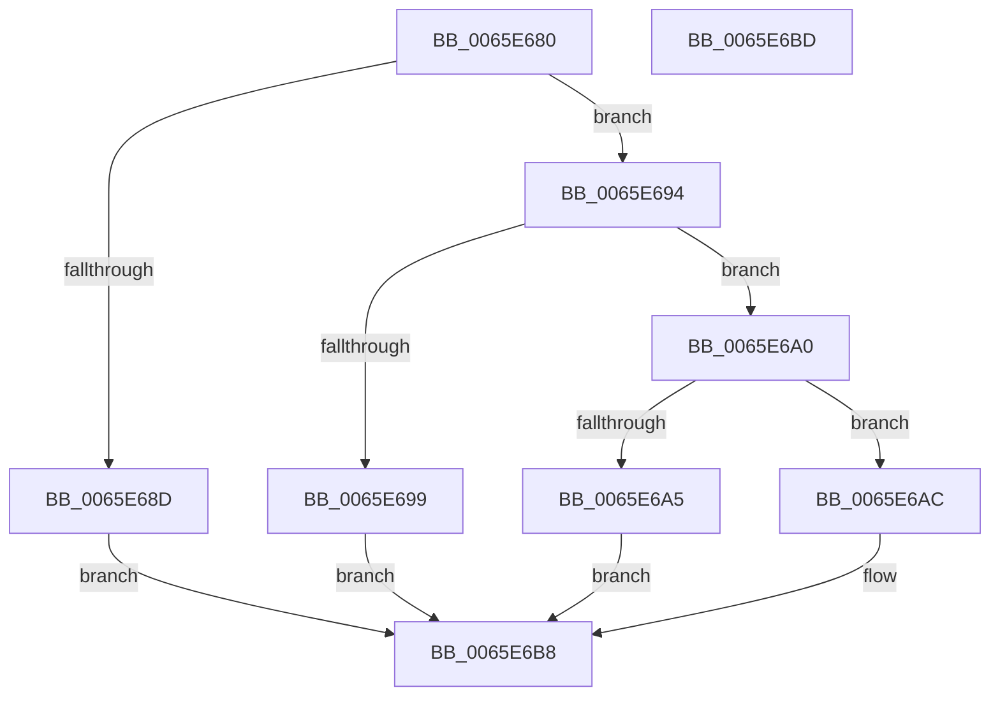

# WheaHwErrorReportGetLogDataBufferDeviceDriver

- RVA: `0x0065E680`–`0x0065E6BE` (길이 `62` bytes)
- VA: `0x000000014065E680`
- 실행 섹션: `.text`
- PDB 이름 있음: `예`; PDB Function 태그: `아니요`
- unwind 정보 RVA: `0x0005C788`
- 디코드: `21`개 명령, `62/62` bytes 표시
- 미해석 바이트: `0` (있으면 어셈블리에 `.byte`로 보존)

> 이 문서는 커널 이미지의 기계어와 PDB 기호를 분석해 생성했습니다. 4번과 5번은 함수 원형과 자료형을 바이너리 사용 방식에서 추정한 C 해석이며 원본 소스 복구 결과는 아닙니다.

## 1. Dependencies

- 직접 호출 지점: **1**; 고유 호출 대상: **1**
- 직접 호출자로 확인된 함수: **2**
- RIP 상대 이미지 참조: **0**

### Outgoing calls
- `0x0065E684` → [WheapErrorHandleIsValid](WheapErrorHandleIsValid_function_0065EC3C.md) (function, `0x0065EC3C`)

### Direct callers
- [WheaReportFatalHwErrorDeviceDriverEx](WheaReportFatalHwErrorDeviceDriverEx_function_0065E910.md) at `0x0065E977`
- [WheaReportHwErrorDeviceDriverEx](WheaReportHwErrorDeviceDriverEx_function_0065EA30.md) at `0x0065EA96`

### Static image references
- 디코드된 RIP-relative 메모리 참조가 없습니다.

## 2. Other-region calls and transfers

- 다른 실행 섹션으로 향하는 call: **0**
- 별도 외부 분기/꼬리 이동을 확인하지 못했습니다.

## 3. Assembly (complete function range)

```asm
0065E680  48 83 EC 28                     sub rsp, 0x28
0065E684  E8 B3 05 00 00                  call 0x14065ec3c
0065E689  84 C0                           test al, al
0065E68B  75 07                           jne 0x14065e694
0065E68D  B8 08 00 00 C0                  mov eax, 0xc0000008
0065E692  EB 24                           jmp 0x14065e6b8
0065E694  83 FA 24                        cmp edx, 0x24
0065E697  76 07                           jbe 0x14065e6a0
0065E699  B8 9A 00 00 C0                  mov eax, 0xc000009a
0065E69E  EB 18                           jmp 0x14065e6b8
0065E6A0  4D 85 C0                        test r8, r8
0065E6A3  75 07                           jne 0x14065e6ac
0065E6A5  B8 F1 00 00 C0                  mov eax, 0xc00000f1
0065E6AA  EB 0C                           jmp 0x14065e6b8
0065E6AC  48 8D 41 40                     lea rax, [rcx + 0x40]
0065E6B0  89 51 64                        mov dword ptr [rcx + 0x64], edx
0065E6B3  49 89 00                        mov qword ptr [r8], rax
0065E6B6  33 C0                           xor eax, eax
0065E6B8  48 83 C4 28                     add rsp, 0x28
0065E6BC  C3                              ret
0065E6BD  CC                              int3
```

## 4. C-style interpretation (structured pseudocode)

```c
__int64 __fastcall WheaHwErrorReportGetLogDataBufferDeviceDriver(__int64 a1, int a2, __int64 a3)
{
    __int64 result;
    __int64 v_rsp;

    v_rsp = (v_rsp) - (40);
    result = WheapErrorHandleIsValid(a1, a2, a3, a4);
    if ((unsigned __int8)(result) != 0) goto loc_0065E694;
    goto loc_0065E6B8;
loc_0065E694:
    if (a2 <= 36) goto loc_0065E6A0;
    goto loc_0065E6B8;
loc_0065E6A0:
    if (a3 != 0) goto loc_0065E6AC;
    goto loc_0065E6B8;
loc_0065E6AC:
    *(unsigned int *)(a1 + 100) = a2;
    *(unsigned __int64 *)(a3) = a1 + 64;
    result = 0;
loc_0065E6B8:
    v_rsp = (v_rsp) + (40);
    return result;
}
```

## 5. (Beta) C Style

```c
int64_t WheaHwErrorReportGetLogDataBufferDeviceDriver(int64_t Arg1, int32_t Arg2, int64_t Arg3)
{
    int64_t result;
    int64_t local_rsp;

    local_rsp = (local_rsp) - (40);
    result = WheapErrorHandleIsValid(Arg1, Arg2, Arg3, a4);
    if ((uint8_t)(result) != 0) goto loc_0065E694;
    goto loc_0065E6B8;
loc_0065E694:
    if (Arg2 <= 36) goto loc_0065E6A0;
    goto loc_0065E6B8;
loc_0065E6A0:
    if (Arg3 != 0) goto loc_0065E6AC;
    goto loc_0065E6B8;
loc_0065E6AC:
    *(uint32_t *)(Arg1 + 0x64) = Arg2;
    *(uint64_t *)(Arg3) = Arg1 + 64;
    result = 0;
loc_0065E6B8:
    local_rsp = (local_rsp) + (40);
    return result;
}
```

## 6. Execution-region graph

[열기: 2D/3D 그래프와 함수 탐색 컨트롤 패널](../../../control-panel.html?section=text&rva=0x0065E680&view=graph)

- 2D 그래프는 위에서 아래로 흐르고, 3D 그래프는 빈 공간을 드래그해 회전합니다. Shift+드래그는 이동, 휠은 확대·축소, 함수 노드 선택은 대상 보고서 이동입니다.

### Static fallback


