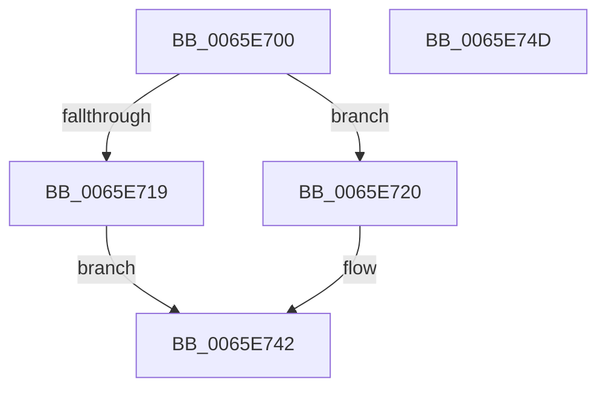

# WheaHwErrorReportSetFatalSeverityDeviceDriver

- RVA: `0x0065E700`–`0x0065E74E` (길이 `78` bytes)
- VA: `0x000000014065E700`
- 실행 섹션: `.text`
- PDB 이름 있음: `예`; PDB Function 태그: `아니요`
- unwind 정보 RVA: `0x0005CAAC`
- 디코드: `23`개 명령, `78/78` bytes 표시
- 미해석 바이트: `0` (있으면 어셈블리에 `.byte`로 보존)

> 이 문서는 커널 이미지의 기계어와 PDB 기호를 분석해 생성했습니다. 4번과 5번은 함수 원형과 자료형을 바이너리 사용 방식에서 추정한 C 해석이며 원본 소스 복구 결과는 아닙니다.

## 1. Dependencies

- 직접 호출 지점: **2**; 고유 호출 대상: **2**
- 직접 호출자로 확인된 함수: **1**
- RIP 상대 이미지 참조: **0**

### Outgoing calls
- `0x0065E710` → [WheapErrorHandleIsValid](WheapErrorHandleIsValid_function_0065EC3C.md) (function, `0x0065EC3C`)
- `0x0065E725` → [WheaHwErrorReportSetSeverityDeviceDriver](WheaHwErrorReportSetSeverityDeviceDriver_function_0065E7B0.md) (function, `0x0065E7B0`)

### Direct callers
- [WheaReportFatalHwErrorDeviceDriverEx](WheaReportFatalHwErrorDeviceDriverEx_function_0065E910.md) at `0x0065E963`

### Static image references
- 디코드된 RIP-relative 메모리 참조가 없습니다.

## 2. Other-region calls and transfers

- 다른 실행 섹션으로 향하는 call: **0**
- 별도 외부 분기/꼬리 이동을 확인하지 못했습니다.

## 3. Assembly (complete function range)

```asm
0065E700  48 89 5C 24 08                  mov qword ptr [rsp + 8], rbx
0065E705  57                              push rdi
0065E706  48 83 EC 20                     sub rsp, 0x20
0065E70A  48 8B FA                        mov rdi, rdx
0065E70D  48 8B D9                        mov rbx, rcx
0065E710  E8 27 05 00 00                  call 0x14065ec3c
0065E715  84 C0                           test al, al
0065E717  75 07                           jne 0x14065e720
0065E719  B8 08 00 00 C0                  mov eax, 0xc0000008
0065E71E  EB 22                           jmp 0x14065e742
0065E720  BA 01 00 00 00                  mov edx, 1
0065E725  E8 86 00 00 00                  call 0x14065e7b0
0065E72A  48 8B 43 28                     mov rax, qword ptr [rbx + 0x28]
0065E72E  0F BA 68 14 1E                  bts dword ptr [rax + 0x14], 0x1e
0065E733  48 8B 43 28                     mov rax, qword ptr [rbx + 0x28]
0065E737  0F BA 70 14 1F                  btr dword ptr [rax + 0x14], 0x1f
0065E73C  33 C0                           xor eax, eax
0065E73E  48 89 7B 38                     mov qword ptr [rbx + 0x38], rdi
0065E742  48 8B 5C 24 30                  mov rbx, qword ptr [rsp + 0x30]
0065E747  48 83 C4 20                     add rsp, 0x20
0065E74B  5F                              pop rdi
0065E74C  C3                              ret
0065E74D  CC                              int3
```

## 4. C-style interpretation (structured pseudocode)

```c
__int64 __fastcall WheaHwErrorReportSetFatalSeverityDeviceDriver(__int64 a1, __int64 a2)
{
    __int64 result;
    __int64 v_rsp;
    unsigned __int64 v_stack_p8;

    v_stack_p8 = v_rbx;
    v_rsp = (v_rsp) - (32);
    result = WheapErrorHandleIsValid(a1, a2, a3, a4);
    if ((unsigned __int8)(result) != 0) goto loc_0065E720;
    goto loc_0065E742;
loc_0065E720:
    result = WheaHwErrorReportSetSeverityDeviceDriver(a1, 1, a3, a4);
    result = 0;
    *(unsigned __int64 *)(a1 + 56) = a2;
loc_0065E742:
    v_rsp = (v_rsp) + (32);
    return result;
}
```

## 5. (Beta) C Style

```c
int64_t WheaHwErrorReportSetFatalSeverityDeviceDriver(void *Arg1, int64_t Arg2)
{
    uint8_t *arg1 = (uint8_t *)Arg1;

    int64_t result;
    int64_t local_rsp;
    uint64_t v_stack_p8;

    v_stack_p8 = local_rbx;
    local_rsp = (local_rsp) - (32);
    result = WheapErrorHandleIsValid(Arg1, Arg2, a3, a4);
    if ((uint8_t)(result) != 0) goto loc_0065E720;
    goto loc_0065E742;
loc_0065E720:
    result = WheaHwErrorReportSetSeverityDeviceDriver(Arg1, 1, a3, a4);
    result = 0;
    *(uint64_t *)(arg1 + 0x38) = Arg2;
loc_0065E742:
    local_rsp = (local_rsp) + (32);
    return result;
}
```

### 관측된 메모리 오프셋

구조체 형식이 확인되지 않은 접근은 인자 기준의 오프셋으로만 기록했습니다.

| 기준 인자 | 오프셋 표현 | 폭 (bit) | 접근 |
|---|---:|---:|---|
| `Arg1` | `+ 0x28` | `64` | `R` |
| `Arg1` | `+ 0x38` | `64` | `W` |

## 6. Execution-region graph

[열기: 2D/3D 그래프와 함수 탐색 컨트롤 패널](../../../control-panel.html?section=text&rva=0x0065E700&view=graph)

- 2D 그래프는 위에서 아래로 흐르고, 3D 그래프는 빈 공간을 드래그해 회전합니다. Shift+드래그는 이동, 휠은 확대·축소, 함수 노드 선택은 대상 보고서 이동입니다.

### Static fallback


