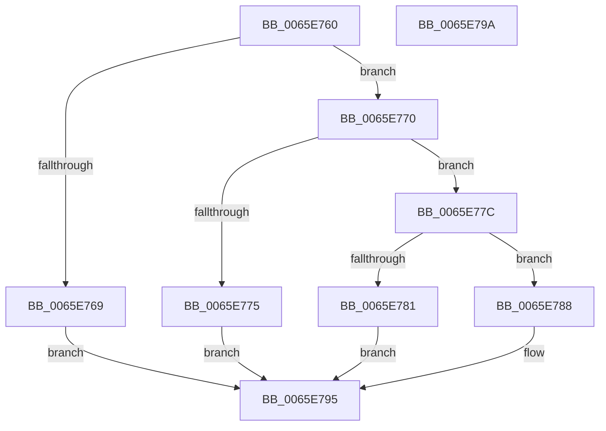

# WheaHwErrorReportSetSectionNameDeviceDriver

- RVA: `0x0065E760`–`0x0065E79B` (길이 `59` bytes)
- VA: `0x000000014065E760`
- 실행 섹션: `.text`
- PDB 이름 있음: `예`; PDB Function 태그: `아니요`
- unwind 정보 RVA: `0x0005C788`
- 디코드: `20`개 명령, `59/59` bytes 표시
- 미해석 바이트: `0` (있으면 어셈블리에 `.byte`로 보존)

> 이 문서는 커널 이미지의 기계어와 PDB 기호를 분석해 생성했습니다. 4번과 5번은 함수 원형과 자료형을 바이너리 사용 방식에서 추정한 C 해석이며 원본 소스 복구 결과는 아닙니다.

## 1. Dependencies

- 직접 호출 지점: **1**; 고유 호출 대상: **1**
- 직접 호출자로 확인된 함수: **0**
- RIP 상대 이미지 참조: **0**

### Outgoing calls
- `0x0065E78E` → [RtlStringCchCopyA](../46/RtlStringCchCopyA_function_00460628.md) (function, `0x00460628`)

### Direct callers
- 이 함수 시작 RVA로 연결되는 직접 call은 확인되지 않았습니다. 간접 호출은 완전히 역산할 수 없습니다.

### Static image references
- 디코드된 RIP-relative 메모리 참조가 없습니다.

## 2. Other-region calls and transfers

- 다른 실행 섹션으로 향하는 call: **0**
- 별도 외부 분기/꼬리 이동을 확인하지 못했습니다.

## 3. Assembly (complete function range)

```asm
0065E760  48 83 EC 28                     sub rsp, 0x28
0065E764  48 85 C9                        test rcx, rcx
0065E767  75 07                           jne 0x14065e770
0065E769  B8 EF 00 00 C0                  mov eax, 0xc00000ef
0065E76E  EB 25                           jmp 0x14065e795
0065E770  83 FA 14                        cmp edx, 0x14
0065E773  76 07                           jbe 0x14065e77c
0065E775  B8 F0 00 00 C0                  mov eax, 0xc00000f0
0065E77A  EB 19                           jmp 0x14065e795
0065E77C  4D 85 C0                        test r8, r8
0065E77F  75 07                           jne 0x14065e788
0065E781  B8 F1 00 00 C0                  mov eax, 0xc00000f1
0065E786  EB 0D                           jmp 0x14065e795
0065E788  48 8B 49 18                     mov rcx, qword ptr [rcx + 0x18]
0065E78C  8B D2                           mov edx, edx
0065E78E  E8 95 1E E0 FF                  call 0x140460628
0065E793  33 C0                           xor eax, eax
0065E795  48 83 C4 28                     add rsp, 0x28
0065E799  C3                              ret
0065E79A  CC                              int3
```

## 4. C-style interpretation (structured pseudocode)

```c
__int64 __fastcall WheaHwErrorReportSetSectionNameDeviceDriver(__int64 a1, int a2, __int64 a3)
{
    __int64 result;
    __int64 v_rsp;

    v_rsp = (v_rsp) - (40);
    if (a1 != 0) goto loc_0065E770;
    goto loc_0065E795;
loc_0065E770:
    if (a2 <= 20) goto loc_0065E77C;
    goto loc_0065E795;
loc_0065E77C:
    if (a3 != 0) goto loc_0065E788;
    goto loc_0065E795;
loc_0065E788:
    result = RtlStringCchCopyA(*(unsigned __int64 *)(a1 + 24), (unsigned int)(a2), a3, a4);
    result = 0;
loc_0065E795:
    v_rsp = (v_rsp) + (40);
    return result;
}
```

## 5. (Beta) C Style

```c
int64_t WheaHwErrorReportSetSectionNameDeviceDriver(int64_t Arg1, int32_t Arg2, int64_t Arg3)
{
    int64_t result;
    int64_t local_rsp;

    local_rsp = (local_rsp) - (40);
    if (Arg1 != 0) goto loc_0065E770;
    goto loc_0065E795;
loc_0065E770:
    if (Arg2 <= 20) goto loc_0065E77C;
    goto loc_0065E795;
loc_0065E77C:
    if (Arg3 != 0) goto loc_0065E788;
    goto loc_0065E795;
loc_0065E788:
    result = RtlStringCchCopyA(*(uint64_t *)(Arg1 + 0x18), (uint32_t)(Arg2), Arg3, a4);
    result = 0;
loc_0065E795:
    local_rsp = (local_rsp) + (40);
    return result;
}
```

## 6. Execution-region graph

[열기: 2D/3D 그래프와 함수 탐색 컨트롤 패널](../../../control-panel.html?section=text&rva=0x0065E760&view=graph)

- 2D 그래프는 위에서 아래로 흐르고, 3D 그래프는 빈 공간을 드래그해 회전합니다. Shift+드래그는 이동, 휠은 확대·축소, 함수 노드 선택은 대상 보고서 이동입니다.

### Static fallback


