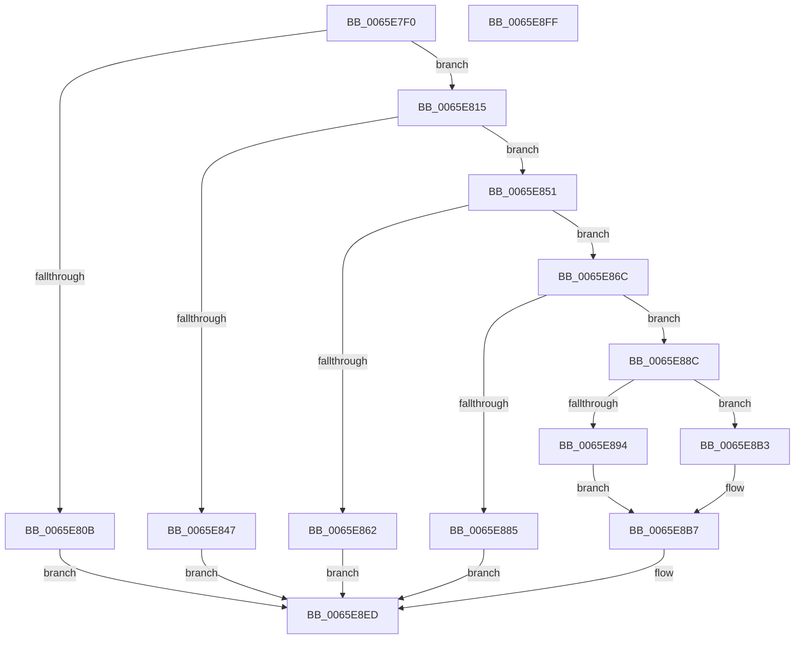

# WheaHwErrorReportSubmitDeviceDriver

- RVA: `0x0065E7F0`–`0x0065E900` (길이 `272` bytes)
- VA: `0x000000014065E7F0`
- 실행 섹션: `.text`
- PDB 이름 있음: `예`; PDB Function 태그: `아니요`
- unwind 정보 RVA: `0x00060BC4`
- 디코드: `76`개 명령, `272/272` bytes 표시
- 미해석 바이트: `0` (있으면 어셈블리에 `.byte`로 보존)

> 이 문서는 커널 이미지의 기계어와 PDB 기호를 분석해 생성했습니다. 4번과 5번은 함수 원형과 자료형을 바이너리 사용 방식에서 추정한 C 해석이며 원본 소스 복구 결과는 아닙니다.

## 1. Dependencies

- 직접 호출 지점: **7**; 고유 호출 대상: **7**
- 직접 호출자로 확인된 함수: **2**
- RIP 상대 이미지 참조: **2**

### Outgoing calls
- `0x0065E802` → [WheapErrorHandleIsValid](WheapErrorHandleIsValid_function_0065EC3C.md) (function, `0x0065EC3C`)
- `0x0065E829` → [WheapGetErrorSource](../49/WheapGetErrorSource_function_0049554C.md) (function, `0x0049554C`)
- `0x0065E83E` → [WheapErrDescIsDeviceDriver](WheapErrDescIsDeviceDriver_function_0065EC24.md) (function, `0x0065EC24`)
- `0x0065E89E` → [memcpy](../6C/memcpy_function_006C6840.md) (function, `0x006C6840`)
- `0x0065E8CE` → `PSHED.dll!PshedRetrieveErrorInfo` (import, 간접 대상; import `PSHED.dll!PshedRetrieveErrorInfo`)
- `0x0065E8DE` → [WheaReportHwError](../4E/WheaReportHwError_function_004ED200.md) (function, `0x004ED200`)
- `0x0065E8E8` → [WheapFreeDriverPacketBuffer](WheapFreeDriverPacketBuffer_function_0065EC58.md) (function, `0x0065EC58`)

### Direct callers
- [WheaReportFatalHwErrorDeviceDriverEx](WheaReportFatalHwErrorDeviceDriverEx_function_0065E910.md) at `0x0065EA00`
- [WheaReportHwErrorDeviceDriverEx](WheaReportHwErrorDeviceDriverEx_function_0065EA30.md) at `0x0065EB1F`

### Static image references
- `0x0065E81F` → RVA `0x00EEF018` (`.data`; read)
- `0x0065E8CE` → RVA `0x00151150` (`PSHED.dll!PshedRetrieveErrorInfo (IAT)`; read)

## 2. Other-region calls and transfers

- 다른 실행 섹션으로 향하는 call: **0**
- 별도 외부 분기/꼬리 이동을 확인하지 못했습니다.

## 3. Assembly (complete function range)

```asm
0065E7F0  48 89 5C 24 08                  mov qword ptr [rsp + 8], rbx
0065E7F5  48 89 74 24 10                  mov qword ptr [rsp + 0x10], rsi
0065E7FA  57                              push rdi
0065E7FB  48 83 EC 20                     sub rsp, 0x20
0065E7FF  48 8B D9                        mov rbx, rcx
0065E802  E8 35 04 00 00                  call 0x14065ec3c
0065E807  84 C0                           test al, al
0065E809  75 0A                           jne 0x14065e815
0065E80B  BF 08 00 00 C0                  mov edi, 0xc0000008
0065E810  E9 D8 00 00 00                  jmp 0x14065e8ed
0065E815  48 8B 49 28                     mov rcx, qword ptr [rcx + 0x28]
0065E819  8B 43 08                        mov eax, dword ptr [rbx + 8]
0065E81C  89 41 08                        mov dword ptr [rcx + 8], eax
0065E81F  48 8D 0D F2 07 89 00            lea rcx, [rip + 0x8907f2]
0065E826  8B 53 0C                        mov edx, dword ptr [rbx + 0xc]
0065E829  E8 1E 6D E3 FF                  call 0x14049554c
0065E82E  48 8D 48 60                     lea rcx, [rax + 0x60]
0065E832  48 F7 D8                        neg rax
0065E835  48 1B F6                        sbb rsi, rsi
0065E838  48 23 F1                        and rsi, rcx
0065E83B  48 8B CE                        mov rcx, rsi
0065E83E  E8 E1 03 00 00                  call 0x14065ec24
0065E843  84 C0                           test al, al
0065E845  75 0A                           jne 0x14065e851
0065E847  BF B6 02 00 C0                  mov edi, 0xc00002b6
0065E84C  E9 9C 00 00 00                  jmp 0x14065e8ed
0065E851  48 8B 43 10                     mov rax, qword ptr [rbx + 0x10]
0065E855  8B 08                           mov ecx, dword ptr [rax]
0065E857  81 E1 F0 3F 00 00               and ecx, 0x3ff0
0065E85D  83 F9 10                        cmp ecx, 0x10
0065E860  73 0A                           jae 0x14065e86c
0065E862  BF 23 00 00 C0                  mov edi, 0xc0000023
0065E867  E9 81 00 00 00                  jmp 0x14065e8ed
0065E86C  48 8B 7B 18                     mov rdi, qword ptr [rbx + 0x18]
0065E870  8B 53 64                        mov edx, dword ptr [rbx + 0x64]
0065E873  48 83 C7 07                     add rdi, 7
0065E877  8B 4B 08                        mov ecx, dword ptr [rbx + 8]
0065E87A  48 83 E7 F8                     and rdi, 0xfffffffffffffff8
0065E87E  03 CA                           add ecx, edx
0065E880  3B 4E 40                        cmp ecx, dword ptr [rsi + 0x40]
0065E883  76 07                           jbe 0x14065e88c
0065E885  BF 9A 00 00 C0                  mov edi, 0xc000009a
0065E88A  EB 61                           jmp 0x14065e8ed
0065E88C  8D 42 FF                        lea eax, [rdx - 1]
0065E88F  83 F8 22                        cmp eax, 0x22
0065E892  77 1F                           ja 0x14065e8b3
0065E894  4C 8B C2                        mov r8, rdx
0065E897  48 8B CF                        mov rcx, rdi
0065E89A  48 8D 53 40                     lea rdx, [rbx + 0x40]
0065E89E  E8 9D 7F 06 00                  call 0x1406c6840
0065E8A3  8B 43 64                        mov eax, dword ptr [rbx + 0x64]
0065E8A6  89 47 58                        mov dword ptr [rdi + 0x58], eax
0065E8A9  0F B7 46 3C                     movzx eax, word ptr [rsi + 0x3c]
0065E8AD  66 89 47 5C                     mov word ptr [rdi + 0x5c], ax
0065E8B1  EB 04                           jmp 0x14065e8b7
0065E8B3  83 67 58 00                     and dword ptr [rdi + 0x58], 0
0065E8B7  48 8D 46 2C                     lea rax, [rsi + 0x2c]
0065E8BB  48 8B D6                        mov rdx, rsi
0065E8BE  48 89 47 48                     mov qword ptr [rdi + 0x48], rax
0065E8C2  48 8B 43 38                     mov rax, qword ptr [rbx + 0x38]
0065E8C6  48 89 47 50                     mov qword ptr [rdi + 0x50], rax
0065E8CA  48 8B 4B 28                     mov rcx, qword ptr [rbx + 0x28]
0065E8CE  48 FF 15 7B 28 AF FF            call qword ptr [rip - 0x50d785]
0065E8D5  0F 1F 44 00 00                  nop dword ptr [rax + rax]
0065E8DA  48 8B 4B 28                     mov rcx, qword ptr [rbx + 0x28]
0065E8DE  E8 1D E9 E8 FF                  call 0x1404ed200
0065E8E3  48 8B CB                        mov rcx, rbx
0065E8E6  8B F8                           mov edi, eax
0065E8E8  E8 6B 03 00 00                  call 0x14065ec58
0065E8ED  48 8B 5C 24 30                  mov rbx, qword ptr [rsp + 0x30]
0065E8F2  8B C7                           mov eax, edi
0065E8F4  48 8B 74 24 38                  mov rsi, qword ptr [rsp + 0x38]
0065E8F9  48 83 C4 20                     add rsp, 0x20
0065E8FD  5F                              pop rdi
0065E8FE  C3                              ret
0065E8FF  CC                              int3
```

## 4. C-style interpretation (structured pseudocode)

```c
__int64 __fastcall WheaHwErrorReportSubmitDeviceDriver(__int64 a1)
{
    __int64 result;
    __int64 v_rdi;
    __int64 v_rsi;
    __int64 v_rsp;
    unsigned __int64 v_stack_p10;
    unsigned __int64 v_stack_p8;

    v_stack_p8 = v_rbx;
    v_stack_p10 = v_rsi;
    v_rsp = (v_rsp) - (32);
    result = WheapErrorHandleIsValid(a1, a2, a3, a4);
    if ((unsigned __int8)(result) != 0) goto loc_0065E815;
    goto loc_0065E8ED;
loc_0065E815:
    *(unsigned int *)(*(unsigned __int64 *)(a1 + 40) + 8) = (unsigned int)((unsigned int)(*(unsigned int *)(a1 + 8)));
    result = WheapGetErrorSource(v_rip + 8980466, (unsigned int)(*(unsigned int *)(a1 + 12)), a3, a4);
    result = -(result);
    v_rsi = (v_rsi) & (result + 96);
    result = WheapErrDescIsDeviceDriver(v_rsi, (unsigned int)(*(unsigned int *)(a1 + 12)), a3, a4);
    if ((unsigned __int8)(result) != 0) goto loc_0065E851;
    goto loc_0065E8ED;
loc_0065E851:
    a1 = (unsigned int)(((unsigned int)(*(unsigned int *)(*(unsigned __int64 *)(a1 + 16)))) & (0x3FF0ULL));
    if (((unsigned int)(a1)) >= 16) goto loc_0065E86C;
    goto loc_0065E8ED;
loc_0065E86C:
    v_rdi = (*(unsigned __int64 *)(a1 + 24)) + (7);
    v_rdi = (v_rdi) & (-8);
    a1 = (unsigned int)(((unsigned int)(*(unsigned int *)(a1 + 8))) + ((unsigned int)((unsigned int)(*(unsigned int *)(a1 + 100)))));
    if (((unsigned int)(a1)) <= (*(unsigned int *)(v_rsi + 64))) goto loc_0065E88C;
    goto loc_0065E8ED;
loc_0065E88C:
    if (((unsigned int)((unsigned int)(*(unsigned int *)(a1 + 100)) - 1)) > 34) goto loc_0065E8B3;
    result = memcpy((unsigned int)(0xC000009AULL), a1 + 64, (unsigned int)(*(unsigned int *)(a1 + 100)), a4);
    *(unsigned int *)((unsigned int)(0xC000009AULL) + 88) = (unsigned int)((unsigned int)(*(unsigned int *)(a1 + 100)));
    *(unsigned __int16 *)((unsigned int)(0xC000009AULL) + 92) = (unsigned __int16)(*(unsigned __int16 *)(v_rsi + 60));
    goto loc_0065E8B7;
loc_0065E8B3:
loc_0065E8B7:
    *(unsigned __int64 *)((unsigned int)(0xC000009AULL) + 72) = v_rsi + 44;
    *(unsigned __int64 *)((unsigned int)(0xC000009AULL) + 80) = *(unsigned __int64 *)(a1 + 56);
    result = PSHED_dll_PshedRetrieveErrorInfo(*(unsigned __int64 *)(a1 + 40), v_rsi, (unsigned int)(*(unsigned int *)(a1 + 100)), a4);
    result = WheaReportHwError(*(unsigned __int64 *)(a1 + 40), v_rsi, (unsigned int)(*(unsigned int *)(a1 + 100)), a4);
    result = WheapFreeDriverPacketBuffer(a1, v_rsi, (unsigned int)(*(unsigned int *)(a1 + 100)), a4);
loc_0065E8ED:
    v_rsp = (v_rsp) + (32);
    return (unsigned int)((unsigned int)((unsigned int)((unsigned int)(result))));
}
```

## 5. (Beta) C Style

```c
int64_t WheaHwErrorReportSubmitDeviceDriver(void *Arg1)
{
    uint8_t *arg1 = (uint8_t *)Arg1;

    int64_t result;
    int64_t local_rdi;
    int64_t local_rsi;
    int64_t local_rsp;
    uint64_t v_stack_p10;
    uint64_t v_stack_p8;

    v_stack_p8 = local_rbx;
    v_stack_p10 = local_rsi;
    local_rsp = (local_rsp) - (32);
    result = WheapErrorHandleIsValid(Arg1, a2, a3, a4);
    if ((uint8_t)(result) != 0) goto loc_0065E815;
    goto loc_0065E8ED;
loc_0065E815:
    *(uint32_t *)(*(uint64_t *)(arg1 + 0x28) + 0x8) = (uint32_t)((uint32_t)(*(uint32_t *)(arg1 + 0x8)));
    result = WheapGetErrorSource(v_rip + 8980466, (uint32_t)(*(uint32_t *)(arg1 + 0xC)), a3, a4);
    result = -(result);
    local_rsi = (local_rsi) & (result + 96);
    result = WheapErrDescIsDeviceDriver(local_rsi, (uint32_t)(*(uint32_t *)(arg1 + 0xC)), a3, a4);
    if ((uint8_t)(result) != 0) goto loc_0065E851;
    goto loc_0065E8ED;
loc_0065E851:
    Arg1 = (uint32_t)(((uint32_t)(*(uint32_t *)(*(uint64_t *)(arg1 + 0x10)))) & (0x3FF0ULL));
    if (((uint32_t)(Arg1)) >= 16) goto loc_0065E86C;
    goto loc_0065E8ED;
loc_0065E86C:
    local_rdi = (*(uint64_t *)(arg1 + 0x18)) + (7);
    local_rdi = (local_rdi) & (-8);
    Arg1 = (uint32_t)(((uint32_t)(*(uint32_t *)(arg1 + 0x8))) + ((uint32_t)((uint32_t)(*(uint32_t *)(arg1 + 0x64)))));
    if (((uint32_t)(Arg1)) <= (*(uint32_t *)(local_rsi + 0x40))) goto loc_0065E88C;
    goto loc_0065E8ED;
loc_0065E88C:
    if (((uint32_t)((uint32_t)(*(uint32_t *)(arg1 + 0x64)) - 1)) > 34) goto loc_0065E8B3;
    result = memcpy((uint32_t)(0xC000009AULL), Arg1 + 64, (uint32_t)(*(uint32_t *)(arg1 + 0x64)), a4);
    *(uint32_t *)((uint32_t)(0xC000009AULL) + 0x58) = (uint32_t)((uint32_t)(*(uint32_t *)(arg1 + 0x64)));
    *(uint16_t *)((uint32_t)(0xC000009AULL) + 0x5C) = (uint16_t)(*(uint16_t *)(local_rsi + 0x3C));
    goto loc_0065E8B7;
loc_0065E8B3:
loc_0065E8B7:
    *(uint64_t *)((uint32_t)(0xC000009AULL) + 0x48) = local_rsi + 44;
    *(uint64_t *)((uint32_t)(0xC000009AULL) + 0x50) = *(uint64_t *)(arg1 + 0x38);
    result = kernel_indirect_call(*(uint64_t *)(arg1 + 0x28), local_rsi, (uint32_t)(*(uint32_t *)(arg1 + 0x64)), a4);
    result = WheaReportHwError(*(uint64_t *)(arg1 + 0x28), local_rsi, (uint32_t)(*(uint32_t *)(arg1 + 0x64)), a4);
    result = WheapFreeDriverPacketBuffer(Arg1, local_rsi, (uint32_t)(*(uint32_t *)(arg1 + 0x64)), a4);
loc_0065E8ED:
    local_rsp = (local_rsp) + (32);
    return (uint32_t)((uint32_t)((uint32_t)((uint32_t)(result))));
}
```

### 관측된 메모리 오프셋

구조체 형식이 확인되지 않은 접근은 인자 기준의 오프셋으로만 기록했습니다.

| 기준 인자 | 오프셋 표현 | 폭 (bit) | 접근 |
|---|---:|---:|---|
| `Arg1` | `+ 0x8` | `32` | `R` |
| `Arg1` | `+ 0xC` | `32` | `R` |
| `Arg1` | `+ 0x10` | `64` | `R` |
| `Arg1` | `+ 0x18` | `64` | `R` |
| `Arg1` | `+ 0x28` | `64` | `R` |
| `Arg1` | `+ 0x38` | `64` | `R` |
| `Arg1` | `+ 0x40` | `64` | `R` |
| `Arg1` | `+ 0x64` | `32` | `R` |

## 6. Execution-region graph

[열기: 2D/3D 그래프와 함수 탐색 컨트롤 패널](../../../control-panel.html?section=text&rva=0x0065E7F0&view=graph)

- 2D 그래프는 위에서 아래로 흐르고, 3D 그래프는 빈 공간을 드래그해 회전합니다. Shift+드래그는 이동, 휠은 확대·축소, 함수 노드 선택은 대상 보고서 이동입니다.

### Static fallback


