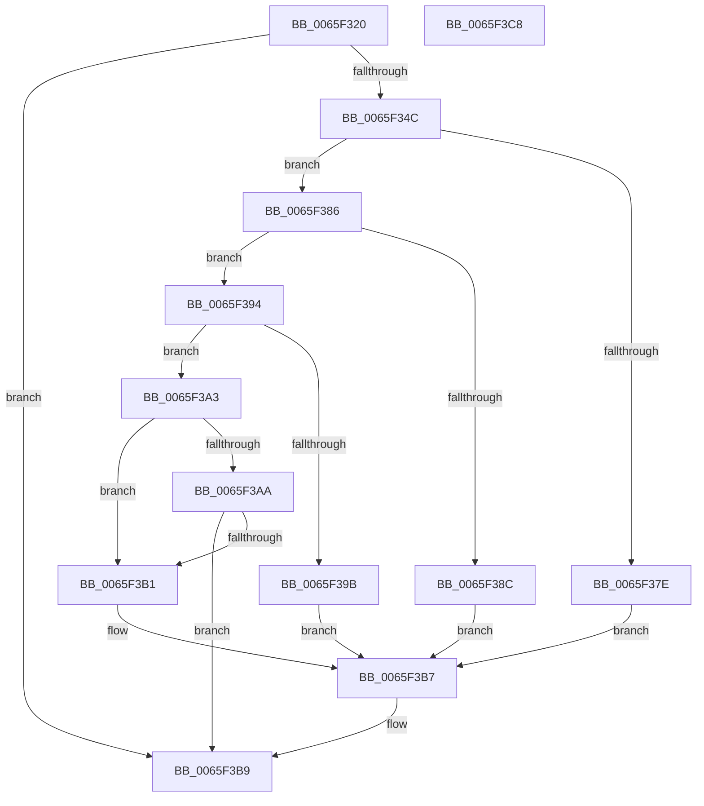

# WheaIsAltContextAllocPossible

- RVA: `0x0065F320`–`0x0065F3C9` (길이 `169` bytes)
- VA: `0x000000014065F320`
- 실행 섹션: `.text`
- PDB 이름 있음: `예`; PDB Function 태그: `아니요`
- unwind 정보 RVA: `0x000CB7FC`
- 디코드: `49`개 명령, `169/169` bytes 표시
- 미해석 바이트: `0` (있으면 어셈블리에 `.byte`로 보존)

> 이 문서는 커널 이미지의 기계어와 PDB 기호를 분석해 생성했습니다. 4번과 5번은 함수 원형과 자료형을 바이너리 사용 방식에서 추정한 C 해석이며 원본 소스 복구 결과는 아닙니다.

## 1. Dependencies

- 직접 호출 지점: **1**; 고유 호출 대상: **1**
- 직접 호출자로 확인된 함수: **1**
- RIP 상대 이미지 참조: **0**

### Outgoing calls
- `0x0065F36D` → [KeQueryCurrentStackInformationEx](../2F/KeQueryCurrentStackInformationEx_function_002F7CD0.md) (function, `0x002F7CD0`)

### Direct callers
- [HalpMceHandlerCore](../54/HalpMceHandlerCore_function_00542038.md) at `0x00542144`

### Static image references
- 디코드된 RIP-relative 메모리 참조가 없습니다.

## 2. Other-region calls and transfers

- 다른 실행 섹션으로 향하는 call: **0**
- 별도 외부 분기/꼬리 이동을 확인하지 못했습니다.

## 3. Assembly (complete function range)

```asm
0065F320  48 8B C4                        mov rax, rsp
0065F323  48 89 58 08                     mov qword ptr [rax + 8], rbx
0065F327  55                              push rbp
0065F328  56                              push rsi
0065F329  57                              push rdi
0065F32A  48 83 EC 20                     sub rsp, 0x20
0065F32E  48 83 60 20 00                  and qword ptr [rax + 0x20], 0
0065F333  49 8B F8                        mov rdi, r8
0065F336  48 83 60 18 00                  and qword ptr [rax + 0x18], 0
0065F33B  48 8B E9                        mov rbp, rcx
0065F33E  83 60 10 00                     and dword ptr [rax + 0x10], 0
0065F342  B3 01                           mov bl, 1
0065F344  41 83 20 00                     and dword ptr [r8], 0
0065F348  84 D2                           test dl, dl
0065F34A  74 6D                           je 0x14065f3b9
0065F34C  48 8B 89 80 01 00 00            mov rcx, qword ptr [rcx + 0x180]
0065F353  4C 8D 48 20                     lea r9, [rax + 0x20]
0065F357  48 8B F1                        mov rsi, rcx
0065F35A  4C 8D 40 18                     lea r8, [rax + 0x18]
0065F35E  48 83 E6 F0                     and rsi, 0xfffffffffffffff0
0065F362  48 8D 50 10                     lea rdx, [rax + 0x10]
0065F366  48 81 EE A0 01 00 00            sub rsi, 0x1a0
0065F36D  E8 5E 89 C9 FF                  call 0x1402f7cd0
0065F372  F7 85 78 01 00 00 00 02 00 00   test dword ptr [rbp + 0x178], 0x200
0065F37C  75 08                           jne 0x14065f386
0065F37E  C7 07 0C 00 00 00               mov dword ptr [rdi], 0xc
0065F384  EB 31                           jmp 0x14065f3b7
0065F386  80 7D 29 0F                     cmp byte ptr [rbp + 0x29], 0xf
0065F38A  75 08                           jne 0x14065f394
0065F38C  C7 07 0A 00 00 00               mov dword ptr [rdi], 0xa
0065F392  EB 23                           jmp 0x14065f3b7
0065F394  83 7C 24 48 05                  cmp dword ptr [rsp + 0x48], 5
0065F399  75 08                           jne 0x14065f3a3
0065F39B  C7 07 0D 00 00 00               mov dword ptr [rdi], 0xd
0065F3A1  EB 14                           jmp 0x14065f3b7
0065F3A3  48 3B 74 24 50                  cmp rsi, qword ptr [rsp + 0x50]
0065F3A8  72 07                           jb 0x14065f3b1
0065F3AA  48 3B 74 24 58                  cmp rsi, qword ptr [rsp + 0x58]
0065F3AF  72 08                           jb 0x14065f3b9
0065F3B1  C7 07 0E 00 00 00               mov dword ptr [rdi], 0xe
0065F3B7  32 DB                           xor bl, bl
0065F3B9  8A C3                           mov al, bl
0065F3BB  48 8B 5C 24 40                  mov rbx, qword ptr [rsp + 0x40]
0065F3C0  48 83 C4 20                     add rsp, 0x20
0065F3C4  5F                              pop rdi
0065F3C5  5E                              pop rsi
0065F3C6  5D                              pop rbp
0065F3C7  C3                              ret
0065F3C8  CC                              int3
```

## 4. C-style interpretation (structured pseudocode)

```c
__int64 __fastcall WheaIsAltContextAllocPossible(__int64 a1, unsigned __int8 a2, __int64 a3)
{
    __int64 result;
    __int64 v_rbx;
    __int64 v_rsi;
    __int64 v_rsp;
    unsigned int v_stack_p10;
    unsigned __int64 v_stack_p18;
    unsigned __int64 v_stack_p20;
    unsigned __int64 v_stack_p8;

    *(unsigned __int64 *)(v_rsp + 8) = v_rbx;
    v_rsp = (v_rsp) - (32);
    if (a2 == 0) goto loc_0065F3B9;
    v_rsi = (*(unsigned __int64 *)(a1 + 384)) & (-16);
    v_rsi = (v_rsi) - (416);
    result = KeQueryCurrentStackInformationEx(*(unsigned __int64 *)(a1 + 384), v_rsp + 16, v_rsp + 24, v_rsp + 32);
    if (((*(unsigned int *)(a1 + 376)) & (512)) != 0) goto loc_0065F386;
    *(unsigned int *)(a3) = 12;
    goto loc_0065F3B7;
loc_0065F386:
    if ((*(unsigned __int8 *)(a1 + 41)) != 15) goto loc_0065F394;
    *(unsigned int *)(a3) = 10;
    goto loc_0065F3B7;
loc_0065F394:
    if (v_stack_p10 != 5) goto loc_0065F3A3;
    *(unsigned int *)(a3) = 13;
    goto loc_0065F3B7;
loc_0065F3A3:
    if (v_rsi < v_stack_p18) goto loc_0065F3B1;
    if (v_rsi < v_stack_p20) goto loc_0065F3B9;
loc_0065F3B1:
    *(unsigned int *)(a3) = 14;
loc_0065F3B7:
    v_rbx = 0;
loc_0065F3B9:
    v_rsp = (v_rsp) + (32);
    return 0;
}
```

## 5. (Beta) C Style

```c
int64_t WheaIsAltContextAllocPossible(void *Arg1, uint8_t Arg2, void *Arg3)
{
    uint8_t *arg1 = (uint8_t *)Arg1;
    uint8_t *arg3 = (uint8_t *)Arg3;

    int64_t result;
    int64_t local_rbx;
    int64_t local_rsi;
    int64_t local_rsp;
    uint32_t v_stack_p10;
    uint64_t v_stack_p18;
    uint64_t v_stack_p20;
    uint64_t v_stack_p8;

    *(uint64_t *)(local_rsp + 0x8) = local_rbx;
    local_rsp = (local_rsp) - (32);
    if (Arg2 == 0) goto loc_0065F3B9;
    local_rsi = (*(uint64_t *)(arg1 + 0x180)) & (-16);
    local_rsi = (local_rsi) - (416);
    result = KeQueryCurrentStackInformationEx(*(uint64_t *)(arg1 + 0x180), local_rsp + 16, local_rsp + 24, local_rsp + 32);
    if (((*(uint32_t *)(arg1 + 0x178)) & (512)) != 0) goto loc_0065F386;
    *(uint32_t *)(arg3) = 12;
    goto loc_0065F3B7;
loc_0065F386:
    if ((*(uint8_t *)(arg1 + 0x29)) != 15) goto loc_0065F394;
    *(uint32_t *)(arg3) = 10;
    goto loc_0065F3B7;
loc_0065F394:
    if (v_stack_p10 != 5) goto loc_0065F3A3;
    *(uint32_t *)(arg3) = 13;
    goto loc_0065F3B7;
loc_0065F3A3:
    if (local_rsi < v_stack_p18) goto loc_0065F3B1;
    if (local_rsi < v_stack_p20) goto loc_0065F3B9;
loc_0065F3B1:
    *(uint32_t *)(arg3) = 14;
loc_0065F3B7:
    local_rbx = 0;
loc_0065F3B9:
    local_rsp = (local_rsp) + (32);
    return 0;
}
```

### 관측된 메모리 오프셋

구조체 형식이 확인되지 않은 접근은 인자 기준의 오프셋으로만 기록했습니다.

| 기준 인자 | 오프셋 표현 | 폭 (bit) | 접근 |
|---|---:|---:|---|
| `Arg1` | `+ 0x29` | `8` | `R` |
| `Arg1` | `+ 0x178` | `32` | `R` |
| `Arg1` | `+ 0x180` | `64` | `R` |
| `Arg3` | `+ 0x0` | `32` | `R/W` |
| `Arg3` | `+ 0x0` | `32` | `W` |

## 6. Execution-region graph

[열기: 2D/3D 그래프와 함수 탐색 컨트롤 패널](../../../control-panel.html?section=text&rva=0x0065F320&view=graph)

- 2D 그래프는 위에서 아래로 흐르고, 3D 그래프는 빈 공간을 드래그해 회전합니다. Shift+드래그는 이동, 휠은 확대·축소, 함수 노드 선택은 대상 보고서 이동입니다.

### Static fallback


