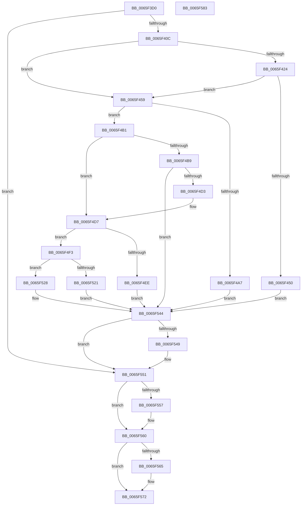

# WheaPersistBadPageToBcd

- RVA: `0x0065F3D0`–`0x0065F584` (길이 `436` bytes)
- VA: `0x000000014065F3D0`
- 실행 섹션: `.text`
- PDB 이름 있음: `예`; PDB Function 태그: `아니요`
- unwind 정보 RVA: `0x000D5DE4`
- 디코드: `128`개 명령, `436/436` bytes 표시
- 미해석 바이트: `0` (있으면 어셈블리에 `.byte`로 보존)

> 이 문서는 커널 이미지의 기계어와 PDB 기호를 분석해 생성했습니다. 4번과 5번은 함수 원형과 자료형을 바이너리 사용 방식에서 추정한 C 해석이며 원본 소스 복구 결과는 아닙니다.

## 1. Dependencies

- 직접 호출 지점: **13**; 고유 호출 대상: **12**
- 직접 호출자로 확인된 함수: **4**
- RIP 상대 이미지 참조: **2**

### Outgoing calls
- `0x0065F3FD` → [BcdOpenStore](../../page/A4/BcdOpenStore_function_00A4116C.md) (function, `0x00A4116C`)
- `0x0065F41B` → [BcdOpenObject](../../page/91/BcdOpenObject_function_00916704.md) (function, `0x00916704`)
- `0x0065F445` → [BcdCreateObject](../../page/A3/BcdCreateObject_function_00A3D890.md) (function, `0x00A3D890`)
- `0x0065F470` → [BcdGetElementData](../../page/A3/BcdGetElementData_function_00A3E390.md) (function, `0x00A3E390`)
- `0x0065F49A` → [ExAllocatePool2](../../poolcode/B8/ExAllocatePool2_function_00B820F0.md) (function, `0x00B820F0`)
- `0x0065F4C8` → [BcdGetElementData](../../page/A3/BcdGetElementData_function_00A3E390.md) (function, `0x00A3E390`)
- `0x0065F4E5` → [WheapIsPageInList](../../page/7D/WheapIsPageInList_function_007D7F88.md) (function, `0x007D7F88`)
- `0x0065F50D` → [qsort_s](../50/qsort_s_function_00500DD0.md) (function, `0x00500DD0`)
- `0x0065F517` → [WheapCountBadPageExtents](../../page/7D/WheapCountBadPageExtents_function_007D7F08.md) (function, `0x007D7F08`)
- `0x0065F537` → [BcdSetElementData](../../page/A3/BcdSetElementData_function_00A3E370.md) (function, `0x00A3E370`)
- `0x0065F54C` → [BcdCloseObject](../../page/A3/BcdCloseObject_function_00A3FB08.md) (function, `0x00A3FB08`)
- `0x0065F55B` → [BcdCloseStore](../../page/A3/BcdCloseStore_function_00A3C68C.md) (function, `0x00A3C68C`)
- `0x0065F56D` → [ExFreePoolWithTag](../../poolcode/B8/ExFreePoolWithTag_function_00B82870.md) (function, `0x00B82870`)

### Direct callers
- [WheapProcessEfiBadMemoryPage](WheapProcessEfiBadMemoryPage_function_0065DEAC.md) at `0x0065DF05`
- [WheaAttemptRowOffline](WheaAttemptRowOffline_function_0065F050.md) at `0x0065F1C3`
- [EmpRemoveBadS3PageWorker](../../page/71/EmpRemoveBadS3PageWorker_function_00713850.md) at `0x0071385A`
- [WheapAttemptPhysicalPageOffline](../../page/7D/WheapAttemptPhysicalPageOffline_function_007D79AC.md) at `0x007D7B4A`

### Static image references
- `0x0065F414` → RVA `0x0002AEB0` (`.rdata`; read)
- `0x0065F4F7` → RVA `0x0065F970` (`WheapPfnComparisonHelper`; read)

## 2. Other-region calls and transfers

- 다른 실행 섹션으로 향하는 call: **12**
  - `0x0065F3FD` → [BcdOpenStore](../../page/A4/BcdOpenStore_function_00A4116C.md) (`.text` → `PAGE`)
  - `0x0065F41B` → [BcdOpenObject](../../page/91/BcdOpenObject_function_00916704.md) (`.text` → `PAGE`)
  - `0x0065F445` → [BcdCreateObject](../../page/A3/BcdCreateObject_function_00A3D890.md) (`.text` → `PAGE`)
  - `0x0065F470` → [BcdGetElementData](../../page/A3/BcdGetElementData_function_00A3E390.md) (`.text` → `PAGE`)
  - `0x0065F49A` → [ExAllocatePool2](../../poolcode/B8/ExAllocatePool2_function_00B820F0.md) (`.text` → `POOLCODE`)
  - `0x0065F4C8` → [BcdGetElementData](../../page/A3/BcdGetElementData_function_00A3E390.md) (`.text` → `PAGE`)
  - `0x0065F4E5` → [WheapIsPageInList](../../page/7D/WheapIsPageInList_function_007D7F88.md) (`.text` → `PAGE`)
  - `0x0065F517` → [WheapCountBadPageExtents](../../page/7D/WheapCountBadPageExtents_function_007D7F08.md) (`.text` → `PAGE`)
  - `0x0065F537` → [BcdSetElementData](../../page/A3/BcdSetElementData_function_00A3E370.md) (`.text` → `PAGE`)
  - `0x0065F54C` → [BcdCloseObject](../../page/A3/BcdCloseObject_function_00A3FB08.md) (`.text` → `PAGE`)
  - `0x0065F55B` → [BcdCloseStore](../../page/A3/BcdCloseStore_function_00A3C68C.md) (`.text` → `PAGE`)
  - `0x0065F56D` → [ExFreePoolWithTag](../../poolcode/B8/ExFreePoolWithTag_function_00B82870.md) (`.text` → `POOLCODE`)
- 별도 외부 분기/꼬리 이동을 확인하지 못했습니다.

## 3. Assembly (complete function range)

```asm
0065F3D0  40 55                           push rbp
0065F3D2  53                              push rbx
0065F3D3  56                              push rsi
0065F3D4  57                              push rdi
0065F3D5  41 54                           push r12
0065F3D7  41 55                           push r13
0065F3D9  41 56                           push r14
0065F3DB  48 8B EC                        mov rbp, rsp
0065F3DE  48 83 EC 40                     sub rsp, 0x40
0065F3E2  45 33 ED                        xor r13d, r13d
0065F3E5  4C 8D 45 50                     lea r8, [rbp + 0x50]
0065F3E9  33 D2                           xor edx, edx
0065F3EB  4C 89 6D F0                     mov qword ptr [rbp - 0x10], r13
0065F3EF  4C 89 6D 50                     mov qword ptr [rbp + 0x50], r13
0065F3F3  41 8B FD                        mov edi, r13d
0065F3F6  4C 89 6D 58                     mov qword ptr [rbp + 0x58], r13
0065F3FA  4C 8B E1                        mov r12, rcx
0065F3FD  E8 6A 1D 3E 00                  call 0x140a4116c
0065F402  8B D8                           mov ebx, eax
0065F404  85 C0                           test eax, eax
0065F406  0F 88 45 01 00 00               js 0x14065f551
0065F40C  48 8B 4D 50                     mov rcx, qword ptr [rbp + 0x50]
0065F410  4C 8D 45 58                     lea r8, [rbp + 0x58]
0065F414  48 8D 15 95 BA 9C FF            lea rdx, [rip - 0x63456b]
0065F41B  E8 E4 72 2B 00                  call 0x140916704
0065F420  85 C0                           test eax, eax
0065F422  79 35                           jns 0x14065f459
0065F424  48 8B 4D 50                     mov rcx, qword ptr [rbp + 0x50]
0065F428  4C 8D 4D 58                     lea r9, [rbp + 0x58]
0065F42C  4C 8D 45 F0                     lea r8, [rbp - 0x10]
0065F430  C7 45 F0 01 00 00 00            mov dword ptr [rbp - 0x10], 1
0065F437  48 8D 15 72 BA 9C FF            lea rdx, [rip - 0x63458e]
0065F43E  C7 45 F4 00 00 10 20            mov dword ptr [rbp - 0xc], 0x20100000
0065F445  E8 46 E4 3D 00                  call 0x140a3d890
0065F44A  8B D8                           mov ebx, eax
0065F44C  85 C0                           test eax, eax
0065F44E  79 09                           jns 0x14065f459
0065F450  48 8B 75 58                     mov rsi, qword ptr [rbp + 0x58]
0065F454  E9 EB 00 00 00                  jmp 0x14065f544
0065F459  48 8B 75 58                     mov rsi, qword ptr [rbp + 0x58]
0065F45D  4C 8D 4D 48                     lea r9, [rbp + 0x48]
0065F461  48 8B CE                        mov rcx, rsi
0065F464  44 89 6D 48                     mov dword ptr [rbp + 0x48], r13d
0065F468  45 33 C0                        xor r8d, r8d
0065F46B  BA 0A 00 00 17                  mov edx, 0x1700000a
0065F470  E8 1B EF 3D 00                  call 0x140a3e390
0065F475  44 8B 75 48                     mov r14d, dword ptr [rbp + 0x48]
0065F479  3D 23 00 00 C0                  cmp eax, 0xc0000023
0065F47E  B9 02 01 00 00                  mov ecx, 0x102
0065F483  41 B8 57 68 65 61               mov r8d, 0x61656857
0065F489  45 0F 45 F5                     cmovne r14d, r13d
0065F48D  8B D8                           mov ebx, eax
0065F48F  41 8B D6                        mov edx, r14d
0065F492  48 83 C2 08                     add rdx, 8
0065F496  44 89 75 48                     mov dword ptr [rbp + 0x48], r14d
0065F49A  E8 51 2C 52 00                  call 0x140b820f0
0065F49F  48 8B F8                        mov rdi, rax
0065F4A2  48 85 C0                        test rax, rax
0065F4A5  75 0A                           jne 0x14065f4b1
0065F4A7  BB 9A 00 00 C0                  mov ebx, 0xc000009a
0065F4AC  E9 93 00 00 00                  jmp 0x14065f544
0065F4B1  81 FB 23 00 00 C0               cmp ebx, 0xc0000023
0065F4B7  75 1E                           jne 0x14065f4d7
0065F4B9  4C 8D 4D 48                     lea r9, [rbp + 0x48]
0065F4BD  4C 8B C7                        mov r8, rdi
0065F4C0  BA 0A 00 00 17                  mov edx, 0x1700000a
0065F4C5  48 8B CE                        mov rcx, rsi
0065F4C8  E8 C3 EE 3D 00                  call 0x140a3e390
0065F4CD  8B D8                           mov ebx, eax
0065F4CF  85 C0                           test eax, eax
0065F4D1  78 71                           js 0x14065f544
0065F4D3  44 8B 75 48                     mov r14d, dword ptr [rbp + 0x48]
0065F4D7  41 8B DE                        mov ebx, r14d
0065F4DA  4D 8B C4                        mov r8, r12
0065F4DD  C1 EB 03                        shr ebx, 3
0065F4E0  48 8B CF                        mov rcx, rdi
0065F4E3  8B D3                           mov edx, ebx
0065F4E5  E8 9E 8A 17 00                  call 0x1407d7f88
0065F4EA  84 C0                           test al, al
0065F4EC  74 05                           je 0x14065f4f3
0065F4EE  41 8B DD                        mov ebx, r13d
0065F4F1  EB 51                           jmp 0x14065f544
0065F4F3  4C 89 24 DF                     mov qword ptr [rdi + rbx*8], r12
0065F4F7  4C 8D 0D 72 04 00 00            lea r9, [rip + 0x472]
0065F4FE  FF C3                           inc ebx
0065F500  4C 89 6C 24 20                  mov qword ptr [rsp + 0x20], r13
0065F505  8B D3                           mov edx, ebx
0065F507  41 B8 08 00 00 00               mov r8d, 8
0065F50D  E8 BE 18 EA FF                  call 0x140500dd0
0065F512  8B D3                           mov edx, ebx
0065F514  48 8B CF                        mov rcx, rdi
0065F517  E8 EC 89 17 00                  call 0x1407d7f08
0065F51C  83 F8 40                        cmp eax, 0x40
0065F51F  76 07                           jbe 0x14065f528
0065F521  BB 01 00 00 C0                  mov ebx, 0xc0000001
0065F526  EB 1C                           jmp 0x14065f544
0065F528  45 8D 4E 08                     lea r9d, [r14 + 8]
0065F52C  4C 8B C7                        mov r8, rdi
0065F52F  BA 0A 00 00 17                  mov edx, 0x1700000a
0065F534  48 8B CE                        mov rcx, rsi
0065F537  E8 34 EE 3D 00                  call 0x140a3e370
0065F53C  85 C0                           test eax, eax
0065F53E  8B D8                           mov ebx, eax
0065F540  41 0F 49 DD                     cmovns ebx, r13d
0065F544  48 85 F6                        test rsi, rsi
0065F547  74 08                           je 0x14065f551
0065F549  48 8B CE                        mov rcx, rsi
0065F54C  E8 B7 05 3E 00                  call 0x140a3fb08
0065F551  4C 39 6D 50                     cmp qword ptr [rbp + 0x50], r13
0065F555  74 09                           je 0x14065f560
0065F557  48 8B 4D 50                     mov rcx, qword ptr [rbp + 0x50]
0065F55B  E8 2C D1 3D 00                  call 0x140a3c68c
0065F560  48 85 FF                        test rdi, rdi
0065F563  74 0D                           je 0x14065f572
0065F565  BA 57 68 65 61                  mov edx, 0x61656857
0065F56A  48 8B CF                        mov rcx, rdi
0065F56D  E8 FE 32 52 00                  call 0x140b82870
0065F572  8B C3                           mov eax, ebx
0065F574  48 83 C4 40                     add rsp, 0x40
0065F578  41 5E                           pop r14
0065F57A  41 5D                           pop r13
0065F57C  41 5C                           pop r12
0065F57E  5F                              pop rdi
0065F57F  5E                              pop rsi
0065F580  5B                              pop rbx
0065F581  5D                              pop rbp
0065F582  C3                              ret
0065F583  CC                              int3
```

## 4. C-style interpretation (structured pseudocode)

```c
__int64 __fastcall WheaPersistBadPageToBcd(__int64 a1, int a2)
{
    __int64 result;
    __int64 v_r13;
    __int64 v_r14;
    __int64 v_rbx;
    __int64 v_rsp;
    unsigned int v_stack_m44;
    unsigned __int64 v_stack_m48;
    unsigned __int64 v_stack_m58;
    unsigned __int64 v_stack_p10;
    unsigned __int64 v_stack_p18;
    unsigned __int64 v_stack_p20;

    v_rsp = (v_rsp) - (64);
    v_r13 = 0;
    a2 = 0;
    v_stack_m48 = 0;
    v_stack_p18 = 0;
    v_stack_p20 = 0;
    result = BcdOpenStore(a1, a2, v_stack_p18, a4);
    if (sign_flag) goto loc_0065F551;
    result = BcdOpenObject(v_stack_p18, v_rip - 6505835, v_stack_p20, a4);
    if (!sign_flag) goto loc_0065F459;
    v_stack_m48 = 1;
    v_stack_m44 = 0x20100000ULL;
    result = BcdCreateObject(v_stack_p18, v_rip - 6505870, v_stack_m48, v_stack_p20);
    if (!sign_flag) goto loc_0065F459;
    goto loc_0065F544;
loc_0065F459:
    v_stack_p10 = 0;
    a3 = 0;
    result = BcdGetElementData(v_stack_p20, (unsigned int)(0x1700000AULL), a3, v_stack_p10);
    v_r14 = (unsigned int)(v_stack_p10);
    if (((unsigned int)(result)) != 0xC0000023ULL) { v_r14 = 0; }
    a2 = ((unsigned int)((unsigned int)(v_r14))) + (8);
    v_stack_p10 = (unsigned int)(v_r14);
    result = ExAllocatePool2(258, a2, (unsigned int)(0x61656857ULL), v_stack_p10);
    if (result != 0) goto loc_0065F4B1;
    goto loc_0065F544;
loc_0065F4B1:
    if (((unsigned int)((unsigned int)(0xC000009AULL))) != 0xC0000023ULL) goto loc_0065F4D7;
    result = BcdGetElementData(v_stack_p20, (unsigned int)(0x1700000AULL), result, v_stack_p10);
    if (sign_flag) goto loc_0065F544;
loc_0065F4D7:
    v_rbx = (unsigned int)(((unsigned int)((unsigned int)((unsigned int)(v_stack_p10)))) >> (3));
    result = WheapIsPageInList(result, (unsigned int)((unsigned int)(v_rbx)), a1, v_stack_p10);
    if ((unsigned __int8)(result) == 0) goto loc_0065F4F3;
    goto loc_0065F544;
loc_0065F4F3:
    *(unsigned __int64 *)(result + 0 * 8) = a1;
    v_rbx = (unsigned int)((0) + 1);
    v_stack_m58 = 0;
    result = qsort_s(result, (unsigned int)((unsigned int)(v_rbx)), 8, v_rip + 1138);
    result = WheapCountBadPageExtents(result, (unsigned int)((unsigned int)(v_rbx)), 8, v_rip + 1138);
    if (((unsigned int)(result)) <= 64) goto loc_0065F528;
    goto loc_0065F544;
loc_0065F528:
    result = BcdSetElementData(v_stack_p20, (unsigned int)(0x1700000AULL), result, (unsigned int)(v_stack_p10) + 8);
    v_rbx = (unsigned int)((unsigned int)(result));
    if (!sign_flag) { v_rbx = 0; }
loc_0065F544:
    if (v_stack_p20 != 0) {
        a1 = v_stack_p20;
        result = BcdCloseObject(a1, (unsigned int)(0x1700000AULL), result, (unsigned int)(v_stack_p10) + 8);
    }
    if (v_stack_p18 != 0) {
        a1 = v_stack_p18;
        result = BcdCloseStore(a1, (unsigned int)(0x1700000AULL), result, (unsigned int)(v_stack_p10) + 8);
    }
    if (result != 0) {
        a2 = 0x61656857ULL;
        a1 = result;
        result = ExFreePoolWithTag(a1, a2, result, (unsigned int)(v_stack_p10) + 8);
    }
    v_rsp = (v_rsp) + (64);
    return (unsigned int)((unsigned int)(v_rbx));
}
```

## 5. (Beta) C Style

```c
int64_t WheaPersistBadPageToBcd(int64_t Arg1, int32_t Arg2)
{
    int64_t result;
    int64_t local_r13;
    int64_t local_r14;
    int64_t local_rbx;
    int64_t local_rsp;
    uint32_t v_stack_m44;
    uint64_t v_stack_m48;
    uint64_t v_stack_m58;
    uint64_t v_stack_p10;
    uint64_t v_stack_p18;
    uint64_t v_stack_p20;

    local_rsp = (local_rsp) - (64);
    local_r13 = 0;
    Arg2 = 0;
    v_stack_m48 = 0;
    v_stack_p18 = 0;
    v_stack_p20 = 0;
    result = BcdOpenStore(Arg1, Arg2, v_stack_p18, a4);
    if (sign_flag) goto loc_0065F551;
    result = BcdOpenObject(v_stack_p18, v_rip - 6505835, v_stack_p20, a4);
    if (!sign_flag) goto loc_0065F459;
    v_stack_m48 = 1;
    v_stack_m44 = 0x20100000ULL;
    result = BcdCreateObject(v_stack_p18, v_rip - 6505870, v_stack_m48, v_stack_p20);
    if (!sign_flag) goto loc_0065F459;
    goto loc_0065F544;
loc_0065F459:
    v_stack_p10 = 0;
    a3 = 0;
    result = BcdGetElementData(v_stack_p20, (uint32_t)(0x1700000AULL), a3, v_stack_p10);
    local_r14 = (uint32_t)(v_stack_p10);
    if (((uint32_t)(result)) != 0xC0000023ULL) { local_r14 = 0; }
    Arg2 = ((uint32_t)((uint32_t)(local_r14))) + (8);
    v_stack_p10 = (uint32_t)(local_r14);
    result = ExAllocatePool2(258, Arg2, (uint32_t)(0x61656857ULL), v_stack_p10);
    if (result != 0) goto loc_0065F4B1;
    goto loc_0065F544;
loc_0065F4B1:
    if (((uint32_t)((uint32_t)(0xC000009AULL))) != 0xC0000023ULL) goto loc_0065F4D7;
    result = BcdGetElementData(v_stack_p20, (uint32_t)(0x1700000AULL), result, v_stack_p10);
    if (sign_flag) goto loc_0065F544;
loc_0065F4D7:
    local_rbx = (uint32_t)(((uint32_t)((uint32_t)((uint32_t)(v_stack_p10)))) >> (3));
    result = WheapIsPageInList(result, (uint32_t)((uint32_t)(local_rbx)), Arg1, v_stack_p10);
    if ((uint8_t)(result) == 0) goto loc_0065F4F3;
    goto loc_0065F544;
loc_0065F4F3:
    *(uint64_t *)(result + 0x0 * 8) = Arg1;
    local_rbx = (uint32_t)((0) + 1);
    v_stack_m58 = 0;
    result = qsort_s(result, (uint32_t)((uint32_t)(local_rbx)), 8, v_rip + 1138);
    result = WheapCountBadPageExtents(result, (uint32_t)((uint32_t)(local_rbx)), 8, v_rip + 1138);
    if (((uint32_t)(result)) <= 64) goto loc_0065F528;
    goto loc_0065F544;
loc_0065F528:
    result = BcdSetElementData(v_stack_p20, (uint32_t)(0x1700000AULL), result, (uint32_t)(v_stack_p10) + 8);
    local_rbx = (uint32_t)((uint32_t)(result));
    if (!sign_flag) { local_rbx = 0; }
loc_0065F544:
    if (v_stack_p20 != 0) {
        Arg1 = v_stack_p20;
        result = BcdCloseObject(Arg1, (uint32_t)(0x1700000AULL), result, (uint32_t)(v_stack_p10) + 8);
    }
    if (v_stack_p18 != 0) {
        Arg1 = v_stack_p18;
        result = BcdCloseStore(Arg1, (uint32_t)(0x1700000AULL), result, (uint32_t)(v_stack_p10) + 8);
    }
    if (result != 0) {
        Arg2 = 0x61656857ULL;
        Arg1 = result;
        result = ExFreePoolWithTag(Arg1, Arg2, result, (uint32_t)(v_stack_p10) + 8);
    }
    local_rsp = (local_rsp) + (64);
    return (uint32_t)((uint32_t)(local_rbx));
}
```

## 6. Execution-region graph

[열기: 2D/3D 그래프와 함수 탐색 컨트롤 패널](../../../control-panel.html?section=text&rva=0x0065F3D0&view=graph)

- 2D 그래프는 위에서 아래로 흐르고, 3D 그래프는 빈 공간을 드래그해 회전합니다. Shift+드래그는 이동, 휠은 확대·축소, 함수 노드 선택은 대상 보고서 이동입니다.

### Static fallback


