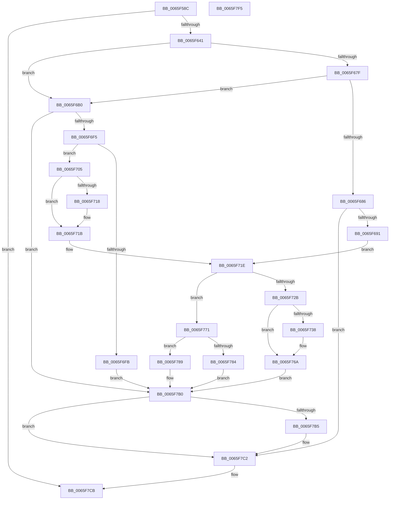

# WheaPersistBadPageToRegistry

- RVA: `0x0065F58C`–`0x0065F7F6` (길이 `618` bytes)
- VA: `0x000000014065F58C`
- 실행 섹션: `.text`
- PDB 이름 있음: `예`; PDB Function 태그: `아니요`
- unwind 정보 RVA: `0x000D5F18`
- 디코드: `162`개 명령, `618/618` bytes 표시
- 미해석 바이트: `0` (있으면 어셈블리에 `.byte`로 보존)

> 이 문서는 커널 이미지의 기계어와 PDB 기호를 분석해 생성했습니다. 4번과 5번은 함수 원형과 자료형을 바이너리 사용 방식에서 추정한 C 해석이며 원본 소스 복구 결과는 아닙니다.

## 1. Dependencies

- 직접 호출 지점: **13**; 고유 호출 대상: **10**
- 직접 호출자로 확인된 함수: **3**
- RIP 상대 이미지 참조: **5**

### Outgoing calls
- `0x0065F5EC` → [RtlInitUnicodeString](../42/RtlInitUnicodeString_function_0042A780.md) (function, `0x0042A780`)
- `0x0065F632` → [ZwCreateKey](../6A/ZwCreateKey_function_006AD470.md) (function, `0x006AD470`)
- `0x0065F64C` → [RtlInitUnicodeString](../42/RtlInitUnicodeString_function_0042A780.md) (function, `0x0042A780`)
- `0x0065F671` → [ZwQueryValueKey](../6A/ZwQueryValueKey_function_006AD3B0.md) (function, `0x006AD3B0`)
- `0x0065F69C` → [ExAllocatePool2](../../poolcode/B8/ExAllocatePool2_function_00B820F0.md) (function, `0x00B820F0`)
- `0x0065F6C3` → [ExAllocatePool2](../../poolcode/B8/ExAllocatePool2_function_00B820F0.md) (function, `0x00B820F0`)
- `0x0065F6E6` → [ZwQueryValueKey](../6A/ZwQueryValueKey_function_006AD3B0.md) (function, `0x006AD3B0`)
- `0x0065F765` → [WheaLogInternalEvent](../66/WheaLogInternalEvent_function_006605B0.md) (function, `0x006605B0`)
- `0x0065F77B` → [WheapInsertPageToList](WheapInsertPageToList_function_0065F898.md) (function, `0x0065F898`)
- `0x0065F7A9` → [ZwSetValueKey](../6A/ZwSetValueKey_function_006ADCD0.md) (function, `0x006ADCD0`)
- `0x0065F7BD` → [ExFreePoolWithTag](../../poolcode/B8/ExFreePoolWithTag_function_00B82870.md) (function, `0x00B82870`)
- `0x0065F7C6` → [ZwClose](../6A/ZwClose_function_006AD2B0.md) (function, `0x006AD2B0`)
- `0x0065F7D4` → [_security_check_cookie](../6A/_security_check_cookie_function_006AC640.md) (function, `0x006AC640`)

### Direct callers
- [WheapProcessEfiBadMemoryPage](WheapProcessEfiBadMemoryPage_function_0065DEAC.md) at `0x0065DF16`
- [WheaAttemptRowOffline](WheaAttemptRowOffline_function_0065F050.md) at `0x0065F1D4`
- [WheapAttemptPhysicalPageOffline](../../page/7D/WheapAttemptPhysicalPageOffline_function_007D79AC.md) at `0x007D7B59`

### Static image references
- `0x0065F5AA` → RVA `0x00E0A740` (`.data`; read)
- `0x0065F5BB` → RVA `0x006D06A0` (` ?? ::FNODOBFM::`string'`; read)
- `0x0065F641` → RVA `0x006D0760` (` ?? ::FNODOBFM::`string'`; read)
- `0x0065F71E` → RVA `0x00E09768` (`.data`; read)
- `0x0065F72D` → RVA `0x00EEF054` (`.data`; read)

## 2. Other-region calls and transfers

- 다른 실행 섹션으로 향하는 call: **3**
  - `0x0065F69C` → [ExAllocatePool2](../../poolcode/B8/ExAllocatePool2_function_00B820F0.md) (`.text` → `POOLCODE`)
  - `0x0065F6C3` → [ExAllocatePool2](../../poolcode/B8/ExAllocatePool2_function_00B820F0.md) (`.text` → `POOLCODE`)
  - `0x0065F7BD` → [ExFreePoolWithTag](../../poolcode/B8/ExFreePoolWithTag_function_00B82870.md) (`.text` → `POOLCODE`)
- 별도 외부 분기/꼬리 이동을 확인하지 못했습니다.

## 3. Assembly (complete function range)

```asm
0065F58C  48 89 5C 24 10                  mov qword ptr [rsp + 0x10], rbx
0065F591  48 89 74 24 18                  mov qword ptr [rsp + 0x18], rsi
0065F596  55                              push rbp
0065F597  57                              push rdi
0065F598  41 54                           push r12
0065F59A  41 56                           push r14
0065F59C  41 57                           push r15
0065F59E  48 8D 6C 24 C9                  lea rbp, [rsp - 0x37]
0065F5A3  48 81 EC D0 00 00 00            sub rsp, 0xd0
0065F5AA  48 8B 05 8F B1 7A 00            mov rax, qword ptr [rip + 0x7ab18f]
0065F5B1  48 33 C4                        xor rax, rsp
0065F5B4  48 89 45 27                     mov qword ptr [rbp + 0x27], rax
0065F5B8  0F 57 C0                        xorps xmm0, xmm0
0065F5BB  48 8D 15 DE 10 07 00            lea rdx, [rip + 0x710de]
0065F5C2  45 33 FF                        xor r15d, r15d
0065F5C5  4C 8B F1                        mov r14, rcx
0065F5C8  48 8D 4D C7                     lea rcx, [rbp - 0x39]
0065F5CC  44 89 7D DB                     mov dword ptr [rbp - 0x25], r15d
0065F5D0  0F 11 45 B7                     movups xmmword ptr [rbp - 0x49], xmm0
0065F5D4  44 89 7D F3                     mov dword ptr [rbp - 0xd], r15d
0065F5D8  0F 11 45 07                     movups xmmword ptr [rbp + 7], xmm0
0065F5DC  4C 89 7D AF                     mov qword ptr [rbp - 0x51], r15
0065F5E0  0F 11 45 17                     movups xmmword ptr [rbp + 0x17], xmm0
0065F5E4  44 89 7D AB                     mov dword ptr [rbp - 0x55], r15d
0065F5E8  0F 11 45 C7                     movups xmmword ptr [rbp - 0x39], xmm0
0065F5EC  E8 8F B1 DC FF                  call 0x14042a780
0065F5F1  48 8D 45 C7                     lea rax, [rbp - 0x39]
0065F5F5  4C 89 7C 24 30                  mov qword ptr [rsp + 0x30], r15
0065F5FA  0F 57 C0                        xorps xmm0, xmm0
0065F5FD  44 89 7C 24 28                  mov dword ptr [rsp + 0x28], r15d
0065F602  41 8D 7F 40                     lea edi, [r15 + 0x40]
0065F606  48 89 45 E7                     mov qword ptr [rbp - 0x19], rax
0065F60A  45 33 C9                        xor r9d, r9d
0065F60D  C7 45 D7 30 00 00 00            mov dword ptr [rbp - 0x29], 0x30
0065F614  4C 8D 45 D7                     lea r8, [rbp - 0x29]
0065F618  4C 89 7D DF                     mov qword ptr [rbp - 0x21], r15
0065F61C  BA 06 00 02 00                  mov edx, 0x20006
0065F621  89 7D EF                        mov dword ptr [rbp - 0x11], edi
0065F624  48 8D 4D AF                     lea rcx, [rbp - 0x51]
0065F628  4C 89 7C 24 20                  mov qword ptr [rsp + 0x20], r15
0065F62D  F3 0F 7F 45 F7                  movdqu xmmword ptr [rbp - 9], xmm0
0065F632  E8 39 DE 04 00                  call 0x1406ad470
0065F637  8B D8                           mov ebx, eax
0065F639  85 C0                           test eax, eax
0065F63B  0F 88 8A 01 00 00               js 0x14065f7cb
0065F641  48 8D 15 18 11 07 00            lea rdx, [rip + 0x71118]
0065F648  48 8D 4D B7                     lea rcx, [rbp - 0x49]
0065F64C  E8 2F B1 DC FF                  call 0x14042a780
0065F651  48 8B 4D AF                     mov rcx, qword ptr [rbp - 0x51]
0065F655  48 8D 45 AB                     lea rax, [rbp - 0x55]
0065F659  48 89 44 24 28                  mov qword ptr [rsp + 0x28], rax
0065F65E  45 8D 67 01                     lea r12d, [r15 + 1]
0065F662  45 33 C9                        xor r9d, r9d
0065F665  44 89 7C 24 20                  mov dword ptr [rsp + 0x20], r15d
0065F66A  45 8B C4                        mov r8d, r12d
0065F66D  48 8D 55 B7                     lea rdx, [rbp - 0x49]
0065F671  E8 3A DD 04 00                  call 0x1406ad3b0
0065F676  8B D8                           mov ebx, eax
0065F678  3D 23 00 00 C0                  cmp eax, 0xc0000023
0065F67D  74 31                           je 0x14065f6b0
0065F67F  3D 05 00 00 80                  cmp eax, 0x80000005
0065F684  74 2A                           je 0x14065f6b0
0065F686  3D 34 00 00 C0                  cmp eax, 0xc0000034
0065F68B  0F 85 31 01 00 00               jne 0x14065f7c2
0065F691  8D 57 C8                        lea edx, [rdi - 0x38]
0065F694  41 B8 57 68 65 61               mov r8d, 0x61656857
0065F69A  8B CF                           mov ecx, edi
0065F69C  E8 4F 2A 52 00                  call 0x140b820f0
0065F6A1  48 8B F8                        mov rdi, rax
0065F6A4  44 89 7D A7                     mov dword ptr [rbp - 0x59], r15d
0065F6A8  48 8B D8                        mov rbx, rax
0065F6AB  41 8B CF                        mov ecx, r15d
0065F6AE  EB 6E                           jmp 0x14065f71e
0065F6B0  8B 5D AB                        mov ebx, dword ptr [rbp - 0x55]
0065F6B3  41 B8 57 68 65 61               mov r8d, 0x61656857
0065F6B9  83 C3 08                        add ebx, 8
0065F6BC  48 8B CF                        mov rcx, rdi
0065F6BF  8B D3                           mov edx, ebx
0065F6C1  8B F3                           mov esi, ebx
0065F6C3  E8 28 2A 52 00                  call 0x140b820f0
0065F6C8  48 8B 4D AF                     mov rcx, qword ptr [rbp - 0x51]
0065F6CC  48 8D 55 B7                     lea rdx, [rbp - 0x49]
0065F6D0  48 8B F8                        mov rdi, rax
0065F6D3  45 8B C4                        mov r8d, r12d
0065F6D6  48 8D 45 AB                     lea rax, [rbp - 0x55]
0065F6DA  4C 8B CF                        mov r9, rdi
0065F6DD  48 89 44 24 28                  mov qword ptr [rsp + 0x28], rax
0065F6E2  89 5C 24 20                     mov dword ptr [rsp + 0x20], ebx
0065F6E6  E8 C5 DC 04 00                  call 0x1406ad3b0
0065F6EB  8B D8                           mov ebx, eax
0065F6ED  85 C0                           test eax, eax
0065F6EF  0F 88 BB 00 00 00               js 0x14065f7b0
0065F6F5  83 7F 04 03                     cmp dword ptr [rdi + 4], 3
0065F6F9  74 0A                           je 0x14065f705
0065F6FB  BB 3E 00 00 C0                  mov ebx, 0xc000003e
0065F700  E9 AB 00 00 00                  jmp 0x14065f7b0
0065F705  8B 47 0C                        mov eax, dword ptr [rdi + 0xc]
0065F708  48 8D 5E F8                     lea rbx, [rsi - 8]
0065F70C  8B C8                           mov ecx, eax
0065F70E  C1 E9 03                        shr ecx, 3
0065F711  89 4D A7                        mov dword ptr [rbp - 0x59], ecx
0065F714  85 C0                           test eax, eax
0065F716  74 03                           je 0x14065f71b
0065F718  8B 5F 08                        mov ebx, dword ptr [rdi + 8]
0065F71B  48 03 DF                        add rbx, rdi
0065F71E  48 8B 05 43 A0 7A 00            mov rax, qword ptr [rip + 0x7aa043]
0065F725  FF C1                           inc ecx
0065F727  3B 08                           cmp ecx, dword ptr [rax]
0065F729  76 46                           jbe 0x14065f771
0065F72B  33 C0                           xor eax, eax
0065F72D  F0 44 0F B1 25 1E F9 88 00      lock cmpxchg dword ptr [rip + 0x88f91e], r12d
0065F736  75 32                           jne 0x14065f76a
0065F738  48 8D 4D 07                     lea rcx, [rbp + 7]
0065F73C  C7 45 07 57 68 4C 67            mov dword ptr [rbp + 7], 0x674c6857
0065F743  44 89 65 0B                     mov dword ptr [rbp + 0xb], r12d
0065F747  48 C7 45 0F 20 00 00 00         mov qword ptr [rbp + 0xf], 0x20
0065F74F  C7 45 1B 34 00 00 80            mov dword ptr [rbp + 0x1b], 0x80000034
0065F756  C7 45 17 4B 52 4E 4C            mov dword ptr [rbp + 0x17], 0x4c4e524b
0065F75D  48 C7 45 1F 02 00 00 00         mov qword ptr [rbp + 0x1f], 2
0065F765  E8 46 0E 00 00                  call 0x1406605b0
0065F76A  BB 01 00 00 C0                  mov ebx, 0xc0000001
0065F76F  EB 3F                           jmp 0x14065f7b0
0065F771  4C 8D 45 A7                     lea r8, [rbp - 0x59]
0065F775  49 8B D6                        mov rdx, r14
0065F778  48 8B CB                        mov rcx, rbx
0065F77B  E8 18 01 00 00                  call 0x14065f898
0065F780  84 C0                           test al, al
0065F782  75 05                           jne 0x14065f789
0065F784  41 8B DF                        mov ebx, r15d
0065F787  EB 27                           jmp 0x14065f7b0
0065F789  8B 45 A7                        mov eax, dword ptr [rbp - 0x59]
0065F78C  48 8D 55 B7                     lea rdx, [rbp - 0x49]
0065F790  48 8B 4D AF                     mov rcx, qword ptr [rbp - 0x51]
0065F794  41 B9 03 00 00 00               mov r9d, 3
0065F79A  C1 E0 03                        shl eax, 3
0065F79D  45 33 C0                        xor r8d, r8d
0065F7A0  89 44 24 28                     mov dword ptr [rsp + 0x28], eax
0065F7A4  48 89 5C 24 20                  mov qword ptr [rsp + 0x20], rbx
0065F7A9  E8 22 E5 04 00                  call 0x1406adcd0
0065F7AE  8B D8                           mov ebx, eax
0065F7B0  48 85 FF                        test rdi, rdi
0065F7B3  74 0D                           je 0x14065f7c2
0065F7B5  BA 57 68 65 61                  mov edx, 0x61656857
0065F7BA  48 8B CF                        mov rcx, rdi
0065F7BD  E8 AE 30 52 00                  call 0x140b82870
0065F7C2  48 8B 4D AF                     mov rcx, qword ptr [rbp - 0x51]
0065F7C6  E8 E5 DA 04 00                  call 0x1406ad2b0
0065F7CB  8B C3                           mov eax, ebx
0065F7CD  48 8B 4D 27                     mov rcx, qword ptr [rbp + 0x27]
0065F7D1  48 33 CC                        xor rcx, rsp
0065F7D4  E8 67 CE 04 00                  call 0x1406ac640
0065F7D9  4C 8D 9C 24 D0 00 00 00         lea r11, [rsp + 0xd0]
0065F7E1  49 8B 5B 38                     mov rbx, qword ptr [r11 + 0x38]
0065F7E5  49 8B 73 40                     mov rsi, qword ptr [r11 + 0x40]
0065F7E9  49 8B E3                        mov rsp, r11
0065F7EC  41 5F                           pop r15
0065F7EE  41 5E                           pop r14
0065F7F0  41 5C                           pop r12
0065F7F2  5F                              pop rdi
0065F7F3  5D                              pop rbp
0065F7F4  C3                              ret
0065F7F5  CC                              int3
```

## 4. C-style interpretation (structured pseudocode)

```c
__int64 __fastcall WheaPersistBadPageToRegistry(__int64 a1, __int64 a2, __int64 a3, int a4)
{
    __int64 result;
    __int64 v_r15;
    __int64 v_rbx;
    __int64 v_rsp;
    unsigned __int64 v_stack_m28;
    unsigned __int64 v_stack_m38;
    unsigned __int64 v_stack_m40;
    unsigned int v_stack_m44;
    unsigned __int64 v_stack_m48;
    unsigned __int64 v_stack_m50;
    unsigned int v_stack_m54;
    unsigned __int64 v_stack_m58;
    unsigned __int64 v_stack_m5F;
    unsigned __int64 v_stack_m68;
    unsigned int v_stack_m6C;
    unsigned int v_stack_m70;
    unsigned __int64 v_stack_m78;
    unsigned __int64 v_stack_m80;
    unsigned int v_stack_m84;
    unsigned int v_stack_m88;
    unsigned __int64 v_stack_m98;
    unsigned __int64 v_stack_mA8;
    unsigned __int64 v_stack_mB0;
    unsigned int v_stack_mB4;
    unsigned int v_stack_mB8;
    unsigned __int64 v_stack_mC8;
    unsigned int v_stack_mD0;
    unsigned __int64 v_stack_mD8;
    unsigned __int64 v_stack_p10;
    unsigned __int64 v_stack_p18;

    v_stack_p10 = v_rbx;
    v_stack_p18 = v_rsi;
    v_rsp = (v_rsp) - (208);
    result = (*(unsigned __int64 *)(v_rip + 8040847)) ^ (v_rsp);
    v_stack_m38 = result;
    v_r15 = 0;
    v_stack_m84 = 0;
    v_stack_mA8 = v_xmm0;
    v_stack_m6C = 0;
    v_stack_m58 = v_xmm0;
    v_stack_mB0 = 0;
    v_stack_m48 = v_xmm0;
    v_stack_mB4 = 0;
    v_stack_m98 = v_xmm0;
    result = RtlInitUnicodeString(v_stack_m98, v_rip + 463070, a3, a4);
    v_stack_mC8 = 0;
    v_stack_mD0 = 0;
    v_stack_m78 = v_stack_m98;
    a4 = 0;
    v_stack_m88 = 48;
    v_stack_m80 = 0;
    v_stack_m70 = (unsigned int)(v_r15 + 64);
    v_stack_mD8 = 0;
    v_stack_m68 = v_xmm0;
    result = ZwCreateKey(v_stack_mB0, (unsigned int)(0x20006ULL), v_stack_m88, a4);
    if (sign_flag) goto loc_0065F7CB;
    result = RtlInitUnicodeString(v_stack_mA8, v_rip + 463128, v_stack_m88, a4);
    v_stack_mD0 = v_stack_mB4;
    a4 = 0;
    v_stack_mD8 = 0;
    result = ZwQueryValueKey(v_stack_mB0, v_stack_mA8, (unsigned int)((unsigned int)(v_r15 + 1)), a4);
    if (((unsigned int)(result)) == 0xC0000023ULL) goto loc_0065F6B0;
    if (((unsigned int)(result)) == 0x80000005ULL) goto loc_0065F6B0;
    if (((unsigned int)(result)) != 0xC0000034ULL) goto loc_0065F7C2;
    result = ExAllocatePool2((unsigned int)((unsigned int)(v_r15 + 64)), v_r15 + 64 - 56, (unsigned int)(0x61656857ULL), a4);
    v_stack_mB8 = 0;
    goto loc_0065F71E;
loc_0065F6B0:
    v_rbx = (unsigned int)(((unsigned int)(v_stack_mB4)) + (8));
    result = ExAllocatePool2(result, (unsigned int)((unsigned int)(v_rbx)), (unsigned int)(0x61656857ULL), a4);
    v_stack_mD0 = v_stack_mB4;
    v_stack_mD8 = (unsigned int)(v_rbx);
    result = ZwQueryValueKey(v_stack_mB0, v_stack_mA8, (unsigned int)((unsigned int)(v_r15 + 1)), result);
    if (sign_flag) goto loc_0065F7B0;
    if ((*(unsigned int *)(result + 4)) == 3) goto loc_0065F705;
    goto loc_0065F7B0;
loc_0065F705:
    a1 = (unsigned int)(((unsigned int)((unsigned int)((unsigned int)(*(unsigned int *)(result + 12))))) >> (3));
    v_stack_mB8 = (unsigned int)(a1);
    v_rbx = (unsigned int)((unsigned int)(v_rbx)) - 8;
    if ((unsigned int)((unsigned int)(*(unsigned int *)(result + 12))) != 0) {
        v_rbx = *(unsigned int *)(result + 8);
    }
    v_rbx = (v_rbx) + (result);
loc_0065F71E:
    a1 = (unsigned int)((a1) + 1);
    if (((unsigned int)(a1)) <= (*(unsigned int *)(*(unsigned __int64 *)(v_rip + 8036419)))) goto loc_0065F771;
    result = 0;
    if (!(condition_is_not_equal)) {
        a1 = v_stack_m58;
        v_stack_m58 = 0x674C6857ULL;
        v_stack_m54 = (unsigned int)(v_r15 + 1);
        v_stack_m50 = 32;
        v_stack_m44 = 0x80000034ULL;
        v_stack_m48 = 0x4C4E524BULL;
        v_stack_m40 = 2;
        result = WheaLogInternalEvent(a1, v_stack_mA8, (unsigned int)((unsigned int)(v_r15 + 1)), result);
    }
    goto loc_0065F7B0;
loc_0065F771:
    result = WheapInsertPageToList((unsigned int)(0xC0000001ULL), a1, v_stack_mB8, result);
    if ((unsigned __int8)(result) != 0) goto loc_0065F789;
    goto loc_0065F7B0;
loc_0065F789:
    result = (unsigned int)(((unsigned int)(v_stack_mB8)) << (3));
    a3 = 0;
    v_stack_mD0 = (unsigned int)(result);
    v_stack_mD8 = 0;
    result = ZwSetValueKey(v_stack_mB0, v_stack_mA8, a3, 3);
loc_0065F7B0:
    if (result != 0) {
        a2 = 0x61656857ULL;
        a1 = result;
        result = ExFreePoolWithTag(a1, a2, a3, 3);
    }
    result = ZwClose(v_stack_mB0, a2, a3, 3);
loc_0065F7CB:
    a1 = (v_stack_m38) ^ (v_rsp);
    result = _security_check_cookie(a1, a2, a3, 3);
    return result;
}
```

## 5. (Beta) C Style

```c
int64_t WheaPersistBadPageToRegistry(int64_t Arg1, int64_t Arg2, int64_t Arg3, int32_t Arg4)
{
    int64_t result;
    int64_t local_r15;
    int64_t local_rbx;
    int64_t local_rsp;
    uint64_t v_stack_m28;
    uint64_t v_stack_m38;
    uint64_t v_stack_m40;
    uint32_t v_stack_m44;
    uint64_t v_stack_m48;
    uint64_t v_stack_m50;
    uint32_t v_stack_m54;
    uint64_t v_stack_m58;
    uint64_t v_stack_m5F;
    uint64_t v_stack_m68;
    uint32_t v_stack_m6C;
    uint32_t v_stack_m70;
    uint64_t v_stack_m78;
    uint64_t v_stack_m80;
    uint32_t v_stack_m84;
    uint32_t v_stack_m88;
    uint64_t v_stack_m98;
    uint64_t v_stack_mA8;
    uint64_t v_stack_mB0;
    uint32_t v_stack_mB4;
    uint32_t v_stack_mB8;
    uint64_t v_stack_mC8;
    uint32_t v_stack_mD0;
    uint64_t v_stack_mD8;
    uint64_t v_stack_p10;
    uint64_t v_stack_p18;

    v_stack_p10 = local_rbx;
    v_stack_p18 = local_rsi;
    local_rsp = (local_rsp) - (208);
    result = (*(uint64_t *)(v_rip + 0x7AB18F)) ^ (local_rsp);
    v_stack_m38 = result;
    local_r15 = 0;
    v_stack_m84 = 0;
    v_stack_mA8 = v_xmm0;
    v_stack_m6C = 0;
    v_stack_m58 = v_xmm0;
    v_stack_mB0 = 0;
    v_stack_m48 = v_xmm0;
    v_stack_mB4 = 0;
    v_stack_m98 = v_xmm0;
    result = RtlInitUnicodeString(v_stack_m98, v_rip + 463070, Arg3, Arg4);
    v_stack_mC8 = 0;
    v_stack_mD0 = 0;
    v_stack_m78 = v_stack_m98;
    Arg4 = 0;
    v_stack_m88 = 48;
    v_stack_m80 = 0;
    v_stack_m70 = (uint32_t)(local_r15 + 64);
    v_stack_mD8 = 0;
    v_stack_m68 = v_xmm0;
    result = ZwCreateKey(v_stack_mB0, (uint32_t)(0x20006ULL), v_stack_m88, Arg4);
    if (sign_flag) goto loc_0065F7CB;
    result = RtlInitUnicodeString(v_stack_mA8, v_rip + 463128, v_stack_m88, Arg4);
    v_stack_mD0 = v_stack_mB4;
    Arg4 = 0;
    v_stack_mD8 = 0;
    result = ZwQueryValueKey(v_stack_mB0, v_stack_mA8, (uint32_t)((uint32_t)(local_r15 + 1)), Arg4);
    if (((uint32_t)(result)) == 0xC0000023ULL) goto loc_0065F6B0;
    if (((uint32_t)(result)) == 0x80000005ULL) goto loc_0065F6B0;
    if (((uint32_t)(result)) != 0xC0000034ULL) goto loc_0065F7C2;
    result = ExAllocatePool2((uint32_t)((uint32_t)(local_r15 + 64)), local_r15 + 64 - 56, (uint32_t)(0x61656857ULL), Arg4);
    v_stack_mB8 = 0;
    goto loc_0065F71E;
loc_0065F6B0:
    local_rbx = (uint32_t)(((uint32_t)(v_stack_mB4)) + (8));
    result = ExAllocatePool2(result, (uint32_t)((uint32_t)(local_rbx)), (uint32_t)(0x61656857ULL), Arg4);
    v_stack_mD0 = v_stack_mB4;
    v_stack_mD8 = (uint32_t)(local_rbx);
    result = ZwQueryValueKey(v_stack_mB0, v_stack_mA8, (uint32_t)((uint32_t)(local_r15 + 1)), result);
    if (sign_flag) goto loc_0065F7B0;
    if ((*(uint32_t *)(result + 0x4)) == 3) goto loc_0065F705;
    goto loc_0065F7B0;
loc_0065F705:
    Arg1 = (uint32_t)(((uint32_t)((uint32_t)((uint32_t)(*(uint32_t *)(result + 0xC))))) >> (3));
    v_stack_mB8 = (uint32_t)(Arg1);
    local_rbx = (uint32_t)((uint32_t)(local_rbx)) - 8;
    if ((uint32_t)((uint32_t)(*(uint32_t *)(result + 0xC))) != 0) {
        local_rbx = *(uint32_t *)(result + 0x8);
    }
    local_rbx = (local_rbx) + (result);
loc_0065F71E:
    Arg1 = (uint32_t)((Arg1) + 1);
    if (((uint32_t)(Arg1)) <= (*(uint32_t *)(*(uint64_t *)(v_rip + 0x7AA043)))) goto loc_0065F771;
    result = 0;
    if (!(condition_is_not_equal)) {
        Arg1 = v_stack_m58;
        v_stack_m58 = 0x674C6857ULL;
        v_stack_m54 = (uint32_t)(local_r15 + 1);
        v_stack_m50 = 32;
        v_stack_m44 = 0x80000034ULL;
        v_stack_m48 = 0x4C4E524BULL;
        v_stack_m40 = 2;
        result = WheaLogInternalEvent(Arg1, v_stack_mA8, (uint32_t)((uint32_t)(local_r15 + 1)), result);
    }
    goto loc_0065F7B0;
loc_0065F771:
    result = WheapInsertPageToList((uint32_t)(0xC0000001ULL), Arg1, v_stack_mB8, result);
    if ((uint8_t)(result) != 0) goto loc_0065F789;
    goto loc_0065F7B0;
loc_0065F789:
    result = (uint32_t)(((uint32_t)(v_stack_mB8)) << (3));
    Arg3 = 0;
    v_stack_mD0 = (uint32_t)(result);
    v_stack_mD8 = 0;
    result = ZwSetValueKey(v_stack_mB0, v_stack_mA8, Arg3, 3);
loc_0065F7B0:
    if (result != 0) {
        Arg2 = 0x61656857ULL;
        Arg1 = result;
        result = ExFreePoolWithTag(Arg1, Arg2, Arg3, 3);
    }
    result = ZwClose(v_stack_mB0, Arg2, Arg3, 3);
loc_0065F7CB:
    Arg1 = (v_stack_m38) ^ (local_rsp);
    result = _security_check_cookie(Arg1, Arg2, Arg3, 3);
    return result;
}
```

## 6. Execution-region graph

[열기: 2D/3D 그래프와 함수 탐색 컨트롤 패널](../../../control-panel.html?section=text&rva=0x0065F58C&view=graph)

- 2D 그래프는 위에서 아래로 흐르고, 3D 그래프는 빈 공간을 드래그해 회전합니다. Shift+드래그는 이동, 휠은 확대·축소, 함수 노드 선택은 대상 보고서 이동입니다.

### Static fallback


