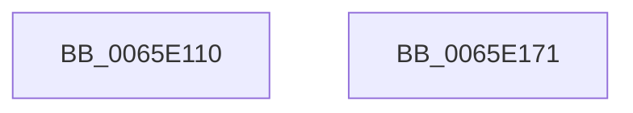

# WheaRecoveryBugCheck

- RVA: `0x0065E110`–`0x0065E172` (길이 `98` bytes)
- VA: `0x000000014065E110`
- 실행 섹션: `.text`
- PDB 이름 있음: `예`; PDB Function 태그: `아니요`
- unwind 정보 RVA: `0x0005CAAC`
- 디코드: `27`개 명령, `98/98` bytes 표시
- 미해석 바이트: `0` (있으면 어셈블리에 `.byte`로 보존)

> 이 문서는 커널 이미지의 기계어와 PDB 기호를 분석해 생성했습니다. 4번과 5번은 함수 원형과 자료형을 바이너리 사용 방식에서 추정한 C 해석이며 원본 소스 복구 결과는 아닙니다.

## 1. Dependencies

- 직접 호출 지점: **5**; 고유 호출 대상: **5**
- 직접 호출자로 확인된 함수: **2**
- RIP 상대 이미지 참조: **2**

### Outgoing calls
- `0x0065E128` → [WheapCompressErrorRecord](../48/WheapCompressErrorRecord_function_004849C8.md) (function, `0x004849C8`)
- `0x0065E130` → [WheapPersistPageForMemoryError](WheapPersistPageForMemoryError_function_0065E388.md) (function, `0x0065E388`)
- `0x0065E13D` → `PSHED.dll!PshedWriteErrorRecord` (import, 간접 대상; import `PSHED.dll!PshedWriteErrorRecord`)
- `0x0065E14F` → [WheapAddToDumpFile](WheapAddToDumpFile_function_0065E1FC.md) (function, `0x0065E1FC`)
- `0x0065E15A` → `PSHED.dll!PshedBugCheckSystem` (import, 간접 대상; import `PSHED.dll!PshedBugCheckSystem`)

### Direct callers
- [WheaReportHwError](../4E/WheaReportHwError_function_004ED200.md) at `0x004ED558`
- [KiMcheckAlternateReturn](../5C/KiMcheckAlternateReturn_function_005CB180.md) at `0x005CB503`

### Static image references
- `0x0065E13D` → RVA `0x00151098` (`PSHED.dll!PshedWriteErrorRecord (IAT)`; read)
- `0x0065E15A` → RVA `0x001510A0` (`PSHED.dll!PshedBugCheckSystem (IAT)`; read)

## 2. Other-region calls and transfers

- 다른 실행 섹션으로 향하는 call: **0**
- 별도 외부 분기/꼬리 이동을 확인하지 못했습니다.

## 3. Assembly (complete function range)

```asm
0065E110  48 89 5C 24 08                  mov qword ptr [rsp + 8], rbx
0065E115  57                              push rdi
0065E116  48 83 EC 20                     sub rsp, 0x20
0065E11A  48 8B FA                        mov rdi, rdx
0065E11D  48 8B D9                        mov rbx, rcx
0065E120  48 8B D1                        mov rdx, rcx
0065E123  B9 03 00 00 00                  mov ecx, 3
0065E128  E8 9B 68 E2 FF                  call 0x1404849c8
0065E12D  48 8B CB                        mov rcx, rbx
0065E130  E8 53 02 00 00                  call 0x14065e388
0065E135  8B 53 14                        mov edx, dword ptr [rbx + 0x14]
0065E138  4C 8B C3                        mov r8, rbx
0065E13B  33 C9                           xor ecx, ecx
0065E13D  48 FF 15 54 2F AF FF            call qword ptr [rip - 0x50d0ac]
0065E144  0F 1F 44 00 00                  nop dword ptr [rax + rax]
0065E149  8B 53 14                        mov edx, dword ptr [rbx + 0x14]
0065E14C  48 8B CB                        mov rcx, rbx
0065E14F  E8 A8 00 00 00                  call 0x14065e1fc
0065E154  48 8B D3                        mov rdx, rbx
0065E157  48 8B CF                        mov rcx, rdi
0065E15A  48 FF 15 3F 2F AF FF            call qword ptr [rip - 0x50d0c1]
0065E161  0F 1F 44 00 00                  nop dword ptr [rax + rax]
0065E166  48 8B 5C 24 30                  mov rbx, qword ptr [rsp + 0x30]
0065E16B  48 83 C4 20                     add rsp, 0x20
0065E16F  5F                              pop rdi
0065E170  C3                              ret
0065E171  CC                              int3
```

## 4. C-style interpretation (structured pseudocode)

```c
__int64 __fastcall WheaRecoveryBugCheck(__int64 a1, __int64 a2)
{
    __int64 result;
    __int64 v_rsp;
    unsigned __int64 v_stack_p8;

    v_stack_p8 = v_rbx;
    v_rsp = (v_rsp) - (32);
    result = WheapCompressErrorRecord(3, a1, a3, a4);
    result = WheapPersistPageForMemoryError(a1, a1, a3, a4);
    a1 = 0;
    result = PSHED_dll_PshedWriteErrorRecord(a1, (unsigned int)(*(unsigned int *)(a1 + 20)), a1, a4);
    result = WheapAddToDumpFile(0, (unsigned int)(*(unsigned int *)(a1 + 20)), a1, a4);
    result = PSHED_dll_PshedBugCheckSystem(a2, 0, a1, a4);
    v_rsp = (v_rsp) + (32);
    return result;
}
```

## 5. (Beta) C Style

```c
int64_t WheaRecoveryBugCheck(void *Arg1, int64_t Arg2)
{
    uint8_t *arg1 = (uint8_t *)Arg1;

    int64_t result;
    int64_t local_rsp;
    uint64_t v_stack_p8;

    v_stack_p8 = local_rbx;
    local_rsp = (local_rsp) - (32);
    result = WheapCompressErrorRecord(3, Arg1, a3, a4);
    result = WheapPersistPageForMemoryError(Arg1, Arg1, a3, a4);
    Arg1 = 0;
    result = kernel_indirect_call(Arg1, (uint32_t)(*(uint32_t *)(arg1 + 0x14)), Arg1, a4);
    result = WheapAddToDumpFile(0, (uint32_t)(*(uint32_t *)(arg1 + 0x14)), Arg1, a4);
    result = kernel_indirect_call(Arg2, 0, Arg1, a4);
    local_rsp = (local_rsp) + (32);
    return result;
}
```

### 관측된 메모리 오프셋

구조체 형식이 확인되지 않은 접근은 인자 기준의 오프셋으로만 기록했습니다.

| 기준 인자 | 오프셋 표현 | 폭 (bit) | 접근 |
|---|---:|---:|---|
| `Arg1` | `+ 0x14` | `32` | `R` |

## 6. Execution-region graph

[열기: 2D/3D 그래프와 함수 탐색 컨트롤 패널](../../../control-panel.html?section=text&rva=0x0065E110&view=graph)

- 2D 그래프는 위에서 아래로 흐르고, 3D 그래프는 빈 공간을 드래그해 회전합니다. Shift+드래그는 이동, 휠은 확대·축소, 함수 노드 선택은 대상 보고서 이동입니다.

### Static fallback


