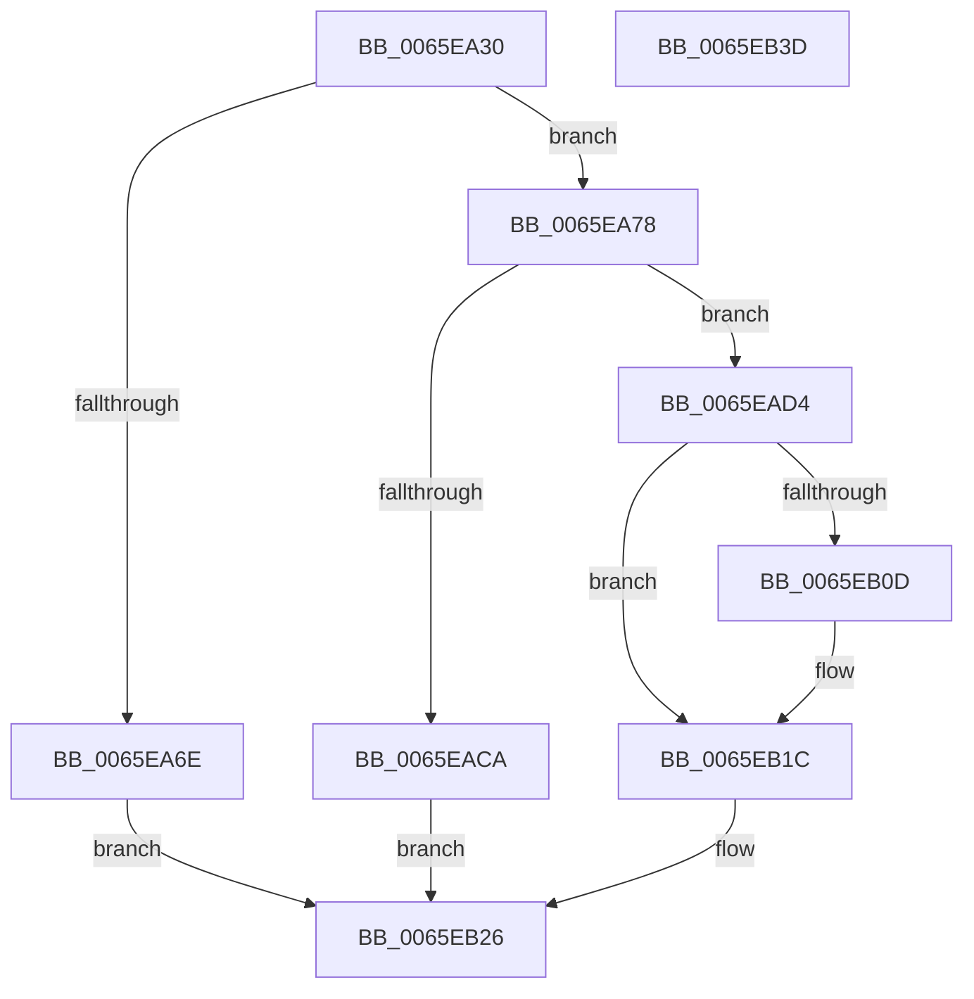

# WheaReportHwErrorDeviceDriverEx

- RVA: `0x0065EA30`–`0x0065EB3E` (길이 `270` bytes)
- VA: `0x000000014065EA30`
- 실행 섹션: `.text`
- PDB 이름 있음: `예`; PDB Function 태그: `아니요`
- unwind 정보 RVA: `0x0006F874`
- 디코드: `68`개 명령, `270/270` bytes 표시
- 미해석 바이트: `0` (있으면 어셈블리에 `.byte`로 보존)

> 이 문서는 커널 이미지의 기계어와 PDB 기호를 분석해 생성했습니다. 4번과 5번은 함수 원형과 자료형을 바이너리 사용 방식에서 추정한 C 해석이며 원본 소스 복구 결과는 아닙니다.

## 1. Dependencies

- 직접 호출 지점: **9**; 고유 호출 대상: **8**
- 직접 호출자로 확인된 함수: **1**
- RIP 상대 이미지 참조: **0**

### Outgoing calls
- `0x0065EA61` → [WheaCreateHwErrorReportDeviceDriver](WheaCreateHwErrorReportDeviceDriver_function_0065E620.md) (function, `0x0065E620`)
- `0x0065EA82` → [WheaHwErrorReportSetSeverityDeviceDriver](WheaHwErrorReportSetSeverityDeviceDriver_function_0065E7B0.md) (function, `0x0065E7B0`)
- `0x0065EA96` → [WheaHwErrorReportGetLogDataBufferDeviceDriver](WheaHwErrorReportGetLogDataBufferDeviceDriver_function_0065E680.md) (function, `0x0065E680`)
- `0x0065EAB0` → [memcpy](../6C/memcpy_function_006C6840.md) (function, `0x006C6840`)
- `0x0065EABF` → [WheaAddHwErrorReportSectionDeviceDriver](WheaAddHwErrorReportSectionDeviceDriver_function_0065E510.md) (function, `0x0065E510`)
- `0x0065EACD` → [WheaHwErrorReportAbandonDeviceDriver](WheaHwErrorReportAbandonDeviceDriver_function_0065E650.md) (function, `0x0065E650`)
- `0x0065EADF` → [memcpy](../6C/memcpy_function_006C6840.md) (function, `0x006C6840`)
- `0x0065EB17` → [RtlStringCchCopyA](../46/RtlStringCchCopyA_function_00460628.md) (function, `0x00460628`)
- `0x0065EB1F` → [WheaHwErrorReportSubmitDeviceDriver](WheaHwErrorReportSubmitDeviceDriver_function_0065E7F0.md) (function, `0x0065E7F0`)

### Direct callers
- [WheaReportHwErrorDeviceDriver](../../page/7D/WheaReportHwErrorDeviceDriver_function_007D71A0.md) at `0x007D71D9`

### Static image references
- 디코드된 RIP-relative 메모리 참조가 없습니다.

## 2. Other-region calls and transfers

- 다른 실행 섹션으로 향하는 call: **0**
- 별도 외부 분기/꼬리 이동을 확인하지 못했습니다.

## 3. Assembly (complete function range)

```asm
0065EA30  4C 8B DC                        mov r11, rsp
0065EA33  49 89 5B 08                     mov qword ptr [r11 + 8], rbx
0065EA37  49 89 6B 10                     mov qword ptr [r11 + 0x10], rbp
0065EA3B  49 89 73 18                     mov qword ptr [r11 + 0x18], rsi
0065EA3F  57                              push rdi
0065EA40  48 83 EC 50                     sub rsp, 0x50
0065EA44  0F 57 C0                        xorps xmm0, xmm0
0065EA47  41 8B F1                        mov esi, r9d
0065EA4A  33 C0                           xor eax, eax
0065EA4C  49 8B E8                        mov rbp, r8
0065EA4F  49 21 43 C8                     and qword ptr [r11 - 0x38], rax
0065EA53  0F 11 44 24 28                  movups xmmword ptr [rsp + 0x28], xmm0
0065EA58  0F 11 44 24 38                  movups xmmword ptr [rsp + 0x38], xmm0
0065EA5D  49 89 43 F0                     mov qword ptr [r11 - 0x10], rax
0065EA61  E8 BA FB FF FF                  call 0x14065e620
0065EA66  48 8B F8                        mov rdi, rax
0065EA69  48 85 C0                        test rax, rax
0065EA6C  75 0A                           jne 0x14065ea78
0065EA6E  BB 9A 00 00 C0                  mov ebx, 0xc000009a
0065EA73  E9 AE 00 00 00                  jmp 0x14065eb26
0065EA78  8B 94 24 A0 00 00 00            mov edx, dword ptr [rsp + 0xa0]
0065EA7F  48 8B CF                        mov rcx, rdi
0065EA82  E8 29 FD FF FF                  call 0x14065e7b0
0065EA87  8B 94 24 88 00 00 00            mov edx, dword ptr [rsp + 0x88]
0065EA8E  4C 8D 44 24 20                  lea r8, [rsp + 0x20]
0065EA93  48 8B CF                        mov rcx, rdi
0065EA96  E8 E5 FB FF FF                  call 0x14065e680
0065EA9B  44 8B 84 24 88 00 00 00         mov r8d, dword ptr [rsp + 0x88]
0065EAA3  48 8B 94 24 80 00 00 00         mov rdx, qword ptr [rsp + 0x80]
0065EAAB  48 8B 4C 24 20                  mov rcx, qword ptr [rsp + 0x20]
0065EAB0  E8 8B 7D 06 00                  call 0x1406c6840
0065EAB5  4C 8D 44 24 28                  lea r8, [rsp + 0x28]
0065EABA  8B D6                           mov edx, esi
0065EABC  48 8B CF                        mov rcx, rdi
0065EABF  E8 4C FA FF FF                  call 0x14065e510
0065EAC4  8B D8                           mov ebx, eax
0065EAC6  85 C0                           test eax, eax
0065EAC8  79 0A                           jns 0x14065ead4
0065EACA  48 8B CF                        mov rcx, rdi
0065EACD  E8 7E FB FF FF                  call 0x14065e650
0065EAD2  EB 52                           jmp 0x14065eb26
0065EAD4  48 8B 4C 24 2C                  mov rcx, qword ptr [rsp + 0x2c]
0065EAD9  4C 8B C6                        mov r8, rsi
0065EADC  48 8B D5                        mov rdx, rbp
0065EADF  E8 5C 7D 06 00                  call 0x1406c6840
0065EAE4  48 8B 84 24 90 00 00 00         mov rax, qword ptr [rsp + 0x90]
0065EAEC  4C 8B 84 24 A8 00 00 00         mov r8, qword ptr [rsp + 0xa8]
0065EAF4  0F 10 00                        movups xmm0, xmmword ptr [rax]
0065EAF7  48 8B 44 24 38                  mov rax, qword ptr [rsp + 0x38]
0065EAFC  F3 0F 7F 00                     movdqu xmmword ptr [rax], xmm0
0065EB00  48 8B 44 24 48                  mov rax, qword ptr [rsp + 0x48]
0065EB05  C6 00 01                        mov byte ptr [rax], 1
0065EB08  4D 85 C0                        test r8, r8
0065EB0B  74 0F                           je 0x14065eb1c
0065EB0D  48 8B 4C 24 40                  mov rcx, qword ptr [rsp + 0x40]
0065EB12  BA 14 00 00 00                  mov edx, 0x14
0065EB17  E8 0C 1B E0 FF                  call 0x140460628
0065EB1C  48 8B CF                        mov rcx, rdi
0065EB1F  E8 CC FC FF FF                  call 0x14065e7f0
0065EB24  8B D8                           mov ebx, eax
0065EB26  48 8B 6C 24 68                  mov rbp, qword ptr [rsp + 0x68]
0065EB2B  8B C3                           mov eax, ebx
0065EB2D  48 8B 5C 24 60                  mov rbx, qword ptr [rsp + 0x60]
0065EB32  48 8B 74 24 70                  mov rsi, qword ptr [rsp + 0x70]
0065EB37  48 83 C4 50                     add rsp, 0x50
0065EB3B  5F                              pop rdi
0065EB3C  C3                              ret
0065EB3D  CC                              int3
```

## 4. C-style interpretation (structured pseudocode)

```c
__int64 __fastcall WheaReportHwErrorDeviceDriverEx(__int64 a1, __int64 a2, __int64 a3, int a4, __int64 a5, unsigned int a6, __int64 a7, __int64 a8, unsigned int a9, __int64 a10)
{
    __int64 result;
    __int64 v_rsp;
    unsigned __int64 v_stack_m10;
    unsigned __int64 v_stack_m18;
    unsigned __int64 v_stack_m20;
    unsigned __int64 v_stack_m2C;
    unsigned __int64 v_stack_m30;
    unsigned __int64 v_stack_m38;
    unsigned __int64 v_stack_p10;
    unsigned __int64 v_stack_p18;
    unsigned __int64 v_stack_p8;

    *(unsigned __int64 *)(v_rsp + 8) = v_rbx;
    *(unsigned __int64 *)(v_rsp + 16) = v_rbp;
    *(unsigned __int64 *)(v_rsp + 24) = v_rsi;
    v_rsp = (v_rsp) - (80);
    result = 0;
    v_stack_m30 = v_xmm0;
    v_stack_m20 = v_xmm0;
    *(unsigned __int64 *)(v_rsp - 16) = 0;
    result = WheaCreateHwErrorReportDeviceDriver(a1, a2, a3, a4);
    if (result != 0) goto loc_0065EA78;
    goto loc_0065EB26;
loc_0065EA78:
    result = WheaHwErrorReportSetSeverityDeviceDriver(result, (unsigned int)(a9), a3, a4);
    result = WheaHwErrorReportGetLogDataBufferDeviceDriver(result, (unsigned int)(a6), v_stack_m38, a4);
    result = memcpy(v_stack_m38, a5, (unsigned int)(a6), a4);
    result = WheaAddHwErrorReportSectionDeviceDriver(result, (unsigned int)((unsigned int)((unsigned int)(a4))), v_stack_m30, a4);
    if (!sign_flag) goto loc_0065EAD4;
    result = WheaHwErrorReportAbandonDeviceDriver(result, (unsigned int)((unsigned int)((unsigned int)(a4))), v_stack_m30, a4);
    goto loc_0065EB26;
loc_0065EAD4:
    result = memcpy(v_stack_m2C, a3, (unsigned int)(a4), a4);
    *(unsigned __int64 *)(v_stack_m20) = v_xmm0;
    *(unsigned __int8 *)(v_stack_m10) = 1;
    result = v_stack_m10;
    if (a10 != 0) {
        a1 = v_stack_m18;
        a2 = 20;
        result = RtlStringCchCopyA(a1, a2, a10, a4);
    }
    result = WheaHwErrorReportSubmitDeviceDriver(result, a2, a10, a4);
loc_0065EB26:
    v_rsp = (v_rsp) + (80);
    return (unsigned int)((unsigned int)((unsigned int)((unsigned int)(result))));
}
```

## 5. (Beta) C Style

```c
int64_t WheaReportHwErrorDeviceDriverEx(int64_t Arg1, int64_t Arg2, int64_t Arg3, int32_t Arg4, int64_t Arg5, uint32_t Arg6, void *Arg7, uint64_t Arg8, uint32_t Arg9, int64_t Arg10)
{
    uint8_t *arg7 = (uint8_t *)Arg7;

    int64_t result;
    int64_t local_rsp;
    uint64_t v_stack_m10;
    uint64_t v_stack_m18;
    uint64_t v_stack_m20;
    uint64_t v_stack_m2C;
    uint64_t v_stack_m30;
    uint64_t v_stack_m38;
    uint64_t v_stack_p10;
    uint64_t v_stack_p18;
    uint64_t v_stack_p8;

    *(uint64_t *)(local_rsp + 0x8) = local_rbx;
    *(uint64_t *)(local_rsp + 0x10) = local_rbp;
    *(uint64_t *)(local_rsp + 0x18) = local_rsi;
    local_rsp = (local_rsp) - (80);
    result = 0;
    v_stack_m30 = v_xmm0;
    v_stack_m20 = v_xmm0;
    *(uint64_t *)(local_rsp - 0x10) = 0;
    result = WheaCreateHwErrorReportDeviceDriver(Arg1, Arg2, Arg3, Arg4);
    if (result != 0) goto loc_0065EA78;
    goto loc_0065EB26;
loc_0065EA78:
    result = WheaHwErrorReportSetSeverityDeviceDriver(result, (uint32_t)(Arg9), Arg3, Arg4);
    result = WheaHwErrorReportGetLogDataBufferDeviceDriver(result, (uint32_t)(Arg6), v_stack_m38, Arg4);
    result = memcpy(v_stack_m38, Arg5, (uint32_t)(Arg6), Arg4);
    result = WheaAddHwErrorReportSectionDeviceDriver(result, (uint32_t)((uint32_t)((uint32_t)(Arg4))), v_stack_m30, Arg4);
    if (!sign_flag) goto loc_0065EAD4;
    result = WheaHwErrorReportAbandonDeviceDriver(result, (uint32_t)((uint32_t)((uint32_t)(Arg4))), v_stack_m30, Arg4);
    goto loc_0065EB26;
loc_0065EAD4:
    result = memcpy(v_stack_m2C, Arg3, (uint32_t)(Arg4), Arg4);
    *(uint64_t *)(v_stack_m20) = v_xmm0;
    *(uint8_t *)(v_stack_m10) = 1;
    result = v_stack_m10;
    if (Arg10 != 0) {
        Arg1 = v_stack_m18;
        Arg2 = 20;
        result = RtlStringCchCopyA(Arg1, Arg2, Arg10, Arg4);
    }
    result = WheaHwErrorReportSubmitDeviceDriver(result, Arg2, Arg10, Arg4);
loc_0065EB26:
    local_rsp = (local_rsp) + (80);
    return (uint32_t)((uint32_t)((uint32_t)((uint32_t)(result))));
}
```

### 관측된 메모리 오프셋

구조체 형식이 확인되지 않은 접근은 인자 기준의 오프셋으로만 기록했습니다.

| 기준 인자 | 오프셋 표현 | 폭 (bit) | 접근 |
|---|---:|---:|---|
| `Arg7` | `+ 0x0` | `128` | `R` |

## 6. Execution-region graph

[열기: 2D/3D 그래프와 함수 탐색 컨트롤 패널](../../../control-panel.html?section=text&rva=0x0065EA30&view=graph)

- 2D 그래프는 위에서 아래로 흐르고, 3D 그래프는 빈 공간을 드래그해 회전합니다. Shift+드래그는 이동, 휠은 확대·축소, 함수 노드 선택은 대상 보고서 이동입니다.

### Static fallback


