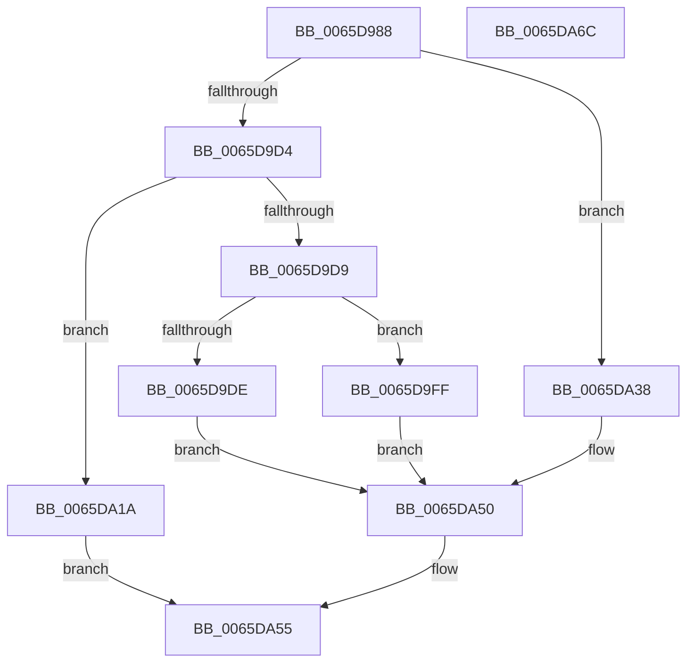

# WheaSelLogErrorPkt

- RVA: `0x0065D988`–`0x0065DA6D` (길이 `229` bytes)
- VA: `0x000000014065D988`
- 실행 섹션: `.text`
- PDB 이름 있음: `예`; PDB Function 태그: `아니요`
- unwind 정보 RVA: `0x000CBCE8`
- 디코드: `65`개 명령, `229/229` bytes 표시
- 미해석 바이트: `0` (있으면 어셈블리에 `.byte`로 보존)

> 이 문서는 커널 이미지의 기계어와 PDB 기호를 분석해 생성했습니다. 4번과 5번은 함수 원형과 자료형을 바이너리 사용 방식에서 추정한 C 해석이며 원본 소스 복구 결과는 아닙니다.

## 1. Dependencies

- 직접 호출 지점: **2**; 고유 호출 대상: **2**
- 직접 호출자로 확인된 함수: **1**
- RIP 상대 이미지 참조: **1**

### Outgoing calls
- `0x0065DA55` → [WheapLogIpmiSELEvent](../66/WheapLogIpmiSELEvent_function_00660910.md) (function, `0x00660910`)
- `0x0065DA61` → [_security_check_cookie](../6A/_security_check_cookie_function_006AC640.md) (function, `0x006AC640`)

### Direct callers
- [WheaSelLogEvent](WheaSelLogEvent_function_0065DA74.md) at `0x0065DB04`

### Static image references
- `0x0065D991` → RVA `0x00E0A740` (`.data`; read)

## 2. Other-region calls and transfers

- 다른 실행 섹션으로 향하는 call: **0**
- 별도 외부 분기/꼬리 이동을 확인하지 못했습니다.

## 3. Assembly (complete function range)

```asm
0065D988  40 55                           push rbp
0065D98A  48 8B EC                        mov rbp, rsp
0065D98D  48 83 EC 70                     sub rsp, 0x70
0065D991  48 8B 05 A8 CD 7A 00            mov rax, qword ptr [rip + 0x7acda8]
0065D998  48 33 C4                        xor rax, rsp
0065D99B  48 89 45 F8                     mov qword ptr [rbp - 8], rax
0065D99F  4C 8B 49 20                     mov r9, qword ptr [rcx + 0x20]
0065D9A3  33 C0                           xor eax, eax
0065D9A5  0F 57 C0                        xorps xmm0, xmm0
0065D9A8  48 89 45 B0                     mov qword ptr [rbp - 0x50], rax
0065D9AC  89 45 B8                        mov dword ptr [rbp - 0x48], eax
0065D9AF  48 89 45 C0                     mov qword ptr [rbp - 0x40], rax
0065D9B3  41 8B 51 40                     mov edx, dword ptr [r9 + 0x40]
0065D9B7  41 8B 49 38                     mov ecx, dword ptr [r9 + 0x38]
0065D9BB  49 03 D1                        add rdx, r9
0065D9BE  89 45 C8                        mov dword ptr [rbp - 0x38], eax
0065D9C1  89 45 F0                        mov dword ptr [rbp - 0x10], eax
0065D9C4  48 89 45 D0                     mov qword ptr [rbp - 0x30], rax
0065D9C8  89 45 D8                        mov dword ptr [rbp - 0x28], eax
0065D9CB  0F 11 45 E0                     movups xmmword ptr [rbp - 0x20], xmm0
0065D9CF  83 E9 01                        sub ecx, 1
0065D9D2  74 64                           je 0x14065da38
0065D9D4  83 E9 02                        sub ecx, 2
0065D9D7  74 41                           je 0x14065da1a
0065D9D9  83 F9 01                        cmp ecx, 1
0065D9DC  74 21                           je 0x14065d9ff
0065D9DE  41 8B 41 1C                     mov eax, dword ptr [r9 + 0x1c]
0065D9E2  48 8D 4D B0                     lea rcx, [rbp - 0x50]
0065D9E6  89 45 B0                        mov dword ptr [rbp - 0x50], eax
0065D9E9  41 B8 05 00 00 00               mov r8d, 5
0065D9EF  41 8B 41 14                     mov eax, dword ptr [r9 + 0x14]
0065D9F3  89 45 B4                        mov dword ptr [rbp - 0x4c], eax
0065D9F6  41 8B 41 0C                     mov eax, dword ptr [r9 + 0xc]
0065D9FA  89 45 B8                        mov dword ptr [rbp - 0x48], eax
0065D9FD  EB 51                           jmp 0x14065da50
0065D9FF  F2 0F 10 02                     movsd xmm0, qword ptr [rdx]
0065DA03  48 8D 4D C0                     lea rcx, [rbp - 0x40]
0065DA07  8B 42 08                        mov eax, dword ptr [rdx + 8]
0065DA0A  41 B8 04 00 00 00               mov r8d, 4
0065DA10  F2 0F 11 45 C0                  movsd qword ptr [rbp - 0x40], xmm0
0065DA15  89 45 C8                        mov dword ptr [rbp - 0x38], eax
0065DA18  EB 36                           jmp 0x14065da50
0065DA1A  0F 10 42 18                     movups xmm0, xmmword ptr [rdx + 0x18]
0065DA1E  8B 42 08                        mov eax, dword ptr [rdx + 8]
0065DA21  48 8D 4D E0                     lea rcx, [rbp - 0x20]
0065DA25  BA 14 00 00 00                  mov edx, 0x14
0065DA2A  89 45 F0                        mov dword ptr [rbp - 0x10], eax
0065DA2D  F3 0F 7F 45 E0                  movdqu xmmword ptr [rbp - 0x20], xmm0
0065DA32  44 8D 42 EF                     lea r8d, [rdx - 0x11]
0065DA36  EB 1D                           jmp 0x14065da55
0065DA38  48 8B 42 28                     mov rax, qword ptr [rdx + 0x28]
0065DA3C  48 8D 4D D0                     lea rcx, [rbp - 0x30]
0065DA40  48 89 45 D0                     mov qword ptr [rbp - 0x30], rax
0065DA44  41 B8 02 00 00 00               mov r8d, 2
0065DA4A  8B 42 24                        mov eax, dword ptr [rdx + 0x24]
0065DA4D  89 45 D8                        mov dword ptr [rbp - 0x28], eax
0065DA50  BA 0C 00 00 00                  mov edx, 0xc
0065DA55  E8 B6 2E 00 00                  call 0x140660910
0065DA5A  48 8B 4D F8                     mov rcx, qword ptr [rbp - 8]
0065DA5E  48 33 CC                        xor rcx, rsp
0065DA61  E8 DA EB 04 00                  call 0x1406ac640
0065DA66  48 83 C4 70                     add rsp, 0x70
0065DA6A  5D                              pop rbp
0065DA6B  C3                              ret
0065DA6C  CC                              int3
```

## 4. C-style interpretation (structured pseudocode)

```c
__int64 __fastcall WheaSelLogErrorPkt(__int64 a1)
{
    __int64 result;
    __int64 v_rsp;
    unsigned __int64 v_stack_m10;
    unsigned int v_stack_m18;
    unsigned __int64 v_stack_m28;
    unsigned int v_stack_m30;
    unsigned __int64 v_stack_m38;
    unsigned int v_stack_m40;
    unsigned __int64 v_stack_m48;
    unsigned int v_stack_m50;
    unsigned int v_stack_m54;
    unsigned __int64 v_stack_m58;

    v_rsp = (v_rsp) - (112);
    result = (*(unsigned __int64 *)(v_rip + 8048040)) ^ (v_rsp);
    v_stack_m10 = result;
    result = 0;
    v_stack_m58 = 0;
    v_stack_m50 = 0;
    v_stack_m48 = 0;
    a2 = ((unsigned int)(*(unsigned int *)(*(unsigned __int64 *)(a1 + 32) + 64))) + (*(unsigned __int64 *)(a1 + 32));
    v_stack_m40 = 0;
    v_stack_m18 = 0;
    v_stack_m38 = 0;
    v_stack_m30 = 0;
    v_stack_m28 = v_xmm0;
    a1 = (unsigned int)(((unsigned int)(*(unsigned int *)(*(unsigned __int64 *)(a1 + 32) + 56))) - (1));
    if (condition_is_equal) goto loc_0065DA38;
    a1 = (unsigned int)((a1) - (2));
    if (condition_is_equal) goto loc_0065DA1A;
    if (((unsigned int)(a1)) == 1) goto loc_0065D9FF;
    v_stack_m58 = (unsigned int)((unsigned int)(*(unsigned int *)(*(unsigned __int64 *)(a1 + 32) + 28)));
    v_stack_m54 = (unsigned int)((unsigned int)(*(unsigned int *)(*(unsigned __int64 *)(a1 + 32) + 20)));
    v_stack_m50 = (unsigned int)((unsigned int)(*(unsigned int *)(*(unsigned __int64 *)(a1 + 32) + 12)));
    goto loc_0065DA50;
loc_0065D9FF:
    v_stack_m48 = v_xmm0;
    v_stack_m40 = (unsigned int)((unsigned int)(*(unsigned int *)(a2 + 8)));
    goto loc_0065DA50;
loc_0065DA1A:
    v_stack_m18 = (unsigned int)((unsigned int)(*(unsigned int *)(a2 + 8)));
    v_stack_m28 = v_xmm0;
    goto loc_0065DA55;
loc_0065DA38:
    v_stack_m38 = *(unsigned __int64 *)(20 + 40);
    v_stack_m30 = (unsigned int)((unsigned int)(*(unsigned int *)(20 + 36)));
loc_0065DA50:
loc_0065DA55:
    result = WheapLogIpmiSELEvent(v_stack_m38, 12, 2, *(unsigned __int64 *)(a1 + 32));
    a1 = (v_stack_m10) ^ (v_rsp);
    result = _security_check_cookie(a1, 12, 2, *(unsigned __int64 *)(a1 + 32));
    v_rsp = (v_rsp) + (112);
    return result;
}
```

## 5. (Beta) C Style

```c
int64_t WheaSelLogErrorPkt(void *Arg1)
{
    uint8_t *arg1 = (uint8_t *)Arg1;

    int64_t result;
    int64_t local_rsp;
    uint64_t v_stack_m10;
    uint32_t v_stack_m18;
    uint64_t v_stack_m28;
    uint32_t v_stack_m30;
    uint64_t v_stack_m38;
    uint32_t v_stack_m40;
    uint64_t v_stack_m48;
    uint32_t v_stack_m50;
    uint32_t v_stack_m54;
    uint64_t v_stack_m58;

    local_rsp = (local_rsp) - (112);
    result = (*(uint64_t *)(v_rip + 0x7ACDA8)) ^ (local_rsp);
    v_stack_m10 = result;
    result = 0;
    v_stack_m58 = 0;
    v_stack_m50 = 0;
    v_stack_m48 = 0;
    a2 = ((uint32_t)(*(uint32_t *)(*(uint64_t *)(arg1 + 0x20) + 0x40))) + (*(uint64_t *)(arg1 + 0x20));
    v_stack_m40 = 0;
    v_stack_m18 = 0;
    v_stack_m38 = 0;
    v_stack_m30 = 0;
    v_stack_m28 = v_xmm0;
    Arg1 = (uint32_t)(((uint32_t)(*(uint32_t *)(*(uint64_t *)(arg1 + 0x20) + 0x38))) - (1));
    if (condition_is_equal) goto loc_0065DA38;
    Arg1 = (uint32_t)((Arg1) - (2));
    if (condition_is_equal) goto loc_0065DA1A;
    if (((uint32_t)(Arg1)) == 1) goto loc_0065D9FF;
    v_stack_m58 = (uint32_t)((uint32_t)(*(uint32_t *)(*(uint64_t *)(arg1 + 0x20) + 0x1C)));
    v_stack_m54 = (uint32_t)((uint32_t)(*(uint32_t *)(*(uint64_t *)(arg1 + 0x20) + 0x14)));
    v_stack_m50 = (uint32_t)((uint32_t)(*(uint32_t *)(*(uint64_t *)(arg1 + 0x20) + 0xC)));
    goto loc_0065DA50;
loc_0065D9FF:
    v_stack_m48 = v_xmm0;
    v_stack_m40 = (uint32_t)((uint32_t)(*(uint32_t *)(a2 + 0x8)));
    goto loc_0065DA50;
loc_0065DA1A:
    v_stack_m18 = (uint32_t)((uint32_t)(*(uint32_t *)(a2 + 0x8)));
    v_stack_m28 = v_xmm0;
    goto loc_0065DA55;
loc_0065DA38:
    v_stack_m38 = *(uint64_t *)(20 + 0x28);
    v_stack_m30 = (uint32_t)((uint32_t)(*(uint32_t *)(20 + 0x24)));
loc_0065DA50:
loc_0065DA55:
    result = WheapLogIpmiSELEvent(v_stack_m38, 12, 2, *(uint64_t *)(arg1 + 0x20));
    Arg1 = (v_stack_m10) ^ (local_rsp);
    result = _security_check_cookie(Arg1, 12, 2, *(uint64_t *)(arg1 + 0x20));
    local_rsp = (local_rsp) + (112);
    return result;
}
```

### 관측된 메모리 오프셋

구조체 형식이 확인되지 않은 접근은 인자 기준의 오프셋으로만 기록했습니다.

| 기준 인자 | 오프셋 표현 | 폭 (bit) | 접근 |
|---|---:|---:|---|
| `Arg1` | `+ 0x20` | `64` | `R` |

## 6. Execution-region graph

[열기: 2D/3D 그래프와 함수 탐색 컨트롤 패널](../../../control-panel.html?section=text&rva=0x0065D988&view=graph)

- 2D 그래프는 위에서 아래로 흐르고, 3D 그래프는 빈 공간을 드래그해 회전합니다. Shift+드래그는 이동, 휠은 확대·축소, 함수 노드 선택은 대상 보고서 이동입니다.

### Static fallback


