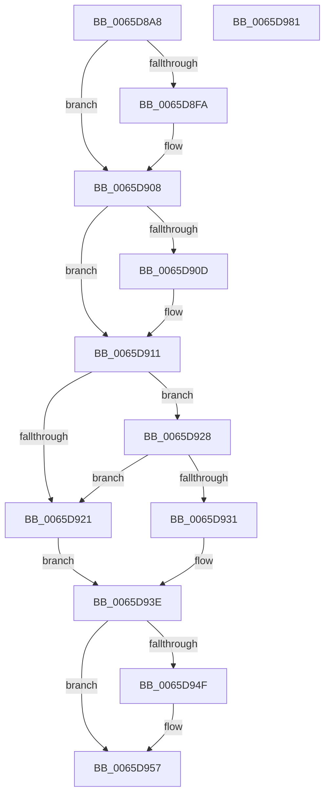

# WheaSelLogError

- RVA: `0x0065D8A8`–`0x0065D982` (길이 `218` bytes)
- VA: `0x000000014065D8A8`
- 실행 섹션: `.text`
- PDB 이름 있음: `예`; PDB Function 태그: `아니요`
- unwind 정보 RVA: `0x0005D7BC`
- 디코드: `58`개 명령, `218/218` bytes 표시
- 미해석 바이트: `0` (있으면 어셈블리에 `.byte`로 보존)

> 이 문서는 커널 이미지의 기계어와 PDB 기호를 분석해 생성했습니다. 4번과 5번은 함수 원형과 자료형을 바이너리 사용 방식에서 추정한 C 해석이며 원본 소스 복구 결과는 아닙니다.

## 1. Dependencies

- 직접 호출 지점: **7**; 고유 호출 대상: **7**
- 직접 호출자로 확인된 함수: **1**
- RIP 상대 이미지 참조: **4**

### Outgoing calls
- `0x0065D8EA` → [KeAbPreAcquire](../21/KeAbPreAcquire_function_00210230.md) (function, `0x00210230`)
- `0x0065D903` → [ExfAcquirePushLockExclusiveEx](../20/ExfAcquirePushLockExclusiveEx_function_0020FC90.md) (function, `0x0020FC90`)
- `0x0065D918` → [IpmiHwContextInitialized](../6A/IpmiHwContextInitialized_function_006A64DC.md) (function, `0x006A64DC`)
- `0x0065D937` → [IpmiLibAddSelErrorRecord](../6A/IpmiLibAddSelErrorRecord_function_006A6BEC.md) (function, `0x006A6BEC`)
- `0x0065D952` → [ExfTryToWakePushLock](../26/ExfTryToWakePushLock_function_00265DD0.md) (function, `0x00265DD0`)
- `0x0065D95A` → [KeAbPostRelease](../2E/KeAbPostRelease_function_002E1600.md) (function, `0x002E1600`)
- `0x0065D95F` → [KeLeaveCriticalRegion](../25/KeLeaveCriticalRegion_function_0025D8B0.md) (function, `0x0025D8B0`)

### Direct callers
- [IopWheaSelLogError](../59/IopWheaSelLogError_function_00596760.md) at `0x0059678C`

### Static image references
- `0x0065D8CA` → RVA `0x00EFA0F0` (`.data`; read)
- `0x0065D911` → RVA `0x00EFA080` (`.data`; read)
- `0x0065D928` → RVA `0x00EFA0F8` (`.data`; read)
- `0x0065D93E` → RVA `0x00EFA0F0` (`.data`; read/write)

## 2. Other-region calls and transfers

- 다른 실행 섹션으로 향하는 call: **0**
- 별도 외부 분기/꼬리 이동을 확인하지 못했습니다.

## 3. Assembly (complete function range)

```asm
0065D8A8  48 8B C4                        mov rax, rsp
0065D8AB  48 89 58 08                     mov qword ptr [rax + 8], rbx
0065D8AF  48 89 68 10                     mov qword ptr [rax + 0x10], rbp
0065D8B3  48 89 70 18                     mov qword ptr [rax + 0x18], rsi
0065D8B7  48 89 78 20                     mov qword ptr [rax + 0x20], rdi
0065D8BB  41 56                           push r14
0065D8BD  48 83 EC 30                     sub rsp, 0x30
0065D8C1  65 48 8B 04 25 88 01 00 00      mov rax, qword ptr gs:[0x188]
0065D8CA  4C 8D 35 1F C8 89 00            lea r14, [rip + 0x89c81f]
0065D8D1  49 8B F0                        mov rsi, r8
0065D8D4  8B EA                           mov ebp, edx
0065D8D6  48 83 CB FF                     or rbx, 0xffffffffffffffff
0065D8DA  45 33 C0                        xor r8d, r8d
0065D8DD  33 D2                           xor edx, edx
0065D8DF  49 8B CE                        mov rcx, r14
0065D8E2  66 01 98 E4 01 00 00            add word ptr [rax + 0x1e4], bx
0065D8E9  90                              nop
0065D8EA  E8 41 29 BB FF                  call 0x140210230
0065D8EF  F0 49 0F BA 2E 00               lock bts qword ptr [r14], 0
0065D8F5  48 8B F8                        mov rdi, rax
0065D8F8  73 0E                           jae 0x14065d908
0065D8FA  4D 8B C6                        mov r8, r14
0065D8FD  48 8B D0                        mov rdx, rax
0065D900  49 8B CE                        mov rcx, r14
0065D903  E8 88 23 BB FF                  call 0x14020fc90
0065D908  48 85 FF                        test rdi, rdi
0065D90B  74 04                           je 0x14065d911
0065D90D  C6 47 0A 01                     mov byte ptr [rdi + 0xa], 1
0065D911  48 8D 0D 68 C7 89 00            lea rcx, [rip + 0x89c768]
0065D918  E8 BF 8B 04 00                  call 0x1406a64dc
0065D91D  84 C0                           test al, al
0065D91F  75 07                           jne 0x14065d928
0065D921  BF 01 00 00 C0                  mov edi, 0xc0000001
0065D926  EB 16                           jmp 0x14065d93e
0065D928  80 3D C9 C7 89 00 00            cmp byte ptr [rip + 0x89c7c9], 0
0065D92F  75 F0                           jne 0x14065d921
0065D931  4C 8B CE                        mov r9, rsi
0065D934  44 8B C5                        mov r8d, ebp
0065D937  E8 B0 92 04 00                  call 0x1406a6bec
0065D93C  8B F8                           mov edi, eax
0065D93E  F0 48 0F C1 1D A9 C7 89 00      lock xadd qword ptr [rip + 0x89c7a9], rbx
0065D947  80 E3 06                        and bl, 6
0065D94A  80 FB 02                        cmp bl, 2
0065D94D  75 08                           jne 0x14065d957
0065D94F  49 8B CE                        mov rcx, r14
0065D952  E8 79 84 C0 FF                  call 0x140265dd0
0065D957  49 8B CE                        mov rcx, r14
0065D95A  E8 A1 3C C8 FF                  call 0x1402e1600
0065D95F  E8 4C FF BF FF                  call 0x14025d8b0
0065D964  48 8B 5C 24 40                  mov rbx, qword ptr [rsp + 0x40]
0065D969  8B C7                           mov eax, edi
0065D96B  48 8B 7C 24 58                  mov rdi, qword ptr [rsp + 0x58]
0065D970  48 8B 6C 24 48                  mov rbp, qword ptr [rsp + 0x48]
0065D975  48 8B 74 24 50                  mov rsi, qword ptr [rsp + 0x50]
0065D97A  48 83 C4 30                     add rsp, 0x30
0065D97E  41 5E                           pop r14
0065D980  C3                              ret
0065D981  CC                              int3
```

## 4. C-style interpretation (structured pseudocode)

```c
__int64 __fastcall WheaSelLogError(__int64 a1, int a2, __int64 a3)
{
    __int64 result;
    __int64 v_rbx;
    __int64 v_rsp;
    unsigned __int64 v_stack_p10;
    unsigned __int64 v_stack_p18;
    unsigned __int64 v_stack_p20;
    unsigned __int64 v_stack_p8;

    *(unsigned __int64 *)(v_rsp + 8) = v_rbx;
    *(unsigned __int64 *)(v_rsp + 16) = v_rbp;
    *(unsigned __int64 *)(v_rsp + 24) = v_rsi;
    *(unsigned __int64 *)(v_rsp + 32) = v_rdi;
    v_rsp = (v_rsp) - (48);
    v_rbx = (v_rbx) | (-1);
    a3 = 0;
    a2 = 0;
    result = KeAbPreAcquire(v_rip + 9029663, a2, a3, a4);
    if (!(condition_is_above_or_equal)) {
        a3 = v_rip + 9029663;
        a2 = result;
        a1 = v_rip + 9029663;
        result = ExfAcquirePushLockExclusiveEx(a1, a2, a3, a4);
    }
    if (result != 0) {
        *(unsigned __int8 *)(result + 10) = 1;
    }
    result = IpmiHwContextInitialized(v_rip + 9029480, a2, a3, a4);
    if ((unsigned __int8)(result) != 0) goto loc_0065D928;
loc_0065D921:
    goto loc_0065D93E;
loc_0065D928:
    if ((*(unsigned __int8 *)(v_rip + 9029577)) != 0) goto loc_0065D921;
    result = IpmiLibAddSelErrorRecord(v_rip + 9029480, a2, (unsigned int)((unsigned int)((unsigned int)(a2))), a3);
loc_0065D93E:
    v_rbx = (unsigned __int8)((v_rbx) & (6));
    if (((unsigned __int8)(v_rbx)) == 2) {
        a1 = v_rip + 9029663;
        result = ExfTryToWakePushLock(a1, a2, (unsigned int)((unsigned int)((unsigned int)(a2))), a3);
    }
    result = KeAbPostRelease(v_rip + 9029663, a2, (unsigned int)((unsigned int)((unsigned int)(a2))), a3);
    result = KeLeaveCriticalRegion(v_rip + 9029663, a2, (unsigned int)((unsigned int)((unsigned int)(a2))), a3);
    v_rsp = (v_rsp) + (48);
    return (unsigned int)((unsigned int)((unsigned int)((unsigned int)(result))));
}
```

## 5. (Beta) C Style

```c
int64_t WheaSelLogError(int64_t Arg1, int32_t Arg2, int64_t Arg3)
{
    int64_t result;
    int64_t local_rbx;
    int64_t local_rsp;
    uint64_t v_stack_p10;
    uint64_t v_stack_p18;
    uint64_t v_stack_p20;
    uint64_t v_stack_p8;

    *(uint64_t *)(local_rsp + 0x8) = local_rbx;
    *(uint64_t *)(local_rsp + 0x10) = local_rbp;
    *(uint64_t *)(local_rsp + 0x18) = local_rsi;
    *(uint64_t *)(local_rsp + 0x20) = local_rdi;
    local_rsp = (local_rsp) - (48);
    local_rbx = (local_rbx) | (-1);
    Arg3 = 0;
    Arg2 = 0;
    result = KeAbPreAcquire(v_rip + 9029663, Arg2, Arg3, a4);
    if (!(condition_is_above_or_equal)) {
        Arg3 = v_rip + 9029663;
        Arg2 = result;
        Arg1 = v_rip + 9029663;
        result = ExfAcquirePushLockExclusiveEx(Arg1, Arg2, Arg3, a4);
    }
    if (result != 0) {
        *(uint8_t *)(result + 0xA) = 1;
    }
    result = IpmiHwContextInitialized(v_rip + 9029480, Arg2, Arg3, a4);
    if ((uint8_t)(result) != 0) goto loc_0065D928;
loc_0065D921:
    goto loc_0065D93E;
loc_0065D928:
    if ((*(uint8_t *)(v_rip + 0x89C7C9)) != 0) goto loc_0065D921;
    result = IpmiLibAddSelErrorRecord(v_rip + 9029480, Arg2, (uint32_t)((uint32_t)((uint32_t)(Arg2))), Arg3);
loc_0065D93E:
    local_rbx = (uint8_t)((local_rbx) & (6));
    if (((uint8_t)(local_rbx)) == 2) {
        Arg1 = v_rip + 9029663;
        result = ExfTryToWakePushLock(Arg1, Arg2, (uint32_t)((uint32_t)((uint32_t)(Arg2))), Arg3);
    }
    result = KeAbPostRelease(v_rip + 9029663, Arg2, (uint32_t)((uint32_t)((uint32_t)(Arg2))), Arg3);
    result = KeLeaveCriticalRegion(v_rip + 9029663, Arg2, (uint32_t)((uint32_t)((uint32_t)(Arg2))), Arg3);
    local_rsp = (local_rsp) + (48);
    return (uint32_t)((uint32_t)((uint32_t)((uint32_t)(result))));
}
```

## 6. Execution-region graph

[열기: 2D/3D 그래프와 함수 탐색 컨트롤 패널](../../../control-panel.html?section=text&rva=0x0065D8A8&view=graph)

- 2D 그래프는 위에서 아래로 흐르고, 3D 그래프는 빈 공간을 드래그해 회전합니다. Shift+드래그는 이동, 휠은 확대·축소, 함수 노드 선택은 대상 보고서 이동입니다.

### Static fallback


