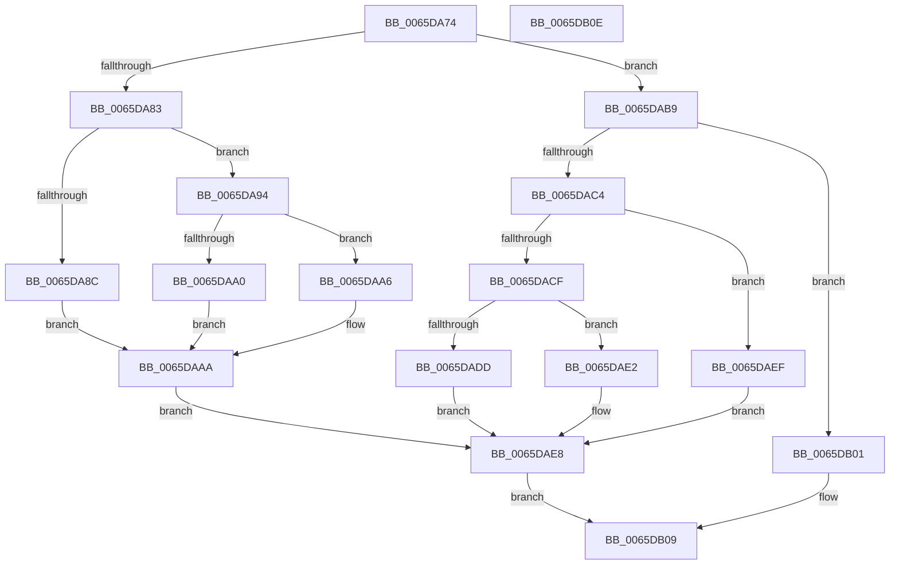

# WheaSelLogEvent

- RVA: `0x0065DA74`–`0x0065DB0F` (길이 `155` bytes)
- VA: `0x000000014065DA74`
- 실행 섹션: `.text`
- PDB 이름 있음: `예`; PDB Function 태그: `아니요`
- unwind 정보 RVA: `0x0005C788`
- 디코드: `46`개 명령, `155/155` bytes 표시
- 미해석 바이트: `0` (있으면 어셈블리에 `.byte`로 보존)

> 이 문서는 커널 이미지의 기계어와 PDB 기호를 분석해 생성했습니다. 4번과 5번은 함수 원형과 자료형을 바이너리 사용 방식에서 추정한 C 해석이며 원본 소스 복구 결과는 아닙니다.

## 1. Dependencies

- 직접 호출 지점: **2**; 고유 호출 대상: **2**
- 직접 호출자로 확인된 함수: **1**
- RIP 상대 이미지 참조: **0**

### Outgoing calls
- `0x0065DAE8` → [WheapLogIpmiSELEvent](../66/WheapLogIpmiSELEvent_function_00660910.md) (function, `0x00660910`)
- `0x0065DB04` → [WheaSelLogErrorPkt](WheaSelLogErrorPkt_function_0065D988.md) (function, `0x0065D988`)

### Direct callers
- [WheaLogInternalEvent](../66/WheaLogInternalEvent_function_006605B0.md) at `0x00660631`

### Static image references
- 디코드된 RIP-relative 메모리 참조가 없습니다.

## 2. Other-region calls and transfers

- 다른 실행 섹션으로 향하는 call: **0**
- 별도 외부 분기/꼬리 이동을 확인하지 못했습니다.

## 3. Assembly (complete function range)

```asm
0065DA74  48 83 EC 28                     sub rsp, 0x28
0065DA78  8B 51 18                        mov edx, dword ptr [rcx + 0x18]
0065DA7B  48 8B C1                        mov rax, rcx
0065DA7E  F6 C2 10                        test dl, 0x10
0065DA81  74 36                           je 0x14065dab9
0065DA83  48 83 C1 10                     add rcx, 0x10
0065DA87  F6 C2 20                        test dl, 0x20
0065DA8A  74 08                           je 0x14065da94
0065DA8C  41 B8 06 00 00 00               mov r8d, 6
0065DA92  EB 16                           jmp 0x14065daaa
0065DA94  44 8B 01                        mov r8d, dword ptr [rcx]
0065DA97  41 C1 E0 10                     shl r8d, 0x10
0065DA9B  F6 C2 40                        test dl, 0x40
0065DA9E  74 06                           je 0x14065daa6
0065DAA0  41 83 C8 07                     or r8d, 7
0065DAA4  EB 04                           jmp 0x14065daaa
0065DAA6  41 83 C8 01                     or r8d, 1
0065DAAA  8B 50 1C                        mov edx, dword ptr [rax + 0x1c]
0065DAAD  C7 01 4B 52 4E 4C               mov dword ptr [rcx], 0x4c4e524b
0065DAB3  48 8D 48 20                     lea rcx, [rax + 0x20]
0065DAB7  EB 2F                           jmp 0x14065dae8
0065DAB9  8B 49 14                        mov ecx, dword ptr [rcx + 0x14]
0065DABC  81 F9 05 00 00 80               cmp ecx, 0x80000005
0065DAC2  74 3D                           je 0x14065db01
0065DAC4  8B 50 1C                        mov edx, dword ptr [rax + 0x1c]
0065DAC7  81 F9 2A 00 00 80               cmp ecx, 0x8000002a
0065DACD  74 20                           je 0x14065daef
0065DACF  83 C2 20                        add edx, 0x20
0065DAD2  81 F9 2F 00 00 80               cmp ecx, 0x8000002f
0065DAD8  48 8B C8                        mov rcx, rax
0065DADB  74 05                           je 0x14065dae2
0065DADD  45 33 C0                        xor r8d, r8d
0065DAE0  EB 06                           jmp 0x14065dae8
0065DAE2  41 B8 09 00 00 00               mov r8d, 9
0065DAE8  E8 23 2E 00 00                  call 0x140660910
0065DAED  EB 1A                           jmp 0x14065db09
0065DAEF  44 8B 40 10                     mov r8d, dword ptr [rax + 0x10]
0065DAF3  48 8D 48 20                     lea rcx, [rax + 0x20]
0065DAF7  41 C1 E0 10                     shl r8d, 0x10
0065DAFB  41 83 C8 08                     or r8d, 8
0065DAFF  EB E7                           jmp 0x14065dae8
0065DB01  48 8B C8                        mov rcx, rax
0065DB04  E8 7F FE FF FF                  call 0x14065d988
0065DB09  48 83 C4 28                     add rsp, 0x28
0065DB0D  C3                              ret
0065DB0E  CC                              int3
```

## 4. C-style interpretation (structured pseudocode)

```c
__int64 __fastcall WheaSelLogEvent(__int64 a1)
{
    __int64 result;
    __int64 v_rsp;

    v_rsp = (v_rsp) - (40);
    if ((((unsigned __int8)((unsigned int)(*(unsigned int *)(a1 + 24)))) & (16)) == 0) goto loc_0065DAB9;
    a1 = (a1) + (16);
    if ((((unsigned __int8)((unsigned int)(*(unsigned int *)(a1 + 24)))) & (32)) == 0) goto loc_0065DA94;
    goto loc_0065DAAA;
loc_0065DA94:
    a3 = (unsigned int)(((unsigned int)(*(unsigned int *)(a1))) << (16));
    if ((((unsigned __int8)((unsigned int)(*(unsigned int *)(a1 + 24)))) & (64)) == 0) goto loc_0065DAA6;
    a3 = (unsigned int)((a3) | (7));
    goto loc_0065DAAA;
loc_0065DAA6:
    a3 = (unsigned int)((a3) | (1));
loc_0065DAAA:
    *(unsigned int *)(a1) = 0x4C4E524BULL;
    goto loc_0065DAE8;
loc_0065DAB9:
    if (((unsigned int)((unsigned int)(*(unsigned int *)(a1 + 32 + 20)))) == 0x80000005ULL) goto loc_0065DB01;
    if (((unsigned int)((unsigned int)(*(unsigned int *)(a1 + 32 + 20)))) == 0x8000002AULL) goto loc_0065DAEF;
    a2 = (unsigned int)(((unsigned int)(*(unsigned int *)(a1 + 28))) + (32));
    if (((unsigned int)((unsigned int)(*(unsigned int *)(a1 + 32 + 20)))) == 0x8000002FULL) goto loc_0065DAE2;
    a3 = 0;
    goto loc_0065DAE8;
loc_0065DAE2:
loc_0065DAE8:
    result = WheapLogIpmiSELEvent(a1, a2, 9, a4);
    goto loc_0065DB09;
loc_0065DAEF:
    a3 = (unsigned int)(((unsigned int)(*(unsigned int *)(result + 16))) << (16));
    a3 = (unsigned int)((a3) | (8));
    goto loc_0065DAE8;
loc_0065DB01:
    result = WheaSelLogErrorPkt(result, a2, a3, a4);
loc_0065DB09:
    v_rsp = (v_rsp) + (40);
    return result;
}
```

## 5. (Beta) C Style

```c
int64_t WheaSelLogEvent(void *Arg1)
{
    uint8_t *arg1 = (uint8_t *)Arg1;

    int64_t result;
    int64_t local_rsp;

    local_rsp = (local_rsp) - (40);
    if ((((uint8_t)((uint32_t)(*(uint32_t *)(arg1 + 0x18)))) & (16)) == 0) goto loc_0065DAB9;
    Arg1 = (Arg1) + (16);
    if ((((uint8_t)((uint32_t)(*(uint32_t *)(arg1 + 0x18)))) & (32)) == 0) goto loc_0065DA94;
    goto loc_0065DAAA;
loc_0065DA94:
    a3 = (uint32_t)(((uint32_t)(*(uint32_t *)(arg1))) << (16));
    if ((((uint8_t)((uint32_t)(*(uint32_t *)(arg1 + 0x18)))) & (64)) == 0) goto loc_0065DAA6;
    a3 = (uint32_t)((a3) | (7));
    goto loc_0065DAAA;
loc_0065DAA6:
    a3 = (uint32_t)((a3) | (1));
loc_0065DAAA:
    *(uint32_t *)(arg1) = 0x4C4E524BULL;
    goto loc_0065DAE8;
loc_0065DAB9:
    if (((uint32_t)((uint32_t)(*(uint32_t *)(arg1 + 0x20 + 0x14)))) == 0x80000005ULL) goto loc_0065DB01;
    if (((uint32_t)((uint32_t)(*(uint32_t *)(arg1 + 0x20 + 0x14)))) == 0x8000002AULL) goto loc_0065DAEF;
    a2 = (uint32_t)(((uint32_t)(*(uint32_t *)(arg1 + 0x1C))) + (32));
    if (((uint32_t)((uint32_t)(*(uint32_t *)(arg1 + 0x20 + 0x14)))) == 0x8000002FULL) goto loc_0065DAE2;
    a3 = 0;
    goto loc_0065DAE8;
loc_0065DAE2:
loc_0065DAE8:
    result = WheapLogIpmiSELEvent(Arg1, a2, 9, a4);
    goto loc_0065DB09;
loc_0065DAEF:
    a3 = (uint32_t)(((uint32_t)(*(uint32_t *)(result + 0x10))) << (16));
    a3 = (uint32_t)((a3) | (8));
    goto loc_0065DAE8;
loc_0065DB01:
    result = WheaSelLogErrorPkt(result, a2, a3, a4);
loc_0065DB09:
    local_rsp = (local_rsp) + (40);
    return result;
}
```

### 관측된 메모리 오프셋

구조체 형식이 확인되지 않은 접근은 인자 기준의 오프셋으로만 기록했습니다.

| 기준 인자 | 오프셋 표현 | 폭 (bit) | 접근 |
|---|---:|---:|---|
| `Arg1` | `+ 0x0` | `32` | `R` |
| `Arg1` | `+ 0x0` | `32` | `W` |
| `Arg1` | `+ 0x10` | `32` | `R` |
| `Arg1` | `+ 0x14` | `32` | `R` |
| `Arg1` | `+ 0x18` | `32` | `R` |
| `Arg1` | `+ 0x1C` | `32` | `R` |
| `Arg1` | `+ 0x20` | `64` | `R` |

## 6. Execution-region graph

[열기: 2D/3D 그래프와 함수 탐색 컨트롤 패널](../../../control-panel.html?section=text&rva=0x0065DA74&view=graph)

- 2D 그래프는 위에서 아래로 흐르고, 3D 그래프는 빈 공간을 드래그해 회전합니다. Shift+드래그는 이동, 휠은 확대·축소, 함수 노드 선택은 대상 보고서 이동입니다.

### Static fallback


