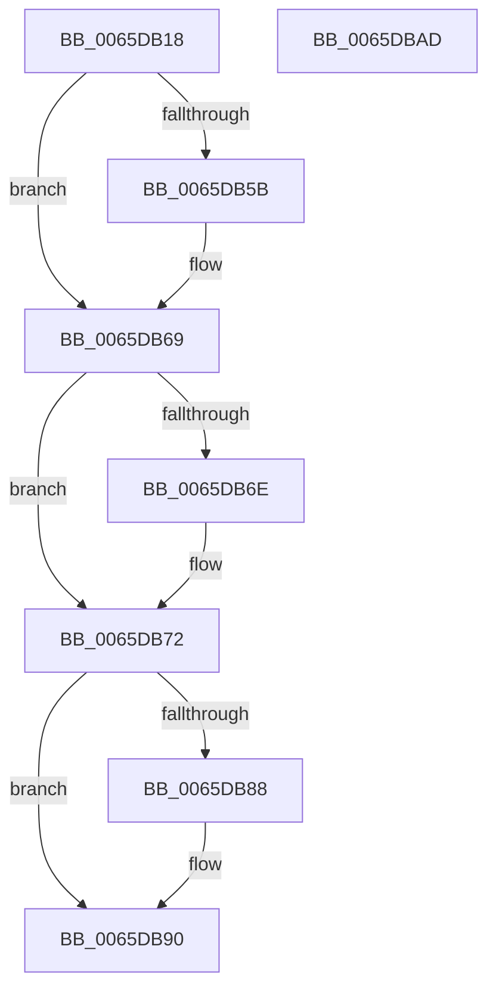

# WheaSelLogSetNtSchedulerAvailability

- RVA: `0x0065DB18`–`0x0065DBAE` (길이 `150` bytes)
- VA: `0x000000014065DB18`
- 실행 섹션: `.text`
- PDB 이름 있음: `예`; PDB Function 태그: `아니요`
- unwind 정보 RVA: `0x00060BC4`
- 디코드: `39`개 명령, `150/150` bytes 표시
- 미해석 바이트: `0` (있으면 어셈블리에 `.byte`로 보존)

> 이 문서는 커널 이미지의 기계어와 PDB 기호를 분석해 생성했습니다. 4번과 5번은 함수 원형과 자료형을 바이너리 사용 방식에서 추정한 C 해석이며 원본 소스 복구 결과는 아닙니다.

## 1. Dependencies

- 직접 호출 지점: **6**; 고유 호출 대상: **6**
- 직접 호출자로 확인된 함수: **1**
- RIP 상대 이미지 참조: **2**

### Outgoing calls
- `0x0065DB4B` → [KeAbPreAcquire](../21/KeAbPreAcquire_function_00210230.md) (function, `0x00210230`)
- `0x0065DB64` → [ExfAcquirePushLockExclusiveEx](../20/ExfAcquirePushLockExclusiveEx_function_0020FC90.md) (function, `0x0020FC90`)
- `0x0065DB72` → [WheapSelLogSetNtSchedulerAvailabilityNoLock](WheapSelLogSetNtSchedulerAvailabilityNoLock_function_0065DBB4.md) (function, `0x0065DBB4`)
- `0x0065DB8B` → [ExfTryToWakePushLock](../26/ExfTryToWakePushLock_function_00265DD0.md) (function, `0x00265DD0`)
- `0x0065DB93` → [KeAbPostRelease](../2E/KeAbPostRelease_function_002E1600.md) (function, `0x002E1600`)
- `0x0065DB98` → [KeLeaveCriticalRegion](../25/KeLeaveCriticalRegion_function_0025D8B0.md) (function, `0x0025D8B0`)

### Direct callers
- [InitBootProcessor](../../init/C1/InitBootProcessor_function_00C1B1C8.md) at `0x00C1B6C3`

### Static image references
- `0x0065DB30` → RVA `0x00EFA0F0` (`.data`; read)
- `0x0065DB77` → RVA `0x00EFA0F0` (`.data`; read/write)

## 2. Other-region calls and transfers

- 다른 실행 섹션으로 향하는 call: **0**
- 별도 외부 분기/꼬리 이동을 확인하지 못했습니다.

## 3. Assembly (complete function range)

```asm
0065DB18  48 89 5C 24 08                  mov qword ptr [rsp + 8], rbx
0065DB1D  48 89 74 24 10                  mov qword ptr [rsp + 0x10], rsi
0065DB22  57                              push rdi
0065DB23  48 83 EC 20                     sub rsp, 0x20
0065DB27  65 48 8B 04 25 88 01 00 00      mov rax, qword ptr gs:[0x188]
0065DB30  48 8D 35 B9 C5 89 00            lea rsi, [rip + 0x89c5b9]
0065DB37  48 83 CB FF                     or rbx, 0xffffffffffffffff
0065DB3B  45 33 C0                        xor r8d, r8d
0065DB3E  33 D2                           xor edx, edx
0065DB40  48 8B CE                        mov rcx, rsi
0065DB43  66 01 98 E4 01 00 00            add word ptr [rax + 0x1e4], bx
0065DB4A  90                              nop
0065DB4B  E8 E0 26 BB FF                  call 0x140210230
0065DB50  F0 48 0F BA 2E 00               lock bts qword ptr [rsi], 0
0065DB56  48 8B F8                        mov rdi, rax
0065DB59  73 0E                           jae 0x14065db69
0065DB5B  4C 8B C6                        mov r8, rsi
0065DB5E  48 8B D0                        mov rdx, rax
0065DB61  48 8B CE                        mov rcx, rsi
0065DB64  E8 27 21 BB FF                  call 0x14020fc90
0065DB69  48 85 FF                        test rdi, rdi
0065DB6C  74 04                           je 0x14065db72
0065DB6E  C6 47 0A 01                     mov byte ptr [rdi + 0xa], 1
0065DB72  E8 3D 00 00 00                  call 0x14065dbb4
0065DB77  F0 48 0F C1 1D 70 C5 89 00      lock xadd qword ptr [rip + 0x89c570], rbx
0065DB80  80 E3 06                        and bl, 6
0065DB83  80 FB 02                        cmp bl, 2
0065DB86  75 08                           jne 0x14065db90
0065DB88  48 8B CE                        mov rcx, rsi
0065DB8B  E8 40 82 C0 FF                  call 0x140265dd0
0065DB90  48 8B CE                        mov rcx, rsi
0065DB93  E8 68 3A C8 FF                  call 0x1402e1600
0065DB98  E8 13 FD BF FF                  call 0x14025d8b0
0065DB9D  48 8B 5C 24 30                  mov rbx, qword ptr [rsp + 0x30]
0065DBA2  48 8B 74 24 38                  mov rsi, qword ptr [rsp + 0x38]
0065DBA7  48 83 C4 20                     add rsp, 0x20
0065DBAB  5F                              pop rdi
0065DBAC  C3                              ret
0065DBAD  CC                              int3
```

## 4. C-style interpretation (structured pseudocode)

```c
__int64 __fastcall WheaSelLogSetNtSchedulerAvailability(__int64 a1, int a2, int a3)
{
    __int64 result;
    __int64 v_rbx;
    __int64 v_rsp;
    unsigned __int64 v_stack_p10;
    unsigned __int64 v_stack_p8;

    v_stack_p8 = v_rbx;
    v_stack_p10 = v_rsi;
    v_rsp = (v_rsp) - (32);
    v_rbx = (v_rbx) | (-1);
    a3 = 0;
    a2 = 0;
    result = KeAbPreAcquire(v_rip + 9029049, a2, a3, a4);
    if (!(condition_is_above_or_equal)) {
        a3 = v_rip + 9029049;
        a2 = result;
        a1 = v_rip + 9029049;
        result = ExfAcquirePushLockExclusiveEx(a1, a2, a3, a4);
    }
    if (result != 0) {
        *(unsigned __int8 *)(result + 10) = 1;
    }
    result = WheapSelLogSetNtSchedulerAvailabilityNoLock(a1, a2, a3, a4);
    v_rbx = (unsigned __int8)((v_rbx) & (6));
    if (((unsigned __int8)(v_rbx)) == 2) {
        a1 = v_rip + 9029049;
        result = ExfTryToWakePushLock(a1, a2, a3, a4);
    }
    result = KeAbPostRelease(v_rip + 9029049, a2, a3, a4);
    result = KeLeaveCriticalRegion(v_rip + 9029049, a2, a3, a4);
    v_rsp = (v_rsp) + (32);
    return result;
}
```

## 5. (Beta) C Style

```c
int64_t WheaSelLogSetNtSchedulerAvailability(int64_t Arg1, int32_t Arg2, int32_t Arg3)
{
    int64_t result;
    int64_t local_rbx;
    int64_t local_rsp;
    uint64_t v_stack_p10;
    uint64_t v_stack_p8;

    v_stack_p8 = local_rbx;
    v_stack_p10 = local_rsi;
    local_rsp = (local_rsp) - (32);
    local_rbx = (local_rbx) | (-1);
    Arg3 = 0;
    Arg2 = 0;
    result = KeAbPreAcquire(v_rip + 9029049, Arg2, Arg3, a4);
    if (!(condition_is_above_or_equal)) {
        Arg3 = v_rip + 9029049;
        Arg2 = result;
        Arg1 = v_rip + 9029049;
        result = ExfAcquirePushLockExclusiveEx(Arg1, Arg2, Arg3, a4);
    }
    if (result != 0) {
        *(uint8_t *)(result + 0xA) = 1;
    }
    result = WheapSelLogSetNtSchedulerAvailabilityNoLock(Arg1, Arg2, Arg3, a4);
    local_rbx = (uint8_t)((local_rbx) & (6));
    if (((uint8_t)(local_rbx)) == 2) {
        Arg1 = v_rip + 9029049;
        result = ExfTryToWakePushLock(Arg1, Arg2, Arg3, a4);
    }
    result = KeAbPostRelease(v_rip + 9029049, Arg2, Arg3, a4);
    result = KeLeaveCriticalRegion(v_rip + 9029049, Arg2, Arg3, a4);
    local_rsp = (local_rsp) + (32);
    return result;
}
```

## 6. Execution-region graph

[열기: 2D/3D 그래프와 함수 탐색 컨트롤 패널](../../../control-panel.html?section=text&rva=0x0065DB18&view=graph)

- 2D 그래프는 위에서 아래로 흐르고, 3D 그래프는 빈 공간을 드래그해 회전합니다. Shift+드래그는 이동, 휠은 확대·축소, 함수 노드 선택은 대상 보고서 이동입니다.

### Static fallback


