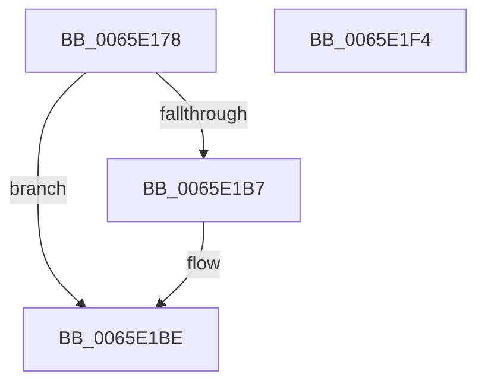

# WheapAddErrorSource

- RVA: `0x0065E178`–`0x0065E1F5` (길이 `125` bytes)
- VA: `0x000000014065E178`
- 실행 섹션: `.text`
- PDB 이름 있음: `예`; PDB Function 태그: `아니요`
- unwind 정보 RVA: `0x00064C80`
- 디코드: `31`개 명령, `125/125` bytes 표시
- 미해석 바이트: `0` (있으면 어셈블리에 `.byte`로 보존)

> 이 문서는 커널 이미지의 기계어와 PDB 기호를 분석해 생성했습니다. 4번과 5번은 함수 원형과 자료형을 바이너리 사용 방식에서 추정한 C 해석이며 원본 소스 복구 결과는 아닙니다.

## 1. Dependencies

- 직접 호출 지점: **2**; 고유 호출 대상: **2**
- 직접 호출자로 확인된 함수: **2**
- RIP 상대 이미지 참조: **7**

### Outgoing calls
- `0x0065E196` → [KeWaitForSingleObject](../20/KeWaitForSingleObject_function_0020E6B0.md) (function, `0x0020E6B0`)
- `0x0065E1E9` → [KeSetEvent](../33/KeSetEvent_function_0033F310.md) (function, `0x0033F310`)

### Direct callers
- [WheaAddErrorSource](../../page/7D/WheaAddErrorSource_function_007D69D0.md) at `0x007D6B14`
- [WheapInitializeErrorSourceTable](../../init/C5/WheapInitializeErrorSourceTable_function_00C55304.md) at `0x00C55425`

### Static image references
- `0x0065E184` → RVA `0x00EEF038` (`.data`; read)
- `0x0065E19B` → RVA `0x00EEF020` (`.data`; read)
- `0x0065E1A1` → RVA `0x00EEF028` (`.data`; read)
- `0x0065E1AB` → RVA `0x00EEF030` (`.data`; read)
- `0x0065E1C8` → RVA `0x00EEF030` (`.data`; write)
- `0x0065E1CF` → RVA `0x00EEF01C` (`.data`; read/write)
- `0x0065E1D6` → RVA `0x00EEF020` (`.data`; read/write)

## 2. Other-region calls and transfers

- 다른 실행 섹션으로 향하는 call: **0**
- 별도 외부 분기/꼬리 이동을 확인하지 못했습니다.

## 3. Assembly (complete function range)

```asm
0065E178  40 53                           push rbx
0065E17A  48 83 EC 30                     sub rsp, 0x30
0065E17E  48 83 64 24 20 00               and qword ptr [rsp + 0x20], 0
0065E184  48 8D 0D AD 0E 89 00            lea rcx, [rip + 0x890ead]
0065E18B  48 8B DA                        mov rbx, rdx
0065E18E  45 33 C9                        xor r9d, r9d
0065E191  33 D2                           xor edx, edx
0065E193  45 33 C0                        xor r8d, r8d
0065E196  E8 15 05 BB FF                  call 0x14020e6b0
0065E19B  8B 05 7F 0E 89 00               mov eax, dword ptr [rip + 0x890e7f]
0065E1A1  48 8D 0D 80 0E 89 00            lea rcx, [rip + 0x890e80]
0065E1A8  89 43 7C                        mov dword ptr [rbx + 0x7c], eax
0065E1AB  48 8B 05 7E 0E 89 00            mov rax, qword ptr [rip + 0x890e7e]
0065E1B2  48 39 08                        cmp qword ptr [rax], rcx
0065E1B5  74 07                           je 0x14065e1be
0065E1B7  B9 03 00 00 00                  mov ecx, 3
0065E1BC  CD 29                           int 0x29
0065E1BE  48 89 0B                        mov qword ptr [rbx], rcx
0065E1C1  48 89 43 08                     mov qword ptr [rbx + 8], rax
0065E1C5  48 89 18                        mov qword ptr [rax], rbx
0065E1C8  48 89 1D 61 0E 89 00            mov qword ptr [rip + 0x890e61], rbx
0065E1CF  F0 FF 05 46 0E 89 00            lock inc dword ptr [rip + 0x890e46]
0065E1D6  F0 FF 05 43 0E 89 00            lock inc dword ptr [rip + 0x890e43]
0065E1DD  45 33 C0                        xor r8d, r8d
0065E1E0  48 8D 0D 51 0E 89 00            lea rcx, [rip + 0x890e51]
0065E1E7  33 D2                           xor edx, edx
0065E1E9  E8 22 11 CE FF                  call 0x14033f310
0065E1EE  48 83 C4 30                     add rsp, 0x30
0065E1F2  5B                              pop rbx
0065E1F3  C3                              ret
0065E1F4  CC                              int3
```

## 4. C-style interpretation (structured pseudocode)

```c
__int64 __fastcall WheapAddErrorSource(__int64 a1, __int64 a2, int a3, int a4)
{
    __int64 result;
    __int64 v_rsp;
    unsigned __int64 v_stack_m18;

    v_rsp = (v_rsp) - (48);
    a4 = 0;
    a2 = 0;
    a3 = 0;
    result = KeWaitForSingleObject(v_rip + 8982189, a2, a3, a4);
    *(unsigned int *)(a2 + 124) = (unsigned int)((unsigned int)(*(unsigned int *)(v_rip + 8982143)));
    if ((*(unsigned __int64 *)(*(unsigned __int64 *)(v_rip + 8982142))) != (v_rip + 8982144)) {
        a1 = 3;
    }
    *(unsigned __int64 *)(a2) = a1;
    *(unsigned __int64 *)(a2 + 8) = *(unsigned __int64 *)(v_rip + 8982142);
    *(unsigned __int64 *)(*(unsigned __int64 *)(v_rip + 8982142)) = 0;
    *(unsigned __int64 *)(v_rip + 8982113) = 0;
    a3 = 0;
    a2 = 0;
    result = KeSetEvent(v_rip + 8982097, a2, a3, a4);
    v_rsp = (v_rsp) + (48);
    return result;
}
```

## 5. (Beta) C Style

```c
int64_t WheapAddErrorSource(int64_t Arg1, void *Arg2, int32_t Arg3, int32_t Arg4)
{
    uint8_t *arg2 = (uint8_t *)Arg2;

    int64_t result;
    int64_t local_rsp;
    uint64_t v_stack_m18;

    local_rsp = (local_rsp) - (48);
    Arg4 = 0;
    Arg2 = 0;
    Arg3 = 0;
    result = KeWaitForSingleObject(v_rip + 8982189, Arg2, Arg3, Arg4);
    *(uint32_t *)(arg2 + 0x7C) = (uint32_t)((uint32_t)(*(uint32_t *)(v_rip + 0x890E7F)));
    if ((*(uint64_t *)(*(uint64_t *)(v_rip + 0x890E7E))) != (v_rip + 8982144)) {
        Arg1 = 3;
    }
    *(uint64_t *)(arg2) = Arg1;
    *(uint64_t *)(arg2 + 0x8) = *(uint64_t *)(v_rip + 0x890E7E);
    *(uint64_t *)(*(uint64_t *)(v_rip + 0x890E7E)) = 0;
    *(uint64_t *)(v_rip + 0x890E61) = 0;
    Arg3 = 0;
    Arg2 = 0;
    result = KeSetEvent(v_rip + 8982097, Arg2, Arg3, Arg4);
    local_rsp = (local_rsp) + (48);
    return result;
}
```

### 관측된 메모리 오프셋

구조체 형식이 확인되지 않은 접근은 인자 기준의 오프셋으로만 기록했습니다.

| 기준 인자 | 오프셋 표현 | 폭 (bit) | 접근 |
|---|---:|---:|---|
| `Arg2` | `+ 0x0` | `64` | `W` |
| `Arg2` | `+ 0x8` | `64` | `W` |
| `Arg2` | `+ 0x7C` | `32` | `W` |

## 6. Execution-region graph

[열기: 2D/3D 그래프와 함수 탐색 컨트롤 패널](../../../control-panel.html?section=text&rva=0x0065E178&view=graph)

- 2D 그래프는 위에서 아래로 흐르고, 3D 그래프는 빈 공간을 드래그해 회전합니다. Shift+드래그는 이동, 휠은 확대·축소, 함수 노드 선택은 대상 보고서 이동입니다.

### Static fallback


