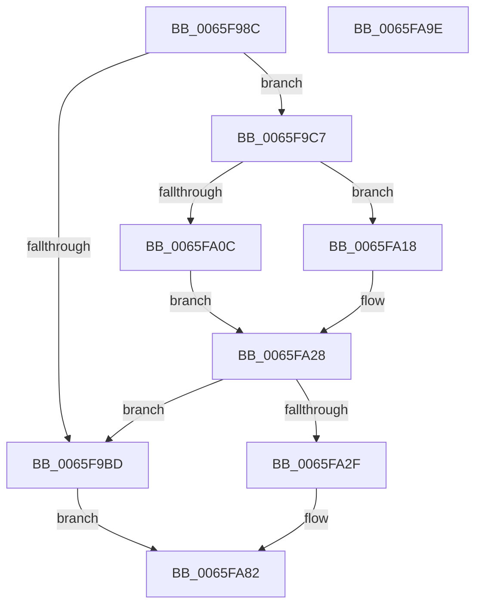

# WheapAddRecoveryPacketToErrorRecord

- RVA: `0x0065F98C`–`0x0065FA9F` (길이 `275` bytes)
- VA: `0x000000014065F98C`
- 실행 섹션: `.text`
- PDB 이름 있음: `예`; PDB Function 태그: `아니요`
- unwind 정보 RVA: `0x000CF3E4`
- 디코드: `71`개 명령, `275/275` bytes 표시
- 미해석 바이트: `0` (있으면 어셈블리에 `.byte`로 보존)

> 이 문서는 커널 이미지의 기계어와 PDB 기호를 분석해 생성했습니다. 4번과 5번은 함수 원형과 자료형을 바이너리 사용 방식에서 추정한 C 해석이며 원본 소스 복구 결과는 아닙니다.

## 1. Dependencies

- 직접 호출 지점: **1**; 고유 호출 대상: **1**
- 직접 호출자로 확인된 함수: **1**
- RIP 상대 이미지 참조: **1**

### Outgoing calls
- `0x0065F9D1` → [memset](../6C/memset_function_006C6C40.md) (function, `0x006C6C40`)

### Direct callers
- [WheapCreateRecordFromGenericErrorData](WheapCreateRecordFromGenericErrorData_function_0065FCE4.md) at `0x0065FFAE`

### Static image references
- `0x0065FA45` → RVA `0x0001A538` (`.rdata`; read)

## 2. Other-region calls and transfers

- 다른 실행 섹션으로 향하는 call: **0**
- 별도 외부 분기/꼬리 이동을 확인하지 못했습니다.

## 3. Assembly (complete function range)

```asm
0065F98C  48 89 5C 24 08                  mov qword ptr [rsp + 8], rbx
0065F991  48 89 74 24 10                  mov qword ptr [rsp + 0x10], rsi
0065F996  48 89 7C 24 18                  mov qword ptr [rsp + 0x18], rdi
0065F99B  55                              push rbp
0065F99C  41 56                           push r14
0065F99E  41 57                           push r15
0065F9A0  48 8B EC                        mov rbp, rsp
0065F9A3  48 83 EC 70                     sub rsp, 0x70
0065F9A7  44 0F B7 72 0A                  movzx r14d, word ptr [rdx + 0xa]
0065F9AC  41 8B F8                        mov edi, r8d
0065F9AF  8B 71 18                        mov esi, dword ptr [rcx + 0x18]
0065F9B2  48 8B DA                        mov rbx, rdx
0065F9B5  4C 8B F9                        mov r15, rcx
0065F9B8  44 3B F6                        cmp r14d, esi
0065F9BB  72 0A                           jb 0x14065f9c7
0065F9BD  BA 23 00 00 C0                  mov edx, 0xc0000023
0065F9C2  E9 BB 00 00 00                  jmp 0x14065fa82
0065F9C7  33 D2                           xor edx, edx
0065F9C9  48 8D 4D B0                     lea rcx, [rbp - 0x50]
0065F9CD  44 8D 42 50                     lea r8d, [rdx + 0x50]
0065F9D1  E8 6A 72 06 00                  call 0x1406c6c40
0065F9D6  41 8B 47 1C                     mov eax, dword ptr [r15 + 0x1c]
0065F9DA  4C 8D 83 80 00 00 00            lea r8, [rbx + 0x80]
0065F9E1  33 D2                           xor edx, edx
0065F9E3  89 45 C8                        mov dword ptr [rbp - 0x38], eax
0065F9E6  41 8B 47 08                     mov eax, dword ptr [r15 + 8]
0065F9EA  89 45 CC                        mov dword ptr [rbp - 0x34], eax
0065F9ED  C7 45 B0 57 48 45 41            mov dword ptr [rbp - 0x50], 0x41454857
0065F9F4  C7 45 B4 03 00 00 00            mov dword ptr [rbp - 0x4c], 3
0065F9FB  C7 45 B8 50 00 00 00            mov dword ptr [rbp - 0x48], 0x50
0065FA02  48 89 5D E0                     mov qword ptr [rbp - 0x20], rbx
0065FA06  66 45 85 F6                     test r14w, r14w
0065FA0A  75 0C                           jne 0x14065fa18
0065FA0C  8D 04 F6                        lea eax, [rsi + rsi*8]
0065FA0F  8D 04 C5 80 00 00 00            lea eax, [rax*8 + 0x80]
0065FA16  EB 10                           jmp 0x14065fa28
0065FA18  4B 8D 0C F6                     lea rcx, [r14 + r14*8]
0065FA1C  4D 8D 04 C8                     lea r8, [r8 + rcx*8]
0065FA20  41 8B 40 BC                     mov eax, dword ptr [r8 - 0x44]
0065FA24  41 03 40 B8                     add eax, dword ptr [r8 - 0x48]
0065FA28  2B F8                           sub edi, eax
0065FA2A  83 FF 50                        cmp edi, 0x50
0065FA2D  72 8E                           jb 0x14065f9bd
0065FA2F  0F 28 4D C0                     movaps xmm1, xmmword ptr [rbp - 0x40]
0065FA33  41 89 00                        mov dword ptr [r8], eax
0065FA36  41 C7 40 04 50 00 00 00         mov dword ptr [r8 + 4], 0x50
0065FA3E  66 41 C7 40 08 00 03            mov word ptr [r8 + 8], 0x300
0065FA45  0F 10 05 EC AA 9B FF            movups xmm0, xmmword ptr [rip - 0x645514]
0065FA4C  41 89 50 30                     mov dword ptr [r8 + 0x30], edx
0065FA50  F3 41 0F 7F 40 10               movdqu xmmword ptr [r8 + 0x10], xmm0
0065FA56  0F 28 45 B0                     movaps xmm0, xmmword ptr [rbp - 0x50]
0065FA5A  0F 11 04 18                     movups xmmword ptr [rax + rbx], xmm0
0065FA5E  0F 28 45 D0                     movaps xmm0, xmmword ptr [rbp - 0x30]
0065FA62  0F 11 4C 18 10                  movups xmmword ptr [rax + rbx + 0x10], xmm1
0065FA67  0F 28 4D E0                     movaps xmm1, xmmword ptr [rbp - 0x20]
0065FA6B  0F 11 44 18 20                  movups xmmword ptr [rax + rbx + 0x20], xmm0
0065FA70  0F 28 45 F0                     movaps xmm0, xmmword ptr [rbp - 0x10]
0065FA74  0F 11 4C 18 30                  movups xmmword ptr [rax + rbx + 0x30], xmm1
0065FA79  0F 11 44 18 40                  movups xmmword ptr [rax + rbx + 0x40], xmm0
0065FA7E  66 FF 43 0A                     inc word ptr [rbx + 0xa]
0065FA82  4C 8D 5C 24 70                  lea r11, [rsp + 0x70]
0065FA87  8B C2                           mov eax, edx
0065FA89  49 8B 5B 20                     mov rbx, qword ptr [r11 + 0x20]
0065FA8D  49 8B 73 28                     mov rsi, qword ptr [r11 + 0x28]
0065FA91  49 8B 7B 30                     mov rdi, qword ptr [r11 + 0x30]
0065FA95  49 8B E3                        mov rsp, r11
0065FA98  41 5F                           pop r15
0065FA9A  41 5E                           pop r14
0065FA9C  5D                              pop rbp
0065FA9D  C3                              ret
0065FA9E  CC                              int3
```

## 4. C-style interpretation (structured pseudocode)

```c
__int64 __fastcall WheapAddRecoveryPacketToErrorRecord(__int64 a1, __int64 a2, int a3)
{
    __int64 result;
    __int64 v_rdi;
    __int64 v_rsp;
    unsigned __int64 v_stack_m18;
    unsigned __int64 v_stack_m28;
    unsigned __int64 v_stack_m38;
    unsigned __int64 v_stack_m48;
    unsigned int v_stack_m4C;
    unsigned int v_stack_m50;
    unsigned __int64 v_stack_m58;
    unsigned int v_stack_m60;
    unsigned int v_stack_m64;
    unsigned __int64 v_stack_m68;
    unsigned __int64 v_stack_p10;
    unsigned __int64 v_stack_p18;
    unsigned __int64 v_stack_p8;

    v_stack_p8 = v_rbx;
    v_stack_p10 = v_rsi;
    v_stack_p18 = v_rdi;
    v_rsp = (v_rsp) - (112);
    if (((unsigned int)(*(unsigned __int16 *)(a2 + 10))) < ((unsigned int)((unsigned int)(*(unsigned int *)(a1 + 24))))) goto loc_0065F9C7;
loc_0065F9BD:
    goto loc_0065FA82;
loc_0065F9C7:
    a2 = 0;
    result = memset(v_stack_m68, a2, a2 + 80, a4);
    a2 = 0;
    v_stack_m50 = (unsigned int)((unsigned int)(*(unsigned int *)(a1 + 28)));
    v_stack_m4C = (unsigned int)((unsigned int)(*(unsigned int *)(a1 + 8)));
    v_stack_m68 = 0x41454857ULL;
    v_stack_m64 = 3;
    v_stack_m60 = 80;
    v_stack_m38 = 0;
    if ((unsigned __int16)(*(unsigned __int16 *)(a2 + 10)) != 0) goto loc_0065FA18;
    goto loc_0065FA28;
loc_0065FA18:
    result = (unsigned int)(((unsigned int)(*(unsigned int *)(a2 + 128 + *(unsigned __int16 *)(a2 + 10) + *(unsigned __int16 *)(a2 + 10) * 8 * 8 - 68))) + (*(unsigned int *)(a2 + 128 + *(unsigned __int16 *)(a2 + 10) + *(unsigned __int16 *)(a2 + 10) * 8 * 8 - 72)));
loc_0065FA28:
    v_rdi = (unsigned int)(((unsigned int)(a3)) - ((unsigned int)(result)));
    if (((unsigned int)(v_rdi)) < 80) goto loc_0065F9BD;
    *(unsigned int *)(a2 + 128 + *(unsigned __int16 *)(a2 + 10) + *(unsigned __int16 *)(a2 + 10) * 8 * 8) = (unsigned int)(result);
    *(unsigned int *)(a2 + 128 + *(unsigned __int16 *)(a2 + 10) + *(unsigned __int16 *)(a2 + 10) * 8 * 8 + 4) = 80;
    *(unsigned __int16 *)(a2 + 128 + *(unsigned __int16 *)(a2 + 10) + *(unsigned __int16 *)(a2 + 10) * 8 * 8 + 8) = 768;
    *(unsigned int *)(a2 + 128 + *(unsigned __int16 *)(a2 + 10) + *(unsigned __int16 *)(a2 + 10) * 8 * 8 + 48) = 0;
    *(unsigned __int64 *)(a2 + 128 + *(unsigned __int16 *)(a2 + 10) + *(unsigned __int16 *)(a2 + 10) * 8 * 8 + 16) = v_xmm0;
    *(unsigned __int64 *)(result + a2 * 1) = v_xmm0;
    *(unsigned __int64 *)(result + a2 * 1 + 16) = v_xmm1;
    *(unsigned __int64 *)(result + a2 * 1 + 32) = v_xmm0;
    *(unsigned __int64 *)(result + a2 * 1 + 48) = v_xmm1;
    *(unsigned __int64 *)(result + a2 * 1 + 64) = v_xmm0;
loc_0065FA82:
    return 0;
}
```

## 5. (Beta) C Style

```c
int64_t WheapAddRecoveryPacketToErrorRecord(void *Arg1, void *Arg2, int32_t Arg3)
{
    uint8_t *arg1 = (uint8_t *)Arg1;
    uint8_t *arg2 = (uint8_t *)Arg2;

    int64_t result;
    int64_t local_rdi;
    int64_t local_rsp;
    uint64_t v_stack_m18;
    uint64_t v_stack_m28;
    uint64_t v_stack_m38;
    uint64_t v_stack_m48;
    uint32_t v_stack_m4C;
    uint32_t v_stack_m50;
    uint64_t v_stack_m58;
    uint32_t v_stack_m60;
    uint32_t v_stack_m64;
    uint64_t v_stack_m68;
    uint64_t v_stack_p10;
    uint64_t v_stack_p18;
    uint64_t v_stack_p8;

    v_stack_p8 = local_rbx;
    v_stack_p10 = local_rsi;
    v_stack_p18 = local_rdi;
    local_rsp = (local_rsp) - (112);
    if (((uint32_t)(*(uint16_t *)(arg2 + 0xA))) < ((uint32_t)((uint32_t)(*(uint32_t *)(arg1 + 0x18))))) goto loc_0065F9C7;
loc_0065F9BD:
    goto loc_0065FA82;
loc_0065F9C7:
    Arg2 = 0;
    result = memset(v_stack_m68, Arg2, Arg2 + 80, a4);
    Arg2 = 0;
    v_stack_m50 = (uint32_t)((uint32_t)(*(uint32_t *)(arg1 + 0x1C)));
    v_stack_m4C = (uint32_t)((uint32_t)(*(uint32_t *)(arg1 + 0x8)));
    v_stack_m68 = 0x41454857ULL;
    v_stack_m64 = 3;
    v_stack_m60 = 80;
    v_stack_m38 = 0;
    if ((uint16_t)(*(uint16_t *)(arg2 + 0xA)) != 0) goto loc_0065FA18;
    goto loc_0065FA28;
loc_0065FA18:
    result = (uint32_t)(((uint32_t)(*(uint32_t *)(arg2 + 0x80 + *(uint16_t *)(arg2 + 0xA) + *(uint16_t *)(arg2 + 0xA) * 8 * 8 - 0x44))) + (*(uint32_t *)(arg2 + 0x80 + *(uint16_t *)(arg2 + 0xA) + *(uint16_t *)(arg2 + 0xA) * 8 * 8 - 0x48)));
loc_0065FA28:
    local_rdi = (uint32_t)(((uint32_t)(Arg3)) - ((uint32_t)(result)));
    if (((uint32_t)(local_rdi)) < 80) goto loc_0065F9BD;
    *(uint32_t *)(arg2 + 0x80 + *(uint16_t *)(arg2 + 0xA) + *(uint16_t *)(arg2 + 0xA) * 8 * 8) = (uint32_t)(result);
    *(uint32_t *)(arg2 + 0x80 + *(uint16_t *)(arg2 + 0xA) + *(uint16_t *)(arg2 + 0xA) * 8 * 8 + 0x4) = 80;
    *(uint16_t *)(arg2 + 0x80 + *(uint16_t *)(arg2 + 0xA) + *(uint16_t *)(arg2 + 0xA) * 8 * 8 + 0x8) = 768;
    *(uint32_t *)(arg2 + 0x80 + *(uint16_t *)(arg2 + 0xA) + *(uint16_t *)(arg2 + 0xA) * 8 * 8 + 0x30) = 0;
    *(uint64_t *)(arg2 + 0x80 + *(uint16_t *)(arg2 + 0xA) + *(uint16_t *)(arg2 + 0xA) * 8 * 8 + 0x10) = v_xmm0;
    *(uint64_t *)(result + arg2 * 1) = v_xmm0;
    *(uint64_t *)(result + arg2 * 1 + 0x10) = v_xmm1;
    *(uint64_t *)(result + arg2 * 1 + 0x20) = v_xmm0;
    *(uint64_t *)(result + arg2 * 1 + 0x30) = v_xmm1;
    *(uint64_t *)(result + arg2 * 1 + 0x40) = v_xmm0;
loc_0065FA82:
    return 0;
}
```

### 관측된 메모리 오프셋

구조체 형식이 확인되지 않은 접근은 인자 기준의 오프셋으로만 기록했습니다.

| 기준 인자 | 오프셋 표현 | 폭 (bit) | 접근 |
|---|---:|---:|---|
| `Arg1` | `+ 0x8` | `32` | `R` |
| `Arg1` | `+ 0x18` | `32` | `R` |
| `Arg1` | `+ 0x1C` | `32` | `R` |
| `Arg2` | `- 0x48` | `32` | `R` |
| `Arg2` | `- 0x44` | `32` | `R` |
| `Arg2` | `+ 0x0` | `32` | `W` |
| `Arg2` | `+ 0x0 + rcx*8` | `64` | `R` |
| `Arg2` | `+ 0x4` | `32` | `W` |
| `Arg2` | `+ 0x8` | `16` | `W` |
| `Arg2` | `+ 0xA` | `16` | `R` |
| `Arg2` | `+ 0xA` | `16` | `R/W` |
| `Arg2` | `+ 0x10` | `128` | `W` |
| `Arg2` | `+ 0x30` | `32` | `W` |
| `Arg2` | `+ 0x80` | `64` | `R` |

## 6. Execution-region graph

[열기: 2D/3D 그래프와 함수 탐색 컨트롤 패널](../../../control-panel.html?section=text&rva=0x0065F98C&view=graph)

- 2D 그래프는 위에서 아래로 흐르고, 3D 그래프는 빈 공간을 드래그해 회전합니다. Shift+드래그는 이동, 휠은 확대·축소, 함수 노드 선택은 대상 보고서 이동입니다.

### Static fallback


