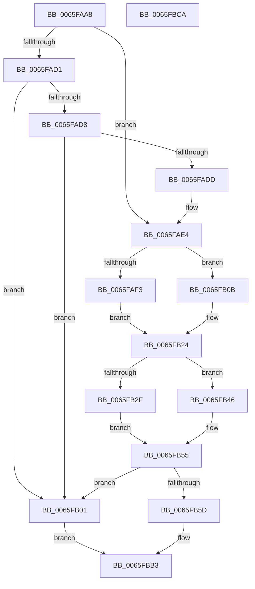

# WheapAddSectionFromGenericErrorData

- RVA: `0x0065FAA8`–`0x0065FBCB` (길이 `291` bytes)
- VA: `0x000000014065FAA8`
- 실행 섹션: `.text`
- PDB 이름 있음: `예`; PDB Function 태그: `아니요`
- unwind 정보 RVA: `0x0005C954`
- 디코드: `79`개 명령, `291/291` bytes 표시
- 미해석 바이트: `0` (있으면 어셈블리에 `.byte`로 보존)

> 이 문서는 커널 이미지의 기계어와 PDB 기호를 분석해 생성했습니다. 4번과 5번은 함수 원형과 자료형을 바이너리 사용 방식에서 추정한 C 해석이며 원본 소스 복구 결과는 아닙니다.

## 1. Dependencies

- 직접 호출 지점: **1**; 고유 호출 대상: **1**
- 직접 호출자로 확인된 함수: **1**
- RIP 상대 이미지 참조: **1**

### Outgoing calls
- `0x0065FBAA` → [memcpy](../6C/memcpy_function_006C6840.md) (function, `0x006C6840`)

### Direct callers
- [WheapCreateRecordFromGenericErrorData](WheapCreateRecordFromGenericErrorData_function_0065FCE4.md) at `0x0065FECA`
- [WheapCreateRecordFromGenericErrorData](WheapCreateRecordFromGenericErrorData_function_0065FCE4.md) at `0x0065FF2B`

### Static image references
- `0x0065FB4B` → RVA `0x00024CE8` (`.rdata`; read)

## 2. Other-region calls and transfers

- 다른 실행 섹션으로 향하는 call: **0**
- 별도 외부 분기/꼬리 이동을 확인하지 못했습니다.

## 3. Assembly (complete function range)

```asm
0065FAA8  48 89 5C 24 08                  mov qword ptr [rsp + 8], rbx
0065FAAD  48 89 6C 24 10                  mov qword ptr [rsp + 0x10], rbp
0065FAB2  48 89 74 24 18                  mov qword ptr [rsp + 0x18], rsi
0065FAB7  57                              push rdi
0065FAB8  48 83 EC 20                     sub rsp, 0x20
0065FABC  44 8B 51 18                     mov r10d, dword ptr [rcx + 0x18]
0065FAC0  33 DB                           xor ebx, ebx
0065FAC2  0F B7 4A 0A                     movzx ecx, word ptr [rdx + 0xa]
0065FAC6  41 8B F0                        mov esi, r8d
0065FAC9  48 8B FA                        mov rdi, rdx
0065FACC  41 3B CA                        cmp ecx, r10d
0065FACF  72 13                           jb 0x14065fae4
0065FAD1  41 F6 41 17 01                  test byte ptr [r9 + 0x17], 1
0065FAD6  74 29                           je 0x14065fb01
0065FAD8  66 85 C9                        test cx, cx
0065FADB  74 24                           je 0x14065fb01
0065FADD  66 FF C9                        dec cx
0065FAE0  66 89 4A 0A                     mov word ptr [rdx + 0xa], cx
0065FAE4  48 83 EA 80                     sub rdx, -0x80
0065FAE8  41 BB 48 00 00 00               mov r11d, 0x48
0065FAEE  66 85 C9                        test cx, cx
0065FAF1  75 18                           jne 0x14065fb0b
0065FAF3  43 8D 04 D2                     lea eax, [r10 + r10*8]
0065FAF7  44 8D 14 C5 80 00 00 00         lea r10d, [rax*8 + 0x80]
0065FAFF  EB 23                           jmp 0x14065fb24
0065FB01  BB 23 00 00 C0                  mov ebx, 0xc0000023
0065FB06  E9 A8 00 00 00                  jmp 0x14065fbb3
0065FB0B  0F B7 C1                        movzx eax, cx
0065FB0E  48 8D 0C C0                     lea rcx, [rax + rax*8]
0065FB12  48 8D 14 CA                     lea rdx, [rdx + rcx*8]
0065FB16  48 83 C2 B8                     add rdx, -0x48
0065FB1A  44 8B 52 04                     mov r10d, dword ptr [rdx + 4]
0065FB1E  44 03 12                        add r10d, dword ptr [rdx]
0065FB21  49 03 D3                        add rdx, r11
0065FB24  BD 00 03 00 00                  mov ebp, 0x300
0065FB29  38 5C 24 58                     cmp byte ptr [rsp + 0x58], bl
0065FB2D  74 17                           je 0x14065fb46
0065FB2F  66 41 39 69 14                  cmp word ptr [r9 + 0x14], bp
0065FB34  B8 40 00 00 00                  mov eax, 0x40
0065FB39  45 8B 41 18                     mov r8d, dword ptr [r9 + 0x18]
0065FB3D  49 8B C9                        mov rcx, r9
0065FB40  4C 0F 45 D8                     cmovne r11, rax
0065FB44  EB 0F                           jmp 0x14065fb55
0065FB46  44 8B 44 24 50                  mov r8d, dword ptr [rsp + 0x50]
0065FB4B  48 8D 0D 96 51 9C FF            lea rcx, [rip - 0x63ae6a]
0065FB52  4C 8B DB                        mov r11, rbx
0065FB55  41 2B F2                        sub esi, r10d
0065FB58  41 3B F0                        cmp esi, r8d
0065FB5B  72 A4                           jb 0x14065fb01
0065FB5D  44 89 12                        mov dword ptr [rdx], r10d
0065FB60  44 89 42 04                     mov dword ptr [rdx + 4], r8d
0065FB64  66 89 6A 08                     mov word ptr [rdx + 8], bp
0065FB68  41 8A 41 16                     mov al, byte ptr [r9 + 0x16]
0065FB6C  88 42 0A                        mov byte ptr [rdx + 0xa], al
0065FB6F  41 0F B6 41 17                  movzx eax, byte ptr [r9 + 0x17]
0065FB74  89 42 0C                        mov dword ptr [rdx + 0xc], eax
0065FB77  0F 10 01                        movups xmm0, xmmword ptr [rcx]
0065FB7A  F3 0F 7F 42 10                  movdqu xmmword ptr [rdx + 0x10], xmm0
0065FB7F  41 0F 10 49 1C                  movups xmm1, xmmword ptr [r9 + 0x1c]
0065FB84  F3 0F 7F 4A 20                  movdqu xmmword ptr [rdx + 0x20], xmm1
0065FB89  41 8B 41 10                     mov eax, dword ptr [r9 + 0x10]
0065FB8D  89 42 30                        mov dword ptr [rdx + 0x30], eax
0065FB90  41 0F 10 41 2C                  movups xmm0, xmmword ptr [r9 + 0x2c]
0065FB95  0F 11 42 34                     movups xmmword ptr [rdx + 0x34], xmm0
0065FB99  41 8B 49 3C                     mov ecx, dword ptr [r9 + 0x3c]
0065FB9D  89 4A 44                        mov dword ptr [rdx + 0x44], ecx
0065FBA0  4B 8D 14 0B                     lea rdx, [r11 + r9]
0065FBA4  41 8B CA                        mov ecx, r10d
0065FBA7  48 03 CF                        add rcx, rdi
0065FBAA  E8 91 6C 06 00                  call 0x1406c6840
0065FBAF  66 FF 47 0A                     inc word ptr [rdi + 0xa]
0065FBB3  48 8B 6C 24 38                  mov rbp, qword ptr [rsp + 0x38]
0065FBB8  8B C3                           mov eax, ebx
0065FBBA  48 8B 5C 24 30                  mov rbx, qword ptr [rsp + 0x30]
0065FBBF  48 8B 74 24 40                  mov rsi, qword ptr [rsp + 0x40]
0065FBC4  48 83 C4 20                     add rsp, 0x20
0065FBC8  5F                              pop rdi
0065FBC9  C3                              ret
0065FBCA  CC                              int3
```

## 4. C-style interpretation (structured pseudocode)

```c
__int64 __fastcall WheapAddSectionFromGenericErrorData(__int64 a1, __int64 a2, int a3, __int64 a4, unsigned int a5, unsigned __int8 a6)
{
    __int64 result;
    __int64 v_r10;
    __int64 v_r11;
    __int64 v_rbx;
    __int64 v_rsi;
    __int64 v_rsp;
    unsigned __int64 v_stack_p10;
    unsigned __int64 v_stack_p18;
    unsigned __int64 v_stack_p8;

    v_stack_p8 = v_rbx;
    v_stack_p10 = v_rbp;
    v_stack_p18 = v_rsi;
    v_rsp = (v_rsp) - (32);
    v_rbx = 0;
    if (((unsigned int)(*(unsigned __int16 *)(a2 + 10))) < ((unsigned int)((unsigned int)(*(unsigned int *)(a1 + 24))))) goto loc_0065FAE4;
    if (((*(unsigned __int8 *)(a4 + 23)) & (1)) == 0) goto loc_0065FB01;
    if ((unsigned __int16)(*(unsigned __int16 *)(a2 + 10)) == 0) goto loc_0065FB01;
    a1 = (unsigned __int16)((*(unsigned __int16 *)(a2 + 10)) - 1);
    *(unsigned __int16 *)(a2 + 10) = (unsigned __int16)(a1);
loc_0065FAE4:
    a2 = (a2) - (-128);
    if ((unsigned __int16)(a1) != 0) goto loc_0065FB0B;
    goto loc_0065FB24;
loc_0065FB01:
    goto loc_0065FBB3;
loc_0065FB0B:
    a2 = (a2 + (unsigned __int16)(a1) + (unsigned __int16)(a1) * 8 * 8) + (-72);
    v_r10 = (unsigned int)(((unsigned int)(*(unsigned int *)(a2 + 4))) + (*(unsigned int *)(a2)));
    a2 = (a2) + (72);
loc_0065FB24:
    if (a6 == ((unsigned __int8)((unsigned int)(0xC0000023ULL)))) goto loc_0065FB46;
    v_r11 = 72;
    if ((*(unsigned __int16 *)(a4 + 20)) != 768) { v_r11 = 64; }
    goto loc_0065FB55;
loc_0065FB46:
loc_0065FB55:
    v_rsi = (unsigned int)(((unsigned int)(a3)) - ((unsigned int)(v_r10)));
    if (((unsigned int)(v_rsi)) < ((unsigned int)((unsigned int)(a5)))) goto loc_0065FB01;
    *(unsigned int *)(a2) = (unsigned int)(v_r10);
    *(unsigned int *)(a2 + 4) = (unsigned int)((unsigned int)(a5));
    *(unsigned __int16 *)(a2 + 8) = 768;
    *(unsigned __int8 *)(a2 + 10) = (unsigned __int8)(*(unsigned __int8 *)(a4 + 22));
    *(unsigned int *)(a2 + 12) = (unsigned int)(*(unsigned __int8 *)(a4 + 23));
    *(unsigned __int64 *)(a2 + 16) = v_xmm0;
    *(unsigned __int64 *)(a2 + 32) = v_xmm1;
    *(unsigned int *)(a2 + 48) = (unsigned int)((unsigned int)(*(unsigned int *)(a4 + 16)));
    *(unsigned __int64 *)(a2 + 52) = v_xmm0;
    *(unsigned int *)(a2 + 68) = (unsigned int)((unsigned int)(*(unsigned int *)(a4 + 60)));
    a1 = ((unsigned int)((unsigned int)(v_r10))) + (a2);
    result = memcpy(a1, (unsigned int)(0xC0000023ULL) + a4 * 1, (unsigned int)(a5), a4);
loc_0065FBB3:
    v_rsp = (v_rsp) + (32);
    return (unsigned int)((unsigned int)((unsigned int)(0xC0000023ULL)));
}
```

## 5. (Beta) C Style

```c
int64_t WheapAddSectionFromGenericErrorData(void *Arg1, void *Arg2, int32_t Arg3, void *Arg4, uint32_t Arg5, uint8_t Arg6)
{
    uint8_t *arg1 = (uint8_t *)Arg1;
    uint8_t *arg2 = (uint8_t *)Arg2;
    uint8_t *arg4 = (uint8_t *)Arg4;

    int64_t result;
    int64_t local_r10;
    int64_t local_r11;
    int64_t local_rbx;
    int64_t local_rsi;
    int64_t local_rsp;
    uint64_t v_stack_p10;
    uint64_t v_stack_p18;
    uint64_t v_stack_p8;

    v_stack_p8 = local_rbx;
    v_stack_p10 = local_rbp;
    v_stack_p18 = local_rsi;
    local_rsp = (local_rsp) - (32);
    local_rbx = 0;
    if (((uint32_t)(*(uint16_t *)(arg2 + 0xA))) < ((uint32_t)((uint32_t)(*(uint32_t *)(arg1 + 0x18))))) goto loc_0065FAE4;
    if (((*(uint8_t *)(arg4 + 0x17)) & (1)) == 0) goto loc_0065FB01;
    if ((uint16_t)(*(uint16_t *)(arg2 + 0xA)) == 0) goto loc_0065FB01;
    Arg1 = (uint16_t)((*(uint16_t *)(arg2 + 0xA)) - 1);
    *(uint16_t *)(arg2 + 0xA) = (uint16_t)(Arg1);
loc_0065FAE4:
    Arg2 = (Arg2) - (-128);
    if ((uint16_t)(Arg1) != 0) goto loc_0065FB0B;
    goto loc_0065FB24;
loc_0065FB01:
    goto loc_0065FBB3;
loc_0065FB0B:
    Arg2 = (Arg2 + (uint16_t)(Arg1) + (uint16_t)(Arg1) * 8 * 8) + (-72);
    local_r10 = (uint32_t)(((uint32_t)(*(uint32_t *)(arg2 + 0x4))) + (*(uint32_t *)(arg2)));
    Arg2 = (Arg2) + (72);
loc_0065FB24:
    if (Arg6 == ((uint8_t)((uint32_t)(0xC0000023ULL)))) goto loc_0065FB46;
    local_r11 = 72;
    if ((*(uint16_t *)(arg4 + 0x14)) != 768) { local_r11 = 64; }
    goto loc_0065FB55;
loc_0065FB46:
loc_0065FB55:
    local_rsi = (uint32_t)(((uint32_t)(Arg3)) - ((uint32_t)(local_r10)));
    if (((uint32_t)(local_rsi)) < ((uint32_t)((uint32_t)(Arg5)))) goto loc_0065FB01;
    *(uint32_t *)(arg2) = (uint32_t)(local_r10);
    *(uint32_t *)(arg2 + 0x4) = (uint32_t)((uint32_t)(Arg5));
    *(uint16_t *)(arg2 + 0x8) = 768;
    *(uint8_t *)(arg2 + 0xA) = (uint8_t)(*(uint8_t *)(arg4 + 0x16));
    *(uint32_t *)(arg2 + 0xC) = (uint32_t)(*(uint8_t *)(arg4 + 0x17));
    *(uint64_t *)(arg2 + 0x10) = v_xmm0;
    *(uint64_t *)(arg2 + 0x20) = v_xmm1;
    *(uint32_t *)(arg2 + 0x30) = (uint32_t)((uint32_t)(*(uint32_t *)(arg4 + 0x10)));
    *(uint64_t *)(arg2 + 0x34) = v_xmm0;
    *(uint32_t *)(arg2 + 0x44) = (uint32_t)((uint32_t)(*(uint32_t *)(arg4 + 0x3C)));
    Arg1 = ((uint32_t)((uint32_t)(local_r10))) + (Arg2);
    result = memcpy(Arg1, (uint32_t)(0xC0000023ULL) + Arg4 * 1, (uint32_t)(Arg5), Arg4);
loc_0065FBB3:
    local_rsp = (local_rsp) + (32);
    return (uint32_t)((uint32_t)((uint32_t)(0xC0000023ULL)));
}
```

### 관측된 메모리 오프셋

구조체 형식이 확인되지 않은 접근은 인자 기준의 오프셋으로만 기록했습니다.

| 기준 인자 | 오프셋 표현 | 폭 (bit) | 접근 |
|---|---:|---:|---|
| `Arg1` | `+ 0x18` | `32` | `R` |
| `Arg2` | `+ 0x0` | `32` | `R` |
| `Arg2` | `+ 0x0` | `32` | `W` |
| `Arg2` | `+ 0x0 + rcx*8` | `64` | `R` |
| `Arg2` | `+ 0x4` | `32` | `R` |
| `Arg2` | `+ 0x4` | `32` | `W` |
| `Arg2` | `+ 0x8` | `16` | `W` |
| `Arg2` | `+ 0xA` | `8` | `W` |
| `Arg2` | `+ 0xA` | `16` | `R` |
| `Arg2` | `+ 0xA` | `16` | `R/W` |
| `Arg2` | `+ 0xA` | `16` | `W` |
| `Arg2` | `+ 0xC` | `32` | `W` |
| `Arg2` | `+ 0x10` | `128` | `W` |
| `Arg2` | `+ 0x20` | `128` | `W` |
| `Arg2` | `+ 0x30` | `32` | `W` |
| `Arg2` | `+ 0x34` | `128` | `R` |
| `Arg2` | `+ 0x44` | `32` | `W` |
| `Arg4` | `+ 0x10` | `32` | `R` |
| `Arg4` | `+ 0x14` | `16` | `R` |
| `Arg4` | `+ 0x16` | `8` | `R` |
| `Arg4` | `+ 0x17` | `8` | `R` |
| `Arg4` | `+ 0x18` | `32` | `R` |
| `Arg4` | `+ 0x1C` | `128` | `R` |
| `Arg4` | `+ 0x2C` | `128` | `R` |
| `Arg4` | `+ 0x3C` | `32` | `R` |

## 6. Execution-region graph

[열기: 2D/3D 그래프와 함수 탐색 컨트롤 패널](../../../control-panel.html?section=text&rva=0x0065FAA8&view=graph)

- 2D 그래프는 위에서 아래로 흐르고, 3D 그래프는 빈 공간을 드래그해 회전합니다. Shift+드래그는 이동, 휠은 확대·축소, 함수 노드 선택은 대상 보고서 이동입니다.

### Static fallback


