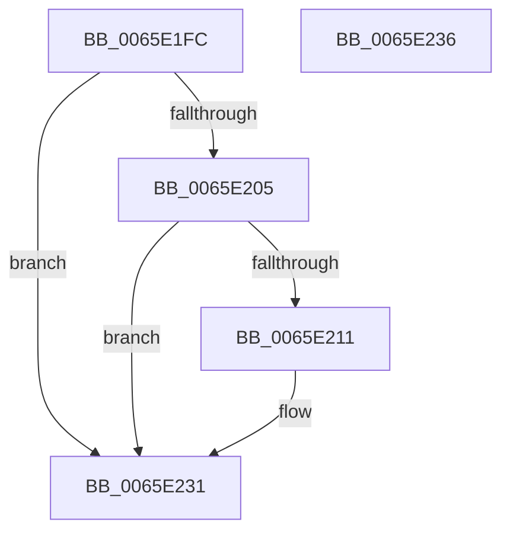

# WheapAddToDumpFile

- RVA: `0x0065E1FC`–`0x0065E237` (길이 `59` bytes)
- VA: `0x000000014065E1FC`
- 실행 섹션: `.text`
- PDB 이름 있음: `예`; PDB Function 태그: `아니요`
- unwind 정보 RVA: `0x0005C788`
- 디코드: `16`개 명령, `59/59` bytes 표시
- 미해석 바이트: `0` (있으면 어셈블리에 `.byte`로 보존)

> 이 문서는 커널 이미지의 기계어와 PDB 기호를 분석해 생성했습니다. 4번과 5번은 함수 원형과 자료형을 바이너리 사용 방식에서 추정한 C 해석이며 원본 소스 복구 결과는 아닙니다.

## 1. Dependencies

- 직접 호출 지점: **1**; 고유 호출 대상: **1**
- 직접 호출자로 확인된 함수: **2**
- RIP 상대 이미지 참조: **0**

### Outgoing calls
- `0x0065E22C` → [IoAddTriageDumpDataBlock](../42/IoAddTriageDumpDataBlock_function_00428374.md) (function, `0x00428374`)

### Direct callers
- [WheaReportHwError](../4E/WheaReportHwError_function_004ED200.md) at `0x004ED4F6`
- [WheaRecoveryBugCheck](WheaRecoveryBugCheck_function_0065E110.md) at `0x0065E14F`

### Static image references
- 디코드된 RIP-relative 메모리 참조가 없습니다.

## 2. Other-region calls and transfers

- 다른 실행 섹션으로 향하는 call: **0**
- 별도 외부 분기/꼬리 이동을 확인하지 못했습니다.

## 3. Assembly (complete function range)

```asm
0065E1FC  48 83 EC 28                     sub rsp, 0x28
0065E200  48 85 C9                        test rcx, rcx
0065E203  74 2C                           je 0x14065e231
0065E205  4C 8B C1                        mov r8, rcx
0065E208  49 81 E0 00 F0 FF FF            and r8, 0xfffffffffffff000
0065E20F  74 20                           je 0x14065e231
0065E211  81 E1 FF 0F 00 00               and ecx, 0xfff
0065E217  8B D2                           mov edx, edx
0065E219  48 81 C1 FF 0F 00 00            add rcx, 0xfff
0065E220  48 03 D1                        add rdx, rcx
0065E223  49 8B C8                        mov rcx, r8
0065E226  81 E2 00 F0 FF FF               and edx, 0xfffff000
0065E22C  E8 43 A1 DC FF                  call 0x140428374
0065E231  48 83 C4 28                     add rsp, 0x28
0065E235  C3                              ret
0065E236  CC                              int3
```

## 4. C-style interpretation (structured pseudocode)

```c
__int64 __fastcall WheapAddToDumpFile(__int64 a1, int a2)
{
    __int64 result;
    __int64 v_rsp;

    v_rsp = (v_rsp) - (40);
    if (a1 == 0) goto loc_0065E231;
    a3 = (a1) & (0xFFFFFFFFFFFFF000ULL);
    if (!(condition_is_equal)) {
        a1 = (unsigned int)((a1) & (0xFFFULL));
        a2 = a2;
        a1 = (a1) + (0xFFFULL);
        a2 = (a2) + (a1);
        a1 = a3;
        a2 = (unsigned int)((a2) & (0xFFFFF000ULL));
        result = IoAddTriageDumpDataBlock(a1, a2, a3, a4);
    }
    v_rsp = (v_rsp) + (40);
    return result;
}
```

## 5. (Beta) C Style

```c
int64_t WheapAddToDumpFile(int64_t Arg1, int32_t Arg2)
{
    int64_t result;
    int64_t local_rsp;

    local_rsp = (local_rsp) - (40);
    if (Arg1 == 0) goto loc_0065E231;
    a3 = (Arg1) & (0xFFFFFFFFFFFFF000ULL);
    if (!(condition_is_equal)) {
        Arg1 = (uint32_t)((Arg1) & (0xFFFULL));
        Arg2 = Arg2;
        Arg1 = (Arg1) + (0xFFFULL);
        Arg2 = (Arg2) + (Arg1);
        Arg1 = a3;
        Arg2 = (uint32_t)((Arg2) & (0xFFFFF000ULL));
        result = IoAddTriageDumpDataBlock(Arg1, Arg2, a3, a4);
    }
    local_rsp = (local_rsp) + (40);
    return result;
}
```

## 6. Execution-region graph

[열기: 2D/3D 그래프와 함수 탐색 컨트롤 패널](../../../control-panel.html?section=text&rva=0x0065E1FC&view=graph)

- 2D 그래프는 위에서 아래로 흐르고, 3D 그래프는 빈 공간을 드래그해 회전합니다. Shift+드래그는 이동, 휠은 확대·축소, 함수 노드 선택은 대상 보고서 이동입니다.

### Static fallback


