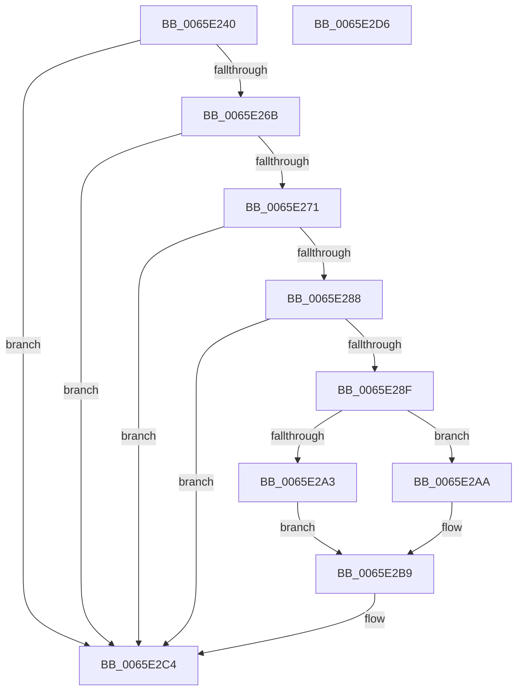

# WheapAttemptArchitecturalErrorRecovery

- RVA: `0x0065E240`–`0x0065E2D7` (길이 `151` bytes)
- VA: `0x000000014065E240`
- 실행 섹션: `.text`
- PDB 이름 있음: `예`; PDB Function 태그: `아니요`
- unwind 정보 RVA: `0x0005FD94`
- 디코드: `44`개 명령, `151/151` bytes 표시
- 미해석 바이트: `0` (있으면 어셈블리에 `.byte`로 보존)

> 이 문서는 커널 이미지의 기계어와 PDB 기호를 분석해 생성했습니다. 4번과 5번은 함수 원형과 자료형을 바이너리 사용 방식에서 추정한 C 해석이며 원본 소스 복구 결과는 아닙니다.

## 1. Dependencies

- 직접 호출 지점: **4**; 고유 호출 대상: **4**
- 직접 호출자로 확인된 함수: **1**
- RIP 상대 이미지 참조: **1**

### Outgoing calls
- `0x0065E25E` → [WheaGetErrPacketFromErrRecord](../55/WheaGetErrPacketFromErrRecord_function_00556490.md) (function, `0x00556490`)
- `0x0065E27B` → [WheapGetErrorSource](../49/WheapGetErrorSource_function_0049554C.md) (function, `0x0049554C`)
- `0x0065E299` → [WheapGetErrorSourceFunction](../49/WheapGetErrorSourceFunction_function_004974EC.md) (function, `0x004974EC`)
- `0x0065E2B2` → [guard_dispatch_icall](../6B/guard_dispatch_icall_function_006BAAD0.md) (function, `0x006BAAD0`)

### Direct callers
- [WheapAttemptErrorRecovery](WheapAttemptErrorRecovery_function_0065E2E0.md) at `0x0065E2ED`

### Static image references
- `0x0065E274` → RVA `0x00EEF018` (`.data`; read)

## 2. Other-region calls and transfers

- 다른 실행 섹션으로 향하는 call: **0**
- 별도 외부 분기/꼬리 이동을 확인하지 못했습니다.

## 3. Assembly (complete function range)

```asm
0065E240  48 89 5C 24 10                  mov qword ptr [rsp + 0x10], rbx
0065E245  48 89 74 24 18                  mov qword ptr [rsp + 0x18], rsi
0065E24A  57                              push rdi
0065E24B  48 83 EC 20                     sub rsp, 0x20
0065E24F  8B 41 0C                        mov eax, dword ptr [rcx + 0xc]
0065E252  48 8B F1                        mov rsi, rcx
0065E255  89 44 24 30                     mov dword ptr [rsp + 0x30], eax
0065E259  BF 0D 00 00 C0                  mov edi, 0xc000000d
0065E25E  E8 2D 82 EF FF                  call 0x140556490
0065E263  4C 8B D8                        mov r11, rax
0065E266  48 85 C0                        test rax, rax
0065E269  74 59                           je 0x14065e2c4
0065E26B  83 78 1C 12                     cmp dword ptr [rax + 0x1c], 0x12
0065E26F  77 53                           ja 0x14065e2c4
0065E271  8B 50 18                        mov edx, dword ptr [rax + 0x18]
0065E274  48 8D 0D 9D 0D 89 00            lea rcx, [rip + 0x890d9d]
0065E27B  E8 CC 72 E3 FF                  call 0x14049554c
0065E280  48 8B D8                        mov rbx, rax
0065E283  48 85 C0                        test rax, rax
0065E286  74 3C                           je 0x14065e2c4
0065E288  49 83 7B 30 00                  cmp qword ptr [r11 + 0x30], 0
0065E28D  74 35                           je 0x14065e2c4
0065E28F  45 33 C0                        xor r8d, r8d
0065E292  48 8B C8                        mov rcx, rax
0065E295  41 8D 50 03                     lea edx, [r8 + 3]
0065E299  E8 4E 92 E3 FF                  call 0x1404974ec
0065E29E  48 85 C0                        test rax, rax
0065E2A1  75 07                           jne 0x14065e2aa
0065E2A3  BF 02 00 00 C0                  mov edi, 0xc0000002
0065E2A8  EB 0F                           jmp 0x14065e2b9
0065E2AA  48 8D 54 24 30                  lea rdx, [rsp + 0x30]
0065E2AF  48 8B CE                        mov rcx, rsi
0065E2B2  E8 19 C8 05 00                  call 0x1406baad0
0065E2B7  8B F8                           mov edi, eax
0065E2B9  F0 FF 4B 5C                     lock dec dword ptr [rbx + 0x5c]
0065E2BD  8B 4C 24 30                     mov ecx, dword ptr [rsp + 0x30]
0065E2C1  89 4E 0C                        mov dword ptr [rsi + 0xc], ecx
0065E2C4  48 8B 5C 24 38                  mov rbx, qword ptr [rsp + 0x38]
0065E2C9  8B C7                           mov eax, edi
0065E2CB  48 8B 74 24 40                  mov rsi, qword ptr [rsp + 0x40]
0065E2D0  48 83 C4 20                     add rsp, 0x20
0065E2D4  5F                              pop rdi
0065E2D5  C3                              ret
0065E2D6  CC                              int3
```

## 4. C-style interpretation (structured pseudocode)

```c
__int64 __fastcall WheapAttemptArchitecturalErrorRecovery(__int64 a1, __int64 a2, int a3)
{
    __int64 result;
    __int64 v_rsp;
    unsigned __int64 v_stack_p10;
    unsigned __int64 v_stack_p18;
    unsigned int v_stack_p8;

    v_stack_p10 = v_rbx;
    v_stack_p18 = v_rsi;
    v_rsp = (v_rsp) - (32);
    v_stack_p8 = (unsigned int)((unsigned int)(*(unsigned int *)(a1 + 12)));
    result = WheaGetErrPacketFromErrRecord(a1, a2, a3, a4);
    if (result == 0) goto loc_0065E2C4;
    if ((*(unsigned int *)(result + 28)) > 18) goto loc_0065E2C4;
    result = WheapGetErrorSource(v_rip + 8981917, (unsigned int)(*(unsigned int *)(result + 24)), a3, a4);
    if (result == 0) goto loc_0065E2C4;
    if ((*(unsigned __int64 *)(result + 48)) == 0) goto loc_0065E2C4;
    a3 = 0;
    result = WheapGetErrorSourceFunction(result, a3 + 3, a3, a4);
    if (result != 0) goto loc_0065E2AA;
    goto loc_0065E2B9;
loc_0065E2AA:
    result = guard_dispatch_icall(a1, v_stack_p8, a3, a4);
loc_0065E2B9:
    *(unsigned int *)(a1 + 12) = (unsigned int)((unsigned int)(v_stack_p8));
loc_0065E2C4:
    v_rsp = (v_rsp) + (32);
    return (unsigned int)((unsigned int)((unsigned int)((unsigned int)(result))));
}
```

## 5. (Beta) C Style

```c
int64_t WheapAttemptArchitecturalErrorRecovery(void *Arg1, int64_t Arg2, int32_t Arg3)
{
    uint8_t *arg1 = (uint8_t *)Arg1;

    int64_t result;
    int64_t local_rsp;
    uint64_t v_stack_p10;
    uint64_t v_stack_p18;
    uint32_t v_stack_p8;

    v_stack_p10 = local_rbx;
    v_stack_p18 = local_rsi;
    local_rsp = (local_rsp) - (32);
    v_stack_p8 = (uint32_t)((uint32_t)(*(uint32_t *)(arg1 + 0xC)));
    result = WheaGetErrPacketFromErrRecord(Arg1, Arg2, Arg3, a4);
    if (result == 0) goto loc_0065E2C4;
    if ((*(uint32_t *)(result + 0x1C)) > 18) goto loc_0065E2C4;
    result = WheapGetErrorSource(v_rip + 8981917, (uint32_t)(*(uint32_t *)(result + 0x18)), Arg3, a4);
    if (result == 0) goto loc_0065E2C4;
    if ((*(uint64_t *)(result + 0x30)) == 0) goto loc_0065E2C4;
    Arg3 = 0;
    result = WheapGetErrorSourceFunction(result, Arg3 + 3, Arg3, a4);
    if (result != 0) goto loc_0065E2AA;
    goto loc_0065E2B9;
loc_0065E2AA:
    result = guard_dispatch_icall(Arg1, v_stack_p8, Arg3, a4);
loc_0065E2B9:
    *(uint32_t *)(arg1 + 0xC) = (uint32_t)((uint32_t)(v_stack_p8));
loc_0065E2C4:
    local_rsp = (local_rsp) + (32);
    return (uint32_t)((uint32_t)((uint32_t)((uint32_t)(result))));
}
```

### 관측된 메모리 오프셋

구조체 형식이 확인되지 않은 접근은 인자 기준의 오프셋으로만 기록했습니다.

| 기준 인자 | 오프셋 표현 | 폭 (bit) | 접근 |
|---|---:|---:|---|
| `Arg1` | `+ 0xC` | `32` | `R` |
| `Arg1` | `+ 0xC` | `32` | `W` |

## 6. Execution-region graph

[열기: 2D/3D 그래프와 함수 탐색 컨트롤 패널](../../../control-panel.html?section=text&rva=0x0065E240&view=graph)

- 2D 그래프는 위에서 아래로 흐르고, 3D 그래프는 빈 공간을 드래그해 회전합니다. Shift+드래그는 이동, 휠은 확대·축소, 함수 노드 선택은 대상 보고서 이동입니다.

### Static fallback


