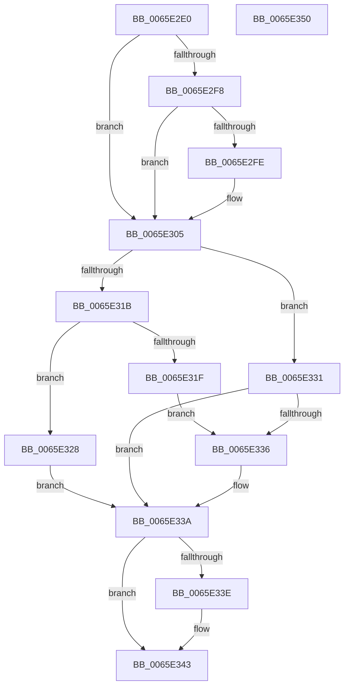

# WheapAttemptErrorRecovery

- RVA: `0x0065E2E0`–`0x0065E351` (길이 `113` bytes)
- VA: `0x000000014065E2E0`
- 실행 섹션: `.text`
- PDB 이름 있음: `예`; PDB Function 태그: `아니요`
- unwind 정보 RVA: `0x0005CAAC`
- 디코드: `36`개 명령, `113/113` bytes 표시
- 미해석 바이트: `0` (있으면 어셈블리에 `.byte`로 보존)

> 이 문서는 커널 이미지의 기계어와 PDB 기호를 분석해 생성했습니다. 4번과 5번은 함수 원형과 자료형을 바이너리 사용 방식에서 추정한 C 해석이며 원본 소스 복구 결과는 아닙니다.

## 1. Dependencies

- 직접 호출 지점: **2**; 고유 호출 대상: **2**
- 직접 호출자로 확인된 함수: **1**
- RIP 상대 이미지 참조: **1**

### Outgoing calls
- `0x0065E2ED` → [WheapAttemptArchitecturalErrorRecovery](WheapAttemptArchitecturalErrorRecovery_function_0065E240.md) (function, `0x0065E240`)
- `0x0065E308` → `PSHED.dll!PshedAttemptErrorRecovery` (import, 간접 대상; import `PSHED.dll!PshedAttemptErrorRecovery`)

### Direct callers
- [WheaReportHwError](../4E/WheaReportHwError_function_004ED200.md) at `0x004ED53E`

### Static image references
- `0x0065E308` → RVA `0x00151090` (`PSHED.dll!PshedAttemptErrorRecovery (IAT)`; read)

## 2. Other-region calls and transfers

- 다른 실행 섹션으로 향하는 call: **0**
- 별도 외부 분기/꼬리 이동을 확인하지 못했습니다.

## 3. Assembly (complete function range)

```asm
0065E2E0  48 89 5C 24 08                  mov qword ptr [rsp + 8], rbx
0065E2E5  57                              push rdi
0065E2E6  48 83 EC 20                     sub rsp, 0x20
0065E2EA  48 8B D9                        mov rbx, rcx
0065E2ED  E8 4E FF FF FF                  call 0x14065e240
0065E2F2  8B F8                           mov edi, eax
0065E2F4  85 C0                           test eax, eax
0065E2F6  78 0D                           js 0x14065e305
0065E2F8  83 7B 0C 00                     cmp dword ptr [rbx + 0xc], 0
0065E2FC  75 07                           jne 0x14065e305
0065E2FE  C7 43 0C 02 00 00 00            mov dword ptr [rbx + 0xc], 2
0065E305  48 8B CB                        mov rcx, rbx
0065E308  48 FF 15 81 2D AF FF            call qword ptr [rip - 0x50d27f]
0065E30F  0F 1F 44 00 00                  nop dword ptr [rax + rax]
0065E314  8B 4B 0C                        mov ecx, dword ptr [rbx + 0xc]
0065E317  85 C9                           test ecx, ecx
0065E319  75 16                           jne 0x14065e331
0065E31B  85 C0                           test eax, eax
0065E31D  78 09                           js 0x14065e328
0065E31F  C7 43 0C 02 00 00 00            mov dword ptr [rbx + 0xc], 2
0065E326  EB 0E                           jmp 0x14065e336
0065E328  C7 43 0C 01 00 00 00            mov dword ptr [rbx + 0xc], 1
0065E32F  EB 09                           jmp 0x14065e33a
0065E331  83 F9 02                        cmp ecx, 2
0065E334  75 04                           jne 0x14065e33a
0065E336  83 4B 68 01                     or dword ptr [rbx + 0x68], 1
0065E33A  85 FF                           test edi, edi
0065E33C  79 05                           jns 0x14065e343
0065E33E  85 C0                           test eax, eax
0065E340  0F 49 F8                        cmovns edi, eax
0065E343  48 8B 5C 24 30                  mov rbx, qword ptr [rsp + 0x30]
0065E348  8B C7                           mov eax, edi
0065E34A  48 83 C4 20                     add rsp, 0x20
0065E34E  5F                              pop rdi
0065E34F  C3                              ret
0065E350  CC                              int3
```

## 4. C-style interpretation (structured pseudocode)

```c
__int64 __fastcall WheapAttemptErrorRecovery(__int64 a1)
{
    __int64 result;
    __int64 v_rdi;
    __int64 v_rsp;
    unsigned __int64 v_stack_p8;

    v_stack_p8 = v_rbx;
    v_rsp = (v_rsp) - (32);
    result = WheapAttemptArchitecturalErrorRecovery(a1, a2, a3, a4);
    if (sign_flag) goto loc_0065E305;
    if ((*(unsigned int *)(a1 + 12)) == 0) {
        *(unsigned int *)(a1 + 12) = 2;
    }
    result = PSHED_dll_PshedAttemptErrorRecovery(a1, a2, a3, a4);
    if ((unsigned int)((unsigned int)(*(unsigned int *)(a1 + 12))) != 0) goto loc_0065E331;
    if (sign_flag) goto loc_0065E328;
    *(unsigned int *)(a1 + 12) = 2;
    goto loc_0065E336;
loc_0065E328:
    *(unsigned int *)(a1 + 12) = 1;
    goto loc_0065E33A;
loc_0065E331:
    if (((unsigned int)((unsigned int)(*(unsigned int *)(a1 + 12)))) == 2) {
    }
    v_rdi = (unsigned int)((unsigned int)(result));
    if (sign_flag) {
        v_rdi = (unsigned int)((unsigned int)(result));
        if (!sign_flag) { v_rdi = (unsigned int)(result); }
    }
    v_rsp = (v_rsp) + (32);
    return (unsigned int)((unsigned int)(v_rdi));
}
```

## 5. (Beta) C Style

```c
int64_t WheapAttemptErrorRecovery(void *Arg1)
{
    uint8_t *arg1 = (uint8_t *)Arg1;

    int64_t result;
    int64_t local_rdi;
    int64_t local_rsp;
    uint64_t v_stack_p8;

    v_stack_p8 = local_rbx;
    local_rsp = (local_rsp) - (32);
    result = WheapAttemptArchitecturalErrorRecovery(Arg1, a2, a3, a4);
    if (sign_flag) goto loc_0065E305;
    if ((*(uint32_t *)(arg1 + 0xC)) == 0) {
        *(uint32_t *)(arg1 + 0xC) = 2;
    }
    result = kernel_indirect_call(Arg1, a2, a3, a4);
    if ((uint32_t)((uint32_t)(*(uint32_t *)(arg1 + 0xC))) != 0) goto loc_0065E331;
    if (sign_flag) goto loc_0065E328;
    *(uint32_t *)(arg1 + 0xC) = 2;
    goto loc_0065E336;
loc_0065E328:
    *(uint32_t *)(arg1 + 0xC) = 1;
    goto loc_0065E33A;
loc_0065E331:
    if (((uint32_t)((uint32_t)(*(uint32_t *)(arg1 + 0xC)))) == 2) {
    }
    local_rdi = (uint32_t)((uint32_t)(result));
    if (sign_flag) {
        local_rdi = (uint32_t)((uint32_t)(result));
        if (!sign_flag) { local_rdi = (uint32_t)(result); }
    }
    local_rsp = (local_rsp) + (32);
    return (uint32_t)((uint32_t)(local_rdi));
}
```

### 관측된 메모리 오프셋

구조체 형식이 확인되지 않은 접근은 인자 기준의 오프셋으로만 기록했습니다.

| 기준 인자 | 오프셋 표현 | 폭 (bit) | 접근 |
|---|---:|---:|---|
| `Arg1` | `+ 0xC` | `32` | `R` |
| `Arg1` | `+ 0xC` | `32` | `W` |
| `Arg1` | `+ 0x68` | `32` | `R/W` |

## 6. Execution-region graph

[열기: 2D/3D 그래프와 함수 탐색 컨트롤 패널](../../../control-panel.html?section=text&rva=0x0065E2E0&view=graph)

- 2D 그래프는 위에서 아래로 흐르고, 3D 그래프는 빈 공간을 드래그해 회전합니다. Shift+드래그는 이동, 휠은 확대·축소, 함수 노드 선택은 대상 보고서 이동입니다.

### Static fallback


