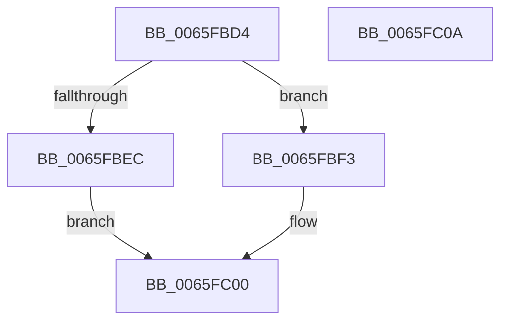

# WheapCallErrorSourceCorrect

- RVA: `0x0065FBD4`–`0x0065FC0B` (길이 `55` bytes)
- VA: `0x000000014065FBD4`
- 실행 섹션: `.text`
- PDB 이름 있음: `예`; PDB Function 태그: `아니요`
- unwind 정보 RVA: `0x0005CF00`
- 디코드: `18`개 명령, `55/55` bytes 표시
- 미해석 바이트: `0` (있으면 어셈블리에 `.byte`로 보존)

> 이 문서는 커널 이미지의 기계어와 PDB 기호를 분석해 생성했습니다. 4번과 5번은 함수 원형과 자료형을 바이너리 사용 방식에서 추정한 C 해석이며 원본 소스 복구 결과는 아닙니다.

## 1. Dependencies

- 직접 호출 지점: **2**; 고유 호출 대상: **2**
- 직접 호출자로 확인된 함수: **1**
- RIP 상대 이미지 참조: **0**

### Outgoing calls
- `0x0065FBE2` → [WheapGetErrorSourceFunction](../49/WheapGetErrorSourceFunction_function_004974EC.md) (function, `0x004974EC`)
- `0x0065FBFB` → [guard_dispatch_icall](../6B/guard_dispatch_icall_function_006BAAD0.md) (function, `0x006BAAD0`)

### Direct callers
- [WheapInitializeErrorSource](../../page/7D/WheapInitializeErrorSource_function_007D68E0.md) at `0x007D6918`

### Static image references
- 디코드된 RIP-relative 메모리 참조가 없습니다.

## 2. Other-region calls and transfers

- 다른 실행 섹션으로 향하는 call: **0**
- 별도 외부 분기/꼬리 이동을 확인하지 못했습니다.

## 3. Assembly (complete function range)

```asm
0065FBD4  40 53                           push rbx
0065FBD6  48 83 EC 20                     sub rsp, 0x20
0065FBDA  45 33 C0                        xor r8d, r8d
0065FBDD  33 D2                           xor edx, edx
0065FBDF  48 8B D9                        mov rbx, rcx
0065FBE2  E8 05 79 E3 FF                  call 0x1404974ec
0065FBE7  48 85 C0                        test rax, rax
0065FBEA  75 07                           jne 0x14065fbf3
0065FBEC  B8 02 00 00 C0                  mov eax, 0xc0000002
0065FBF1  EB 0D                           jmp 0x14065fc00
0065FBF3  48 8D 53 44                     lea rdx, [rbx + 0x44]
0065FBF7  48 8D 4B 60                     lea rcx, [rbx + 0x60]
0065FBFB  E8 D0 AE 05 00                  call 0x1406baad0
0065FC00  F0 FF 4B 5C                     lock dec dword ptr [rbx + 0x5c]
0065FC04  48 83 C4 20                     add rsp, 0x20
0065FC08  5B                              pop rbx
0065FC09  C3                              ret
0065FC0A  CC                              int3
```

## 4. C-style interpretation (structured pseudocode)

```c
__int64 __fastcall WheapCallErrorSourceCorrect(__int64 a1, int a2, int a3)
{
    __int64 result;
    __int64 v_rsp;

    v_rsp = (v_rsp) - (32);
    a3 = 0;
    a2 = 0;
    result = WheapGetErrorSourceFunction(a1, a2, a3, a4);
    if (result != 0) goto loc_0065FBF3;
    goto loc_0065FC00;
loc_0065FBF3:
    result = guard_dispatch_icall(a1 + 96, a1 + 68, a3, a4);
loc_0065FC00:
    v_rsp = (v_rsp) + (32);
    return result;
}
```

## 5. (Beta) C Style

```c
int64_t WheapCallErrorSourceCorrect(void *Arg1, int32_t Arg2, int32_t Arg3)
{
    uint8_t *arg1 = (uint8_t *)Arg1;

    int64_t result;
    int64_t local_rsp;

    local_rsp = (local_rsp) - (32);
    Arg3 = 0;
    Arg2 = 0;
    result = WheapGetErrorSourceFunction(Arg1, Arg2, Arg3, a4);
    if (result != 0) goto loc_0065FBF3;
    goto loc_0065FC00;
loc_0065FBF3:
    result = guard_dispatch_icall(Arg1 + 96, Arg1 + 68, Arg3, a4);
loc_0065FC00:
    local_rsp = (local_rsp) + (32);
    return result;
}
```

### 관측된 메모리 오프셋

구조체 형식이 확인되지 않은 접근은 인자 기준의 오프셋으로만 기록했습니다.

| 기준 인자 | 오프셋 표현 | 폭 (bit) | 접근 |
|---|---:|---:|---|
| `Arg1` | `+ 0x44` | `64` | `R` |
| `Arg1` | `+ 0x5C` | `32` | `R/W` |
| `Arg1` | `+ 0x60` | `64` | `R` |

## 6. Execution-region graph

[열기: 2D/3D 그래프와 함수 탐색 컨트롤 패널](../../../control-panel.html?section=text&rva=0x0065FBD4&view=graph)

- 2D 그래프는 위에서 아래로 흐르고, 3D 그래프는 빈 공간을 드래그해 회전합니다. Shift+드래그는 이동, 휠은 확대·축소, 함수 노드 선택은 대상 보고서 이동입니다.

### Static fallback


