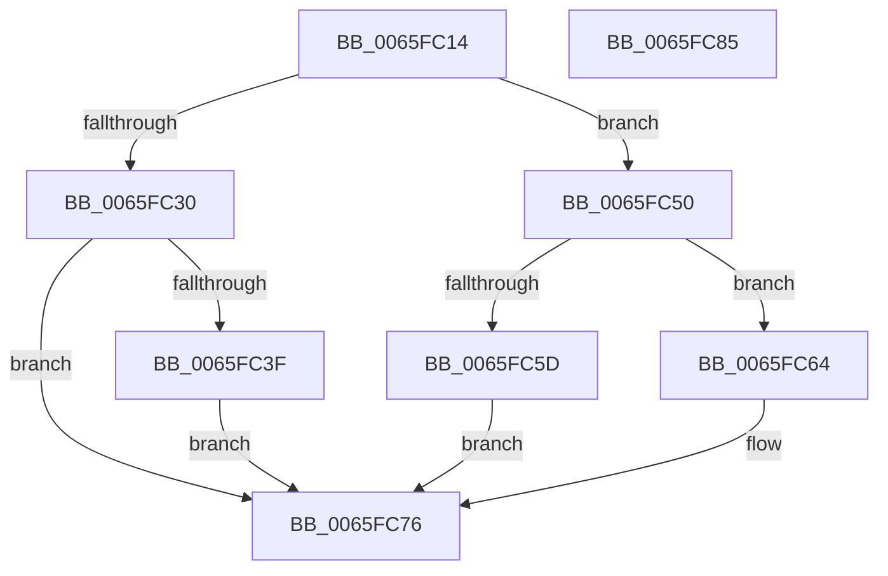

# WheapCallErrorSourceInitialize

- RVA: `0x0065FC14`–`0x0065FC86` (길이 `114` bytes)
- VA: `0x000000014065FC14`
- 실행 섹션: `.text`
- PDB 이름 있음: `예`; PDB Function 태그: `아니요`
- unwind 정보 RVA: `0x0005CAAC`
- 디코드: `36`개 명령, `114/114` bytes 표시
- 미해석 바이트: `0` (있으면 어셈블리에 `.byte`로 보존)

> 이 문서는 커널 이미지의 기계어와 PDB 기호를 분석해 생성했습니다. 4번과 5번은 함수 원형과 자료형을 바이너리 사용 방식에서 추정한 C 해석이며 원본 소스 복구 결과는 아닙니다.

## 1. Dependencies

- 직접 호출 지점: **4**; 고유 호출 대상: **2**
- 직접 호출자로 확인된 함수: **4**
- RIP 상대 이미지 참조: **0**

### Outgoing calls
- `0x0065FC30` → [WheapGetErrorSourceFunction](../49/WheapGetErrorSourceFunction_function_004974EC.md) (function, `0x004974EC`)
- `0x0065FC49` → [guard_dispatch_icall](../6B/guard_dispatch_icall_function_006BAAD0.md) (function, `0x006BAAD0`)
- `0x0065FC50` → [WheapGetErrorSourceFunction](../49/WheapGetErrorSourceFunction_function_004974EC.md) (function, `0x004974EC`)
- `0x0065FC71` → [guard_dispatch_icall](../6B/guard_dispatch_icall_function_006BAAD0.md) (function, `0x006BAAD0`)

### Direct callers
- [WheapInitializeDeferredErrorSources](WheapInitializeDeferredErrorSources_function_0065DDA0.md) at `0x0065DDF0`
- [WheaAddErrorSource](../../page/7D/WheaAddErrorSource_function_007D69D0.md) at `0x007D6B32`
- [WheaInitializeProcessor](../../pagelk/B7/WheaInitializeProcessor_function_00B732E4.md) at `0x00B73374`
- [WheaInitialize](../../init/C5/WheaInitialize_function_00C54C08.md) at `0x00C54FC6`
- [WheaInitialize](../../init/C5/WheaInitialize_function_00C54C08.md) at `0x00C550A5`

### Static image references
- 디코드된 RIP-relative 메모리 참조가 없습니다.

## 2. Other-region calls and transfers

- 다른 실행 섹션으로 향하는 call: **0**
- 별도 외부 분기/꼬리 이동을 확인하지 못했습니다.

## 3. Assembly (complete function range)

```asm
0065FC14  48 89 5C 24 08                  mov qword ptr [rsp + 8], rbx
0065FC19  57                              push rdi
0065FC1A  48 83 EC 20                     sub rsp, 0x20
0065FC1E  45 33 C0                        xor r8d, r8d
0065FC21  8B FA                           mov edi, edx
0065FC23  83 79 28 10                     cmp dword ptr [rcx + 0x28], 0x10
0065FC27  48 8B D9                        mov rbx, rcx
0065FC2A  41 8D 50 01                     lea edx, [r8 + 1]
0065FC2E  75 20                           jne 0x14065fc50
0065FC30  E8 B7 78 E3 FF                  call 0x1404974ec
0065FC35  4C 8B C0                        mov r8, rax
0065FC38  33 C0                           xor eax, eax
0065FC3A  4D 85 C0                        test r8, r8
0065FC3D  74 37                           je 0x14065fc76
0065FC3F  8B 53 7C                        mov edx, dword ptr [rbx + 0x7c]
0065FC42  49 8B C0                        mov rax, r8
0065FC45  48 8B 4B 38                     mov rcx, qword ptr [rbx + 0x38]
0065FC49  E8 82 AE 05 00                  call 0x1406baad0
0065FC4E  EB 26                           jmp 0x14065fc76
0065FC50  E8 97 78 E3 FF                  call 0x1404974ec
0065FC55  4C 8B C8                        mov r9, rax
0065FC58  48 85 C0                        test rax, rax
0065FC5B  75 07                           jne 0x14065fc64
0065FC5D  B8 02 00 00 C0                  mov eax, 0xc0000002
0065FC62  EB 12                           jmp 0x14065fc76
0065FC64  4C 8B 43 38                     mov r8, qword ptr [rbx + 0x38]
0065FC68  48 8D 53 60                     lea rdx, [rbx + 0x60]
0065FC6C  8B CF                           mov ecx, edi
0065FC6E  49 8B C1                        mov rax, r9
0065FC71  E8 5A AE 05 00                  call 0x1406baad0
0065FC76  F0 FF 4B 5C                     lock dec dword ptr [rbx + 0x5c]
0065FC7A  48 8B 5C 24 30                  mov rbx, qword ptr [rsp + 0x30]
0065FC7F  48 83 C4 20                     add rsp, 0x20
0065FC83  5F                              pop rdi
0065FC84  C3                              ret
0065FC85  CC                              int3
```

## 4. C-style interpretation (structured pseudocode)

```c
__int64 __fastcall WheapCallErrorSourceInitialize(__int64 a1, int a2, int a3)
{
    __int64 result;
    __int64 v_rsp;
    unsigned __int64 v_stack_p8;

    v_stack_p8 = v_rbx;
    v_rsp = (v_rsp) - (32);
    a3 = 0;
    if ((*(unsigned int *)(a1 + 40)) != 16) goto loc_0065FC50;
    result = WheapGetErrorSourceFunction(a1, a3 + 1, a3, a4);
    result = 0;
    if (0 == 0) goto loc_0065FC76;
    result = guard_dispatch_icall(*(unsigned __int64 *)(a1 + 56), (unsigned int)(*(unsigned int *)(a1 + 124)), result, a4);
    goto loc_0065FC76;
loc_0065FC50:
    result = WheapGetErrorSourceFunction(*(unsigned __int64 *)(a1 + 56), (unsigned int)(*(unsigned int *)(a1 + 124)), result, a4);
    if (result != 0) goto loc_0065FC64;
    goto loc_0065FC76;
loc_0065FC64:
    result = guard_dispatch_icall((unsigned int)((unsigned int)((unsigned int)(a2))), a1 + 96, *(unsigned __int64 *)(a1 + 56), result);
loc_0065FC76:
    v_rsp = (v_rsp) + (32);
    return result;
}
```

## 5. (Beta) C Style

```c
int64_t WheapCallErrorSourceInitialize(void *Arg1, int32_t Arg2, int32_t Arg3)
{
    uint8_t *arg1 = (uint8_t *)Arg1;

    int64_t result;
    int64_t local_rsp;
    uint64_t v_stack_p8;

    v_stack_p8 = local_rbx;
    local_rsp = (local_rsp) - (32);
    Arg3 = 0;
    if ((*(uint32_t *)(arg1 + 0x28)) != 16) goto loc_0065FC50;
    result = WheapGetErrorSourceFunction(Arg1, Arg3 + 1, Arg3, a4);
    result = 0;
    if (0 == 0) goto loc_0065FC76;
    result = guard_dispatch_icall(*(uint64_t *)(arg1 + 0x38), (uint32_t)(*(uint32_t *)(arg1 + 0x7C)), result, a4);
    goto loc_0065FC76;
loc_0065FC50:
    result = WheapGetErrorSourceFunction(*(uint64_t *)(arg1 + 0x38), (uint32_t)(*(uint32_t *)(arg1 + 0x7C)), result, a4);
    if (result != 0) goto loc_0065FC64;
    goto loc_0065FC76;
loc_0065FC64:
    result = guard_dispatch_icall((uint32_t)((uint32_t)((uint32_t)(Arg2))), Arg1 + 96, *(uint64_t *)(arg1 + 0x38), result);
loc_0065FC76:
    local_rsp = (local_rsp) + (32);
    return result;
}
```

### 관측된 메모리 오프셋

구조체 형식이 확인되지 않은 접근은 인자 기준의 오프셋으로만 기록했습니다.

| 기준 인자 | 오프셋 표현 | 폭 (bit) | 접근 |
|---|---:|---:|---|
| `Arg1` | `+ 0x28` | `32` | `R` |
| `Arg1` | `+ 0x38` | `64` | `R` |
| `Arg1` | `+ 0x5C` | `32` | `R/W` |
| `Arg1` | `+ 0x60` | `64` | `R` |
| `Arg1` | `+ 0x7C` | `32` | `R` |

## 6. Execution-region graph

[열기: 2D/3D 그래프와 함수 탐색 컨트롤 패널](../../../control-panel.html?section=text&rva=0x0065FC14&view=graph)

- 2D 그래프는 위에서 아래로 흐르고, 3D 그래프는 빈 공간을 드래그해 회전합니다. Shift+드래그는 이동, 휠은 확대·축소, 함수 노드 선택은 대상 보고서 이동입니다.

### Static fallback


