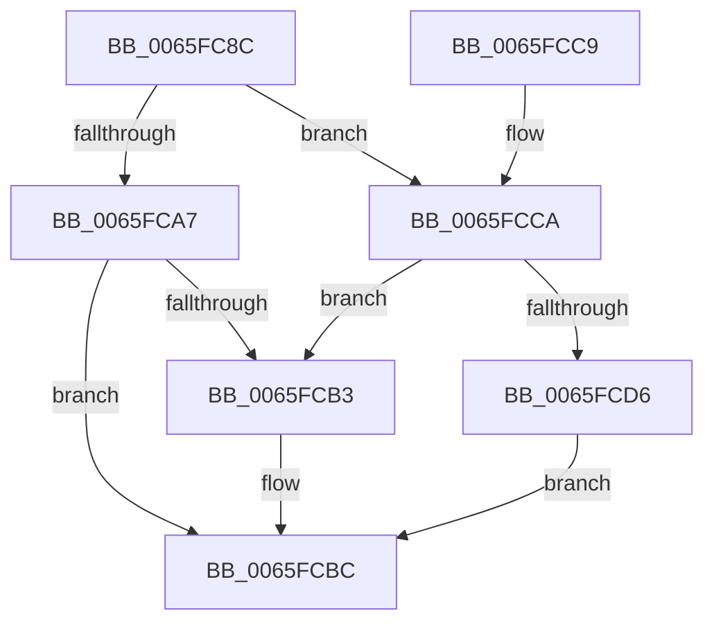

# WheapCallErrorSourceUninitialize

- RVA: `0x0065FC8C`–`0x0065FCDD` (길이 `81` bytes)
- VA: `0x000000014065FC8C`
- 실행 섹션: `.text`
- PDB 이름 있음: `예`; PDB Function 태그: `아니요`
- unwind 정보 RVA: `0x00065624`
- 디코드: `26`개 명령, `81/81` bytes 표시
- 미해석 바이트: `0` (있으면 어셈블리에 `.byte`로 보존)

> 이 문서는 커널 이미지의 기계어와 PDB 기호를 분석해 생성했습니다. 4번과 5번은 함수 원형과 자료형을 바이너리 사용 방식에서 추정한 C 해석이며 원본 소스 복구 결과는 아닙니다.

## 1. Dependencies

- 직접 호출 지점: **3**; 고유 호출 대상: **2**
- 직접 호출자로 확인된 함수: **1**
- RIP 상대 이미지 참조: **0**

### Outgoing calls
- `0x0065FCA7` → [WheapGetErrorSourceFunction](../49/WheapGetErrorSourceFunction_function_004974EC.md) (function, `0x004974EC`)
- `0x0065FCB7` → [guard_dispatch_icall](../6B/guard_dispatch_icall_function_006BAAD0.md) (function, `0x006BAAD0`)
- `0x0065FCCA` → [WheapGetErrorSourceFunction](../49/WheapGetErrorSourceFunction_function_004974EC.md) (function, `0x004974EC`)

### Direct callers
- [WheaRemoveErrorSource](../../page/7D/WheaRemoveErrorSource_function_007D6C70.md) at `0x007D6DA1`

### Static image references
- 디코드된 RIP-relative 메모리 참조가 없습니다.

## 2. Other-region calls and transfers

- 다른 실행 섹션으로 향하는 call: **0**
- 별도 외부 분기/꼬리 이동을 확인하지 못했습니다.

## 3. Assembly (complete function range)

```asm
0065FC8C  48 89 5C 24 08                  mov qword ptr [rsp + 8], rbx
0065FC91  57                              push rdi
0065FC92  48 83 EC 20                     sub rsp, 0x20
0065FC96  83 79 28 10                     cmp dword ptr [rcx + 0x28], 0x10
0065FC9A  48 8B F9                        mov rdi, rcx
0065FC9D  41 B0 01                        mov r8b, 1
0065FCA0  BA 04 00 00 00                  mov edx, 4
0065FCA5  75 23                           jne 0x14065fcca
0065FCA7  E8 40 78 E3 FF                  call 0x1404974ec
0065FCAC  33 DB                           xor ebx, ebx
0065FCAE  48 85 C0                        test rax, rax
0065FCB1  74 09                           je 0x14065fcbc
0065FCB3  48 8B 4F 38                     mov rcx, qword ptr [rdi + 0x38]
0065FCB7  E8 14 AE 05 00                  call 0x1406baad0
0065FCBC  8B C3                           mov eax, ebx
0065FCBE  48 8B 5C 24 30                  mov rbx, qword ptr [rsp + 0x30]
0065FCC3  48 83 C4 20                     add rsp, 0x20
0065FCC7  5F                              pop rdi
0065FCC8  C3                              ret
0065FCC9  CC                              int3
0065FCCA  E8 1D 78 E3 FF                  call 0x1404974ec
0065FCCF  33 DB                           xor ebx, ebx
0065FCD1  48 85 C0                        test rax, rax
0065FCD4  75 DD                           jne 0x14065fcb3
0065FCD6  BB 02 00 00 C0                  mov ebx, 0xc0000002
0065FCDB  EB DF                           jmp 0x14065fcbc
```

## 4. C-style interpretation (structured pseudocode)

```c
__int64 __fastcall WheapCallErrorSourceUninitialize(__int64 a1)
{
    __int64 result;
    __int64 v_rbx;
    __int64 v_rsp;
    unsigned __int64 v_stack_p8;

    v_stack_p8 = v_rbx;
    v_rsp = (v_rsp) - (32);
    if ((*(unsigned int *)(a1 + 40)) != 16) goto loc_0065FCCA;
    result = WheapGetErrorSourceFunction(a1, 4, 1, a4);
    v_rbx = 0;
    if (result != 0) {
        a1 = *(unsigned __int64 *)(a1 + 56);
        result = guard_dispatch_icall(a1, 4, 1, a4);
    }
    v_rsp = (v_rsp) + (32);
    return 0;
loc_0065FCCA:
    result = WheapGetErrorSourceFunction(a1, 4, 1, a4);
    v_rbx = 0;
    if (result != 0) goto loc_0065FCB3;
    goto loc_0065FCBC;
}
```

## 5. (Beta) C Style

```c
int64_t WheapCallErrorSourceUninitialize(void *Arg1)
{
    uint8_t *arg1 = (uint8_t *)Arg1;

    int64_t result;
    int64_t local_rbx;
    int64_t local_rsp;
    uint64_t v_stack_p8;

    v_stack_p8 = local_rbx;
    local_rsp = (local_rsp) - (32);
    if ((*(uint32_t *)(arg1 + 0x28)) != 16) goto loc_0065FCCA;
    result = WheapGetErrorSourceFunction(Arg1, 4, 1, a4);
    local_rbx = 0;
    if (result != 0) {
        Arg1 = *(uint64_t *)(arg1 + 0x38);
        result = guard_dispatch_icall(Arg1, 4, 1, a4);
    }
    local_rsp = (local_rsp) + (32);
    return 0;
loc_0065FCCA:
    result = WheapGetErrorSourceFunction(Arg1, 4, 1, a4);
    local_rbx = 0;
    if (result != 0) goto loc_0065FCB3;
    goto loc_0065FCBC;
}
```

### 관측된 메모리 오프셋

구조체 형식이 확인되지 않은 접근은 인자 기준의 오프셋으로만 기록했습니다.

| 기준 인자 | 오프셋 표현 | 폭 (bit) | 접근 |
|---|---:|---:|---|
| `Arg1` | `+ 0x28` | `32` | `R` |
| `Arg1` | `+ 0x38` | `64` | `R` |

## 6. Execution-region graph

[열기: 2D/3D 그래프와 함수 탐색 컨트롤 패널](../../../control-panel.html?section=text&rva=0x0065FC8C&view=graph)

- 2D 그래프는 위에서 아래로 흐르고, 3D 그래프는 빈 공간을 드래그해 회전합니다. Shift+드래그는 이동, 휠은 확대·축소, 함수 노드 선택은 대상 보고서 이동입니다.

### Static fallback


