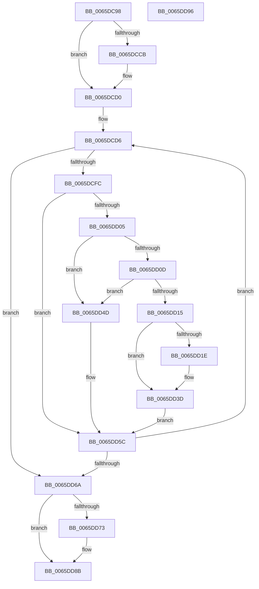

# WheapCheckForAndReportErrorsFromPreviousSession

- RVA: `0x0065DC98`–`0x0065DD97` (길이 `255` bytes)
- VA: `0x000000014065DC98`
- 실행 섹션: `.text`
- PDB 이름 있음: `예`; PDB Function 태그: `아니요`
- unwind 정보 RVA: `0x000C4850`
- 디코드: `67`개 명령, `255/255` bytes 표시
- 미해석 바이트: `0` (있으면 어셈블리에 `.byte`로 보존)

> 이 문서는 커널 이미지의 기계어와 PDB 기호를 분석해 생성했습니다. 4번과 5번은 함수 원형과 자료형을 바이너리 사용 방식에서 추정한 C 해석이며 원본 소스 복구 결과는 아닙니다.

## 1. Dependencies

- 직접 호출 지점: **9**; 고유 호출 대상: **7**
- 직접 호출자로 확인된 함수: **1**
- RIP 상대 이미지 참조: **3**

### Outgoing calls
- `0x0065DCBB` → `PSHED.dll!PshedGetBootErrorPacket` (import, 간접 대상; import `PSHED.dll!PshedGetBootErrorPacket`)
- `0x0065DCEC` → `PSHED.dll!PshedReadErrorRecord` (import, 간접 대상; import `PSHED.dll!PshedReadErrorRecord`)
- `0x0065DD15` → [WheapReportPersistedErrorRecord](WheapReportPersistedErrorRecord_function_0065E010.md) (function, `0x0065E010`)
- `0x0065DD31` → `PSHED.dll!PshedClearErrorRecord` (import, 간접 대상; import `PSHED.dll!PshedClearErrorRecord`)
- `0x0065DD46` → [ExFreePoolWithTag](../../poolcode/B8/ExFreePoolWithTag_function_00B82870.md) (function, `0x00B82870`)
- `0x0065DD52` → [ExFreePoolWithTag](../../poolcode/B8/ExFreePoolWithTag_function_00B82870.md) (function, `0x00B82870`)
- `0x0065DD73` → [WheapReportBootError](WheapReportBootError_function_0065DF58.md) (function, `0x0065DF58`)
- `0x0065DD81` → [ExFreePoolWithTag](../../poolcode/B8/ExFreePoolWithTag_function_00B82870.md) (function, `0x00B82870`)
- `0x0065DD8B` → [WheapProcessEfiBadMemoryPage](WheapProcessEfiBadMemoryPage_function_0065DEAC.md) (function, `0x0065DEAC`)

### Direct callers
- [WheaInitialize](../../init/C5/WheaInitialize_function_00C54C08.md) at `0x00C5506F`

### Static image references
- `0x0065DCBB` → RVA `0x00151078` (`PSHED.dll!PshedGetBootErrorPacket (IAT)`; read)
- `0x0065DCEC` → RVA `0x00151110` (`PSHED.dll!PshedReadErrorRecord (IAT)`; read)
- `0x0065DD31` → RVA `0x001510B8` (`PSHED.dll!PshedClearErrorRecord (IAT)`; read)

## 2. Other-region calls and transfers

- 다른 실행 섹션으로 향하는 call: **3**
  - `0x0065DD46` → [ExFreePoolWithTag](../../poolcode/B8/ExFreePoolWithTag_function_00B82870.md) (`.text` → `POOLCODE`)
  - `0x0065DD52` → [ExFreePoolWithTag](../../poolcode/B8/ExFreePoolWithTag_function_00B82870.md) (`.text` → `POOLCODE`)
  - `0x0065DD81` → [ExFreePoolWithTag](../../poolcode/B8/ExFreePoolWithTag_function_00B82870.md) (`.text` → `POOLCODE`)
- 별도 외부 분기/꼬리 이동을 확인하지 못했습니다.

## 3. Assembly (complete function range)

```asm
0065DC98  40 55                           push rbp
0065DC9A  48 8B EC                        mov rbp, rsp
0065DC9D  48 83 EC 40                     sub rsp, 0x40
0065DCA1  48 83 65 28 00                  and qword ptr [rbp + 0x28], 0
0065DCA6  48 8D 55 28                     lea rdx, [rbp + 0x28]
0065DCAA  83 65 18 00                     and dword ptr [rbp + 0x18], 0
0065DCAE  48 8D 4D 18                     lea rcx, [rbp + 0x18]
0065DCB2  83 65 10 00                     and dword ptr [rbp + 0x10], 0
0065DCB6  48 83 65 20 00                  and qword ptr [rbp + 0x20], 0
0065DCBB  48 FF 15 B6 33 AF FF            call qword ptr [rip - 0x50cc4a]
0065DCC2  0F 1F 44 00 00                  nop dword ptr [rax + rax]
0065DCC7  85 C0                           test eax, eax
0065DCC9  79 05                           jns 0x14065dcd0
0065DCCB  48 83 65 28 00                  and qword ptr [rbp + 0x28], 0
0065DCD0  33 C0                           xor eax, eax
0065DCD2  48 89 45 F0                     mov qword ptr [rbp - 0x10], rax
0065DCD6  48 8D 4D 20                     lea rcx, [rbp + 0x20]
0065DCDA  48 8B D0                        mov rdx, rax
0065DCDD  48 89 4C 24 20                  mov qword ptr [rsp + 0x20], rcx
0065DCE2  4C 8D 4D 10                     lea r9, [rbp + 0x10]
0065DCE6  33 C9                           xor ecx, ecx
0065DCE8  4C 8D 45 F0                     lea r8, [rbp - 0x10]
0065DCEC  48 FF 15 1D 34 AF FF            call qword ptr [rip - 0x50cbe3]
0065DCF3  0F 1F 44 00 00                  nop dword ptr [rax + rax]
0065DCF8  85 C0                           test eax, eax
0065DCFA  78 6E                           js 0x14065dd6a
0065DCFC  48 8B 4D 20                     mov rcx, qword ptr [rbp + 0x20]
0065DD00  48 85 C9                        test rcx, rcx
0065DD03  74 57                           je 0x14065dd5c
0065DD05  81 39 43 50 45 52               cmp dword ptr [rcx], 0x52455043
0065DD0B  75 40                           jne 0x14065dd4d
0065DD0D  8B 45 10                        mov eax, dword ptr [rbp + 0x10]
0065DD10  39 41 14                        cmp dword ptr [rcx + 0x14], eax
0065DD13  77 38                           ja 0x14065dd4d
0065DD15  E8 F6 02 00 00                  call 0x14065e010
0065DD1A  3C 01                           cmp al, 1
0065DD1C  75 1F                           jne 0x14065dd3d
0065DD1E  48 8B 55 20                     mov rdx, qword ptr [rbp + 0x20]
0065DD22  48 8B 42 6C                     mov rax, qword ptr [rdx + 0x6c]
0065DD26  48 8B 52 60                     mov rdx, qword ptr [rdx + 0x60]
0065DD2A  48 C1 E8 28                     shr rax, 0x28
0065DD2E  0F B7 C8                        movzx ecx, ax
0065DD31  48 FF 15 80 33 AF FF            call qword ptr [rip - 0x50cc80]
0065DD38  0F 1F 44 00 00                  nop dword ptr [rax + rax]
0065DD3D  48 8B 4D 20                     mov rcx, qword ptr [rbp + 0x20]
0065DD41  BA 50 53 48 44                  mov edx, 0x44485350
0065DD46  E8 25 4B 52 00                  call 0x140b82870
0065DD4B  EB 0F                           jmp 0x14065dd5c
0065DD4D  BA 50 53 48 44                  mov edx, 0x44485350
0065DD52  E8 19 4B 52 00                  call 0x140b82870
0065DD57  48 83 65 20 00                  and qword ptr [rbp + 0x20], 0
0065DD5C  48 8B 45 F0                     mov rax, qword ptr [rbp - 0x10]
0065DD60  48 83 F8 FF                     cmp rax, -1
0065DD64  0F 85 6C FF FF FF               jne 0x14065dcd6
0065DD6A  48 8B 4D 28                     mov rcx, qword ptr [rbp + 0x28]
0065DD6E  48 85 C9                        test rcx, rcx
0065DD71  74 18                           je 0x14065dd8b
0065DD73  E8 E0 01 00 00                  call 0x14065df58
0065DD78  48 8B 4D 28                     mov rcx, qword ptr [rbp + 0x28]
0065DD7C  BA 50 53 48 44                  mov edx, 0x44485350
0065DD81  E8 EA 4A 52 00                  call 0x140b82870
0065DD86  48 83 65 28 00                  and qword ptr [rbp + 0x28], 0
0065DD8B  E8 1C 01 00 00                  call 0x14065deac
0065DD90  48 83 C4 40                     add rsp, 0x40
0065DD94  5D                              pop rbp
0065DD95  C3                              ret
0065DD96  CC                              int3
```

## 4. C-style interpretation (structured pseudocode)

```c
__int64 __fastcall WheapCheckForAndReportErrorsFromPreviousSession(void)
{
    __int64 result;
    __int64 v_rsp;
    unsigned __int64 v_stack_m18;
    unsigned __int64 v_stack_m28;
    unsigned int v_stack_p10;
    unsigned __int64 v_stack_p18;
    unsigned __int64 v_stack_p20;
    unsigned int v_stack_p8;

    v_rsp = (v_rsp) - (64);
    result = PSHED_dll_PshedGetBootErrorPacket(v_stack_p10, v_stack_p20, a3, a4);
    if (sign_flag) {
    }
    result = 0;
    v_stack_m18 = 0;
loc_0065DCD6:
    v_stack_m28 = v_stack_p18;
    a1 = 0;
    result = PSHED_dll_PshedReadErrorRecord(a1, 0, v_stack_m18, v_stack_p8);
    if (sign_flag) goto loc_0065DD6A;
    if (v_stack_p18 == 0) goto loc_0065DD5C;
    if ((*(unsigned int *)(v_stack_p18)) != 0x52455043ULL) goto loc_0065DD4D;
    if ((*(unsigned int *)(v_stack_p18 + 20)) > ((unsigned int)((unsigned int)(v_stack_p8)))) goto loc_0065DD4D;
    result = WheapReportPersistedErrorRecord(v_stack_p18, 0, v_stack_m18, v_stack_p8);
    if (((unsigned __int8)(result)) == 1) {
        a2 = v_stack_p18;
        result = *(unsigned __int64 *)(a2 + 108);
        a2 = *(unsigned __int64 *)(a2 + 96);
        result = (result) >> (40);
        a1 = (unsigned __int16)(result);
        result = PSHED_dll_PshedClearErrorRecord(a1, a2, v_stack_m18, v_stack_p8);
    }
    result = ExFreePoolWithTag(v_stack_p18, (unsigned int)(0x44485350ULL), v_stack_m18, v_stack_p8);
    goto loc_0065DD5C;
loc_0065DD4D:
    result = ExFreePoolWithTag(v_stack_p18, (unsigned int)(0x44485350ULL), v_stack_m18, v_stack_p8);
loc_0065DD5C:
    if (v_stack_m18 != -1) goto loc_0065DCD6;
loc_0065DD6A:
    result = v_stack_m18;
    if (v_stack_p20 != 0) {
        result = WheapReportBootError(v_stack_p20, (unsigned int)(0x44485350ULL), v_stack_m18, v_stack_p8);
        a1 = v_stack_p20;
        a2 = 0x44485350ULL;
        result = ExFreePoolWithTag(a1, a2, v_stack_m18, v_stack_p8);
    }
    result = WheapProcessEfiBadMemoryPage(a1, a2, v_stack_m18, v_stack_p8);
    v_rsp = (v_rsp) + (64);
    return result;
}
```

## 5. (Beta) C Style

```c
void WheapCheckForAndReportErrorsFromPreviousSession(void)
{
    int64_t result;
    int64_t local_rsp;
    uint64_t v_stack_m18;
    uint64_t v_stack_m28;
    uint32_t v_stack_p10;
    uint64_t v_stack_p18;
    uint64_t v_stack_p20;
    uint32_t v_stack_p8;

    local_rsp = (local_rsp) - (64);
    result = kernel_indirect_call(v_stack_p10, v_stack_p20, a3, a4);
    if (sign_flag) {
    }
    result = 0;
    v_stack_m18 = 0;
loc_0065DCD6:
    v_stack_m28 = v_stack_p18;
    a1 = 0;
    result = kernel_indirect_call(a1, 0, v_stack_m18, v_stack_p8);
    if (sign_flag) goto loc_0065DD6A;
    if (v_stack_p18 == 0) goto loc_0065DD5C;
    if ((*(uint32_t *)(v_stack_p18)) != 0x52455043ULL) goto loc_0065DD4D;
    if ((*(uint32_t *)(v_stack_p18 + 0x14)) > ((uint32_t)((uint32_t)(v_stack_p8)))) goto loc_0065DD4D;
    result = WheapReportPersistedErrorRecord(v_stack_p18, 0, v_stack_m18, v_stack_p8);
    if (((uint8_t)(result)) == 1) {
        a2 = v_stack_p18;
        result = *(uint64_t *)(a2 + 0x6C);
        a2 = *(uint64_t *)(a2 + 0x60);
        result = (result) >> (40);
        a1 = (uint16_t)(result);
        result = kernel_indirect_call(a1, a2, v_stack_m18, v_stack_p8);
    }
    result = ExFreePoolWithTag(v_stack_p18, (uint32_t)(0x44485350ULL), v_stack_m18, v_stack_p8);
    goto loc_0065DD5C;
loc_0065DD4D:
    result = ExFreePoolWithTag(v_stack_p18, (uint32_t)(0x44485350ULL), v_stack_m18, v_stack_p8);
loc_0065DD5C:
    if (v_stack_m18 != -1) goto loc_0065DCD6;
loc_0065DD6A:
    result = v_stack_m18;
    if (v_stack_p20 != 0) {
        result = WheapReportBootError(v_stack_p20, (uint32_t)(0x44485350ULL), v_stack_m18, v_stack_p8);
        a1 = v_stack_p20;
        a2 = 0x44485350ULL;
        result = ExFreePoolWithTag(a1, a2, v_stack_m18, v_stack_p8);
    }
    result = WheapProcessEfiBadMemoryPage(a1, a2, v_stack_m18, v_stack_p8);
    local_rsp = (local_rsp) + (64);
    return result;
}
```

## 6. Execution-region graph

[열기: 2D/3D 그래프와 함수 탐색 컨트롤 패널](../../../control-panel.html?section=text&rva=0x0065DC98&view=graph)

- 2D 그래프는 위에서 아래로 흐르고, 3D 그래프는 빈 공간을 드래그해 회전합니다. Shift+드래그는 이동, 휠은 확대·축소, 함수 노드 선택은 대상 보고서 이동입니다.

### Static fallback


