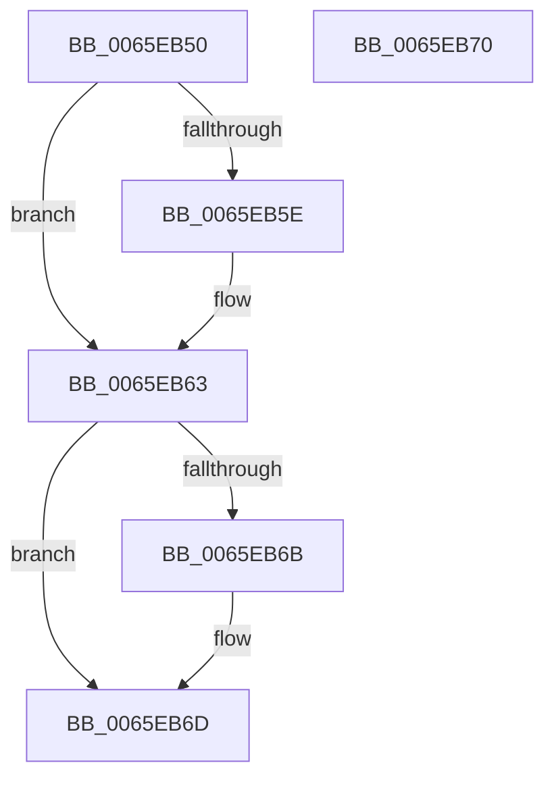

# WheapCorrectErrorSourceDeviceDriver

- RVA: `0x0065EB50`–`0x0065EB71` (길이 `33` bytes)
- VA: `0x000000014065EB50`
- 실행 섹션: `.text`
- PDB 이름 있음: `예`; PDB Function 태그: `아니요`
- unwind 정보 RVA: `0x000DB714`
- 디코드: `13`개 명령, `33/33` bytes 표시
- 미해석 바이트: `0` (있으면 어셈블리에 `.byte`로 보존)

> 이 문서는 커널 이미지의 기계어와 PDB 기호를 분석해 생성했습니다. 4번과 5번은 함수 원형과 자료형을 바이너리 사용 방식에서 추정한 C 해석이며 원본 소스 복구 결과는 아닙니다.

## 1. Dependencies

- 직접 호출 지점: **0**; 고유 호출 대상: **0**
- 직접 호출자로 확인된 함수: **0**
- RIP 상대 이미지 참조: **0**

### Outgoing calls
- 직접 디코드된 call 명령이 없습니다.

### Direct callers
- 이 함수 시작 RVA로 연결되는 직접 call은 확인되지 않았습니다. 간접 호출은 완전히 역산할 수 없습니다.

### Static image references
- 디코드된 RIP-relative 메모리 참조가 없습니다.

## 2. Other-region calls and transfers

- 다른 실행 섹션으로 향하는 call: **0**
- 별도 외부 분기/꼬리 이동을 확인하지 못했습니다.

## 3. Assembly (complete function range)

```asm
0065EB50  44 8B 02                        mov r8d, dword ptr [rdx]
0065EB53  8B 81 88 00 00 00               mov eax, dword ptr [rcx + 0x88]
0065EB59  44 3B C0                        cmp r8d, eax
0065EB5C  73 05                           jae 0x14065eb63
0065EB5E  89 02                           mov dword ptr [rdx], eax
0065EB60  44 8B C0                        mov r8d, eax
0065EB63  8B 41 40                        mov eax, dword ptr [rcx + 0x40]
0065EB66  44 3B C0                        cmp r8d, eax
0065EB69  73 02                           jae 0x14065eb6d
0065EB6B  89 02                           mov dword ptr [rdx], eax
0065EB6D  33 C0                           xor eax, eax
0065EB6F  C3                              ret
0065EB70  CC                              int3
```

## 4. C-style interpretation (structured pseudocode)

```c
__int64 __fastcall WheapCorrectErrorSourceDeviceDriver(__int64 a1, __int64 a2)
{
    __int64 result;

    if (((unsigned int)((unsigned int)(*(unsigned int *)(a2)))) < ((unsigned int)((unsigned int)(*(unsigned int *)(a1 + 136))))) {
        *(unsigned int *)(a2) = (unsigned int)((unsigned int)(*(unsigned int *)(a1 + 136)));
        a3 = (unsigned int)((unsigned int)(*(unsigned int *)(a1 + 136)));
    }
    if (((unsigned int)(a3)) < ((unsigned int)((unsigned int)(*(unsigned int *)(a1 + 64))))) {
        *(unsigned int *)(a2) = (unsigned int)((unsigned int)(*(unsigned int *)(a1 + 64)));
    }
    result = 0;
    return result;
}
```

## 5. (Beta) C Style

```c
int64_t WheapCorrectErrorSourceDeviceDriver(void *Arg1, void *Arg2)
{
    uint8_t *arg1 = (uint8_t *)Arg1;
    uint8_t *arg2 = (uint8_t *)Arg2;

    int64_t result;

    if (((uint32_t)((uint32_t)(*(uint32_t *)(arg2)))) < ((uint32_t)((uint32_t)(*(uint32_t *)(arg1 + 0x88))))) {
        *(uint32_t *)(arg2) = (uint32_t)((uint32_t)(*(uint32_t *)(arg1 + 0x88)));
        a3 = (uint32_t)((uint32_t)(*(uint32_t *)(arg1 + 0x88)));
    }
    if (((uint32_t)(a3)) < ((uint32_t)((uint32_t)(*(uint32_t *)(arg1 + 0x40))))) {
        *(uint32_t *)(arg2) = (uint32_t)((uint32_t)(*(uint32_t *)(arg1 + 0x40)));
    }
    result = 0;
    return result;
}
```

### 관측된 메모리 오프셋

구조체 형식이 확인되지 않은 접근은 인자 기준의 오프셋으로만 기록했습니다.

| 기준 인자 | 오프셋 표현 | 폭 (bit) | 접근 |
|---|---:|---:|---|
| `Arg1` | `+ 0x40` | `32` | `R` |
| `Arg1` | `+ 0x88` | `32` | `R` |
| `Arg2` | `+ 0x0` | `32` | `R` |
| `Arg2` | `+ 0x0` | `32` | `W` |

## 6. Execution-region graph

[열기: 2D/3D 그래프와 함수 탐색 컨트롤 패널](../../../control-panel.html?section=text&rva=0x0065EB50&view=graph)

- 2D 그래프는 위에서 아래로 흐르고, 3D 그래프는 빈 공간을 드래그해 회전합니다. Shift+드래그는 이동, 휠은 확대·축소, 함수 노드 선택은 대상 보고서 이동입니다.

### Static fallback


