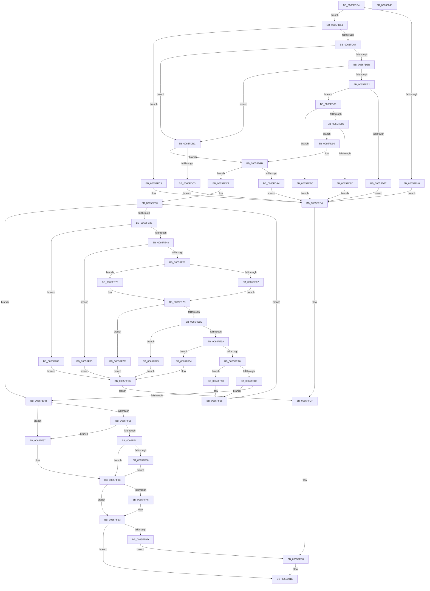

# WheapCreateRecordFromGenericErrorData

- RVA: `0x0065FCE4`–`0x00660041` (길이 `861` bytes)
- VA: `0x000000014065FCE4`
- 실행 섹션: `.text`
- PDB 이름 있음: `예`; PDB Function 태그: `아니요`
- unwind 정보 RVA: `0x000C6EAC`
- 디코드: `235`개 명령, `861/861` bytes 표시
- 미해석 바이트: `0` (있으면 어셈블리에 `.byte`로 보존)

> 이 문서는 커널 이미지의 기계어와 PDB 기호를 분석해 생성했습니다. 4번과 5번은 함수 원형과 자료형을 바이너리 사용 방식에서 추정한 C 해석이며 원본 소스 복구 결과는 아닙니다.

## 1. Dependencies

- 직접 호출 지점: **11**; 고유 호출 대상: **7**
- 직접 호출자로 확인된 함수: **2**
- RIP 상대 이미지 참조: **15**

### Outgoing calls
- `0x0065FD26` → [memset](../6C/memset_function_006C6C40.md) (function, `0x006C6C40`)
- `0x0065FDD7` → [memset](../6C/memset_function_006C6C40.md) (function, `0x006C6C40`)
- `0x0065FDDF` → [WheaInitializeRecordHeader](../42/WheaInitializeRecordHeader_function_0042DFF0.md) (function, `0x0042DFF0`)
- `0x0065FECA` → [WheapAddSectionFromGenericErrorData](WheapAddSectionFromGenericErrorData_function_0065FAA8.md) (function, `0x0065FAA8`)
- `0x0065FEE3` → [RtlStringCchCopyA](../46/RtlStringCchCopyA_function_00460628.md) (function, `0x00460628`)
- `0x0065FF2B` → [WheapAddSectionFromGenericErrorData](WheapAddSectionFromGenericErrorData_function_0065FAA8.md) (function, `0x0065FAA8`)
- `0x0065FF44` → [RtlStringCchCopyA](../46/RtlStringCchCopyA_function_00460628.md) (function, `0x00460628`)
- `0x0065FFAE` → [WheapAddRecoveryPacketToErrorRecord](WheapAddRecoveryPacketToErrorRecord_function_0065F98C.md) (function, `0x0065F98C`)
- `0x0065FFDB` → [RtlStringCchCopyA](../46/RtlStringCchCopyA_function_00460628.md) (function, `0x00460628`)
- `0x00660019` → [WheaLogInternalEvent](../66/WheaLogInternalEvent_function_006605B0.md) (function, `0x006605B0`)
- `0x00660027` → [_security_check_cookie](../6A/_security_check_cookie_function_006AC640.md) (function, `0x006AC640`)

### Direct callers
- [WheapDeviceDriverCreateRecord](WheapDeviceDriverCreateRecord_function_0065EB80.md) at `0x0065EBAE`
- [WheapDefaultErrSrcCreateRecord](../66/WheapDefaultErrSrcCreateRecord_function_00660050.md) at `0x0066005A`

### Static image references
- `0x0065FCFD` → RVA `0x00E0A740` (`.data`; read)
- `0x0065FD48` → RVA `0x006D0800` (` ?? ::FNODOBFM::`string'`; read)
- `0x0065FD77` → RVA `0x006D0820` (` ?? ::FNODOBFM::`string'`; read)
- `0x0065FD8D` → RVA `0x006D0780` (` ?? ::FNODOBFM::`string'`; read)
- `0x0065FDA4` → RVA `0x006D07C0` (` ?? ::FNODOBFM::`string'`; read)
- `0x0065FDB0` → RVA `0x006D07A0` (` ?? ::FNODOBFM::`string'`; read)
- `0x0065FDC3` → RVA `0x006D07E0` (` ?? ::FNODOBFM::`string'`; read)
- `0x0065FED5` → RVA `0x006D0860` (` ?? ::FNODOBFM::`string'`; read)
- `0x0065FF36` → RVA `0x006D08A0` (` ?? ::FNODOBFM::`string'`; read)
- `0x0065FF64` → RVA `0x006D0880` (` ?? ::FNODOBFM::`string'`; read)
- `0x0065FF73` → RVA `0x006D0900` (` ?? ::FNODOBFM::`string'`; read)
- `0x0065FF7C` → RVA `0x006D0920` (` ?? ::FNODOBFM::`string'`; read)
- `0x0065FF85` → RVA `0x006D08C0` (` ?? ::FNODOBFM::`string'`; read)
- `0x0065FF8E` → RVA `0x006D08E0` (` ?? ::FNODOBFM::`string'`; read)
- `0x0065FFC3` → RVA `0x006D0840` (` ?? ::FNODOBFM::`string'`; read)

## 2. Other-region calls and transfers

- 다른 실행 섹션으로 향하는 call: **0**
- 별도 외부 분기/꼬리 이동을 확인하지 못했습니다.

## 3. Assembly (complete function range)

```asm
0065FCE4  40 55                           push rbp
0065FCE6  53                              push rbx
0065FCE7  56                              push rsi
0065FCE8  57                              push rdi
0065FCE9  41 54                           push r12
0065FCEB  41 55                           push r13
0065FCED  41 56                           push r14
0065FCEF  41 57                           push r15
0065FCF1  48 8D 6C 24 E9                  lea rbp, [rsp - 0x17]
0065FCF6  48 81 EC B8 00 00 00            sub rsp, 0xb8
0065FCFD  48 8B 05 3C AA 7A 00            mov rax, qword ptr [rip + 0x7aaa3c]
0065FD04  48 33 C4                        xor rax, rsp
0065FD07  48 89 45 FF                     mov qword ptr [rbp - 1], rax
0065FD0B  48 8B FA                        mov rdi, rdx
0065FD0E  48 89 55 9F                     mov qword ptr [rbp - 0x61], rdx
0065FD12  33 D2                           xor edx, edx
0065FD14  48 89 4D 97                     mov qword ptr [rbp - 0x69], rcx
0065FD18  4D 8B F8                        mov r15, r8
0065FD1B  45 8B E9                        mov r13d, r9d
0065FD1E  48 8D 4D AF                     lea rcx, [rbp - 0x51]
0065FD22  44 8D 42 48                     lea r8d, [rdx + 0x48]
0065FD26  E8 15 6F 06 00                  call 0x1406c6c40
0065FD2B  8B 5F 40                        mov ebx, dword ptr [rdi + 0x40]
0065FD2E  32 C0                           xor al, al
0065FD30  8B 4F 44                        mov ecx, dword ptr [rdi + 0x44]
0065FD33  41 BA 01 00 00 00               mov r10d, 1
0065FD39  48 03 DF                        add rbx, rdi
0065FD3C  89 45 8F                        mov dword ptr [rbp - 0x71], eax
0065FD3F  45 8D 72 13                     lea r14d, [r10 + 0x13]
0065FD43  41 3B CE                        cmp ecx, r14d
0065FD46  73 0C                           jae 0x14065fd54
0065FD48  4C 8D 05 B1 0A 07 00            lea r8, [rip + 0x70ab1]
0065FD4F  E9 76 02 00 00                  jmp 0x14065ffca
0065FD54  44 8B 63 0C                     mov r12d, dword ptr [rbx + 0xc]
0065FD58  45 03 E6                        add r12d, r14d
0065FD5B  45 3B E6                        cmp r12d, r14d
0065FD5E  0F 82 5F 02 00 00               jb 0x14065ffc3
0065FD64  8B 43 04                        mov eax, dword ptr [rbx + 4]
0065FD67  85 C0                           test eax, eax
0065FD69  74 51                           je 0x14065fdbc
0065FD6B  8B 53 08                        mov edx, dword ptr [rbx + 8]
0065FD6E  85 D2                           test edx, edx
0065FD70  74 4A                           je 0x14065fdbc
0065FD72  44 3B E0                        cmp r12d, eax
0065FD75  76 0C                           jbe 0x14065fd83
0065FD77  4C 8D 05 A2 0A 07 00            lea r8, [rip + 0x70aa2]
0065FD7E  E9 47 02 00 00                  jmp 0x14065ffca
0065FD83  03 D0                           add edx, eax
0065FD85  3B D0                           cmp edx, eax
0065FD87  72 27                           jb 0x14065fdb0
0065FD89  3B D1                           cmp edx, ecx
0065FD8B  76 0C                           jbe 0x14065fd99
0065FD8D  4C 8D 05 EC 09 07 00            lea r8, [rip + 0x709ec]
0065FD94  E9 31 02 00 00                  jmp 0x14065ffca
0065FD99  33 F6                           xor esi, esi
0065FD9B  41 81 FD 80 00 00 00            cmp r13d, 0x80
0065FDA2  73 2B                           jae 0x14065fdcf
0065FDA4  4C 8D 05 15 0A 07 00            lea r8, [rip + 0x70a15]
0065FDAB  E9 1A 02 00 00                  jmp 0x14065ffca
0065FDB0  4C 8D 05 E9 09 07 00            lea r8, [rip + 0x709e9]
0065FDB7  E9 0E 02 00 00                  jmp 0x14065ffca
0065FDBC  33 F6                           xor esi, esi
0065FDBE  44 3B E1                        cmp r12d, ecx
0065FDC1  76 D8                           jbe 0x14065fd9b
0065FDC3  4C 8D 05 16 0A 07 00            lea r8, [rip + 0x70a16]
0065FDCA  E9 FB 01 00 00                  jmp 0x14065ffca
0065FDCF  4D 8B C5                        mov r8, r13
0065FDD2  33 D2                           xor edx, edx
0065FDD4  49 8B CF                        mov rcx, r15
0065FDD7  E8 64 6E 06 00                  call 0x1406c6c40
0065FDDC  49 8B CF                        mov rcx, r15
0065FDDF  E8 0C E2 DC FF                  call 0x14042dff0
0065FDE4  8B 47 14                        mov eax, dword ptr [rdi + 0x14]
0065FDE7  41 89 47 0C                     mov dword ptr [r15 + 0xc], eax
0065FDEB  0F 10 47 20                     movups xmm0, xmmword ptr [rdi + 0x20]
0065FDEF  41 8B 47 68                     mov eax, dword ptr [r15 + 0x68]
0065FDF3  F3 41 0F 7F 47 50               movdqu xmmword ptr [r15 + 0x50], xmm0
0065FDF9  8B 4F 0C                        mov ecx, dword ptr [rdi + 0xc]
0065FDFC  03 C9                           add ecx, ecx
0065FDFE  33 C8                           xor ecx, eax
0065FE00  83 E1 02                        and ecx, 2
0065FE03  33 C8                           xor ecx, eax
0065FE05  41 89 4F 68                     mov dword ptr [r15 + 0x68], ecx
0065FE09  8B 47 0C                        mov eax, dword ptr [rdi + 0xc]
0065FE0C  BF 20 00 00 00                  mov edi, 0x20
0065FE11  D1 E8                           shr eax, 1
0065FE13  33 C1                           xor eax, ecx
0065FE15  45 89 6F 14                     mov dword ptr [r15 + 0x14], r13d
0065FE19  83 E0 04                        and eax, 4
0065FE1C  33 C1                           xor eax, ecx
0065FE1E  44 8D 57 E1                     lea r10d, [rdi - 0x1f]
0065FE22  41 89 47 68                     mov dword ptr [r15 + 0x68], eax
0065FE26  8B 03                           mov eax, dword ptr [rbx]
0065FE28  C1 E8 04                        shr eax, 4
0065FE2B  25 FF 03 00 00                  and eax, 0x3ff
0065FE30  89 45 93                        mov dword ptr [rbp - 0x6d], eax
0065FE33  85 C0                           test eax, eax
0065FE35  0F 84 C0 00 00 00               je 0x14065fefb
0065FE3B  41 8D 46 40                     lea eax, [r14 + 0x40]
0065FE3F  41 3B C6                        cmp eax, r14d
0065FE42  0F 82 46 01 00 00               jb 0x14065ff8e
0065FE48  41 3B C4                        cmp eax, r12d
0065FE4B  0F 87 34 01 00 00               ja 0x14065ff85
0065FE51  45 8B CE                        mov r9d, r14d
0065FE54  B9 00 03 00 00                  mov ecx, 0x300
0065FE59  4C 03 CB                        add r9, rbx
0065FE5C  41 8B 41 18                     mov eax, dword ptr [r9 + 0x18]
0065FE60  66 41 39 49 14                  cmp word ptr [r9 + 0x14], cx
0065FE65  75 0B                           jne 0x14065fe72
0065FE67  83 C0 48                        add eax, 0x48
0065FE6A  83 C9 FF                        or ecx, 0xffffffff
0065FE6D  83 F8 48                        cmp eax, 0x48
0065FE70  EB 09                           jmp 0x14065fe7b
0065FE72  83 C0 40                        add eax, 0x40
0065FE75  83 C9 FF                        or ecx, 0xffffffff
0065FE78  83 F8 40                        cmp eax, 0x40
0065FE7B  0F 43 C8                        cmovae ecx, eax
0065FE7E  1B C0                           sbb eax, eax
0065FE80  25 95 00 00 C0                  and eax, 0xc0000095
0065FE85  85 C0                           test eax, eax
0065FE87  0F 88 EF 00 00 00               js 0x14065ff7c
0065FE8D  41 8D 04 0E                     lea eax, [r14 + rcx]
0065FE91  41 3B C6                        cmp eax, r14d
0065FE94  0F 82 D9 00 00 00               jb 0x14065ff73
0065FE9A  44 8B F0                        mov r14d, eax
0065FE9D  41 3B C4                        cmp eax, r12d
0065FEA0  0F 87 BE 00 00 00               ja 0x14065ff64
0065FEA6  8B 45 8F                        mov eax, dword ptr [rbp - 0x71]
0065FEA9  45 8B C5                        mov r8d, r13d
0065FEAC  45 84 51 17                     test byte ptr [r9 + 0x17], r10b
0065FEB0  49 8B D7                        mov rdx, r15
0065FEB3  0F B6 C0                        movzx eax, al
0065FEB6  44 88 54 24 28                  mov byte ptr [rsp + 0x28], r10b
0065FEBB  41 0F 45 C2                     cmovne eax, r10d
0065FEBF  89 4C 24 20                     mov dword ptr [rsp + 0x20], ecx
0065FEC3  48 8B 4D 97                     mov rcx, qword ptr [rbp - 0x69]
0065FEC7  89 45 8F                        mov dword ptr [rbp - 0x71], eax
0065FECA  E8 D9 FB FF FF                  call 0x14065faa8
0065FECF  8B F0                           mov esi, eax
0065FED1  85 C0                           test eax, eax
0065FED3  79 7B                           jns 0x14065ff50
0065FED5  4C 8D 05 84 09 07 00            lea r8, [rip + 0x70984]
0065FEDC  48 8B D7                        mov rdx, rdi
0065FEDF  48 8D 4D CF                     lea rcx, [rbp - 0x31]
0065FEE3  E8 40 07 E0 FF                  call 0x140460628
0065FEE8  41 83 4F 68 40                  or dword ptr [r15 + 0x68], 0x40
0065FEED  41 BA 01 00 00 00               mov r10d, 1
0065FEF3  8B 45 8F                        mov eax, dword ptr [rbp - 0x71]
0065FEF6  41 3A C2                        cmp al, r10b
0065FEF9  75 5B                           jne 0x14065ff56
0065FEFB  8B 4B 04                        mov ecx, dword ptr [rbx + 4]
0065FEFE  85 C9                           test ecx, ecx
0065FF00  0F 84 91 00 00 00               je 0x14065ff97
0065FF06  8B 43 08                        mov eax, dword ptr [rbx + 8]
0065FF09  85 C0                           test eax, eax
0065FF0B  0F 84 86 00 00 00               je 0x14065ff97
0065FF11  4C 8D 0C 0B                     lea r9, [rbx + rcx]
0065FF15  C6 44 24 28 00                  mov byte ptr [rsp + 0x28], 0
0065FF1A  48 8B 5D 97                     mov rbx, qword ptr [rbp - 0x69]
0065FF1E  45 8B C5                        mov r8d, r13d
0065FF21  48 8B CB                        mov rcx, rbx
0065FF24  89 44 24 20                     mov dword ptr [rsp + 0x20], eax
0065FF28  49 8B D7                        mov rdx, r15
0065FF2B  E8 78 FB FF FF                  call 0x14065faa8
0065FF30  8B F0                           mov esi, eax
0065FF32  85 C0                           test eax, eax
0065FF34  79 65                           jns 0x14065ff9b
0065FF36  4C 8D 05 63 09 07 00            lea r8, [rip + 0x70963]
0065FF3D  48 8B D7                        mov rdx, rdi
0065FF40  48 8D 4D CF                     lea rcx, [rbp - 0x31]
0065FF44  E8 DF 06 E0 FF                  call 0x140460628
0065FF49  41 83 4F 68 40                  or dword ptr [r15 + 0x68], 0x40
0065FF4E  EB 4B                           jmp 0x14065ff9b
0065FF50  41 BA 01 00 00 00               mov r10d, 1
0065FF56  8B 45 93                        mov eax, dword ptr [rbp - 0x6d]
0065FF59  FF C8                           dec eax
0065FF5B  44 01 55 EF                     add dword ptr [rbp - 0x11], r10d
0065FF5F  E9 CC FE FF FF                  jmp 0x14065fe30
0065FF64  4C 8D 05 15 09 07 00            lea r8, [rip + 0x70915]
0065FF6B  41 BA 01 00 00 00               mov r10d, 1
0065FF71  EB 5C                           jmp 0x14065ffcf
0065FF73  4C 8D 05 86 09 07 00            lea r8, [rip + 0x70986]
0065FF7A  EB EF                           jmp 0x14065ff6b
0065FF7C  4C 8D 05 9D 09 07 00            lea r8, [rip + 0x7099d]
0065FF83  EB E6                           jmp 0x14065ff6b
0065FF85  4C 8D 05 34 09 07 00            lea r8, [rip + 0x70934]
0065FF8C  EB DD                           jmp 0x14065ff6b
0065FF8E  4C 8D 05 4B 09 07 00            lea r8, [rip + 0x7094b]
0065FF95  EB D4                           jmp 0x14065ff6b
0065FF97  48 8B 5D 97                     mov rbx, qword ptr [rbp - 0x69]
0065FF9B  48 8B 45 9F                     mov rax, qword ptr [rbp - 0x61]
0065FF9F  83 78 14 00                     cmp dword ptr [rax + 0x14], 0
0065FFA3  75 0E                           jne 0x14065ffb3
0065FFA5  45 8B C5                        mov r8d, r13d
0065FFA8  49 8B D7                        mov rdx, r15
0065FFAB  48 8B CB                        mov rcx, rbx
0065FFAE  E8 D9 F9 FF FF                  call 0x14065f98c
0065FFB3  C1 EE 1F                        shr esi, 0x1f
0065FFB6  33 DB                           xor ebx, ebx
0065FFB8  40 84 F6                        test sil, sil
0065FFBB  74 61                           je 0x14066001e
0065FFBD  44 8D 53 01                     lea r10d, [rbx + 1]
0065FFC1  EB 1D                           jmp 0x14065ffe0
0065FFC3  4C 8D 05 76 08 07 00            lea r8, [rip + 0x70876]
0065FFCA  BF 20 00 00 00                  mov edi, 0x20
0065FFCF  48 8D 4D CF                     lea rcx, [rbp - 0x31]
0065FFD3  48 8B D7                        mov rdx, rdi
0065FFD6  BB 0D 00 00 C0                  mov ebx, 0xc000000d
0065FFDB  E8 48 06 E0 FF                  call 0x140460628
0065FFE0  83 65 BB 00                     and dword ptr [rbp - 0x45], 0
0065FFE4  48 8D 4D AF                     lea rcx, [rbp - 0x51]
0065FFE8  C7 45 AF 57 68 4C 67            mov dword ptr [rbp - 0x51], 0x674c6857
0065FFEF  44 89 55 B3                     mov dword ptr [rbp - 0x4d], r10d
0065FFF3  C7 45 B7 48 00 00 00            mov dword ptr [rbp - 0x49], 0x48
0065FFFA  C7 45 C3 15 00 00 80            mov dword ptr [rbp - 0x3d], 0x80000015
00660001  C7 45 BF 4B 52 4E 4C            mov dword ptr [rbp - 0x41], 0x4c4e524b
00660008  C7 45 C7 02 00 00 00            mov dword ptr [rbp - 0x39], 2
0066000F  C7 45 CB 28 00 00 00            mov dword ptr [rbp - 0x35], 0x28
00660016  89 5D F3                        mov dword ptr [rbp - 0xd], ebx
00660019  E8 92 05 00 00                  call 0x1406605b0
0066001E  8B C3                           mov eax, ebx
00660020  48 8B 4D FF                     mov rcx, qword ptr [rbp - 1]
00660024  48 33 CC                        xor rcx, rsp
00660027  E8 14 C6 04 00                  call 0x1406ac640
0066002C  48 81 C4 B8 00 00 00            add rsp, 0xb8
00660033  41 5F                           pop r15
00660035  41 5E                           pop r14
00660037  41 5D                           pop r13
00660039  41 5C                           pop r12
0066003B  5F                              pop rdi
0066003C  5E                              pop rsi
0066003D  5B                              pop rbx
0066003E  5D                              pop rbp
0066003F  C3                              ret
00660040  CC                              int3
```

## 4. C-style interpretation (structured pseudocode)

```c
__int64 __fastcall WheapCreateRecordFromGenericErrorData(__int64 a1, __int64 a2, __int64 a3, int a4)
{
    __int64 result;
    __int64 v_r12;
    __int64 v_rbx;
    __int64 v_rsi;
    __int64 v_rsp;
    unsigned __int64 v_stack_m57;
    unsigned __int64 v_stack_m58;
    unsigned int v_stack_m64;
    unsigned int v_stack_m68;
    unsigned __int64 v_stack_m88;
    unsigned int v_stack_m8C;
    unsigned int v_stack_m90;
    unsigned int v_stack_m94;
    unsigned int v_stack_m98;
    unsigned int v_stack_m9C;
    unsigned int v_stack_mA0;
    unsigned int v_stack_mA4;
    unsigned __int64 v_stack_mA8;
    unsigned __int64 v_stack_mB8;
    unsigned __int64 v_stack_mC0;
    unsigned int v_stack_mC4;
    unsigned int v_stack_mC8;
    unsigned __int8 v_stack_mD0;
    unsigned int v_stack_mD8;

    v_rsp = (v_rsp) - (184);
    result = (*(unsigned __int64 *)(v_rip + 8038972)) ^ (v_rsp);
    v_stack_m58 = result;
    v_stack_mB8 = a2;
    a2 = 0;
    v_stack_mC0 = a1;
    result = memset(v_stack_mA8, a2, a2 + 72, a4);
    result = 0;
    v_rbx = ((unsigned int)(*(unsigned int *)(a2 + 64))) + (0);
    v_stack_mC8 = 0;
    if (((unsigned int)((unsigned int)(*(unsigned int *)(a2 + 68)))) >= ((unsigned int)(1 + 19))) goto loc_0065FD54;
    goto loc_0065FFCA;
loc_0065FD54:
    v_r12 = (unsigned int)(((unsigned int)(*(unsigned int *)(v_rbx + 12))) + ((unsigned int)(1 + 19)));
    if (((unsigned int)(v_r12)) < ((unsigned int)(1 + 19))) goto loc_0065FFC3;
    if ((unsigned int)((unsigned int)(*(unsigned int *)(v_rbx + 4))) == 0) goto loc_0065FDBC;
    if ((unsigned int)((unsigned int)(*(unsigned int *)(v_rbx + 8))) == 0) goto loc_0065FDBC;
    if (((unsigned int)(v_r12)) <= ((unsigned int)((unsigned int)(*(unsigned int *)(v_rbx + 4))))) goto loc_0065FD83;
    goto loc_0065FFCA;
loc_0065FD83:
    a2 = (unsigned int)(((unsigned int)(*(unsigned int *)(v_rbx + 8))) + ((unsigned int)((unsigned int)(*(unsigned int *)(v_rbx + 4)))));
    if (((unsigned int)(a2)) < ((unsigned int)((unsigned int)(*(unsigned int *)(v_rbx + 4))))) goto loc_0065FDB0;
    if (((unsigned int)(a2)) <= ((unsigned int)((unsigned int)(*(unsigned int *)(a2 + 68))))) goto loc_0065FD99;
    goto loc_0065FFCA;
loc_0065FD99:
    v_rsi = 0;
loc_0065FD9B:
    if (((unsigned int)((unsigned int)(a4))) >= 128) goto loc_0065FDCF;
    goto loc_0065FFCA;
loc_0065FDB0:
    goto loc_0065FFCA;
loc_0065FDBC:
    v_rsi = 0;
    if (((unsigned int)(v_r12)) <= ((unsigned int)((unsigned int)(*(unsigned int *)(a2 + 68))))) goto loc_0065FD9B;
    goto loc_0065FFCA;
loc_0065FDCF:
    a2 = 0;
    result = memset(a3, a2, (unsigned int)(a4), a4);
    result = WheaInitializeRecordHeader(a3, a2, (unsigned int)(a4), a4);
    *(unsigned int *)(a3 + 12) = (unsigned int)((unsigned int)(*(unsigned int *)(a2 + 20)));
    *(unsigned __int64 *)(a3 + 80) = v_xmm0;
    a1 = (unsigned int)(((unsigned int)(*(unsigned int *)(a2 + 12))) + ((unsigned int)((unsigned int)(*(unsigned int *)(a2 + 12)))));
    a1 = (unsigned int)((a1) ^ ((unsigned int)((unsigned int)(*(unsigned int *)(a3 + 104)))));
    a1 = (unsigned int)((a1) & (2));
    a1 = (unsigned int)((a1) ^ ((unsigned int)((unsigned int)(*(unsigned int *)(a3 + 104)))));
    *(unsigned int *)(a3 + 104) = (unsigned int)(a1);
    result = (unsigned int)(((unsigned int)(*(unsigned int *)(a2 + 12))) >> (1));
    result = (unsigned int)((result) ^ ((unsigned int)(a1)));
    *(unsigned int *)(a3 + 20) = (unsigned int)((unsigned int)(a4));
    result = (unsigned int)((result) & (4));
    result = (unsigned int)((result) ^ ((unsigned int)(a1)));
    *(unsigned int *)(a3 + 104) = (unsigned int)(result);
    result = (unsigned int)(((unsigned int)(*(unsigned int *)(v_rbx))) >> (4));
    result = (unsigned int)((result) & (0x3FFULL));
loc_0065FE30:
    v_stack_mC4 = (unsigned int)(result);
    if ((unsigned int)(result) == 0) goto loc_0065FEFB;
    if (((unsigned int)(1 + 19 + 64)) < ((unsigned int)(1 + 19))) goto loc_0065FF8E;
    if (((unsigned int)(1 + 19 + 64)) > ((unsigned int)(v_r12))) goto loc_0065FF85;
    a4 = ((unsigned int)((unsigned int)(1 + 19))) + (v_rbx);
    if ((*(unsigned __int16 *)(a4 + 20)) != 768) goto loc_0065FE72;
    result = (unsigned int)(((unsigned int)(*(unsigned int *)(a4 + 24))) + (72));
    a1 = (unsigned int)((768) | (0xFFFFFFFFULL));
    goto loc_0065FE7B;
loc_0065FE72:
    result = (unsigned int)((result) + (64));
    a1 = (unsigned int)((a1) | (0xFFFFFFFFULL));
loc_0065FE7B:
    if (((unsigned int)(result)) >= 64) { a1 = (unsigned int)(result); }
    result = (unsigned int)((result) & (0xC0000095ULL));
    if (sign_flag) goto loc_0065FF7C;
    if (((unsigned int)(1 + 19 + a1 * 1)) < ((unsigned int)(1 + 19))) goto loc_0065FF73;
    if (((unsigned int)(1 + 19 + a1 * 1)) > ((unsigned int)(v_r12))) goto loc_0065FF64;
    v_stack_mD0 = (unsigned __int8)(32 - 31);
    result = (unsigned __int8)((unsigned int)(v_stack_mC8));
    if (((*(unsigned __int8 *)(a4 + 23)) & ((unsigned __int8)(32 - 31))) != 0) { result = (unsigned int)(32 - 31); }
    v_stack_mD8 = (unsigned int)(a1);
    v_stack_mC8 = (unsigned int)(result);
    result = WheapAddSectionFromGenericErrorData(v_stack_mC0, a3, (unsigned int)((unsigned int)((unsigned int)(a4))), a4);
    if (!sign_flag) goto loc_0065FF50;
    result = RtlStringCchCopyA(v_stack_m88, 32, v_rip + 461188, a4);
    if (((unsigned __int8)((unsigned int)(v_stack_mC8))) != 1) goto loc_0065FF56;
loc_0065FEFB:
    if ((unsigned int)((unsigned int)(*(unsigned int *)(v_rbx + 4))) == 0) goto loc_0065FF97;
    if ((unsigned int)((unsigned int)(*(unsigned int *)(v_rbx + 8))) == 0) goto loc_0065FF97;
    v_stack_mD0 = 0;
    v_stack_mD8 = (unsigned int)((unsigned int)(*(unsigned int *)(v_rbx + 8)));
    result = WheapAddSectionFromGenericErrorData(v_stack_mC0, a3, (unsigned int)((unsigned int)((unsigned int)(a4))), v_rbx + (unsigned int)(*(unsigned int *)(v_rbx + 4)) * 1);
    if (!sign_flag) goto loc_0065FF9B;
    result = RtlStringCchCopyA(v_stack_m88, 32, v_rip + 461155, v_rbx + (unsigned int)(*(unsigned int *)(v_rbx + 4)) * 1);
    goto loc_0065FF9B;
loc_0065FF50:
loc_0065FF56:
    result = (unsigned int)(((unsigned int)(v_stack_mC4)) - 1);
    goto loc_0065FE30;
loc_0065FF64:
loc_0065FF6B:
    goto loc_0065FFCF;
loc_0065FF73:
    goto loc_0065FF6B;
loc_0065FF7C:
    goto loc_0065FF6B;
loc_0065FF85:
    goto loc_0065FF6B;
loc_0065FF8E:
    goto loc_0065FF6B;
loc_0065FF97:
loc_0065FF9B:
    result = v_stack_mB8;
    if ((*(unsigned int *)(v_stack_mB8 + 20)) == 0) {
        a3 = (unsigned int)((unsigned int)(a4));
        a2 = a3;
        a1 = v_stack_mC0;
        result = WheapAddRecoveryPacketToErrorRecord(a1, a2, a3, v_rbx + (unsigned int)(*(unsigned int *)(v_rbx + 4)) * 1);
    }
    v_rsi = (unsigned int)(((unsigned int)((unsigned int)(result))) >> (31));
    v_rbx = 0;
    if ((unsigned __int8)(v_rsi) == 0) goto loc_0066001E;
    goto loc_0065FFE0;
loc_0065FFC3:
loc_0065FFCA:
loc_0065FFCF:
    result = RtlStringCchCopyA(v_stack_m88, 32, v_rip + 460918, v_rbx + (unsigned int)(*(unsigned int *)(v_rbx + 4)) * 1);
loc_0065FFE0:
    v_stack_mA8 = 0x674C6857ULL;
    v_stack_mA4 = (unsigned int)(v_rbx + 1);
    v_stack_mA0 = 72;
    v_stack_m94 = 0x80000015ULL;
    v_stack_m98 = 0x4C4E524BULL;
    v_stack_m90 = 2;
    v_stack_m8C = 40;
    v_stack_m64 = (unsigned int)((unsigned int)(0xC000000DULL));
    result = WheaLogInternalEvent(v_stack_mA8, 32, v_rip + 460918, v_rbx + (unsigned int)(*(unsigned int *)(v_rbx + 4)) * 1);
loc_0066001E:
    a1 = (v_stack_m58) ^ (v_rsp);
    result = _security_check_cookie(a1, 32, v_rip + 460918, v_rbx + (unsigned int)(*(unsigned int *)(v_rbx + 4)) * 1);
    v_rsp = (v_rsp) + (184);
    return result;
}
```

## 5. (Beta) C Style

```c
int64_t WheapCreateRecordFromGenericErrorData(int64_t Arg1, void *Arg2, void *Arg3, int32_t Arg4)
{
    uint8_t *arg2 = (uint8_t *)Arg2;
    uint8_t *arg3 = (uint8_t *)Arg3;

    int64_t result;
    int64_t local_r12;
    int64_t local_rbx;
    int64_t local_rsi;
    int64_t local_rsp;
    uint64_t v_stack_m57;
    uint64_t v_stack_m58;
    uint32_t v_stack_m64;
    uint32_t v_stack_m68;
    uint64_t v_stack_m88;
    uint32_t v_stack_m8C;
    uint32_t v_stack_m90;
    uint32_t v_stack_m94;
    uint32_t v_stack_m98;
    uint32_t v_stack_m9C;
    uint32_t v_stack_mA0;
    uint32_t v_stack_mA4;
    uint64_t v_stack_mA8;
    uint64_t v_stack_mB8;
    uint64_t v_stack_mC0;
    uint32_t v_stack_mC4;
    uint32_t v_stack_mC8;
    uint8_t v_stack_mD0;
    uint32_t v_stack_mD8;

    local_rsp = (local_rsp) - (184);
    result = (*(uint64_t *)(v_rip + 0x7AAA3C)) ^ (local_rsp);
    v_stack_m58 = result;
    v_stack_mB8 = Arg2;
    Arg2 = 0;
    v_stack_mC0 = Arg1;
    result = memset(v_stack_mA8, Arg2, Arg2 + 72, Arg4);
    result = 0;
    local_rbx = ((uint32_t)(*(uint32_t *)(arg2 + 0x40))) + (0);
    v_stack_mC8 = 0;
    if (((uint32_t)((uint32_t)(*(uint32_t *)(arg2 + 0x44)))) >= ((uint32_t)(1 + 19))) goto loc_0065FD54;
    goto loc_0065FFCA;
loc_0065FD54:
    local_r12 = (uint32_t)(((uint32_t)(*(uint32_t *)(local_rbx + 0xC))) + ((uint32_t)(1 + 19)));
    if (((uint32_t)(local_r12)) < ((uint32_t)(1 + 19))) goto loc_0065FFC3;
    if ((uint32_t)((uint32_t)(*(uint32_t *)(local_rbx + 0x4))) == 0) goto loc_0065FDBC;
    if ((uint32_t)((uint32_t)(*(uint32_t *)(local_rbx + 0x8))) == 0) goto loc_0065FDBC;
    if (((uint32_t)(local_r12)) <= ((uint32_t)((uint32_t)(*(uint32_t *)(local_rbx + 0x4))))) goto loc_0065FD83;
    goto loc_0065FFCA;
loc_0065FD83:
    Arg2 = (uint32_t)(((uint32_t)(*(uint32_t *)(local_rbx + 0x8))) + ((uint32_t)((uint32_t)(*(uint32_t *)(local_rbx + 0x4)))));
    if (((uint32_t)(Arg2)) < ((uint32_t)((uint32_t)(*(uint32_t *)(local_rbx + 0x4))))) goto loc_0065FDB0;
    if (((uint32_t)(Arg2)) <= ((uint32_t)((uint32_t)(*(uint32_t *)(arg2 + 0x44))))) goto loc_0065FD99;
    goto loc_0065FFCA;
loc_0065FD99:
    local_rsi = 0;
loc_0065FD9B:
    if (((uint32_t)((uint32_t)(Arg4))) >= 128) goto loc_0065FDCF;
    goto loc_0065FFCA;
loc_0065FDB0:
    goto loc_0065FFCA;
loc_0065FDBC:
    local_rsi = 0;
    if (((uint32_t)(local_r12)) <= ((uint32_t)((uint32_t)(*(uint32_t *)(arg2 + 0x44))))) goto loc_0065FD9B;
    goto loc_0065FFCA;
loc_0065FDCF:
    Arg2 = 0;
    result = memset(Arg3, Arg2, (uint32_t)(Arg4), Arg4);
    result = WheaInitializeRecordHeader(Arg3, Arg2, (uint32_t)(Arg4), Arg4);
    *(uint32_t *)(arg3 + 0xC) = (uint32_t)((uint32_t)(*(uint32_t *)(arg2 + 0x14)));
    *(uint64_t *)(arg3 + 0x50) = v_xmm0;
    Arg1 = (uint32_t)(((uint32_t)(*(uint32_t *)(arg2 + 0xC))) + ((uint32_t)((uint32_t)(*(uint32_t *)(arg2 + 0xC)))));
    Arg1 = (uint32_t)((Arg1) ^ ((uint32_t)((uint32_t)(*(uint32_t *)(arg3 + 0x68)))));
    Arg1 = (uint32_t)((Arg1) & (2));
    Arg1 = (uint32_t)((Arg1) ^ ((uint32_t)((uint32_t)(*(uint32_t *)(arg3 + 0x68)))));
    *(uint32_t *)(arg3 + 0x68) = (uint32_t)(Arg1);
    result = (uint32_t)(((uint32_t)(*(uint32_t *)(arg2 + 0xC))) >> (1));
    result = (uint32_t)((result) ^ ((uint32_t)(Arg1)));
    *(uint32_t *)(arg3 + 0x14) = (uint32_t)((uint32_t)(Arg4));
    result = (uint32_t)((result) & (4));
    result = (uint32_t)((result) ^ ((uint32_t)(Arg1)));
    *(uint32_t *)(arg3 + 0x68) = (uint32_t)(result);
    result = (uint32_t)(((uint32_t)(*(uint32_t *)(local_rbx))) >> (4));
    result = (uint32_t)((result) & (0x3FFULL));
loc_0065FE30:
    v_stack_mC4 = (uint32_t)(result);
    if ((uint32_t)(result) == 0) goto loc_0065FEFB;
    if (((uint32_t)(1 + 19 + 64)) < ((uint32_t)(1 + 19))) goto loc_0065FF8E;
    if (((uint32_t)(1 + 19 + 64)) > ((uint32_t)(local_r12))) goto loc_0065FF85;
    Arg4 = ((uint32_t)((uint32_t)(1 + 19))) + (local_rbx);
    if ((*(uint16_t *)(Arg4 + 0x14)) != 768) goto loc_0065FE72;
    result = (uint32_t)(((uint32_t)(*(uint32_t *)(Arg4 + 0x18))) + (72));
    Arg1 = (uint32_t)((768) | (0xFFFFFFFFULL));
    goto loc_0065FE7B;
loc_0065FE72:
    result = (uint32_t)((result) + (64));
    Arg1 = (uint32_t)((Arg1) | (0xFFFFFFFFULL));
loc_0065FE7B:
    if (((uint32_t)(result)) >= 64) { Arg1 = (uint32_t)(result); }
    result = (uint32_t)((result) & (0xC0000095ULL));
    if (sign_flag) goto loc_0065FF7C;
    if (((uint32_t)(1 + 19 + Arg1 * 1)) < ((uint32_t)(1 + 19))) goto loc_0065FF73;
    if (((uint32_t)(1 + 19 + Arg1 * 1)) > ((uint32_t)(local_r12))) goto loc_0065FF64;
    v_stack_mD0 = (uint8_t)(32 - 31);
    result = (uint8_t)((uint32_t)(v_stack_mC8));
    if (((*(uint8_t *)(Arg4 + 0x17)) & ((uint8_t)(32 - 31))) != 0) { result = (uint32_t)(32 - 31); }
    v_stack_mD8 = (uint32_t)(Arg1);
    v_stack_mC8 = (uint32_t)(result);
    result = WheapAddSectionFromGenericErrorData(v_stack_mC0, Arg3, (uint32_t)((uint32_t)((uint32_t)(Arg4))), Arg4);
    if (!sign_flag) goto loc_0065FF50;
    result = RtlStringCchCopyA(v_stack_m88, 32, v_rip + 461188, Arg4);
    if (((uint8_t)((uint32_t)(v_stack_mC8))) != 1) goto loc_0065FF56;
loc_0065FEFB:
    if ((uint32_t)((uint32_t)(*(uint32_t *)(local_rbx + 0x4))) == 0) goto loc_0065FF97;
    if ((uint32_t)((uint32_t)(*(uint32_t *)(local_rbx + 0x8))) == 0) goto loc_0065FF97;
    v_stack_mD0 = 0;
    v_stack_mD8 = (uint32_t)((uint32_t)(*(uint32_t *)(local_rbx + 0x8)));
    result = WheapAddSectionFromGenericErrorData(v_stack_mC0, Arg3, (uint32_t)((uint32_t)((uint32_t)(Arg4))), local_rbx + (uint32_t)(*(uint32_t *)(local_rbx + 0x4)) * 1);
    if (!sign_flag) goto loc_0065FF9B;
    result = RtlStringCchCopyA(v_stack_m88, 32, v_rip + 461155, local_rbx + (uint32_t)(*(uint32_t *)(local_rbx + 0x4)) * 1);
    goto loc_0065FF9B;
loc_0065FF50:
loc_0065FF56:
    result = (uint32_t)(((uint32_t)(v_stack_mC4)) - 1);
    goto loc_0065FE30;
loc_0065FF64:
loc_0065FF6B:
    goto loc_0065FFCF;
loc_0065FF73:
    goto loc_0065FF6B;
loc_0065FF7C:
    goto loc_0065FF6B;
loc_0065FF85:
    goto loc_0065FF6B;
loc_0065FF8E:
    goto loc_0065FF6B;
loc_0065FF97:
loc_0065FF9B:
    result = v_stack_mB8;
    if ((*(uint32_t *)(v_stack_mB8 + 0x14)) == 0) {
        Arg3 = (uint32_t)((uint32_t)(Arg4));
        Arg2 = Arg3;
        Arg1 = v_stack_mC0;
        result = WheapAddRecoveryPacketToErrorRecord(Arg1, Arg2, Arg3, local_rbx + (uint32_t)(*(uint32_t *)(local_rbx + 0x4)) * 1);
    }
    local_rsi = (uint32_t)(((uint32_t)((uint32_t)(result))) >> (31));
    local_rbx = 0;
    if ((uint8_t)(local_rsi) == 0) goto loc_0066001E;
    goto loc_0065FFE0;
loc_0065FFC3:
loc_0065FFCA:
loc_0065FFCF:
    result = RtlStringCchCopyA(v_stack_m88, 32, v_rip + 460918, local_rbx + (uint32_t)(*(uint32_t *)(local_rbx + 0x4)) * 1);
loc_0065FFE0:
    v_stack_mA8 = 0x674C6857ULL;
    v_stack_mA4 = (uint32_t)(local_rbx + 1);
    v_stack_mA0 = 72;
    v_stack_m94 = 0x80000015ULL;
    v_stack_m98 = 0x4C4E524BULL;
    v_stack_m90 = 2;
    v_stack_m8C = 40;
    v_stack_m64 = (uint32_t)((uint32_t)(0xC000000DULL));
    result = WheaLogInternalEvent(v_stack_mA8, 32, v_rip + 460918, local_rbx + (uint32_t)(*(uint32_t *)(local_rbx + 0x4)) * 1);
loc_0066001E:
    Arg1 = (v_stack_m58) ^ (local_rsp);
    result = _security_check_cookie(Arg1, 32, v_rip + 460918, local_rbx + (uint32_t)(*(uint32_t *)(local_rbx + 0x4)) * 1);
    local_rsp = (local_rsp) + (184);
    return result;
}
```

### 관측된 메모리 오프셋

구조체 형식이 확인되지 않은 접근은 인자 기준의 오프셋으로만 기록했습니다.

| 기준 인자 | 오프셋 표현 | 폭 (bit) | 접근 |
|---|---:|---:|---|
| `Arg2` | `+ 0xC` | `32` | `R` |
| `Arg2` | `+ 0x14` | `32` | `R` |
| `Arg2` | `+ 0x20` | `128` | `R` |
| `Arg2` | `+ 0x40` | `32` | `R` |
| `Arg2` | `+ 0x44` | `32` | `R` |
| `Arg3` | `+ 0xC` | `32` | `W` |
| `Arg3` | `+ 0x14` | `32` | `W` |
| `Arg3` | `+ 0x50` | `128` | `W` |
| `Arg3` | `+ 0x68` | `32` | `R` |
| `Arg3` | `+ 0x68` | `32` | `R/W` |
| `Arg3` | `+ 0x68` | `32` | `W` |

## 6. Execution-region graph

[열기: 2D/3D 그래프와 함수 탐색 컨트롤 패널](../../../control-panel.html?section=text&rva=0x0065FCE4&view=graph)

- 2D 그래프는 위에서 아래로 흐르고, 3D 그래프는 빈 공간을 드래그해 회전합니다. Shift+드래그는 이동, 휠은 확대·축소, 함수 노드 선택은 대상 보고서 이동입니다.

### Static fallback


