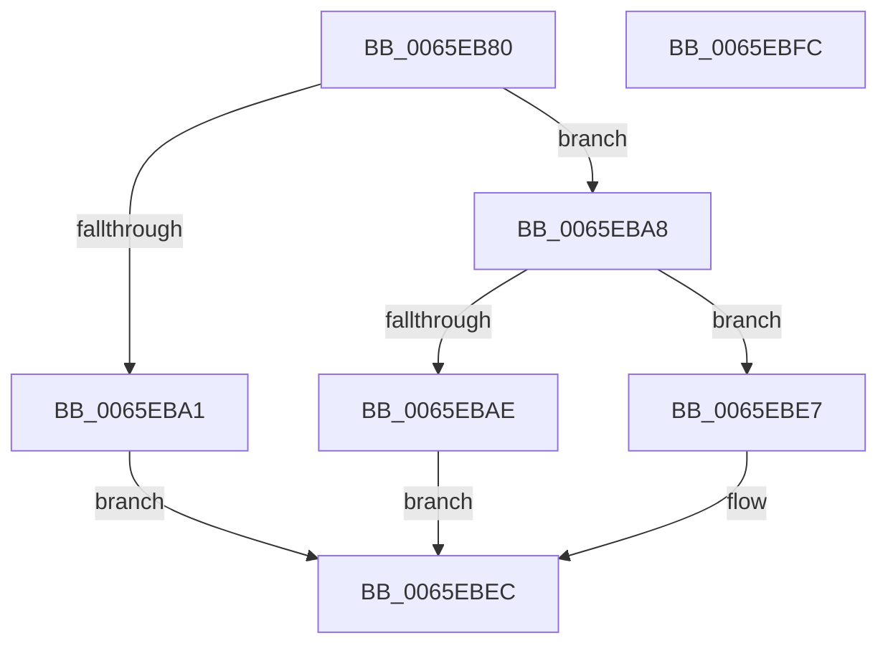

# WheapDeviceDriverCreateRecord

- RVA: `0x0065EB80`–`0x0065EBFD` (길이 `125` bytes)
- VA: `0x000000014065EB80`
- 실행 섹션: `.text`
- PDB 이름 있음: `예`; PDB Function 태그: `아니요`
- unwind 정보 RVA: `0x000794E0`
- 디코드: `36`개 명령, `125/125` bytes 표시
- 미해석 바이트: `0` (있으면 어셈블리에 `.byte`로 보존)

> 이 문서는 커널 이미지의 기계어와 PDB 기호를 분석해 생성했습니다. 4번과 5번은 함수 원형과 자료형을 바이너리 사용 방식에서 추정한 C 해석이며 원본 소스 복구 결과는 아닙니다.

## 1. Dependencies

- 직접 호출 지점: **1**; 고유 호출 대상: **1**
- 직접 호출자로 확인된 함수: **0**
- RIP 상대 이미지 참조: **0**

### Outgoing calls
- `0x0065EBAE` → [WheapCreateRecordFromGenericErrorData](WheapCreateRecordFromGenericErrorData_function_0065FCE4.md) (function, `0x0065FCE4`)

### Direct callers
- 이 함수 시작 RVA로 연결되는 직접 call은 확인되지 않았습니다. 간접 호출은 완전히 역산할 수 없습니다.

### Static image references
- 디코드된 RIP-relative 메모리 참조가 없습니다.

## 2. Other-region calls and transfers

- 다른 실행 섹션으로 향하는 call: **0**
- 별도 외부 분기/꼬리 이동을 확인하지 못했습니다.

## 3. Assembly (complete function range)

```asm
0065EB80  48 89 5C 24 08                  mov qword ptr [rsp + 8], rbx
0065EB85  48 89 74 24 10                  mov qword ptr [rsp + 0x10], rsi
0065EB8A  57                              push rdi
0065EB8B  48 83 EC 30                     sub rsp, 0x30
0065EB8F  49 8B D8                        mov rbx, r8
0065EB92  48 8B FA                        mov rdi, rdx
0065EB95  48 8B F1                        mov rsi, rcx
0065EB98  41 81 F9 C8 00 00 00            cmp r9d, 0xc8
0065EB9F  73 07                           jae 0x14065eba8
0065EBA1  B8 23 00 00 C0                  mov eax, 0xc0000023
0065EBA6  EB 44                           jmp 0x14065ebec
0065EBA8  83 7A 38 07                     cmp dword ptr [rdx + 0x38], 7
0065EBAC  75 39                           jne 0x14065ebe7
0065EBAE  E8 31 11 00 00                  call 0x14065fce4
0065EBB3  0F 10 46 68                     movups xmm0, xmmword ptr [rsi + 0x68]
0065EBB7  8B 4B 68                        mov ecx, dword ptr [rbx + 0x68]
0065EBBA  F3 0F 7F 43 40                  movdqu xmmword ptr [rbx + 0x40], xmm0
0065EBBF  0F 10 4E 78                     movups xmm1, xmmword ptr [rsi + 0x78]
0065EBC3  F3 0F 7F 4B 30                  movdqu xmmword ptr [rbx + 0x30], xmm1
0065EBC8  0F 10 46 2C                     movups xmm0, xmmword ptr [rsi + 0x2c]
0065EBCC  83 4B 10 05                     or dword ptr [rbx + 0x10], 5
0065EBD0  F3 0F 7F 43 20                  movdqu xmmword ptr [rbx + 0x20], xmm0
0065EBD5  8B 57 0C                        mov edx, dword ptr [rdi + 0xc]
0065EBD8  C1 E2 03                        shl edx, 3
0065EBDB  33 D1                           xor edx, ecx
0065EBDD  83 E2 10                        and edx, 0x10
0065EBE0  33 D1                           xor edx, ecx
0065EBE2  89 53 68                        mov dword ptr [rbx + 0x68], edx
0065EBE5  EB 05                           jmp 0x14065ebec
0065EBE7  B8 02 00 00 C0                  mov eax, 0xc0000002
0065EBEC  48 8B 5C 24 40                  mov rbx, qword ptr [rsp + 0x40]
0065EBF1  48 8B 74 24 48                  mov rsi, qword ptr [rsp + 0x48]
0065EBF6  48 83 C4 30                     add rsp, 0x30
0065EBFA  5F                              pop rdi
0065EBFB  C3                              ret
0065EBFC  CC                              int3
```

## 4. C-style interpretation (structured pseudocode)

```c
__int64 __fastcall WheapDeviceDriverCreateRecord(__int64 a1, __int64 a2, __int64 a3, int a4)
{
    __int64 result;
    __int64 v_rsp;
    unsigned __int64 v_stack_p10;
    unsigned __int64 v_stack_p8;

    v_stack_p8 = v_rbx;
    v_stack_p10 = v_rsi;
    v_rsp = (v_rsp) - (48);
    if (a4 >= 200) goto loc_0065EBA8;
    goto loc_0065EBEC;
loc_0065EBA8:
    if ((*(unsigned int *)(a2 + 56)) != 7) goto loc_0065EBE7;
    result = WheapCreateRecordFromGenericErrorData(a1, a2, a3, a4);
    *(unsigned __int64 *)(a3 + 64) = v_xmm0;
    *(unsigned __int64 *)(a3 + 48) = v_xmm1;
    *(unsigned __int64 *)(a3 + 32) = v_xmm0;
    a2 = (unsigned int)(((unsigned int)(*(unsigned int *)(a2 + 12))) << (3));
    a2 = (unsigned int)((a2) ^ ((unsigned int)((unsigned int)(*(unsigned int *)(a3 + 104)))));
    a2 = (unsigned int)((a2) & (16));
    a2 = (unsigned int)((a2) ^ ((unsigned int)((unsigned int)(*(unsigned int *)(a3 + 104)))));
    *(unsigned int *)(a3 + 104) = (unsigned int)(a2);
    goto loc_0065EBEC;
loc_0065EBE7:
loc_0065EBEC:
    v_rsp = (v_rsp) + (48);
    return (unsigned int)(0xC0000002ULL);
}
```

## 5. (Beta) C Style

```c
int64_t WheapDeviceDriverCreateRecord(void *Arg1, void *Arg2, void *Arg3, int32_t Arg4)
{
    uint8_t *arg1 = (uint8_t *)Arg1;
    uint8_t *arg2 = (uint8_t *)Arg2;
    uint8_t *arg3 = (uint8_t *)Arg3;

    int64_t result;
    int64_t local_rsp;
    uint64_t v_stack_p10;
    uint64_t v_stack_p8;

    v_stack_p8 = local_rbx;
    v_stack_p10 = local_rsi;
    local_rsp = (local_rsp) - (48);
    if (Arg4 >= 200) goto loc_0065EBA8;
    goto loc_0065EBEC;
loc_0065EBA8:
    if ((*(uint32_t *)(arg2 + 0x38)) != 7) goto loc_0065EBE7;
    result = WheapCreateRecordFromGenericErrorData(Arg1, Arg2, Arg3, Arg4);
    *(uint64_t *)(arg3 + 0x40) = v_xmm0;
    *(uint64_t *)(arg3 + 0x30) = v_xmm1;
    *(uint64_t *)(arg3 + 0x20) = v_xmm0;
    Arg2 = (uint32_t)(((uint32_t)(*(uint32_t *)(arg2 + 0xC))) << (3));
    Arg2 = (uint32_t)((Arg2) ^ ((uint32_t)((uint32_t)(*(uint32_t *)(arg3 + 0x68)))));
    Arg2 = (uint32_t)((Arg2) & (16));
    Arg2 = (uint32_t)((Arg2) ^ ((uint32_t)((uint32_t)(*(uint32_t *)(arg3 + 0x68)))));
    *(uint32_t *)(arg3 + 0x68) = (uint32_t)(Arg2);
    goto loc_0065EBEC;
loc_0065EBE7:
loc_0065EBEC:
    local_rsp = (local_rsp) + (48);
    return (uint32_t)(0xC0000002ULL);
}
```

### 관측된 메모리 오프셋

구조체 형식이 확인되지 않은 접근은 인자 기준의 오프셋으로만 기록했습니다.

| 기준 인자 | 오프셋 표현 | 폭 (bit) | 접근 |
|---|---:|---:|---|
| `Arg1` | `+ 0x2C` | `128` | `R` |
| `Arg1` | `+ 0x68` | `128` | `R` |
| `Arg1` | `+ 0x78` | `128` | `R` |
| `Arg2` | `+ 0xC` | `32` | `R` |
| `Arg2` | `+ 0x38` | `32` | `R` |
| `Arg3` | `+ 0x10` | `32` | `R/W` |
| `Arg3` | `+ 0x20` | `128` | `W` |
| `Arg3` | `+ 0x30` | `128` | `W` |
| `Arg3` | `+ 0x40` | `128` | `W` |
| `Arg3` | `+ 0x68` | `32` | `R` |
| `Arg3` | `+ 0x68` | `32` | `W` |

## 6. Execution-region graph

[열기: 2D/3D 그래프와 함수 탐색 컨트롤 패널](../../../control-panel.html?section=text&rva=0x0065EB80&view=graph)

- 2D 그래프는 위에서 아래로 흐르고, 3D 그래프는 빈 공간을 드래그해 회전합니다. Shift+드래그는 이동, 휠은 확대·축소, 함수 노드 선택은 대상 보고서 이동입니다.

### Static fallback


