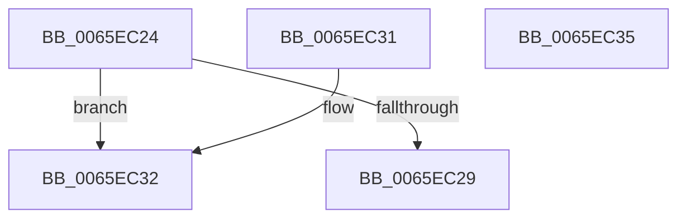

# WheapErrDescIsDeviceDriver

- RVA: `0x0065EC24`–`0x0065EC36` (길이 `18` bytes)
- VA: `0x000000014065EC24`
- 실행 섹션: `.text`
- PDB 이름 있음: `예`; PDB Function 태그: `아니요`
- unwind 정보 RVA: `0x000DB714`
- 디코드: `9`개 명령, `18/18` bytes 표시
- 미해석 바이트: `0` (있으면 어셈블리에 `.byte`로 보존)

> 이 문서는 커널 이미지의 기계어와 PDB 기호를 분석해 생성했습니다. 4번과 5번은 함수 원형과 자료형을 바이너리 사용 방식에서 추정한 C 해석이며 원본 소스 복구 결과는 아닙니다.

## 1. Dependencies

- 직접 호출 지점: **0**; 고유 호출 대상: **0**
- 직접 호출자로 확인된 함수: **6**
- RIP 상대 이미지 참조: **0**

### Outgoing calls
- 직접 디코드된 call 명령이 없습니다.

### Direct callers
- [WheaAddHwErrorReportSectionDeviceDriver](WheaAddHwErrorReportSectionDeviceDriver_function_0065E510.md) at `0x0065E55D`
- [WheaHwErrorReportSubmitDeviceDriver](WheaHwErrorReportSubmitDeviceDriver_function_0065E7F0.md) at `0x0065E83E`
- [WheapFreeDriverPacketBuffer](WheapFreeDriverPacketBuffer_function_0065EC58.md) at `0x0065EC84`
- [WheapGetPreallocatedPacketBuffer](WheapGetPreallocatedPacketBuffer_function_0065ECD4.md) at `0x0065ECFF`
- [WheapInitErrorReportDeviceDriver](WheapInitErrorReportDeviceDriver_function_0065ED88.md) at `0x0065EDF4`
- [WheaRemoveErrorSourceDeviceDriver](../../page/7D/WheaRemoveErrorSourceDeviceDriver_function_007D7060.md) at `0x007D70A4`

### Static image references
- 디코드된 RIP-relative 메모리 참조가 없습니다.

## 2. Other-region calls and transfers

- 다른 실행 섹션으로 향하는 call: **0**
- 별도 외부 분기/꼬리 이동을 확인하지 못했습니다.

## 3. Assembly (complete function range)

```asm
0065EC24  48 85 C9                        test rcx, rcx
0065EC27  74 09                           je 0x14065ec32
0065EC29  83 79 08 10                     cmp dword ptr [rcx + 8], 0x10
0065EC2D  0F 94 C0                        sete al
0065EC30  C3                              ret
0065EC31  CC                              int3
0065EC32  32 C0                           xor al, al
0065EC34  C3                              ret
0065EC35  CC                              int3
```

## 4. C-style interpretation (structured pseudocode)

```c
__int64 __fastcall WheapErrDescIsDeviceDriver(__int64 a1)
{
    __int64 result;

    if (a1 == 0) goto loc_0065EC32;
    result = ((*(unsigned int *)(a1 + 8)) == 16) ? 1 : 0;
    return result;
loc_0065EC32:
    result = 0;
    return result;
}
```

## 5. (Beta) C Style

```c
int64_t WheapErrDescIsDeviceDriver(int64_t Arg1)
{
    int64_t result;

    if (Arg1 == 0) goto loc_0065EC32;
    result = ((*(uint32_t *)(Arg1 + 0x8)) == 16) ? 1 : 0;
    return result;
loc_0065EC32:
    result = 0;
    return result;
}
```

## 6. Execution-region graph

[열기: 2D/3D 그래프와 함수 탐색 컨트롤 패널](../../../control-panel.html?section=text&rva=0x0065EC24&view=graph)

- 2D 그래프는 위에서 아래로 흐르고, 3D 그래프는 빈 공간을 드래그해 회전합니다. Shift+드래그는 이동, 휠은 확대·축소, 함수 노드 선택은 대상 보고서 이동입니다.

### Static fallback


