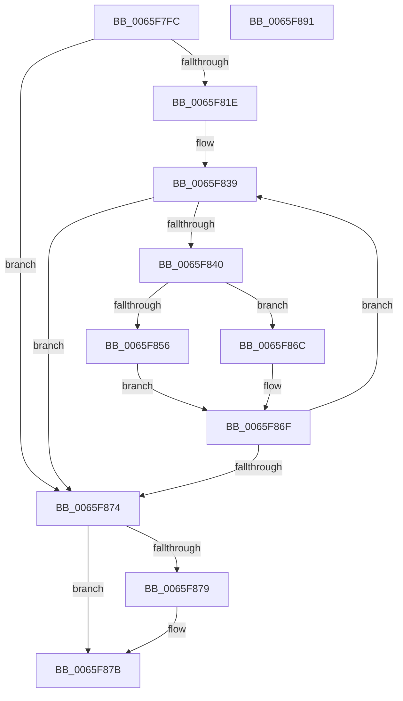

# WheapFormatBadPageList

- RVA: `0x0065F7FC`–`0x0065F892` (길이 `150` bytes)
- VA: `0x000000014065F7FC`
- 실행 섹션: `.text`
- PDB 이름 있음: `예`; PDB Function 태그: `아니요`
- unwind 정보 RVA: `0x0009B270`
- 디코드: `47`개 명령, `150/150` bytes 표시
- 미해석 바이트: `0` (있으면 어셈블리에 `.byte`로 보존)

> 이 문서는 커널 이미지의 기계어와 PDB 기호를 분석해 생성했습니다. 4번과 5번은 함수 원형과 자료형을 바이너리 사용 방식에서 추정한 C 해석이며 원본 소스 복구 결과는 아닙니다.

## 1. Dependencies

- 직접 호출 지점: **2**; 고유 호출 대상: **2**
- 직접 호출자로 확인된 함수: **1**
- RIP 상대 이미지 참조: **1**

### Outgoing calls
- `0x0065F832` → [qsort_s](../50/qsort_s_function_00500DD0.md) (function, `0x00500DD0`)
- `0x0065F863` → [memcpy](../6C/memcpy_function_006C6840.md) (function, `0x006C6840`)

### Direct callers
- [WheapInsertPageToList](WheapInsertPageToList_function_0065F898.md) at `0x0065F924`

### Static image references
- `0x0065F823` → RVA `0x0065F970` (`WheapPfnComparisonHelper`; read)

## 2. Other-region calls and transfers

- 다른 실행 섹션으로 향하는 call: **0**
- 별도 외부 분기/꼬리 이동을 확인하지 못했습니다.

## 3. Assembly (complete function range)

```asm
0065F7FC  48 8B C4                        mov rax, rsp
0065F7FF  48 89 58 08                     mov qword ptr [rax + 8], rbx
0065F803  48 89 70 10                     mov qword ptr [rax + 0x10], rsi
0065F807  48 89 78 18                     mov qword ptr [rax + 0x18], rdi
0065F80B  41 56                           push r14
0065F80D  48 83 EC 30                     sub rsp, 0x30
0065F811  8B DA                           mov ebx, edx
0065F813  49 8B F0                        mov rsi, r8
0065F816  4C 8B F1                        mov r14, rcx
0065F819  83 FA 01                        cmp edx, 1
0065F81C  76 56                           jbe 0x14065f874
0065F81E  48 83 60 E8 00                  and qword ptr [rax - 0x18], 0
0065F823  4C 8D 0D 46 01 00 00            lea r9, [rip + 0x146]
0065F82A  8B D3                           mov edx, ebx
0065F82C  41 B8 08 00 00 00               mov r8d, 8
0065F832  E8 99 15 EA FF                  call 0x140500dd0
0065F837  33 FF                           xor edi, edi
0065F839  8D 43 FF                        lea eax, [rbx - 1]
0065F83C  3B F8                           cmp edi, eax
0065F83E  73 34                           jae 0x14065f874
0065F840  8B C7                           mov eax, edi
0065F842  44 8D 47 01                     lea r8d, [rdi + 1]
0065F846  4B 8D 14 C6                     lea rdx, [r14 + r8*8]
0065F84A  49 8D 0C C6                     lea rcx, [r14 + rax*8]
0065F84E  48 8B 02                        mov rax, qword ptr [rdx]
0065F851  48 39 01                        cmp qword ptr [rcx], rax
0065F854  75 16                           jne 0x14065f86c
0065F856  44 8B C3                        mov r8d, ebx
0065F859  44 2B C7                        sub r8d, edi
0065F85C  41 FF C8                        dec r8d
0065F85F  49 C1 E0 03                     shl r8, 3
0065F863  E8 D8 6F 06 00                  call 0x1406c6840
0065F868  FF CB                           dec ebx
0065F86A  EB 03                           jmp 0x14065f86f
0065F86C  41 8B F8                        mov edi, r8d
0065F86F  83 FB 01                        cmp ebx, 1
0065F872  77 C5                           ja 0x14065f839
0065F874  48 85 F6                        test rsi, rsi
0065F877  74 02                           je 0x14065f87b
0065F879  89 1E                           mov dword ptr [rsi], ebx
0065F87B  48 8B 5C 24 40                  mov rbx, qword ptr [rsp + 0x40]
0065F880  48 8B 74 24 48                  mov rsi, qword ptr [rsp + 0x48]
0065F885  48 8B 7C 24 50                  mov rdi, qword ptr [rsp + 0x50]
0065F88A  48 83 C4 30                     add rsp, 0x30
0065F88E  41 5E                           pop r14
0065F890  C3                              ret
0065F891  CC                              int3
```

## 4. C-style interpretation (structured pseudocode)

```c
__int64 __fastcall WheapFormatBadPageList(__int64 a1, int a2, __int64 a3)
{
    __int64 result;
    __int64 v_rbx;
    __int64 v_rdi;
    __int64 v_rsp;
    unsigned __int64 v_stack_p10;
    unsigned __int64 v_stack_p18;
    unsigned __int64 v_stack_p8;

    *(unsigned __int64 *)(v_rsp + 8) = v_rbx;
    *(unsigned __int64 *)(v_rsp + 16) = v_rsi;
    *(unsigned __int64 *)(v_rsp + 24) = v_rdi;
    v_rsp = (v_rsp) - (48);
    if (a2 <= 1) goto loc_0065F874;
    result = qsort_s(a1, (unsigned int)((unsigned int)((unsigned int)(a2))), 8, v_rip + 326);
    v_rdi = 0;
loc_0065F839:
    if (0 >= ((unsigned int)((unsigned int)(a2) - 1))) goto loc_0065F874;
    if ((*(unsigned __int64 *)(a1 + 0 * 8)) != (*(unsigned __int64 *)(a1 + v_rdi + 1 * 8))) goto loc_0065F86C;
    a3 = (unsigned int)(((unsigned int)((unsigned int)((unsigned int)(a2)))) - (0));
    a3 = (unsigned int)((a3) - 1);
    a3 = (a3) << (3);
    result = memcpy(a1 + 0 * 8, a1 + v_rdi + 1 * 8, a3, v_rip + 326);
    v_rbx = (unsigned int)(((unsigned int)(a2)) - 1);
    goto loc_0065F86F;
loc_0065F86C:
loc_0065F86F:
    if (((unsigned int)(v_rbx)) > 1) goto loc_0065F839;
loc_0065F874:
    if (a3 != 0) {
        *(unsigned int *)(a3) = (unsigned int)(v_rbx);
    }
    v_rsp = (v_rsp) + (48);
    return result;
}
```

## 5. (Beta) C Style

```c
int64_t WheapFormatBadPageList(void *Arg1, int32_t Arg2, int64_t Arg3)
{
    uint8_t *arg1 = (uint8_t *)Arg1;

    int64_t result;
    int64_t local_rbx;
    int64_t local_rdi;
    int64_t local_rsp;
    uint64_t v_stack_p10;
    uint64_t v_stack_p18;
    uint64_t v_stack_p8;

    *(uint64_t *)(local_rsp + 0x8) = local_rbx;
    *(uint64_t *)(local_rsp + 0x10) = local_rsi;
    *(uint64_t *)(local_rsp + 0x18) = local_rdi;
    local_rsp = (local_rsp) - (48);
    if (Arg2 <= 1) goto loc_0065F874;
    result = qsort_s(Arg1, (uint32_t)((uint32_t)((uint32_t)(Arg2))), 8, v_rip + 326);
    local_rdi = 0;
loc_0065F839:
    if (0 >= ((uint32_t)((uint32_t)(Arg2) - 1))) goto loc_0065F874;
    if ((*(uint64_t *)(arg1 + 0x0 * 8)) != (*(uint64_t *)(arg1 + local_rdi + 0x1 * 8))) goto loc_0065F86C;
    Arg3 = (uint32_t)(((uint32_t)((uint32_t)((uint32_t)(Arg2)))) - (0));
    Arg3 = (uint32_t)((Arg3) - 1);
    Arg3 = (Arg3) << (3);
    result = memcpy(Arg1 + 0 * 8, Arg1 + local_rdi + 1 * 8, Arg3, v_rip + 326);
    local_rbx = (uint32_t)(((uint32_t)(Arg2)) - 1);
    goto loc_0065F86F;
loc_0065F86C:
loc_0065F86F:
    if (((uint32_t)(local_rbx)) > 1) goto loc_0065F839;
loc_0065F874:
    if (Arg3 != 0) {
        *(uint32_t *)(Arg3) = (uint32_t)(local_rbx);
    }
    local_rsp = (local_rsp) + (48);
    return result;
}
```

### 관측된 메모리 오프셋

구조체 형식이 확인되지 않은 접근은 인자 기준의 오프셋으로만 기록했습니다.

| 기준 인자 | 오프셋 표현 | 폭 (bit) | 접근 |
|---|---:|---:|---|
| `Arg1` | `+ 0x0` | `64` | `R` |
| `Arg1` | `+ 0x0 + r8*8` | `64` | `R` |
| `Arg1` | `+ 0x0 + rax*8` | `64` | `R` |

## 6. Execution-region graph

[열기: 2D/3D 그래프와 함수 탐색 컨트롤 패널](../../../control-panel.html?section=text&rva=0x0065F7FC&view=graph)

- 2D 그래프는 위에서 아래로 흐르고, 3D 그래프는 빈 공간을 드래그해 회전합니다. Shift+드래그는 이동, 휠은 확대·축소, 함수 노드 선택은 대상 보고서 이동입니다.

### Static fallback


