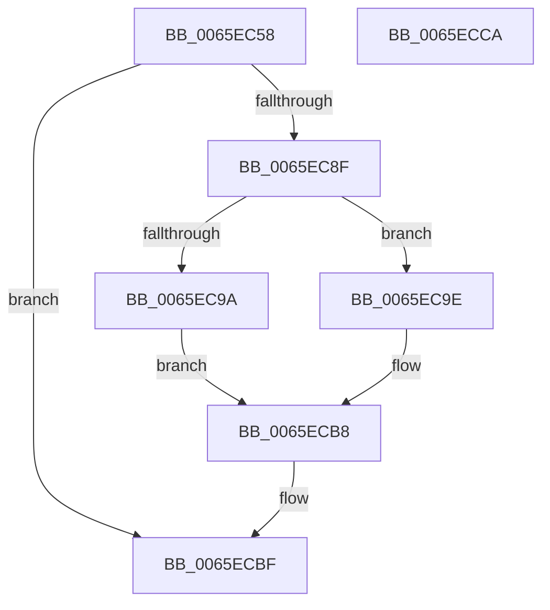

# WheapFreeDriverPacketBuffer

- RVA: `0x0065EC58`–`0x0065ECCB` (길이 `115` bytes)
- VA: `0x000000014065EC58`
- 실행 섹션: `.text`
- PDB 이름 있음: `예`; PDB Function 태그: `아니요`
- unwind 정보 RVA: `0x0005CAAC`
- 디코드: `34`개 명령, `115/115` bytes 표시
- 미해석 바이트: `0` (있으면 어셈블리에 `.byte`로 보존)

> 이 문서는 커널 이미지의 기계어와 PDB 기호를 분석해 생성했습니다. 4번과 5번은 함수 원형과 자료형을 바이너리 사용 방식에서 추정한 C 해석이며 원본 소스 복구 결과는 아닙니다.

## 1. Dependencies

- 직접 호출 지점: **4**; 고유 호출 대상: **3**
- 직접 호출자로 확인된 함수: **2**
- RIP 상대 이미지 참조: **1**

### Outgoing calls
- `0x0065EC6F` → [WheapGetErrorSource](../49/WheapGetErrorSource_function_0049554C.md) (function, `0x0049554C`)
- `0x0065EC84` → [WheapErrDescIsDeviceDriver](WheapErrDescIsDeviceDriver_function_0065EC24.md) (function, `0x0065EC24`)
- `0x0065ECA6` → [ExFreePoolWithTag](../../poolcode/B8/ExFreePoolWithTag_function_00B82870.md) (function, `0x00B82870`)
- `0x0065ECB3` → [ExFreePoolWithTag](../../poolcode/B8/ExFreePoolWithTag_function_00B82870.md) (function, `0x00B82870`)

### Direct callers
- [WheaHwErrorReportAbandonDeviceDriver](WheaHwErrorReportAbandonDeviceDriver_function_0065E650.md) at `0x0065E664`
- [WheaHwErrorReportSubmitDeviceDriver](WheaHwErrorReportSubmitDeviceDriver_function_0065E7F0.md) at `0x0065E8E8`

### Static image references
- `0x0065EC68` → RVA `0x00EEF018` (`.data`; read)

## 2. Other-region calls and transfers

- 다른 실행 섹션으로 향하는 call: **2**
  - `0x0065ECA6` → [ExFreePoolWithTag](../../poolcode/B8/ExFreePoolWithTag_function_00B82870.md) (`.text` → `POOLCODE`)
  - `0x0065ECB3` → [ExFreePoolWithTag](../../poolcode/B8/ExFreePoolWithTag_function_00B82870.md) (`.text` → `POOLCODE`)
- 별도 외부 분기/꼬리 이동을 확인하지 못했습니다.

## 3. Assembly (complete function range)

```asm
0065EC58  48 89 5C 24 08                  mov qword ptr [rsp + 8], rbx
0065EC5D  57                              push rdi
0065EC5E  48 83 EC 20                     sub rsp, 0x20
0065EC62  8B 51 0C                        mov edx, dword ptr [rcx + 0xc]
0065EC65  48 8B D9                        mov rbx, rcx
0065EC68  48 8D 0D A9 03 89 00            lea rcx, [rip + 0x8903a9]
0065EC6F  E8 D8 68 E3 FF                  call 0x14049554c
0065EC74  48 8D 50 60                     lea rdx, [rax + 0x60]
0065EC78  48 F7 D8                        neg rax
0065EC7B  48 1B FF                        sbb rdi, rdi
0065EC7E  48 23 FA                        and rdi, rdx
0065EC81  48 8B CF                        mov rcx, rdi
0065EC84  E8 9B FF FF FF                  call 0x14065ec24
0065EC89  33 C9                           xor ecx, ecx
0065EC8B  84 C0                           test al, al
0065EC8D  74 30                           je 0x14065ecbf
0065EC8F  48 8B 43 20                     mov rax, qword ptr [rbx + 0x20]
0065EC93  89 0B                           mov dword ptr [rbx], ecx
0065EC95  38 4B 30                        cmp byte ptr [rbx + 0x30], cl
0065EC98  74 04                           je 0x14065ec9e
0065EC9A  87 08                           xchg dword ptr [rax], ecx
0065EC9C  EB 1A                           jmp 0x14065ecb8
0065EC9E  BA 57 48 45 41                  mov edx, 0x41454857
0065ECA3  48 8B C8                        mov rcx, rax
0065ECA6  E8 C5 3B 52 00                  call 0x140b82870
0065ECAB  BA 57 48 45 41                  mov edx, 0x41454857
0065ECB0  48 8B CB                        mov rcx, rbx
0065ECB3  E8 B8 3B 52 00                  call 0x140b82870
0065ECB8  F0 FF 8F 98 00 00 00            lock dec dword ptr [rdi + 0x98]
0065ECBF  48 8B 5C 24 30                  mov rbx, qword ptr [rsp + 0x30]
0065ECC4  48 83 C4 20                     add rsp, 0x20
0065ECC8  5F                              pop rdi
0065ECC9  C3                              ret
0065ECCA  CC                              int3
```

## 4. C-style interpretation (structured pseudocode)

```c
__int64 __fastcall WheapFreeDriverPacketBuffer(__int64 a1)
{
    __int64 result;
    __int64 v_rdi;
    __int64 v_rsp;
    unsigned __int64 v_stack_p8;

    v_stack_p8 = v_rbx;
    v_rsp = (v_rsp) - (32);
    result = WheapGetErrorSource(v_rip + 8979369, (unsigned int)(*(unsigned int *)(a1 + 12)), a3, a4);
    result = -(result);
    v_rdi = (v_rdi) & (result + 96);
    result = WheapErrDescIsDeviceDriver(v_rdi, result + 96, a3, a4);
    a1 = 0;
    if ((unsigned __int8)(result) == 0) goto loc_0065ECBF;
    *(unsigned int *)(a1) = 0;
    if ((*(unsigned __int8 *)(a1 + 48)) == 0) goto loc_0065EC9E;
    goto loc_0065ECB8;
loc_0065EC9E:
    result = ExFreePoolWithTag(*(unsigned __int64 *)(a1 + 32), (unsigned int)(0x41454857ULL), a3, a4);
    result = ExFreePoolWithTag(0, (unsigned int)(0x41454857ULL), a3, a4);
loc_0065ECB8:
loc_0065ECBF:
    v_rsp = (v_rsp) + (32);
    return result;
}
```

## 5. (Beta) C Style

```c
int64_t WheapFreeDriverPacketBuffer(void *Arg1)
{
    uint8_t *arg1 = (uint8_t *)Arg1;

    int64_t result;
    int64_t local_rdi;
    int64_t local_rsp;
    uint64_t v_stack_p8;

    v_stack_p8 = local_rbx;
    local_rsp = (local_rsp) - (32);
    result = WheapGetErrorSource(v_rip + 8979369, (uint32_t)(*(uint32_t *)(arg1 + 0xC)), a3, a4);
    result = -(result);
    local_rdi = (local_rdi) & (result + 96);
    result = WheapErrDescIsDeviceDriver(local_rdi, result + 96, a3, a4);
    Arg1 = 0;
    if ((uint8_t)(result) == 0) goto loc_0065ECBF;
    *(uint32_t *)(arg1) = 0;
    if ((*(uint8_t *)(arg1 + 0x30)) == 0) goto loc_0065EC9E;
    goto loc_0065ECB8;
loc_0065EC9E:
    result = ExFreePoolWithTag(*(uint64_t *)(arg1 + 0x20), (uint32_t)(0x41454857ULL), a3, a4);
    result = ExFreePoolWithTag(0, (uint32_t)(0x41454857ULL), a3, a4);
loc_0065ECB8:
loc_0065ECBF:
    local_rsp = (local_rsp) + (32);
    return result;
}
```

### 관측된 메모리 오프셋

구조체 형식이 확인되지 않은 접근은 인자 기준의 오프셋으로만 기록했습니다.

| 기준 인자 | 오프셋 표현 | 폭 (bit) | 접근 |
|---|---:|---:|---|
| `Arg1` | `+ 0x0` | `32` | `W` |
| `Arg1` | `+ 0xC` | `32` | `R` |
| `Arg1` | `+ 0x20` | `64` | `R` |
| `Arg1` | `+ 0x30` | `8` | `R` |

## 6. Execution-region graph

[열기: 2D/3D 그래프와 함수 탐색 컨트롤 패널](../../../control-panel.html?section=text&rva=0x0065EC58&view=graph)

- 2D 그래프는 위에서 아래로 흐르고, 3D 그래프는 빈 공간을 드래그해 회전합니다. Shift+드래그는 이동, 휠은 확대·축소, 함수 노드 선택은 대상 보고서 이동입니다.

### Static fallback


