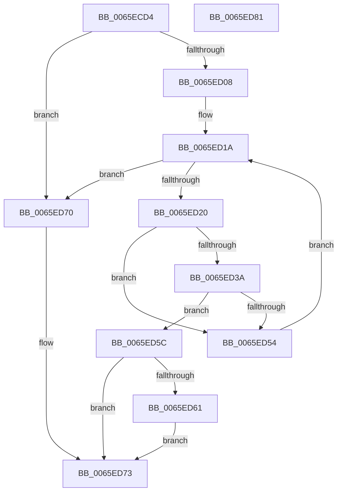

# WheapGetPreallocatedPacketBuffer

- RVA: `0x0065ECD4`–`0x0065ED82` (길이 `174` bytes)
- VA: `0x000000014065ECD4`
- 실행 섹션: `.text`
- PDB 이름 있음: `예`; PDB Function 태그: `아니요`
- unwind 정보 RVA: `0x0005CAAC`
- 디코드: `51`개 명령, `174/174` bytes 표시
- 미해석 바이트: `0` (있으면 어셈블리에 `.byte`로 보존)

> 이 문서는 커널 이미지의 기계어와 PDB 기호를 분석해 생성했습니다. 4번과 5번은 함수 원형과 자료형을 바이너리 사용 방식에서 추정한 C 해석이며 원본 소스 복구 결과는 아닙니다.

## 1. Dependencies

- 직접 호출 지점: **2**; 고유 호출 대상: **2**
- 직접 호출자로 확인된 함수: **1**
- RIP 상대 이미지 참조: **1**

### Outgoing calls
- `0x0065ECEA` → [WheapGetErrorSource](../49/WheapGetErrorSource_function_0049554C.md) (function, `0x0049554C`)
- `0x0065ECFF` → [WheapErrDescIsDeviceDriver](WheapErrDescIsDeviceDriver_function_0065EC24.md) (function, `0x0065EC24`)

### Direct callers
- [WheapInitErrorReportDeviceDriver](WheapInitErrorReportDeviceDriver_function_0065ED88.md) at `0x0065EE8E`

### Static image references
- `0x0065ECE3` → RVA `0x00EEF018` (`.data`; read)

## 2. Other-region calls and transfers

- 다른 실행 섹션으로 향하는 call: **0**
- 별도 외부 분기/꼬리 이동을 확인하지 못했습니다.

## 3. Assembly (complete function range)

```asm
0065ECD4  48 89 5C 24 08                  mov qword ptr [rsp + 8], rbx
0065ECD9  57                              push rdi
0065ECDA  48 83 EC 20                     sub rsp, 0x20
0065ECDE  4C 8B DA                        mov r11, rdx
0065ECE1  8B D1                           mov edx, ecx
0065ECE3  48 8D 0D 2E 03 89 00            lea rcx, [rip + 0x89032e]
0065ECEA  E8 5D 68 E3 FF                  call 0x14049554c
0065ECEF  48 8D 48 60                     lea rcx, [rax + 0x60]
0065ECF3  48 F7 D8                        neg rax
0065ECF6  4D 1B C9                        sbb r9, r9
0065ECF9  4C 23 C9                        and r9, rcx
0065ECFC  49 8B C9                        mov rcx, r9
0065ECFF  E8 20 FF FF FF                  call 0x14065ec24
0065ED04  84 C0                           test al, al
0065ED06  74 68                           je 0x14065ed70
0065ED08  41 8B 79 40                     mov edi, dword ptr [r9 + 0x40]
0065ED0C  45 33 D2                        xor r10d, r10d
0065ED0F  4D 8B 41 48                     mov r8, qword ptr [r9 + 0x48]
0065ED13  49 8B 99 90 00 00 00            mov rbx, qword ptr [r9 + 0x90]
0065ED1A  45 3B 51 44                     cmp r10d, dword ptr [r9 + 0x44]
0065ED1E  73 50                           jae 0x14065ed70
0065ED20  4C 89 44 24 40                  mov qword ptr [rsp + 0x40], r8
0065ED25  48 8B 44 24 40                  mov rax, qword ptr [rsp + 0x40]
0065ED2A  8B 08                           mov ecx, dword ptr [rax]
0065ED2C  81 E1 00 00 00 F0               and ecx, 0xf0000000
0065ED32  81 F9 00 00 00 80               cmp ecx, 0x80000000
0065ED38  74 1A                           je 0x14065ed54
0065ED3A  48 8B 44 24 40                  mov rax, qword ptr [rsp + 0x40]
0065ED3F  48 8B 4C 24 40                  mov rcx, qword ptr [rsp + 0x40]
0065ED44  8B 00                           mov eax, dword ptr [rax]
0065ED46  8B D0                           mov edx, eax
0065ED48  81 CA 00 00 00 80               or edx, 0x80000000
0065ED4E  F0 0F B1 11                     lock cmpxchg dword ptr [rcx], edx
0065ED52  74 08                           je 0x14065ed5c
0065ED54  4C 03 C7                        add r8, rdi
0065ED57  41 FF C2                        inc r10d
0065ED5A  EB BE                           jmp 0x14065ed1a
0065ED5C  4D 85 DB                        test r11, r11
0065ED5F  74 12                           je 0x14065ed73
0065ED61  41 8B C2                        mov eax, r10d
0065ED64  48 6B C8 68                     imul rcx, rax, 0x68
0065ED68  48 03 CB                        add rcx, rbx
0065ED6B  49 89 0B                        mov qword ptr [r11], rcx
0065ED6E  EB 03                           jmp 0x14065ed73
0065ED70  45 33 C0                        xor r8d, r8d
0065ED73  48 8B 5C 24 30                  mov rbx, qword ptr [rsp + 0x30]
0065ED78  49 8B C0                        mov rax, r8
0065ED7B  48 83 C4 20                     add rsp, 0x20
0065ED7F  5F                              pop rdi
0065ED80  C3                              ret
0065ED81  CC                              int3
```

## 4. C-style interpretation (structured pseudocode)

```c
__int64 __fastcall WheapGetPreallocatedPacketBuffer(int a1, __int64 a2, __int64 a3, __int64 a4)
{
    __int64 result;
    __int64 v_r10;
    __int64 v_rsp;
    unsigned __int64 v_stack_p18;
    unsigned __int64 v_stack_p8;

    v_stack_p8 = v_rbx;
    v_rsp = (v_rsp) - (32);
    result = WheapGetErrorSource(v_rip + 8979246, (unsigned int)(a1), a3, a4);
    result = -(result);
    a4 = (a4) & (result + 96);
    result = WheapErrDescIsDeviceDriver(a4, (unsigned int)(a1), a3, a4);
    if ((unsigned __int8)(result) == 0) goto loc_0065ED70;
    v_r10 = 0;
loc_0065ED1A:
    if (0 >= (*(unsigned int *)(a4 + 68))) goto loc_0065ED70;
    v_stack_p18 = *(unsigned __int64 *)(a4 + 72);
    a1 = (unsigned int)(((unsigned int)(*(unsigned int *)(v_stack_p18))) & (0xF0000000ULL));
    if (a1 == 0x80000000ULL) goto loc_0065ED54;
    a2 = (unsigned int)(((unsigned int)((unsigned int)((unsigned int)(*(unsigned int *)(v_stack_p18))))) | (0x80000000ULL));
    if (condition_is_equal) goto loc_0065ED5C;
loc_0065ED54:
    a3 = (*(unsigned __int64 *)(a4 + 72)) + ((unsigned int)(*(unsigned int *)(a4 + 64)));
    v_r10 = (unsigned int)((v_r10) + 1);
    goto loc_0065ED1A;
loc_0065ED5C:
    if (a2 == 0) goto loc_0065ED73;
    a1 = (v_stack_p18) * ((unsigned int)((unsigned int)(v_r10)));
    a1 = (a1) + (*(unsigned __int64 *)(a4 + 144));
    *(unsigned __int64 *)(a2) = a1;
    goto loc_0065ED73;
loc_0065ED70:
    a3 = 0;
loc_0065ED73:
    v_rsp = (v_rsp) + (32);
    return 0;
}
```

## 5. (Beta) C Style

```c
int64_t WheapGetPreallocatedPacketBuffer(int32_t Arg1, int64_t Arg2, int64_t Arg3, int64_t Arg4)
{
    int64_t result;
    int64_t local_r10;
    int64_t local_rsp;
    uint64_t v_stack_p18;
    uint64_t v_stack_p8;

    v_stack_p8 = local_rbx;
    local_rsp = (local_rsp) - (32);
    result = WheapGetErrorSource(v_rip + 8979246, (uint32_t)(Arg1), Arg3, Arg4);
    result = -(result);
    Arg4 = (Arg4) & (result + 96);
    result = WheapErrDescIsDeviceDriver(Arg4, (uint32_t)(Arg1), Arg3, Arg4);
    if ((uint8_t)(result) == 0) goto loc_0065ED70;
    local_r10 = 0;
loc_0065ED1A:
    if (0 >= (*(uint32_t *)(Arg4 + 0x44))) goto loc_0065ED70;
    v_stack_p18 = *(uint64_t *)(Arg4 + 0x48);
    Arg1 = (uint32_t)(((uint32_t)(*(uint32_t *)(v_stack_p18))) & (0xF0000000ULL));
    if (Arg1 == 0x80000000ULL) goto loc_0065ED54;
    Arg2 = (uint32_t)(((uint32_t)((uint32_t)((uint32_t)(*(uint32_t *)(v_stack_p18))))) | (0x80000000ULL));
    if (condition_is_equal) goto loc_0065ED5C;
loc_0065ED54:
    Arg3 = (*(uint64_t *)(Arg4 + 0x48)) + ((uint32_t)(*(uint32_t *)(Arg4 + 0x40)));
    local_r10 = (uint32_t)((local_r10) + 1);
    goto loc_0065ED1A;
loc_0065ED5C:
    if (Arg2 == 0) goto loc_0065ED73;
    Arg1 = (v_stack_p18) * ((uint32_t)((uint32_t)(local_r10)));
    Arg1 = (Arg1) + (*(uint64_t *)(Arg4 + 0x90));
    *(uint64_t *)(Arg2) = Arg1;
    goto loc_0065ED73;
loc_0065ED70:
    Arg3 = 0;
loc_0065ED73:
    local_rsp = (local_rsp) + (32);
    return 0;
}
```

## 6. Execution-region graph

[열기: 2D/3D 그래프와 함수 탐색 컨트롤 패널](../../../control-panel.html?section=text&rva=0x0065ECD4&view=graph)

- 2D 그래프는 위에서 아래로 흐르고, 3D 그래프는 빈 공간을 드래그해 회전합니다. Shift+드래그는 이동, 휠은 확대·축소, 함수 노드 선택은 대상 보고서 이동입니다.

### Static fallback


