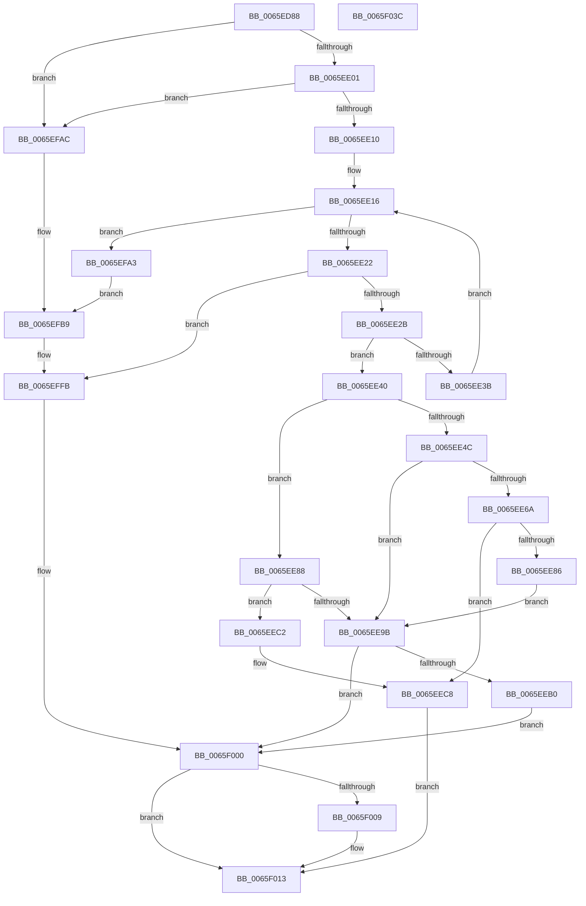

# WheapInitErrorReportDeviceDriver

- RVA: `0x0065ED88`–`0x0065F03D` (길이 `693` bytes)
- VA: `0x000000014065ED88`
- 실행 섹션: `.text`
- PDB 이름 있음: `예`; PDB Function 태그: `아니요`
- unwind 정보 RVA: `0x000B8D94`
- 디코드: `175`개 명령, `693/693` bytes 표시
- 미해석 바이트: `0` (있으면 어셈블리에 `.byte`로 보존)

> 이 문서는 커널 이미지의 기계어와 PDB 기호를 분석해 생성했습니다. 4번과 5번은 함수 원형과 자료형을 바이너리 사용 방식에서 추정한 C 해석이며 원본 소스 복구 결과는 아닙니다.

## 1. Dependencies

- 직접 호출 지점: **13**; 고유 호출 대상: **9**
- 직접 호출자로 확인된 함수: **1**
- RIP 상대 이미지 참조: **4**

### Outgoing calls
- `0x0065EDC8` → [memset](../6C/memset_function_006C6C40.md) (function, `0x006C6C40`)
- `0x0065EDDF` → [WheapGetErrorSource](../49/WheapGetErrorSource_function_0049554C.md) (function, `0x0049554C`)
- `0x0065EDF4` → [WheapErrDescIsDeviceDriver](WheapErrDescIsDeviceDriver_function_0065EC24.md) (function, `0x0065EC24`)
- `0x0065EE5D` → [ExAllocatePool2](../../poolcode/B8/ExAllocatePool2_function_00B820F0.md) (function, `0x00B820F0`)
- `0x0065EE78` → [ExAllocatePool2](../../poolcode/B8/ExAllocatePool2_function_00B820F0.md) (function, `0x00B820F0`)
- `0x0065EE8E` → [WheapGetPreallocatedPacketBuffer](WheapGetPreallocatedPacketBuffer_function_0065ECD4.md) (function, `0x0065ECD4`)
- `0x0065EEB8` → [ExFreePoolWithTag](../../poolcode/B8/ExFreePoolWithTag_function_00B82870.md) (function, `0x00B82870`)
- `0x0065EED2` → [memset](../6C/memset_function_006C6C40.md) (function, `0x006C6C40`)
- `0x0065EF1A` → [memset](../6C/memset_function_006C6C40.md) (function, `0x006C6C40`)
- `0x0065EFED` → [RtlStringCchCopyA](../46/RtlStringCchCopyA_function_00460628.md) (function, `0x00460628`)
- `0x0065EFF6` → [WheaLogInternalEvent](../66/WheaLogInternalEvent_function_006605B0.md) (function, `0x006605B0`)
- `0x0065F00E` → [ExFreePoolWithTag](../../poolcode/B8/ExFreePoolWithTag_function_00B82870.md) (function, `0x00B82870`)
- `0x0065F01C` → [_security_check_cookie](../6A/_security_check_cookie_function_006AC640.md) (function, `0x006AC640`)

### Direct callers
- [WheaCreateHwErrorReportDeviceDriver](WheaCreateHwErrorReportDeviceDriver_function_0065E620.md) at `0x0065E632`

### Static image references
- `0x0065EDA2` → RVA `0x00E0A740` (`.data`; read)
- `0x0065EDCF` → RVA `0x00EEF018` (`.data`; read)
- `0x0065EF1F` → RVA `0x00024758` (`.rdata`; read)
- `0x0065EFC5` → RVA `0x006D0680` (` ?? ::FNODOBFM::`string'`; read)

## 2. Other-region calls and transfers

- 다른 실행 섹션으로 향하는 call: **4**
  - `0x0065EE5D` → [ExAllocatePool2](../../poolcode/B8/ExAllocatePool2_function_00B820F0.md) (`.text` → `POOLCODE`)
  - `0x0065EE78` → [ExAllocatePool2](../../poolcode/B8/ExAllocatePool2_function_00B820F0.md) (`.text` → `POOLCODE`)
  - `0x0065EEB8` → [ExFreePoolWithTag](../../poolcode/B8/ExFreePoolWithTag_function_00B82870.md) (`.text` → `POOLCODE`)
  - `0x0065F00E` → [ExFreePoolWithTag](../../poolcode/B8/ExFreePoolWithTag_function_00B82870.md) (`.text` → `POOLCODE`)
- 별도 외부 분기/꼬리 이동을 확인하지 못했습니다.

## 3. Assembly (complete function range)

```asm
0065ED88  48 89 5C 24 18                  mov qword ptr [rsp + 0x18], rbx
0065ED8D  55                              push rbp
0065ED8E  56                              push rsi
0065ED8F  57                              push rdi
0065ED90  41 54                           push r12
0065ED92  41 55                           push r13
0065ED94  41 56                           push r14
0065ED96  41 57                           push r15
0065ED98  48 8B EC                        mov rbp, rsp
0065ED9B  48 81 EC 80 00 00 00            sub rsp, 0x80
0065EDA2  48 8B 05 97 B9 7A 00            mov rax, qword ptr [rip + 0x7ab997]
0065EDA9  48 33 C4                        xor rax, rsp
0065EDAC  48 89 45 F0                     mov qword ptr [rbp - 0x10], rax
0065EDB0  4C 8B E2                        mov r12, rdx
0065EDB3  89 4D A0                        mov dword ptr [rbp - 0x60], ecx
0065EDB6  44 8B F9                        mov r15d, ecx
0065EDB9  41 BD 40 00 00 00               mov r13d, 0x40
0065EDBF  45 8B C5                        mov r8d, r13d
0065EDC2  48 8D 4D B0                     lea rcx, [rbp - 0x50]
0065EDC6  33 D2                           xor edx, edx
0065EDC8  E8 73 7E 06 00                  call 0x1406c6c40
0065EDCD  33 DB                           xor ebx, ebx
0065EDCF  48 8D 0D 42 02 89 00            lea rcx, [rip + 0x890242]
0065EDD6  41 8B D7                        mov edx, r15d
0065EDD9  49 89 1C 24                     mov qword ptr [r12], rbx
0065EDDD  8B FB                           mov edi, ebx
0065EDDF  E8 68 67 E3 FF                  call 0x14049554c
0065EDE4  48 8D 48 60                     lea rcx, [rax + 0x60]
0065EDE8  48 F7 D8                        neg rax
0065EDEB  48 1B F6                        sbb rsi, rsi
0065EDEE  48 23 F1                        and rsi, rcx
0065EDF1  48 8B CE                        mov rcx, rsi
0065EDF4  E8 2B FE FF FF                  call 0x14065ec24
0065EDF9  84 C0                           test al, al
0065EDFB  0F 84 AB 01 00 00               je 0x14065efac
0065EE01  8B 86 98 00 00 00               mov eax, dword ptr [rsi + 0x98]
0065EE07  83 F8 FF                        cmp eax, -1
0065EE0A  0F 84 9C 01 00 00               je 0x14065efac
0065EE10  8B D3                           mov edx, ebx
0065EE12  45 8D 75 C1                     lea r14d, [r13 - 0x3f]
0065EE16  44 8B C0                        mov r8d, eax
0065EE19  83 FA 0A                        cmp edx, 0xa
0065EE1C  0F 83 81 01 00 00               jae 0x14065efa3
0065EE22  83 F8 FF                        cmp eax, -1
0065EE25  0F 84 D0 01 00 00               je 0x14065effb
0065EE2B  8D 48 01                        lea ecx, [rax + 1]
0065EE2E  F0 0F B1 8E 98 00 00 00         lock cmpxchg dword ptr [rsi + 0x98], ecx
0065EE36  44 3B C0                        cmp r8d, eax
0065EE39  74 05                           je 0x14065ee40
0065EE3B  41 03 D6                        add edx, r14d
0065EE3E  EB D6                           jmp 0x14065ee16
0065EE40  44 8B 6E 40                     mov r13d, dword ptr [rsi + 0x40]
0065EE44  44 0F 20 C0                     mov rax, cr8
0065EE48  3C 02                           cmp al, 2
0065EE4A  73 3C                           jae 0x14065ee88
0065EE4C  41 B8 57 48 45 41               mov r8d, 0x41454857
0065EE52  41 8B D5                        mov edx, r13d
0065EE55  B9 42 00 00 00                  mov ecx, 0x42
0065EE5A  45 8B F5                        mov r14d, r13d
0065EE5D  E8 8E 32 52 00                  call 0x140b820f0
0065EE62  4C 8B F8                        mov r15, rax
0065EE65  48 85 C0                        test rax, rax
0065EE68  74 31                           je 0x14065ee9b
0065EE6A  BA 68 00 00 00                  mov edx, 0x68
0065EE6F  41 B8 57 48 45 41               mov r8d, 0x41454857
0065EE75  8D 4A DA                        lea ecx, [rdx - 0x26]
0065EE78  E8 73 32 52 00                  call 0x140b820f0
0065EE7D  49 89 04 24                     mov qword ptr [r12], rax
0065EE81  48 85 C0                        test rax, rax
0065EE84  75 42                           jne 0x14065eec8
0065EE86  EB 13                           jmp 0x14065ee9b
0065EE88  49 8B D4                        mov rdx, r12
0065EE8B  41 8B CF                        mov ecx, r15d
0065EE8E  E8 41 FE FF FF                  call 0x14065ecd4
0065EE93  4C 8B F8                        mov r15, rax
0065EE96  48 85 C0                        test rax, rax
0065EE99  75 27                           jne 0x14065eec2
0065EE9B  F0 FF 8E 98 00 00 00            lock dec dword ptr [rsi + 0x98]
0065EEA2  BF 9A 00 00 C0                  mov edi, 0xc000009a
0065EEA7  4D 85 FF                        test r15, r15
0065EEAA  0F 84 50 01 00 00               je 0x14065f000
0065EEB0  BA 57 48 45 41                  mov edx, 0x41454857
0065EEB5  49 8B CF                        mov rcx, r15
0065EEB8  E8 B3 39 52 00                  call 0x140b82870
0065EEBD  E9 3E 01 00 00                  jmp 0x14065f000
0065EEC2  41 8A DE                        mov bl, r14b
0065EEC5  4D 8B F5                        mov r14, r13
0065EEC8  49 8B 0C 24                     mov rcx, qword ptr [r12]
0065EECC  33 D2                           xor edx, edx
0065EECE  44 8D 42 68                     lea r8d, [rdx + 0x68]
0065EED2  E8 69 7D 06 00                  call 0x1406c6c40
0065EED7  49 8B 04 24                     mov rax, qword ptr [r12]
0065EEDB  4D 8D 46 F8                     lea r8, [r14 - 8]
0065EEDF  8B 75 A0                        mov esi, dword ptr [rbp - 0x60]
0065EEE2  33 D2                           xor edx, edx
0065EEE4  C7 00 57 48 45 41               mov dword ptr [rax], 0x41454857
0065EEEA  49 8B 04 24                     mov rax, qword ptr [r12]
0065EEEE  89 70 0C                        mov dword ptr [rax + 0xc], esi
0065EEF1  49 8B 04 24                     mov rax, qword ptr [r12]
0065EEF5  C7 40 34 02 00 00 00            mov dword ptr [rax + 0x34], 2
0065EEFC  49 8B 04 24                     mov rax, qword ptr [r12]
0065EF00  88 58 30                        mov byte ptr [rax + 0x30], bl
0065EF03  49 8D 5F 08                     lea rbx, [r15 + 8]
0065EF07  49 8B 04 24                     mov rax, qword ptr [r12]
0065EF0B  48 8B CB                        mov rcx, rbx
0065EF0E  48 89 58 28                     mov qword ptr [rax + 0x28], rbx
0065EF12  49 8B 04 24                     mov rax, qword ptr [r12]
0065EF16  4C 89 78 20                     mov qword ptr [rax + 0x20], r15
0065EF1A  E8 21 7D 06 00                  call 0x1406c6c40
0065EF1F  0F 10 05 32 58 9C FF            movups xmm0, xmmword ptr [rip - 0x63a7ce]
0065EF26  C7 03 57 48 45 41               mov dword ptr [rbx], 0x41454857
0065EF2C  48 8D 4B 50                     lea rcx, [rbx + 0x50]
0065EF30  C7 43 04 03 00 00 00            mov dword ptr [rbx + 4], 3
0065EF37  41 8D 45 90                     lea eax, [r13 - 0x70]
0065EF3B  89 43 08                        mov dword ptr [rbx + 8], eax
0065EF3E  83 C0 B0                        add eax, -0x50
0065EF41  89 43 44                        mov dword ptr [rbx + 0x44], eax
0065EF44  C7 43 10 06 00 00 00            mov dword ptr [rbx + 0x10], 6
0065EF4B  C7 43 14 02 00 00 80            mov dword ptr [rbx + 0x14], 0x80000002
0065EF52  89 73 18                        mov dword ptr [rbx + 0x18], esi
0065EF55  C7 43 1C 0C 00 00 00            mov dword ptr [rbx + 0x1c], 0xc
0065EF5C  F3 0F 7F 43 20                  movdqu xmmword ptr [rbx + 0x20], xmm0
0065EF61  C7 43 38 07 00 00 00            mov dword ptr [rbx + 0x38], 7
0065EF68  C7 43 40 50 00 00 00            mov dword ptr [rbx + 0x40], 0x50
0065EF6F  49 8B 04 24                     mov rax, qword ptr [r12]
0065EF73  48 89 48 10                     mov qword ptr [rax + 0x10], rcx
0065EF77  81 21 0F C0 FF FF               and dword ptr [rcx], 0xffffc00f
0065EF7D  C7 41 10 02 00 00 00            mov dword ptr [rcx + 0x10], 2
0065EF84  8B 43 08                        mov eax, dword ptr [rbx + 8]
0065EF87  83 E8 64                        sub eax, 0x64
0065EF8A  89 41 0C                        mov dword ptr [rcx + 0xc], eax
0065EF8D  48 83 C1 14                     add rcx, 0x14
0065EF91  49 8B 04 24                     mov rax, qword ptr [r12]
0065EF95  48 89 48 18                     mov qword ptr [rax + 0x18], rcx
0065EF99  49 8B 04 24                     mov rax, qword ptr [r12]
0065EF9D  83 40 08 64                     add dword ptr [rax + 8], 0x64
0065EFA1  EB 70                           jmp 0x14065f013
0065EFA3  C7 45 C4 2C 00 00 80            mov dword ptr [rbp - 0x3c], 0x8000002c
0065EFAA  EB 0D                           jmp 0x14065efb9
0065EFAC  41 BE 01 00 00 00               mov r14d, 1
0065EFB2  C7 45 C4 2B 00 00 80            mov dword ptr [rbp - 0x3c], 0x8000002b
0065EFB9  BA 20 00 00 00                  mov edx, 0x20
0065EFBE  C7 45 B0 57 68 4C 67            mov dword ptr [rbp - 0x50], 0x674c6857
0065EFC5  4C 8D 05 B4 16 07 00            lea r8, [rip + 0x716b4]
0065EFCC  89 55 CC                        mov dword ptr [rbp - 0x34], edx
0065EFCF  48 8D 4D D0                     lea rcx, [rbp - 0x30]
0065EFD3  44 89 75 B4                     mov dword ptr [rbp - 0x4c], r14d
0065EFD7  44 89 6D B8                     mov dword ptr [rbp - 0x48], r13d
0065EFDB  44 89 75 BC                     mov dword ptr [rbp - 0x44], r14d
0065EFDF  C7 45 C0 4B 52 4E 4C            mov dword ptr [rbp - 0x40], 0x4c4e524b
0065EFE6  C7 45 C8 02 00 00 00            mov dword ptr [rbp - 0x38], 2
0065EFED  E8 36 16 E0 FF                  call 0x140460628
0065EFF2  48 8D 4D B0                     lea rcx, [rbp - 0x50]
0065EFF6  E8 B5 15 00 00                  call 0x1406605b0
0065EFFB  BF 0D 00 00 C0                  mov edi, 0xc000000d
0065F000  49 8B 0C 24                     mov rcx, qword ptr [r12]
0065F004  48 85 C9                        test rcx, rcx
0065F007  74 0A                           je 0x14065f013
0065F009  BA 57 48 45 41                  mov edx, 0x41454857
0065F00E  E8 5D 38 52 00                  call 0x140b82870
0065F013  8B C7                           mov eax, edi
0065F015  48 8B 4D F0                     mov rcx, qword ptr [rbp - 0x10]
0065F019  48 33 CC                        xor rcx, rsp
0065F01C  E8 1F D6 04 00                  call 0x1406ac640
0065F021  48 8B 9C 24 D0 00 00 00         mov rbx, qword ptr [rsp + 0xd0]
0065F029  48 81 C4 80 00 00 00            add rsp, 0x80
0065F030  41 5F                           pop r15
0065F032  41 5E                           pop r14
0065F034  41 5D                           pop r13
0065F036  41 5C                           pop r12
0065F038  5F                              pop rdi
0065F039  5E                              pop rsi
0065F03A  5D                              pop rbp
0065F03B  C3                              ret
0065F03C  CC                              int3
```

## 4. C-style interpretation (structured pseudocode)

```c
__int64 __fastcall WheapInitErrorReportDeviceDriver(int a1, __int64 a2)
{
    __int64 result;
    __int64 v_rbx;
    __int64 v_rsi;
    __int64 v_rsp;
    unsigned __int64 v_stack_m48;
    unsigned __int64 v_stack_m68;
    unsigned int v_stack_m6C;
    unsigned int v_stack_m70;
    unsigned int v_stack_m74;
    unsigned int v_stack_m78;
    unsigned int v_stack_m7C;
    unsigned int v_stack_m80;
    unsigned int v_stack_m84;
    unsigned __int64 v_stack_m88;
    unsigned int v_stack_m98;
    unsigned __int64 v_stack_p18;

    v_stack_p18 = v_rbx;
    v_rsp = (v_rsp) - (128);
    result = (*(unsigned __int64 *)(v_rip + 8042903)) ^ (v_rsp);
    v_stack_m48 = result;
    v_stack_m98 = a1;
    a2 = 0;
    result = memset(v_stack_m88, a2, 64, a4);
    v_rbx = 0;
    *(unsigned __int64 *)(a2) = 0;
    result = WheapGetErrorSource(v_rip + 8979010, (unsigned int)((unsigned int)((unsigned int)(a1))), 64, a4);
    result = -(result);
    v_rsi = (v_rsi) & (result + 96);
    result = WheapErrDescIsDeviceDriver(v_rsi, (unsigned int)((unsigned int)((unsigned int)(a1))), 64, a4);
    if ((unsigned __int8)(result) == 0) goto loc_0065EFAC;
    if (((unsigned int)((unsigned int)(*(unsigned int *)(v_rsi + 152)))) == -1) goto loc_0065EFAC;
loc_0065EE16:
    if (0 >= 10) goto loc_0065EFA3;
    if (((unsigned int)((unsigned int)(*(unsigned int *)(v_rsi + 152)))) == -1) goto loc_0065EFFB;
    if (((unsigned int)((unsigned int)((unsigned int)((unsigned int)(*(unsigned int *)(v_rsi + 152)))))) == ((unsigned int)((unsigned int)(*(unsigned int *)(v_rsi + 152))))) goto loc_0065EE40;
    a2 = (unsigned int)((0) + ((unsigned int)(64 - 63)));
    goto loc_0065EE16;
loc_0065EE40:
    if (((unsigned __int8)(v_cr8)) >= 2) goto loc_0065EE88;
    result = ExAllocatePool2(66, (unsigned int)((unsigned int)((unsigned int)(*(unsigned int *)(v_rsi + 64)))), (unsigned int)(0x41454857ULL), a4);
    if (result == 0) goto loc_0065EE9B;
    result = ExAllocatePool2(104 - 38, 104, (unsigned int)(0x41454857ULL), a4);
    *(unsigned __int64 *)(a2) = result;
    if (result != 0) goto loc_0065EEC8;
    goto loc_0065EE9B;
loc_0065EE88:
    result = WheapGetPreallocatedPacketBuffer((unsigned int)((unsigned int)(result)), a2, (unsigned int)(0x41454857ULL), a4);
    if (result != 0) goto loc_0065EEC2;
loc_0065EE9B:
    if (result == 0) goto loc_0065F000;
    result = ExFreePoolWithTag(result, (unsigned int)(0x41454857ULL), (unsigned int)(0x41454857ULL), a4);
    goto loc_0065F000;
loc_0065EEC2:
loc_0065EEC8:
    a2 = 0;
    result = memset(*(unsigned __int64 *)(a2), a2, a2 + 104, a4);
    a2 = 0;
    *(unsigned int *)(*(unsigned __int64 *)(a2)) = 0x41454857ULL;
    *(unsigned int *)(*(unsigned __int64 *)(a2) + 12) = (unsigned int)((unsigned int)(v_stack_m98));
    *(unsigned int *)(*(unsigned __int64 *)(a2) + 52) = 2;
    *(unsigned __int8 *)(*(unsigned __int64 *)(a2) + 48) = (unsigned __int8)((unsigned __int8)((unsigned int)((unsigned int)((unsigned int)(*(unsigned int *)(v_rsi + 64))))));
    *(unsigned __int64 *)(*(unsigned __int64 *)(a2) + 40) = result + 8;
    *(unsigned __int64 *)(*(unsigned __int64 *)(a2) + 32) = result;
    result = memset(result + 8, a2, (unsigned int)(*(unsigned int *)(v_rsi + 64)) - 8, a4);
    *(unsigned int *)(result + 8) = 0x41454857ULL;
    *(unsigned int *)(result + 8 + 4) = 3;
    *(unsigned int *)(result + 8 + 8) = (unsigned int)((unsigned int)(*(unsigned int *)(v_rsi + 64)) - 112);
    result = (unsigned int)(((unsigned int)(*(unsigned int *)(v_rsi + 64)) - 112) + (-80));
    *(unsigned int *)(result + 8 + 68) = (unsigned int)(result);
    *(unsigned int *)(result + 8 + 16) = 6;
    *(unsigned int *)(result + 8 + 20) = 0x80000002ULL;
    *(unsigned int *)(result + 8 + 24) = (unsigned int)((unsigned int)(v_stack_m98));
    *(unsigned int *)(result + 8 + 28) = 12;
    *(unsigned __int64 *)(result + 8 + 32) = v_xmm0;
    *(unsigned int *)(result + 8 + 56) = 7;
    *(unsigned int *)(result + 8 + 64) = 80;
    *(unsigned __int64 *)(*(unsigned __int64 *)(a2) + 16) = result + 8 + 80;
    *(unsigned int *)(result + 8 + 80 + 16) = 2;
    result = (unsigned int)(((unsigned int)(*(unsigned int *)(result + 8 + 8))) - (100));
    *(unsigned int *)(result + 8 + 80 + 12) = (unsigned int)(result);
    a1 = (result + 8 + 80) + (20);
    *(unsigned __int64 *)(*(unsigned __int64 *)(a2) + 24) = a1;
    goto loc_0065F013;
loc_0065EFA3:
    v_stack_m74 = 0x8000002CULL;
    goto loc_0065EFB9;
loc_0065EFAC:
    v_stack_m74 = 0x8000002BULL;
loc_0065EFB9:
    v_stack_m88 = 0x674C6857ULL;
    v_stack_m6C = 32;
    v_stack_m84 = 1;
    v_stack_m80 = (unsigned int)((unsigned int)(*(unsigned int *)(v_rsi + 64)));
    v_stack_m7C = 1;
    v_stack_m78 = 0x4C4E524BULL;
    v_stack_m70 = 2;
    result = RtlStringCchCopyA(v_stack_m68, 32, v_rip + 464564, a4);
    result = WheaLogInternalEvent(v_stack_m88, 32, v_rip + 464564, a4);
loc_0065EFFB:
loc_0065F000:
    if (*(unsigned __int64 *)(a2) != 0) {
        a2 = 0x41454857ULL;
        result = ExFreePoolWithTag(*(unsigned __int64 *)(a2), a2, v_rip + 464564, a4);
    }
    a1 = (v_stack_m48) ^ (v_rsp);
    result = _security_check_cookie(a1, a2, v_rip + 464564, a4);
    v_rsp = (v_rsp) + (128);
    return result;
}
```

## 5. (Beta) C Style

```c
int64_t WheapInitErrorReportDeviceDriver(int32_t Arg1, void *Arg2)
{
    uint8_t *arg2 = (uint8_t *)Arg2;

    int64_t result;
    int64_t local_rbx;
    int64_t local_rsi;
    int64_t local_rsp;
    uint64_t v_stack_m48;
    uint64_t v_stack_m68;
    uint32_t v_stack_m6C;
    uint32_t v_stack_m70;
    uint32_t v_stack_m74;
    uint32_t v_stack_m78;
    uint32_t v_stack_m7C;
    uint32_t v_stack_m80;
    uint32_t v_stack_m84;
    uint64_t v_stack_m88;
    uint32_t v_stack_m98;
    uint64_t v_stack_p18;

    v_stack_p18 = local_rbx;
    local_rsp = (local_rsp) - (128);
    result = (*(uint64_t *)(v_rip + 0x7AB997)) ^ (local_rsp);
    v_stack_m48 = result;
    v_stack_m98 = Arg1;
    Arg2 = 0;
    result = memset(v_stack_m88, Arg2, 64, a4);
    local_rbx = 0;
    *(uint64_t *)(arg2) = 0;
    result = WheapGetErrorSource(v_rip + 8979010, (uint32_t)((uint32_t)((uint32_t)(Arg1))), 64, a4);
    result = -(result);
    local_rsi = (local_rsi) & (result + 96);
    result = WheapErrDescIsDeviceDriver(local_rsi, (uint32_t)((uint32_t)((uint32_t)(Arg1))), 64, a4);
    if ((uint8_t)(result) == 0) goto loc_0065EFAC;
    if (((uint32_t)((uint32_t)(*(uint32_t *)(local_rsi + 0x98)))) == -1) goto loc_0065EFAC;
loc_0065EE16:
    if (0 >= 10) goto loc_0065EFA3;
    if (((uint32_t)((uint32_t)(*(uint32_t *)(local_rsi + 0x98)))) == -1) goto loc_0065EFFB;
    if (((uint32_t)((uint32_t)((uint32_t)((uint32_t)(*(uint32_t *)(local_rsi + 0x98)))))) == ((uint32_t)((uint32_t)(*(uint32_t *)(local_rsi + 0x98))))) goto loc_0065EE40;
    Arg2 = (uint32_t)((0) + ((uint32_t)(64 - 63)));
    goto loc_0065EE16;
loc_0065EE40:
    if (((uint8_t)(v_cr8)) >= 2) goto loc_0065EE88;
    result = ExAllocatePool2(66, (uint32_t)((uint32_t)((uint32_t)(*(uint32_t *)(local_rsi + 0x40)))), (uint32_t)(0x41454857ULL), a4);
    if (result == 0) goto loc_0065EE9B;
    result = ExAllocatePool2(104 - 38, 104, (uint32_t)(0x41454857ULL), a4);
    *(uint64_t *)(arg2) = result;
    if (result != 0) goto loc_0065EEC8;
    goto loc_0065EE9B;
loc_0065EE88:
    result = WheapGetPreallocatedPacketBuffer((uint32_t)((uint32_t)(result)), Arg2, (uint32_t)(0x41454857ULL), a4);
    if (result != 0) goto loc_0065EEC2;
loc_0065EE9B:
    if (result == 0) goto loc_0065F000;
    result = ExFreePoolWithTag(result, (uint32_t)(0x41454857ULL), (uint32_t)(0x41454857ULL), a4);
    goto loc_0065F000;
loc_0065EEC2:
loc_0065EEC8:
    Arg2 = 0;
    result = memset(*(uint64_t *)(arg2), Arg2, Arg2 + 104, a4);
    Arg2 = 0;
    *(uint32_t *)(*(uint64_t *)(arg2)) = 0x41454857ULL;
    *(uint32_t *)(*(uint64_t *)(arg2) + 0xC) = (uint32_t)((uint32_t)(v_stack_m98));
    *(uint32_t *)(*(uint64_t *)(arg2) + 0x34) = 2;
    *(uint8_t *)(*(uint64_t *)(arg2) + 0x30) = (uint8_t)((uint8_t)((uint32_t)((uint32_t)((uint32_t)(*(uint32_t *)(local_rsi + 0x40))))));
    *(uint64_t *)(*(uint64_t *)(arg2) + 0x28) = result + 8;
    *(uint64_t *)(*(uint64_t *)(arg2) + 0x20) = result;
    result = memset(result + 8, Arg2, (uint32_t)(*(uint32_t *)(local_rsi + 0x40)) - 8, a4);
    *(uint32_t *)(result + 0x8) = 0x41454857ULL;
    *(uint32_t *)(result + 0x8 + 0x4) = 3;
    *(uint32_t *)(result + 0x8 + 0x8) = (uint32_t)((uint32_t)(*(uint32_t *)(local_rsi + 0x40)) - 112);
    result = (uint32_t)(((uint32_t)(*(uint32_t *)(local_rsi + 0x40)) - 112) + (-80));
    *(uint32_t *)(result + 0x8 + 0x44) = (uint32_t)(result);
    *(uint32_t *)(result + 0x8 + 0x10) = 6;
    *(uint32_t *)(result + 0x8 + 0x14) = 0x80000002ULL;
    *(uint32_t *)(result + 0x8 + 0x18) = (uint32_t)((uint32_t)(v_stack_m98));
    *(uint32_t *)(result + 0x8 + 0x1C) = 12;
    *(uint64_t *)(result + 0x8 + 0x20) = v_xmm0;
    *(uint32_t *)(result + 0x8 + 0x38) = 7;
    *(uint32_t *)(result + 0x8 + 0x40) = 80;
    *(uint64_t *)(*(uint64_t *)(arg2) + 0x10) = result + 8 + 80;
    *(uint32_t *)(result + 0x8 + 0x50 + 0x10) = 2;
    result = (uint32_t)(((uint32_t)(*(uint32_t *)(result + 0x8 + 0x8))) - (100));
    *(uint32_t *)(result + 0x8 + 0x50 + 0xC) = (uint32_t)(result);
    Arg1 = (result + 8 + 80) + (20);
    *(uint64_t *)(*(uint64_t *)(arg2) + 0x18) = Arg1;
    goto loc_0065F013;
loc_0065EFA3:
    v_stack_m74 = 0x8000002CULL;
    goto loc_0065EFB9;
loc_0065EFAC:
    v_stack_m74 = 0x8000002BULL;
loc_0065EFB9:
    v_stack_m88 = 0x674C6857ULL;
    v_stack_m6C = 32;
    v_stack_m84 = 1;
    v_stack_m80 = (uint32_t)((uint32_t)(*(uint32_t *)(local_rsi + 0x40)));
    v_stack_m7C = 1;
    v_stack_m78 = 0x4C4E524BULL;
    v_stack_m70 = 2;
    result = RtlStringCchCopyA(v_stack_m68, 32, v_rip + 464564, a4);
    result = WheaLogInternalEvent(v_stack_m88, 32, v_rip + 464564, a4);
loc_0065EFFB:
loc_0065F000:
    if (*(uint64_t *)(arg2) != 0) {
        Arg2 = 0x41454857ULL;
        result = ExFreePoolWithTag(*(uint64_t *)(arg2), Arg2, v_rip + 464564, a4);
    }
    Arg1 = (v_stack_m48) ^ (local_rsp);
    result = _security_check_cookie(Arg1, Arg2, v_rip + 464564, a4);
    local_rsp = (local_rsp) + (128);
    return result;
}
```

### 관측된 메모리 오프셋

구조체 형식이 확인되지 않은 접근은 인자 기준의 오프셋으로만 기록했습니다.

| 기준 인자 | 오프셋 표현 | 폭 (bit) | 접근 |
|---|---:|---:|---|
| `Arg2` | `+ 0x0` | `64` | `R` |
| `Arg2` | `+ 0x0` | `64` | `W` |

## 6. Execution-region graph

[열기: 2D/3D 그래프와 함수 탐색 컨트롤 패널](../../../control-panel.html?section=text&rva=0x0065ED88&view=graph)

- 2D 그래프는 위에서 아래로 흐르고, 3D 그래프는 빈 공간을 드래그해 회전합니다. Shift+드래그는 이동, 휠은 확대·축소, 함수 노드 선택은 대상 보고서 이동입니다.

### Static fallback


