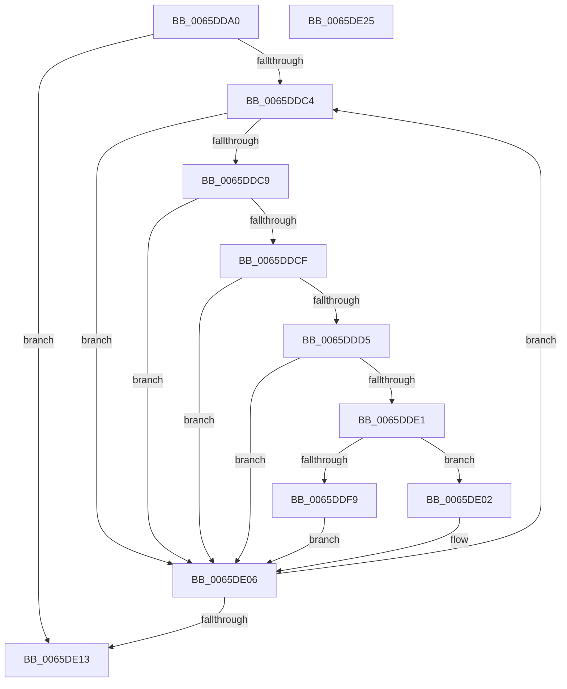

# WheapInitializeDeferredErrorSources

- RVA: `0x0065DDA0`–`0x0065DE26` (길이 `134` bytes)
- VA: `0x000000014065DDA0`
- 실행 섹션: `.text`
- PDB 이름 있음: `예`; PDB Function 태그: `아니요`
- unwind 정보 RVA: `0x00060BC4`
- 디코드: `40`개 명령, `134/134` bytes 표시
- 미해석 바이트: `0` (있으면 어셈블리에 `.byte`로 보존)

> 이 문서는 커널 이미지의 기계어와 PDB 기호를 분석해 생성했습니다. 4번과 5번은 함수 원형과 자료형을 바이너리 사용 방식에서 추정한 C 해석이며 원본 소스 복구 결과는 아닙니다.

## 1. Dependencies

- 직접 호출 지점: **2**; 고유 호출 대상: **2**
- 직접 호출자로 확인된 함수: **1**
- RIP 상대 이미지 참조: **2**

### Outgoing calls
- `0x0065DDD8` → [WheapInitializeErrorSource](../../page/7D/WheapInitializeErrorSource_function_007D68E0.md) (function, `0x007D68E0`)
- `0x0065DDF0` → [WheapCallErrorSourceInitialize](WheapCallErrorSourceInitialize_function_0065FC14.md) (function, `0x0065FC14`)

### Direct callers
- [WheaConfigureErrorSource](../../pagelk/B7/WheaConfigureErrorSource_function_00B733A0.md) at `0x00B734E5`

### Static image references
- `0x0065DDAF` → RVA `0x00EEF01C` (`.data`; read)
- `0x0065DDB7` → RVA `0x00EEF028` (`.data`; read)

## 2. Other-region calls and transfers

- 다른 실행 섹션으로 향하는 call: **1**
  - `0x0065DDD8` → [WheapInitializeErrorSource](../../page/7D/WheapInitializeErrorSource_function_007D68E0.md) (`.text` → `PAGE`)
- 별도 외부 분기/꼬리 이동을 확인하지 못했습니다.

## 3. Assembly (complete function range)

```asm
0065DDA0  48 89 5C 24 08                  mov qword ptr [rsp + 8], rbx
0065DDA5  48 89 74 24 10                  mov qword ptr [rsp + 0x10], rsi
0065DDAA  57                              push rdi
0065DDAB  48 83 EC 20                     sub rsp, 0x20
0065DDAF  8B 05 67 12 89 00               mov eax, dword ptr [rip + 0x891267]
0065DDB5  33 FF                           xor edi, edi
0065DDB7  48 8B 1D 6A 12 89 00            mov rbx, qword ptr [rip + 0x89126a]
0065DDBE  8B F1                           mov esi, ecx
0065DDC0  85 C0                           test eax, eax
0065DDC2  7E 4F                           jle 0x14065de13
0065DDC4  39 73 68                        cmp dword ptr [rbx + 0x68], esi
0065DDC7  75 3D                           jne 0x14065de06
0065DDC9  80 7B 58 00                     cmp byte ptr [rbx + 0x58], 0
0065DDCD  74 37                           je 0x14065de06
0065DDCF  83 7B 6C 01                     cmp dword ptr [rbx + 0x6c], 1
0065DDD3  75 31                           jne 0x14065de06
0065DDD5  48 8B CB                        mov rcx, rbx
0065DDD8  E8 03 8B 17 00                  call 0x1407d68e0
0065DDDD  85 C0                           test eax, eax
0065DDDF  78 25                           js 0x14065de06
0065DDE1  BA 01 00 00 00                  mov edx, 1
0065DDE6  C7 43 6C 02 00 00 00            mov dword ptr [rbx + 0x6c], 2
0065DDED  48 8B CB                        mov rcx, rbx
0065DDF0  E8 1F 1E 00 00                  call 0x14065fc14
0065DDF5  85 C0                           test eax, eax
0065DDF7  79 09                           jns 0x14065de02
0065DDF9  C7 43 6C 01 00 00 00            mov dword ptr [rbx + 0x6c], 1
0065DE00  EB 04                           jmp 0x14065de06
0065DE02  C6 43 58 00                     mov byte ptr [rbx + 0x58], 0
0065DE06  48 8B 1B                        mov rbx, qword ptr [rbx]
0065DE09  FF C7                           inc edi
0065DE0B  3B 3D 0B 12 89 00               cmp edi, dword ptr [rip + 0x89120b]
0065DE11  7C B1                           jl 0x14065ddc4
0065DE13  48 8B 5C 24 30                  mov rbx, qword ptr [rsp + 0x30]
0065DE18  33 C0                           xor eax, eax
0065DE1A  48 8B 74 24 38                  mov rsi, qword ptr [rsp + 0x38]
0065DE1F  48 83 C4 20                     add rsp, 0x20
0065DE23  5F                              pop rdi
0065DE24  C3                              ret
0065DE25  CC                              int3
```

## 4. C-style interpretation (structured pseudocode)

```c
__int64 __fastcall WheapInitializeDeferredErrorSources(int a1)
{
    __int64 result;
    __int64 v_rdi;
    __int64 v_rsp;
    unsigned __int64 v_stack_p10;
    unsigned __int64 v_stack_p8;

    v_stack_p8 = v_rbx;
    v_stack_p10 = v_rsi;
    v_rsp = (v_rsp) - (32);
    v_rdi = 0;
    if (condition_is_less_or_equal) goto loc_0065DE13;
loc_0065DDC4:
    if ((*(unsigned int *)(*(unsigned __int64 *)(v_rip + 8983146) + 104)) != ((unsigned int)((unsigned int)(a1)))) goto loc_0065DE06;
    if ((*(unsigned __int8 *)(*(unsigned __int64 *)(v_rip + 8983146) + 88)) == 0) goto loc_0065DE06;
    if ((*(unsigned int *)(*(unsigned __int64 *)(v_rip + 8983146) + 108)) != 1) goto loc_0065DE06;
    result = WheapInitializeErrorSource(*(unsigned __int64 *)(v_rip + 8983146), a2, a3, a4);
    if (sign_flag) goto loc_0065DE06;
    *(unsigned int *)(*(unsigned __int64 *)(v_rip + 8983146) + 108) = 2;
    result = WheapCallErrorSourceInitialize(*(unsigned __int64 *)(v_rip + 8983146), 1, a3, a4);
    if (!sign_flag) goto loc_0065DE02;
    *(unsigned int *)(*(unsigned __int64 *)(v_rip + 8983146) + 108) = 1;
    goto loc_0065DE06;
loc_0065DE02:
    *(unsigned __int8 *)(*(unsigned __int64 *)(v_rip + 8983146) + 88) = 0;
loc_0065DE06:
    v_rdi = (unsigned int)((v_rdi) + 1);
    if (((unsigned int)(v_rdi)) < (*(unsigned int *)(v_rip + 8983051))) goto loc_0065DDC4;
loc_0065DE13:
    result = 0;
    v_rsp = (v_rsp) + (32);
    return result;
}
```

## 5. (Beta) C Style

```c
int64_t WheapInitializeDeferredErrorSources(int32_t Arg1)
{
    int64_t result;
    int64_t local_rdi;
    int64_t local_rsp;
    uint64_t v_stack_p10;
    uint64_t v_stack_p8;

    v_stack_p8 = local_rbx;
    v_stack_p10 = local_rsi;
    local_rsp = (local_rsp) - (32);
    local_rdi = 0;
    if (condition_is_less_or_equal) goto loc_0065DE13;
loc_0065DDC4:
    if ((*(uint32_t *)(*(uint64_t *)(v_rip + 0x89126A) + 0x68)) != ((uint32_t)((uint32_t)(Arg1)))) goto loc_0065DE06;
    if ((*(uint8_t *)(*(uint64_t *)(v_rip + 0x89126A) + 0x58)) == 0) goto loc_0065DE06;
    if ((*(uint32_t *)(*(uint64_t *)(v_rip + 0x89126A) + 0x6C)) != 1) goto loc_0065DE06;
    result = WheapInitializeErrorSource(*(uint64_t *)(v_rip + 0x89126A), a2, a3, a4);
    if (sign_flag) goto loc_0065DE06;
    *(uint32_t *)(*(uint64_t *)(v_rip + 0x89126A) + 0x6C) = 2;
    result = WheapCallErrorSourceInitialize(*(uint64_t *)(v_rip + 0x89126A), 1, a3, a4);
    if (!sign_flag) goto loc_0065DE02;
    *(uint32_t *)(*(uint64_t *)(v_rip + 0x89126A) + 0x6C) = 1;
    goto loc_0065DE06;
loc_0065DE02:
    *(uint8_t *)(*(uint64_t *)(v_rip + 0x89126A) + 0x58) = 0;
loc_0065DE06:
    local_rdi = (uint32_t)((local_rdi) + 1);
    if (((uint32_t)(local_rdi)) < (*(uint32_t *)(v_rip + 0x89120B))) goto loc_0065DDC4;
loc_0065DE13:
    result = 0;
    local_rsp = (local_rsp) + (32);
    return result;
}
```

## 6. Execution-region graph

[열기: 2D/3D 그래프와 함수 탐색 컨트롤 패널](../../../control-panel.html?section=text&rva=0x0065DDA0&view=graph)

- 2D 그래프는 위에서 아래로 흐르고, 3D 그래프는 빈 공간을 드래그해 회전합니다. Shift+드래그는 이동, 휠은 확대·축소, 함수 노드 선택은 대상 보고서 이동입니다.

### Static fallback


