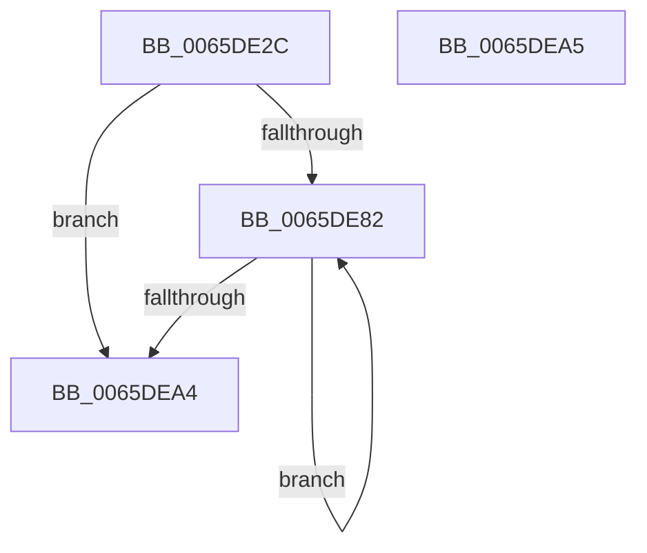

# WheapInitializeErrorRecordWrapper

- RVA: `0x0065DE2C`–`0x0065DEA6` (길이 `122` bytes)
- VA: `0x000000014065DE2C`
- 실행 섹션: `.text`
- PDB 이름 있음: `예`; PDB Function 태그: `아니요`
- unwind 정보 RVA: `0x000DB714`
- 디코드: `30`개 명령, `122/122` bytes 표시
- 미해석 바이트: `0` (있으면 어셈블리에 `.byte`로 보존)

> 이 문서는 커널 이미지의 기계어와 PDB 기호를 분석해 생성했습니다. 4번과 5번은 함수 원형과 자료형을 바이너리 사용 방식에서 추정한 C 해석이며 원본 소스 복구 결과는 아닙니다.

## 1. Dependencies

- 직접 호출 지점: **0**; 고유 호출 대상: **0**
- 직접 호출자로 확인된 함수: **2**
- RIP 상대 이미지 참조: **1**

### Outgoing calls
- 직접 디코드된 call 명령이 없습니다.

### Direct callers
- [WheapAllocErrorRecord](../49/WheapAllocErrorRecord_function_004985C0.md) at `0x00498652`
- [WheapInitializeErrorSource](../../page/7D/WheapInitializeErrorSource_function_007D68E0.md) at `0x007D6987`

### Static image references
- `0x0065DE37` → RVA `0x00014558` (`.rdata`; read)

## 2. Other-region calls and transfers

- 다른 실행 섹션으로 향하는 call: **0**
- 별도 외부 분기/꼬리 이동을 확인하지 못했습니다.

## 3. Assembly (complete function range)

```asm
0065DE2C  83 49 2E FF                     or dword ptr [rcx + 0x2e], 0xffffffff
0065DE30  4C 8D 89 A8 00 00 00            lea r9, [rcx + 0xa8]
0065DE37  0F 10 05 1A 67 9B FF            movups xmm0, xmmword ptr [rip - 0x6498e6]
0065DE3E  89 51 10                        mov dword ptr [rcx + 0x10], edx
0065DE41  4C 89 41 20                     mov qword ptr [rcx + 0x20], r8
0065DE45  F3 0F 7F 41 68                  movdqu xmmword ptr [rcx + 0x68], xmm0
0065DE4A  C7 41 28 43 50 45 52            mov dword ptr [rcx + 0x28], 0x52455043
0065DE51  66 C7 41 2C 10 02               mov word ptr [rcx + 0x2c], 0x210
0065DE57  41 0F B7 40 40                  movzx eax, word ptr [r8 + 0x40]
0065DE5C  66 89 41 32                     mov word ptr [rcx + 0x32], ax
0065DE60  8D 42 D8                        lea eax, [rdx - 0x28]
0065DE63  89 41 3C                        mov dword ptr [rcx + 0x3c], eax
0065DE66  33 D2                           xor edx, edx
0065DE68  C7 41 34 03 00 00 00            mov dword ptr [rcx + 0x34], 3
0065DE6F  41 8B 48 40                     mov ecx, dword ptr [r8 + 0x40]
0065DE73  8D 04 C9                        lea eax, [rcx + rcx*8]
0065DE76  44 8D 14 C5 80 00 00 00         lea r10d, [rax*8 + 0x80]
0065DE7E  85 C9                           test ecx, ecx
0065DE80  74 22                           je 0x14065dea4
0065DE82  45 89 11                        mov dword ptr [r9], r10d
0065DE85  FF C2                           inc edx
0065DE87  41 8B 40 44                     mov eax, dword ptr [r8 + 0x44]
0065DE8B  41 89 41 04                     mov dword ptr [r9 + 4], eax
0065DE8F  66 41 C7 41 08 00 03            mov word ptr [r9 + 8], 0x300
0065DE96  4D 8D 49 48                     lea r9, [r9 + 0x48]
0065DE9A  45 03 50 44                     add r10d, dword ptr [r8 + 0x44]
0065DE9E  41 3B 50 40                     cmp edx, dword ptr [r8 + 0x40]
0065DEA2  72 DE                           jb 0x14065de82
0065DEA4  C3                              ret
0065DEA5  CC                              int3
```

## 4. C-style interpretation (structured pseudocode)

```c
__int64 __fastcall WheapInitializeErrorRecordWrapper(__int64 a1, __int64 a2, __int64 a3)
{
    __int64 v_r10;

    *(unsigned int *)(a1 + 16) = (unsigned int)(a2);
    *(unsigned __int64 *)(a1 + 32) = a3;
    *(unsigned __int64 *)(a1 + 104) = v_xmm0;
    *(unsigned int *)(a1 + 40) = 0x52455043ULL;
    *(unsigned __int16 *)(a1 + 44) = 528;
    *(unsigned __int16 *)(a1 + 50) = (unsigned __int16)(*(unsigned __int16 *)(a3 + 64));
    *(unsigned int *)(a1 + 60) = (unsigned int)(a2 - 40);
    a2 = 0;
    *(unsigned int *)(a1 + 52) = 3;
    if ((unsigned int)((unsigned int)(*(unsigned int *)(a3 + 64))) == 0) goto loc_0065DEA4;
loc_0065DE82:
    *(unsigned int *)(a1 + 168) = (unsigned int)((unsigned int)(*(unsigned int *)(a3 + 64)) + (unsigned int)(*(unsigned int *)(a3 + 64)) * 8 * 8 + 128);
    a2 = (unsigned int)((a2) + 1);
    *(unsigned int *)(a1 + 168 + 4) = (unsigned int)((unsigned int)(*(unsigned int *)(a3 + 68)));
    *(unsigned __int16 *)(a1 + 168 + 8) = 768;
    v_r10 = (unsigned int)(((unsigned int)(*(unsigned int *)(a3 + 64)) + (unsigned int)(*(unsigned int *)(a3 + 64)) * 8 * 8 + 128) + (*(unsigned int *)(a3 + 68)));
    if (((unsigned int)(a2)) < (*(unsigned int *)(a3 + 64))) goto loc_0065DE82;
loc_0065DEA4:
    return (unsigned int)(*(unsigned int *)(a3 + 68));
}
```

## 5. (Beta) C Style

```c
int64_t WheapInitializeErrorRecordWrapper(void *Arg1, void *Arg2, void *Arg3)
{
    uint8_t *arg1 = (uint8_t *)Arg1;
    uint8_t *arg2 = (uint8_t *)Arg2;
    uint8_t *arg3 = (uint8_t *)Arg3;

    int64_t local_r10;

    *(uint32_t *)(arg1 + 0x10) = (uint32_t)(Arg2);
    *(void **)(arg1 + 0x20) = Arg3;
    *(uint64_t *)(arg1 + 0x68) = v_xmm0;
    *(uint32_t *)(arg1 + 0x28) = 0x52455043ULL;
    *(uint16_t *)(arg1 + 0x2C) = 528;
    *(uint16_t *)(arg1 + 0x32) = (uint16_t)(*(uint16_t *)(arg3 + 0x40));
    *(uint32_t *)(arg1 + 0x3C) = (uint32_t)(Arg2 - 40);
    Arg2 = 0;
    *(uint32_t *)(arg1 + 0x34) = 3;
    if ((uint32_t)((uint32_t)(*(uint32_t *)(arg3 + 0x40))) == 0) goto loc_0065DEA4;
loc_0065DE82:
    *(uint32_t *)(arg1 + 0xA8) = (uint32_t)((uint32_t)(*(uint32_t *)(arg3 + 0x40)) + (uint32_t)(*(uint32_t *)(arg3 + 0x40)) * 8 * 8 + 128);
    Arg2 = (uint32_t)((Arg2) + 1);
    *(uint32_t *)(arg1 + 0xA8 + 0x4) = (uint32_t)((uint32_t)(*(uint32_t *)(arg3 + 0x44)));
    *(uint16_t *)(arg1 + 0xA8 + 0x8) = 768;
    local_r10 = (uint32_t)(((uint32_t)(*(uint32_t *)(arg3 + 0x40)) + (uint32_t)(*(uint32_t *)(arg3 + 0x40)) * 8 * 8 + 128) + (*(uint32_t *)(arg3 + 0x44)));
    if (((uint32_t)(Arg2)) < (*(uint32_t *)(arg3 + 0x40))) goto loc_0065DE82;
loc_0065DEA4:
    return (uint32_t)(*(uint32_t *)(arg3 + 0x44));
}
```

### 관측된 메모리 오프셋

구조체 형식이 확인되지 않은 접근은 인자 기준의 오프셋으로만 기록했습니다.

| 기준 인자 | 오프셋 표현 | 폭 (bit) | 접근 |
|---|---:|---:|---|
| `Arg1` | `+ 0x0` | `32` | `W` |
| `Arg1` | `+ 0x4` | `32` | `W` |
| `Arg1` | `+ 0x8` | `16` | `W` |
| `Arg1` | `+ 0x10` | `32` | `W` |
| `Arg1` | `+ 0x20` | `64` | `W` |
| `Arg1` | `+ 0x28` | `32` | `W` |
| `Arg1` | `+ 0x2C` | `16` | `W` |
| `Arg1` | `+ 0x2E` | `32` | `R/W` |
| `Arg1` | `+ 0x32` | `16` | `W` |
| `Arg1` | `+ 0x34` | `32` | `W` |
| `Arg1` | `+ 0x3C` | `32` | `W` |
| `Arg1` | `+ 0x48` | `64` | `R` |
| `Arg1` | `+ 0x68` | `128` | `W` |
| `Arg1` | `+ 0xA8` | `64` | `R` |
| `Arg2` | `- 0x28` | `32` | `R` |
| `Arg3` | `+ 0x40` | `16` | `R` |
| `Arg3` | `+ 0x40` | `32` | `R` |
| `Arg3` | `+ 0x44` | `32` | `R` |

## 6. Execution-region graph

[열기: 2D/3D 그래프와 함수 탐색 컨트롤 패널](../../../control-panel.html?section=text&rva=0x0065DE2C&view=graph)

- 2D 그래프는 위에서 아래로 흐르고, 3D 그래프는 빈 공간을 드래그해 회전합니다. Shift+드래그는 이동, 휠은 확대·축소, 함수 노드 선택은 대상 보고서 이동입니다.

### Static fallback


