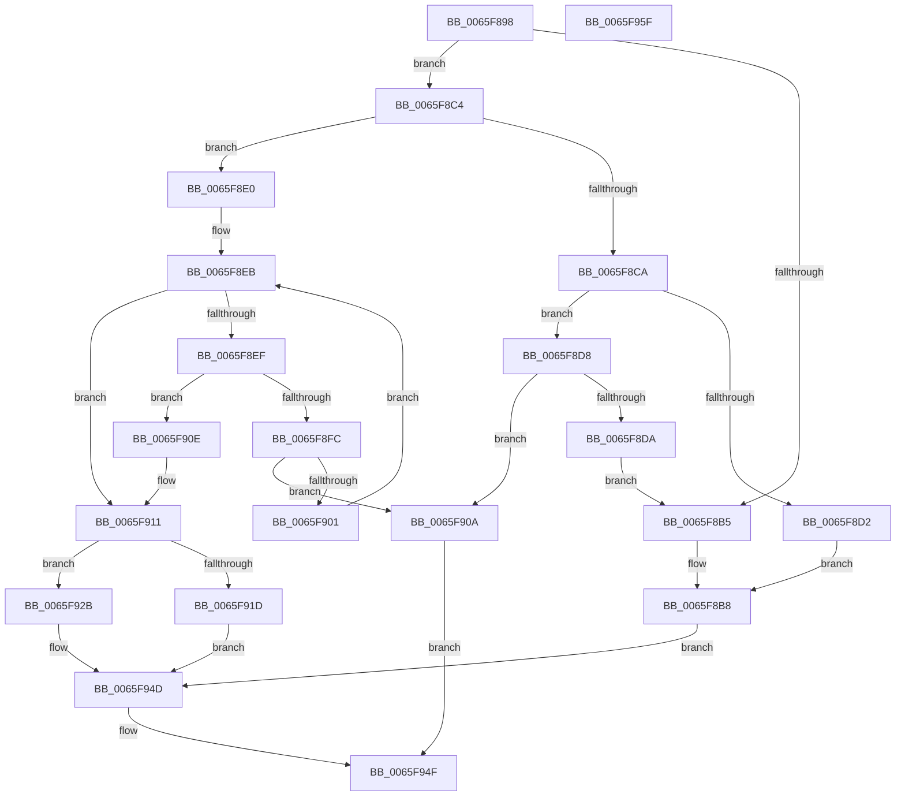

# WheapInsertPageToList

- RVA: `0x0065F898`–`0x0065F960` (길이 `200` bytes)
- VA: `0x000000014065F898`
- 실행 섹션: `.text`
- PDB 이름 있음: `예`; PDB Function 태그: `아니요`
- unwind 정보 RVA: `0x00060BC4`
- 디코드: `67`개 명령, `200/200` bytes 표시
- 미해석 바이트: `0` (있으면 어셈블리에 `.byte`로 보존)

> 이 문서는 커널 이미지의 기계어와 PDB 기호를 분석해 생성했습니다. 4번과 5번은 함수 원형과 자료형을 바이너리 사용 방식에서 추정한 C 해석이며 원본 소스 복구 결과는 아닙니다.

## 1. Dependencies

- 직접 호출 지점: **2**; 고유 호출 대상: **2**
- 직접 호출자로 확인된 함수: **1**
- RIP 상대 이미지 참조: **0**

### Outgoing calls
- `0x0065F924` → [WheapFormatBadPageList](WheapFormatBadPageList_function_0065F7FC.md) (function, `0x0065F7FC`)
- `0x0065F945` → [memcpy](../6C/memcpy_function_006C6840.md) (function, `0x006C6840`)

### Direct callers
- [WheaPersistBadPageToRegistry](WheaPersistBadPageToRegistry_function_0065F58C.md) at `0x0065F77B`

### Static image references
- 디코드된 RIP-relative 메모리 참조가 없습니다.

## 2. Other-region calls and transfers

- 다른 실행 섹션으로 향하는 call: **0**
- 별도 외부 분기/꼬리 이동을 확인하지 못했습니다.

## 3. Assembly (complete function range)

```asm
0065F898  48 89 5C 24 08                  mov qword ptr [rsp + 8], rbx
0065F89D  48 89 74 24 10                  mov qword ptr [rsp + 0x10], rsi
0065F8A2  57                              push rdi
0065F8A3  48 83 EC 20                     sub rsp, 0x20
0065F8A7  45 8B 08                        mov r9d, dword ptr [r8]
0065F8AA  48 8B FA                        mov rdi, rdx
0065F8AD  4C 8B D1                        mov r10, rcx
0065F8B0  45 85 C9                        test r9d, r9d
0065F8B3  75 0F                           jne 0x14065f8c4
0065F8B5  48 89 39                        mov qword ptr [rcx], rdi
0065F8B8  41 8D 41 01                     lea eax, [r9 + 1]
0065F8BC  41 89 00                        mov dword ptr [r8], eax
0065F8BF  E9 89 00 00 00                  jmp 0x14065f94d
0065F8C4  41 83 F9 01                     cmp r9d, 1
0065F8C8  75 16                           jne 0x14065f8e0
0065F8CA  48 8B 01                        mov rax, qword ptr [rcx]
0065F8CD  48 3B F8                        cmp rdi, rax
0065F8D0  76 06                           jbe 0x14065f8d8
0065F8D2  48 89 79 08                     mov qword ptr [rcx + 8], rdi
0065F8D6  EB E0                           jmp 0x14065f8b8
0065F8D8  73 30                           jae 0x14065f90a
0065F8DA  48 89 41 08                     mov qword ptr [rcx + 8], rax
0065F8DE  EB D5                           jmp 0x14065f8b5
0065F8E0  33 C9                           xor ecx, ecx
0065F8E2  41 8D 71 FF                     lea esi, [r9 - 1]
0065F8E6  33 C0                           xor eax, eax
0065F8E8  41 B3 01                        mov r11b, 1
0065F8EB  3B C6                           cmp eax, esi
0065F8ED  73 22                           jae 0x14065f911
0065F8EF  49 8B 1C C2                     mov rbx, qword ptr [r10 + rax*8]
0065F8F3  8D 50 01                        lea edx, [rax + 1]
0065F8F6  49 3B 1C D2                     cmp rbx, qword ptr [r10 + rdx*8]
0065F8FA  73 12                           jae 0x14065f90e
0065F8FC  48 3B DF                        cmp rbx, rdi
0065F8FF  74 09                           je 0x14065f90a
0065F901  8B C2                           mov eax, edx
0065F903  0F 43 D1                        cmovae edx, ecx
0065F906  8B CA                           mov ecx, edx
0065F908  EB E1                           jmp 0x14065f8eb
0065F90A  32 C0                           xor al, al
0065F90C  EB 41                           jmp 0x14065f94f
0065F90E  45 32 DB                        xor r11b, r11b
0065F911  41 8D 51 01                     lea edx, [r9 + 1]
0065F915  41 89 10                        mov dword ptr [r8], edx
0065F918  45 84 DB                        test r11b, r11b
0065F91B  75 0E                           jne 0x14065f92b
0065F91D  49 8B CA                        mov rcx, r10
0065F920  4B 89 3C CA                     mov qword ptr [r10 + r9*8], rdi
0065F924  E8 D3 FE FF FF                  call 0x14065f7fc
0065F929  EB 22                           jmp 0x14065f94d
0065F92B  8B C1                           mov eax, ecx
0065F92D  44 2B C9                        sub r9d, ecx
0065F930  45 8B C1                        mov r8d, r9d
0065F933  49 C1 E0 03                     shl r8, 3
0065F937  49 8D 1C C2                     lea rbx, [r10 + rax*8]
0065F93B  8D 41 01                        lea eax, [rcx + 1]
0065F93E  48 8B D3                        mov rdx, rbx
0065F941  49 8D 0C C2                     lea rcx, [r10 + rax*8]
0065F945  E8 F6 6E 06 00                  call 0x1406c6840
0065F94A  48 89 3B                        mov qword ptr [rbx], rdi
0065F94D  B0 01                           mov al, 1
0065F94F  48 8B 5C 24 30                  mov rbx, qword ptr [rsp + 0x30]
0065F954  48 8B 74 24 38                  mov rsi, qword ptr [rsp + 0x38]
0065F959  48 83 C4 20                     add rsp, 0x20
0065F95D  5F                              pop rdi
0065F95E  C3                              ret
0065F95F  CC                              int3
```

## 4. C-style interpretation (structured pseudocode)

```c
__int64 __fastcall WheapInsertPageToList(__int64 a1, __int64 a2, __int64 a3)
{
    __int64 result;
    __int64 v_r11;
    __int64 v_rsp;
    unsigned __int64 v_stack_p10;
    unsigned __int64 v_stack_p8;

    v_stack_p8 = v_rbx;
    v_stack_p10 = v_rsi;
    v_rsp = (v_rsp) - (32);
    if ((unsigned int)((unsigned int)(*(unsigned int *)(a3))) != 0) goto loc_0065F8C4;
loc_0065F8B5:
    *(unsigned __int64 *)(a1) = a2;
loc_0065F8B8:
    *(unsigned int *)(a3) = (unsigned int)((unsigned int)(*(unsigned int *)(a3)) + 1);
    goto loc_0065F94D;
loc_0065F8C4:
    if (((unsigned int)((unsigned int)(*(unsigned int *)(a3)))) != 1) goto loc_0065F8E0;
    if (a2 <= (*(unsigned __int64 *)(a1))) goto loc_0065F8D8;
    *(unsigned __int64 *)(a1 + 8) = a2;
    goto loc_0065F8B8;
loc_0065F8D8:
    if (a2 >= (*(unsigned __int64 *)(a1))) goto loc_0065F90A;
    *(unsigned __int64 *)(a1 + 8) = *(unsigned __int64 *)(a1);
    goto loc_0065F8B5;
loc_0065F8E0:
    a1 = 0;
    result = 0;
loc_0065F8EB:
    if (0 >= ((unsigned int)((unsigned int)(*(unsigned int *)(a3)) - 1))) goto loc_0065F911;
    if ((*(unsigned __int64 *)(a1 + result * 8)) >= (*(unsigned __int64 *)(a1 + result + 1 * 8))) goto loc_0065F90E;
    if ((*(unsigned __int64 *)(a1 + result * 8)) == a2) goto loc_0065F90A;
    a2 = result + 1;
    if ((*(unsigned __int64 *)(a1 + result * 8)) >= a2) { a2 = 0; }
    goto loc_0065F8EB;
loc_0065F90A:
    result = 0;
    goto loc_0065F94F;
loc_0065F90E:
    v_r11 = 0;
loc_0065F911:
    *(unsigned int *)(a3) = (unsigned int)((unsigned int)(*(unsigned int *)(a3)) + 1);
    if (0 != 0) goto loc_0065F92B;
    *(unsigned __int64 *)(a1 + (unsigned int)(*(unsigned int *)(a3)) * 8) = a2;
    result = WheapFormatBadPageList(0, (unsigned int)(*(unsigned int *)(a3)) + 1, a3, (unsigned int)(*(unsigned int *)(a3)));
    goto loc_0065F94D;
loc_0065F92B:
    a4 = (unsigned int)(((unsigned int)(*(unsigned int *)(a3))) - (0));
    a3 = ((unsigned int)((unsigned int)(a4))) << (3);
    result = memcpy(a1 + 0 + 1 * 8, a1 + 0 * 8, a3, a4);
    *(unsigned __int64 *)(a1 + 0 * 8) = a2;
loc_0065F94D:
loc_0065F94F:
    v_rsp = (v_rsp) + (32);
    return 1;
}
```

## 5. (Beta) C Style

```c
int64_t WheapInsertPageToList(void *Arg1, int64_t Arg2, void *Arg3)
{
    uint8_t *arg1 = (uint8_t *)Arg1;
    uint8_t *arg3 = (uint8_t *)Arg3;

    int64_t result;
    int64_t local_r11;
    int64_t local_rsp;
    uint64_t v_stack_p10;
    uint64_t v_stack_p8;

    v_stack_p8 = local_rbx;
    v_stack_p10 = local_rsi;
    local_rsp = (local_rsp) - (32);
    if ((uint32_t)((uint32_t)(*(uint32_t *)(arg3))) != 0) goto loc_0065F8C4;
loc_0065F8B5:
    *(uint64_t *)(arg1) = Arg2;
loc_0065F8B8:
    *(uint32_t *)(arg3) = (uint32_t)((uint32_t)(*(uint32_t *)(arg3)) + 1);
    goto loc_0065F94D;
loc_0065F8C4:
    if (((uint32_t)((uint32_t)(*(uint32_t *)(arg3)))) != 1) goto loc_0065F8E0;
    if (Arg2 <= (*(uint64_t *)(arg1))) goto loc_0065F8D8;
    *(uint64_t *)(arg1 + 0x8) = Arg2;
    goto loc_0065F8B8;
loc_0065F8D8:
    if (Arg2 >= (*(uint64_t *)(arg1))) goto loc_0065F90A;
    *(uint64_t *)(arg1 + 0x8) = *(uint64_t *)(arg1);
    goto loc_0065F8B5;
loc_0065F8E0:
    Arg1 = 0;
    result = 0;
loc_0065F8EB:
    if (0 >= ((uint32_t)((uint32_t)(*(uint32_t *)(arg3)) - 1))) goto loc_0065F911;
    if ((*(uint64_t *)(arg1 + result * 8)) >= (*(uint64_t *)(arg1 + result + 0x1 * 8))) goto loc_0065F90E;
    if ((*(uint64_t *)(arg1 + result * 8)) == Arg2) goto loc_0065F90A;
    Arg2 = result + 1;
    if ((*(uint64_t *)(arg1 + result * 8)) >= Arg2) { Arg2 = 0; }
    goto loc_0065F8EB;
loc_0065F90A:
    result = 0;
    goto loc_0065F94F;
loc_0065F90E:
    local_r11 = 0;
loc_0065F911:
    *(uint32_t *)(arg3) = (uint32_t)((uint32_t)(*(uint32_t *)(arg3)) + 1);
    if (0 != 0) goto loc_0065F92B;
    *(uint64_t *)(arg1 + (uint32_t)(*(uint32_t *)(arg3)) * 8) = Arg2;
    result = WheapFormatBadPageList(0, (uint32_t)(*(uint32_t *)(arg3)) + 1, Arg3, (uint32_t)(*(uint32_t *)(arg3)));
    goto loc_0065F94D;
loc_0065F92B:
    a4 = (uint32_t)(((uint32_t)(*(uint32_t *)(arg3))) - (0));
    Arg3 = ((uint32_t)((uint32_t)(a4))) << (3);
    result = memcpy(Arg1 + 0 + 1 * 8, Arg1 + 0 * 8, Arg3, a4);
    *(uint64_t *)(arg1 + 0x0 * 8) = Arg2;
loc_0065F94D:
loc_0065F94F:
    local_rsp = (local_rsp) + (32);
    return 1;
}
```

### 관측된 메모리 오프셋

구조체 형식이 확인되지 않은 접근은 인자 기준의 오프셋으로만 기록했습니다.

| 기준 인자 | 오프셋 표현 | 폭 (bit) | 접근 |
|---|---:|---:|---|
| `Arg1` | `+ 0x0` | `64` | `R` |
| `Arg1` | `+ 0x0` | `64` | `W` |
| `Arg1` | `+ 0x0 + r9*8` | `64` | `W` |
| `Arg1` | `+ 0x0 + rax*8` | `64` | `R` |
| `Arg1` | `+ 0x0 + rdx*8` | `64` | `R` |
| `Arg1` | `+ 0x8` | `64` | `W` |
| `Arg3` | `+ 0x0` | `32` | `R` |
| `Arg3` | `+ 0x0` | `32` | `W` |

## 6. Execution-region graph

[열기: 2D/3D 그래프와 함수 탐색 컨트롤 패널](../../../control-panel.html?section=text&rva=0x0065F898&view=graph)

- 2D 그래프는 위에서 아래로 흐르고, 3D 그래프는 빈 공간을 드래그해 회전합니다. Shift+드래그는 이동, 휠은 확대·축소, 함수 노드 선택은 대상 보고서 이동입니다.

### Static fallback


