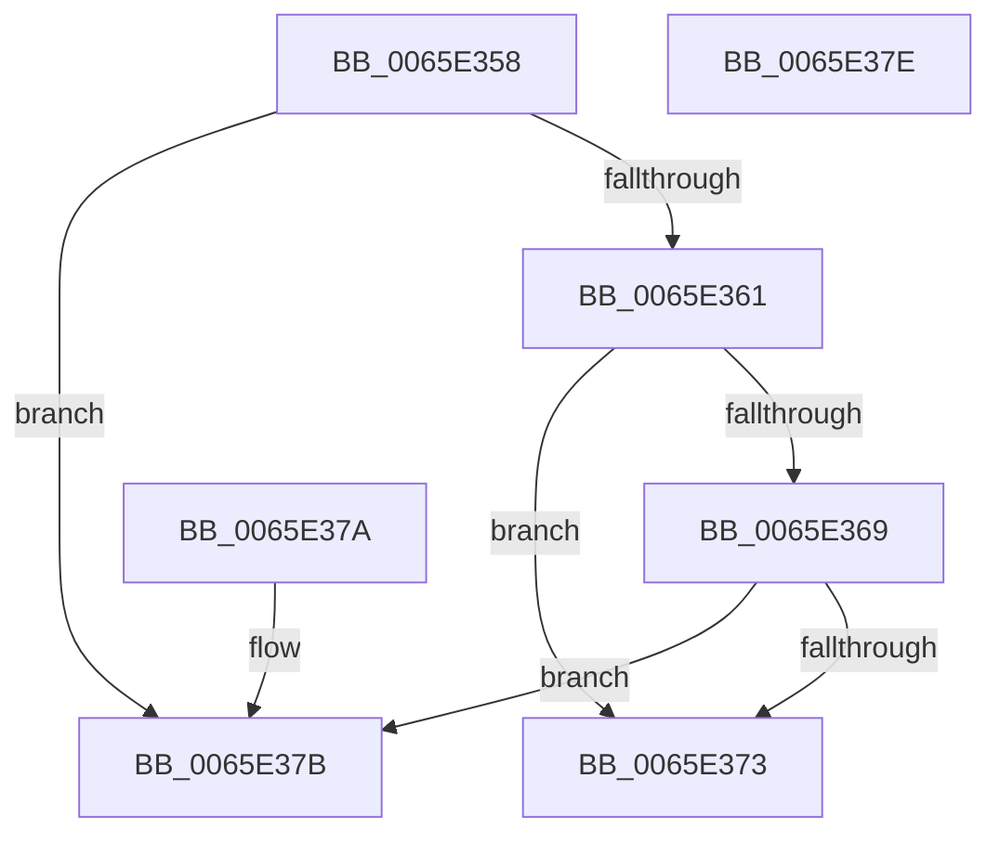

# WheapIsErrorSourceTypeAddable

- RVA: `0x0065E358`–`0x0065E37F` (길이 `39` bytes)
- VA: `0x000000014065E358`
- 실행 섹션: `.text`
- PDB 이름 있음: `예`; PDB Function 태그: `아니요`
- unwind 정보 RVA: `0x000DB714`
- 디코드: `15`개 명령, `39/39` bytes 표시
- 미해석 바이트: `0` (있으면 어셈블리에 `.byte`로 보존)

> 이 문서는 커널 이미지의 기계어와 PDB 기호를 분석해 생성했습니다. 4번과 5번은 함수 원형과 자료형을 바이너리 사용 방식에서 추정한 C 해석이며 원본 소스 복구 결과는 아닙니다.

## 1. Dependencies

- 직접 호출 지점: **0**; 고유 호출 대상: **0**
- 직접 호출자로 확인된 함수: **2**
- RIP 상대 이미지 참조: **0**

### Outgoing calls
- 직접 디코드된 call 명령이 없습니다.

### Direct callers
- [WheaAddErrorSource](../../page/7D/WheaAddErrorSource_function_007D69D0.md) at `0x007D6A1E`
- [WheaRemoveErrorSource](../../page/7D/WheaRemoveErrorSource_function_007D6C70.md) at `0x007D6CD0`

### Static image references
- 디코드된 RIP-relative 메모리 참조가 없습니다.

## 2. Other-region calls and transfers

- 다른 실행 섹션으로 향하는 call: **0**
- 별도 외부 분기/꼬리 이동을 확인하지 못했습니다.

## 3. Assembly (complete function range)

```asm
0065E358  F7 41 24 00 00 00 40            test dword ptr [rcx + 0x24], 0x40000000
0065E35F  75 1A                           jne 0x14065e37b
0065E361  8B 41 08                        mov eax, dword ptr [rcx + 8]
0065E364  83 F8 0D                        cmp eax, 0xd
0065E367  77 0A                           ja 0x14065e373
0065E369  B9 30 31 00 00                  mov ecx, 0x3130
0065E36E  0F A3 C1                        bt ecx, eax
0065E371  72 08                           jb 0x14065e37b
0065E373  83 F8 0E                        cmp eax, 0xe
0065E376  0F 9D C0                        setge al
0065E379  C3                              ret
0065E37A  CC                              int3
0065E37B  B0 01                           mov al, 1
0065E37D  C3                              ret
0065E37E  CC                              int3
```

## 4. C-style interpretation (structured pseudocode)

```c
__int64 __fastcall WheapIsErrorSourceTypeAddable(__int64 a1)
{
    __int64 result;

    if (((*(unsigned int *)(a1 + 36)) & (0x40000000ULL)) != 0) goto loc_0065E37B;
    if (((unsigned int)((unsigned int)(*(unsigned int *)(a1 + 8)))) > 13) goto loc_0065E373;
    if (((unsigned int)((unsigned int)(*(unsigned int *)(a1 + 8)))) < 13) goto loc_0065E37B;
loc_0065E373:
    result = (((unsigned int)((unsigned int)(*(unsigned int *)(a1 + 8)))) >= 14) ? 1 : 0;
    return result;
loc_0065E37B:
    return 1;
}
```

## 5. (Beta) C Style

```c
int64_t WheapIsErrorSourceTypeAddable(void *Arg1)
{
    uint8_t *arg1 = (uint8_t *)Arg1;

    int64_t result;

    if (((*(uint32_t *)(arg1 + 0x24)) & (0x40000000ULL)) != 0) goto loc_0065E37B;
    if (((uint32_t)((uint32_t)(*(uint32_t *)(arg1 + 0x8)))) > 13) goto loc_0065E373;
    if (((uint32_t)((uint32_t)(*(uint32_t *)(arg1 + 0x8)))) < 13) goto loc_0065E37B;
loc_0065E373:
    result = (((uint32_t)((uint32_t)(*(uint32_t *)(arg1 + 0x8)))) >= 14) ? 1 : 0;
    return result;
loc_0065E37B:
    return 1;
}
```

### 관측된 메모리 오프셋

구조체 형식이 확인되지 않은 접근은 인자 기준의 오프셋으로만 기록했습니다.

| 기준 인자 | 오프셋 표현 | 폭 (bit) | 접근 |
|---|---:|---:|---|
| `Arg1` | `+ 0x8` | `32` | `R` |
| `Arg1` | `+ 0x24` | `32` | `R` |

## 6. Execution-region graph

[열기: 2D/3D 그래프와 함수 탐색 컨트롤 패널](../../../control-panel.html?section=text&rva=0x0065E358&view=graph)

- 2D 그래프는 위에서 아래로 흐르고, 3D 그래프는 빈 공간을 드래그해 회전합니다. Shift+드래그는 이동, 휠은 확대·축소, 함수 노드 선택은 대상 보고서 이동입니다.

### Static fallback


