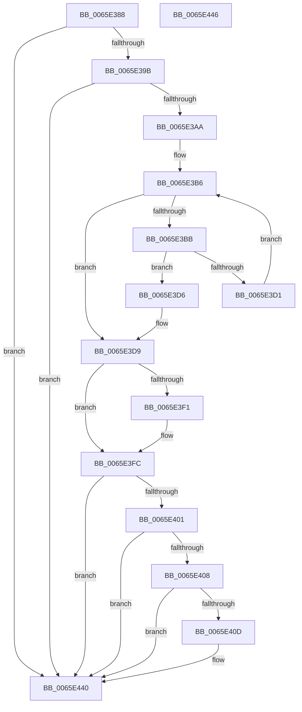

# WheapPersistPageForMemoryError

- RVA: `0x0065E388`–`0x0065E447` (길이 `191` bytes)
- VA: `0x000000014065E388`
- 실행 섹션: `.text`
- PDB 이름 있음: `예`; PDB Function 태그: `아니요`
- unwind 정보 RVA: `0x00064C80`
- 디코드: `52`개 명령, `191/191` bytes 표시
- 미해석 바이트: `0` (있으면 어셈블리에 `.byte`로 보존)

> 이 문서는 커널 이미지의 기계어와 PDB 기호를 분석해 생성했습니다. 4번과 5번은 함수 원형과 자료형을 바이너리 사용 방식에서 추정한 C 해석이며 원본 소스 복구 결과는 아닙니다.

## 1. Dependencies

- 직접 호출 지점: **1**; 고유 호출 대상: **1**
- 직접 호출자로 확인된 함수: **2**
- RIP 상대 이미지 참조: **4**

### Outgoing calls
- `0x0065E43B` → [HalSetEnvironmentVariableEx](../44/HalSetEnvironmentVariableEx_function_00448EB0.md) (function, `0x00448EB0`)

### Direct callers
- [WheaReportHwError](../4E/WheaReportHwError_function_004ED200.md) at `0x004ED4CA`
- [WheaRecoveryBugCheck](WheaRecoveryBugCheck_function_0065E110.md) at `0x0065E130`

### Static image references
- `0x0065E3E8` → RVA `0x0001A738` (`.rdata`; read)
- `0x0065E3F5` → RVA `0x0001A740` (`.rdata`; read)
- `0x0065E41A` → RVA `0x00E0EC08` (`.data`; read)
- `0x0065E42C` → RVA `0x006D0720` (` ?? ::FNODOBFM::`string'`; read)

## 2. Other-region calls and transfers

- 다른 실행 섹션으로 향하는 call: **0**
- 별도 외부 분기/꼬리 이동을 확인하지 못했습니다.

## 3. Assembly (complete function range)

```asm
0065E388  40 53                           push rbx
0065E38A  48 83 EC 30                     sub rsp, 0x30
0065E38E  F6 41 68 20                     test byte ptr [rcx + 0x68], 0x20
0065E392  48 8B D1                        mov rdx, rcx
0065E395  0F 84 A5 00 00 00               je 0x14065e440
0065E39B  0F B7 41 0A                     movzx eax, word ptr [rcx + 0xa]
0065E39F  33 DB                           xor ebx, ebx
0065E3A1  66 85 C0                        test ax, ax
0065E3A4  0F 84 96 00 00 00               je 0x14065e440
0065E3AA  44 8B CB                        mov r9d, ebx
0065E3AD  44 8A D3                        mov r10b, bl
0065E3B0  44 8B C3                        mov r8d, ebx
0065E3B3  44 8B D8                        mov r11d, eax
0065E3B6  45 3B C3                        cmp r8d, r11d
0065E3B9  73 1E                           jae 0x14065e3d9
0065E3BB  41 8B C0                        mov eax, r8d
0065E3BE  4C 8D 48 02                     lea r9, [rax + 2]
0065E3C2  4E 8D 0C C8                     lea r9, [rax + r9*8]
0065E3C6  4E 8D 0C C9                     lea r9, [rcx + r9*8]
0065E3CA  41 F6 41 0C 01                  test byte ptr [r9 + 0xc], 1
0065E3CF  75 05                           jne 0x14065e3d6
0065E3D1  41 FF C0                        inc r8d
0065E3D4  EB E0                           jmp 0x14065e3b6
0065E3D6  41 B2 01                        mov r10b, 1
0065E3D9  48 83 E9 80                     sub rcx, -0x80
0065E3DD  45 84 D2                        test r10b, r10b
0065E3E0  49 0F 45 C9                     cmovne rcx, r9
0065E3E4  48 8B 41 10                     mov rax, qword ptr [rcx + 0x10]
0065E3E8  48 2B 05 49 C3 9B FF            sub rax, qword ptr [rip - 0x643cb7]
0065E3EF  75 0B                           jne 0x14065e3fc
0065E3F1  48 8B 41 18                     mov rax, qword ptr [rcx + 0x18]
0065E3F5  48 2B 05 44 C3 9B FF            sub rax, qword ptr [rip - 0x643cbc]
0065E3FC  48 85 C0                        test rax, rax
0065E3FF  75 3F                           jne 0x14065e440
0065E401  8B 09                           mov ecx, dword ptr [rcx]
0065E403  48 03 CA                        add rcx, rdx
0065E406  74 38                           je 0x14065e440
0065E408  F6 01 02                        test byte ptr [rcx], 2
0065E40B  74 33                           je 0x14065e440
0065E40D  48 8B 41 10                     mov rax, qword ptr [rcx + 0x10]
0065E411  4C 8D 44 24 40                  lea r8, [rsp + 0x40]
0065E416  48 C1 E8 0C                     shr rax, 0xc
0065E41A  48 8D 15 E7 07 7B 00            lea rdx, [rip + 0x7b07e7]
0065E421  41 B9 08 00 00 00               mov r9d, 8
0065E427  48 89 44 24 40                  mov qword ptr [rsp + 0x40], rax
0065E42C  48 8D 0D ED 22 07 00            lea rcx, [rip + 0x722ed]
0065E433  C7 44 24 20 07 00 00 00         mov dword ptr [rsp + 0x20], 7
0065E43B  E8 70 AA DE FF                  call 0x140448eb0
0065E440  48 83 C4 30                     add rsp, 0x30
0065E444  5B                              pop rbx
0065E445  C3                              ret
0065E446  CC                              int3
```

## 4. C-style interpretation (structured pseudocode)

```c
__int64 __fastcall WheapPersistPageForMemoryError(__int64 a1)
{
    __int64 result;
    __int64 v_rbx;
    __int64 v_rsp;
    unsigned int v_stack_m18;
    unsigned __int64 v_stack_p8;

    v_rsp = (v_rsp) - (48);
    if (((*(unsigned __int8 *)(a1 + 104)) & (32)) == 0) goto loc_0065E440;
    v_rbx = 0;
    if ((unsigned __int16)(*(unsigned __int16 *)(a1 + 10)) == 0) goto loc_0065E440;
loc_0065E3B6:
    if (0 >= ((unsigned int)((unsigned int)((unsigned int)(*(unsigned __int16 *)(a1 + 10)))))) goto loc_0065E3D9;
    if (((*(unsigned __int8 *)(a1 + 0 + 0 + 2 * 8 * 8 + 12)) & (1)) != 0) goto loc_0065E3D6;
    a3 = (unsigned int)((0) + 1);
    goto loc_0065E3B6;
loc_0065E3D6:
loc_0065E3D9:
    a1 = (a1) - (-128);
    if (1 != 0) { a1 = a1 + 0 + 0 + 2 * 8 * 8; }
    result = (*(unsigned __int64 *)(a1 + 16)) - (*(unsigned __int64 *)(v_rip - 6569143));
    if (!(condition_is_not_equal)) {
        result = *(unsigned __int64 *)(a1 + 24);
        result = (result) - (*(unsigned __int64 *)(v_rip - 6569148));
    }
    if (result != 0) goto loc_0065E440;
    a1 = ((unsigned int)(*(unsigned int *)(a1))) + (a1);
    if (condition_is_equal) goto loc_0065E440;
    if (((*(unsigned __int8 *)(a1)) & (2)) != 0) {
        result = *(unsigned __int64 *)(a1 + 16);
        a3 = v_stack_p8;
        result = (result) >> (12);
        a2 = v_rip + 8062951;
        a4 = 8;
        v_stack_p8 = result;
        a1 = v_rip + 467693;
        v_stack_m18 = 7;
        result = HalSetEnvironmentVariableEx(a1, a2, a3, a4);
    }
    v_rsp = (v_rsp) + (48);
    return result;
}
```

## 5. (Beta) C Style

```c
int64_t WheapPersistPageForMemoryError(void *Arg1)
{
    uint8_t *arg1 = (uint8_t *)Arg1;

    int64_t result;
    int64_t local_rbx;
    int64_t local_rsp;
    uint32_t v_stack_m18;
    uint64_t v_stack_p8;

    local_rsp = (local_rsp) - (48);
    if (((*(uint8_t *)(arg1 + 0x68)) & (32)) == 0) goto loc_0065E440;
    local_rbx = 0;
    if ((uint16_t)(*(uint16_t *)(arg1 + 0xA)) == 0) goto loc_0065E440;
loc_0065E3B6:
    if (0 >= ((uint32_t)((uint32_t)((uint32_t)(*(uint16_t *)(arg1 + 0xA)))))) goto loc_0065E3D9;
    if (((*(uint8_t *)(arg1 + 0x0 + 0x0 + 0x2 * 8 * 8 + 0xC)) & (1)) != 0) goto loc_0065E3D6;
    a3 = (uint32_t)((0) + 1);
    goto loc_0065E3B6;
loc_0065E3D6:
loc_0065E3D9:
    Arg1 = (Arg1) - (-128);
    if (1 != 0) { Arg1 = Arg1 + 0 + 0 + 2 * 8 * 8; }
    result = (*(uint64_t *)(arg1 + 0x10)) - (*(uint64_t *)(v_rip - 0x643CB7));
    if (!(condition_is_not_equal)) {
        result = *(uint64_t *)(arg1 + 0x18);
        result = (result) - (*(uint64_t *)(v_rip - 0x643CBC));
    }
    if (result != 0) goto loc_0065E440;
    Arg1 = ((uint32_t)(*(uint32_t *)(arg1))) + (Arg1);
    if (condition_is_equal) goto loc_0065E440;
    if (((*(uint8_t *)(arg1)) & (2)) != 0) {
        result = *(uint64_t *)(arg1 + 0x10);
        a3 = v_stack_p8;
        result = (result) >> (12);
        a2 = v_rip + 8062951;
        a4 = 8;
        v_stack_p8 = result;
        Arg1 = v_rip + 467693;
        v_stack_m18 = 7;
        result = HalSetEnvironmentVariableEx(Arg1, a2, a3, a4);
    }
    local_rsp = (local_rsp) + (48);
    return result;
}
```

### 관측된 메모리 오프셋

구조체 형식이 확인되지 않은 접근은 인자 기준의 오프셋으로만 기록했습니다.

| 기준 인자 | 오프셋 표현 | 폭 (bit) | 접근 |
|---|---:|---:|---|
| `Arg1` | `+ 0x0 + r9*8` | `64` | `R` |
| `Arg1` | `+ 0xA` | `16` | `R` |
| `Arg1` | `+ 0xC` | `8` | `R` |
| `Arg1` | `+ 0x68` | `8` | `R` |

## 6. Execution-region graph

[열기: 2D/3D 그래프와 함수 탐색 컨트롤 패널](../../../control-panel.html?section=text&rva=0x0065E388&view=graph)

- 2D 그래프는 위에서 아래로 흐르고, 3D 그래프는 빈 공간을 드래그해 회전합니다. Shift+드래그는 이동, 휠은 확대·축소, 함수 노드 선택은 대상 보고서 이동입니다.

### Static fallback


