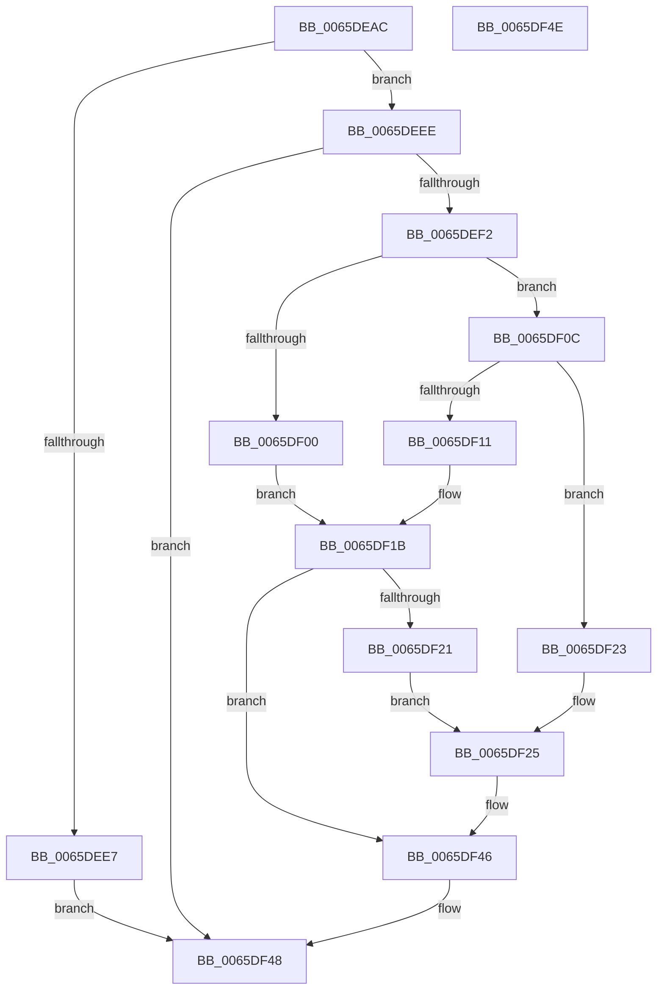

# WheapProcessEfiBadMemoryPage

- RVA: `0x0065DEAC`–`0x0065DF4F` (길이 `163` bytes)
- VA: `0x000000014065DEAC`
- 실행 섹션: `.text`
- PDB 이름 있음: `예`; PDB Function 태그: `아니요`
- unwind 정보 RVA: `0x000AA39C`
- 디코드: `44`개 명령, `163/163` bytes 표시
- 미해석 바이트: `0` (있으면 어셈블리에 `.byte`로 보존)

> 이 문서는 커널 이미지의 기계어와 PDB 기호를 분석해 생성했습니다. 4번과 5번은 함수 원형과 자료형을 바이너리 사용 방식에서 추정한 C 해석이며 원본 소스 복구 결과는 아닙니다.

## 1. Dependencies

- 직접 호출 지점: **4**; 고유 호출 대상: **4**
- 직접 호출자로 확인된 함수: **1**
- RIP 상대 이미지 참조: **3**

### Outgoing calls
- `0x0065DEDB` → [HalGetEnvironmentVariableEx](../44/HalGetEnvironmentVariableEx_function_00449100.md) (function, `0x00449100`)
- `0x0065DF05` → [WheaPersistBadPageToBcd](WheaPersistBadPageToBcd_function_0065F3D0.md) (function, `0x0065F3D0`)
- `0x0065DF16` → [WheaPersistBadPageToRegistry](WheaPersistBadPageToRegistry_function_0065F58C.md) (function, `0x0065F58C`)
- `0x0065DF41` → [HalSetEnvironmentVariableEx](../44/HalSetEnvironmentVariableEx_function_00448EB0.md) (function, `0x00448EB0`)

### Direct callers
- [WheapCheckForAndReportErrorsFromPreviousSession](WheapCheckForAndReportErrorsFromPreviousSession_function_0065DC98.md) at `0x0065DD8B`

### Static image references
- `0x0065DEC6` → RVA `0x00E0EC08` (`.data`; read)
- `0x0065DED4` → RVA `0x006D0720` (` ?? ::FNODOBFM::`string'`; read)
- `0x0065DEF2` → RVA `0x00E09788` (`.data`; read)

## 2. Other-region calls and transfers

- 다른 실행 섹션으로 향하는 call: **0**
- 별도 외부 분기/꼬리 이동을 확인하지 못했습니다.

## 3. Assembly (complete function range)

```asm
0065DEAC  48 8B C4                        mov rax, rsp
0065DEAF  53                              push rbx
0065DEB0  48 83 EC 30                     sub rsp, 0x30
0065DEB4  48 83 60 10 00                  and qword ptr [rax + 0x10], 0
0065DEB9  4C 8D 48 08                     lea r9, [rax + 8]
0065DEBD  48 83 60 E8 00                  and qword ptr [rax - 0x18], 0
0065DEC2  4C 8D 40 10                     lea r8, [rax + 0x10]
0065DEC6  48 8D 15 3B 0D 7B 00            lea rdx, [rip + 0x7b0d3b]
0065DECD  C7 40 08 08 00 00 00            mov dword ptr [rax + 8], 8
0065DED4  48 8D 0D 45 28 07 00            lea rcx, [rip + 0x72845]
0065DEDB  E8 20 B2 DE FF                  call 0x140449100
0065DEE0  83 7C 24 40 00                  cmp dword ptr [rsp + 0x40], 0
0065DEE5  75 07                           jne 0x14065deee
0065DEE7  B8 25 02 00 C0                  mov eax, 0xc0000225
0065DEEC  EB 5A                           jmp 0x14065df48
0065DEEE  85 C0                           test eax, eax
0065DEF0  78 56                           js 0x14065df48
0065DEF2  48 8B 05 8F B8 7A 00            mov rax, qword ptr [rip + 0x7ab88f]
0065DEF9  8B 08                           mov ecx, dword ptr [rax]
0065DEFB  83 F9 01                        cmp ecx, 1
0065DEFE  75 0C                           jne 0x14065df0c
0065DF00  48 8B 4C 24 48                  mov rcx, qword ptr [rsp + 0x48]
0065DF05  E8 C6 14 00 00                  call 0x14065f3d0
0065DF0A  EB 0F                           jmp 0x14065df1b
0065DF0C  83 F9 02                        cmp ecx, 2
0065DF0F  75 12                           jne 0x14065df23
0065DF11  48 8B 4C 24 48                  mov rcx, qword ptr [rsp + 0x48]
0065DF16  E8 71 16 00 00                  call 0x14065f58c
0065DF1B  8B D8                           mov ebx, eax
0065DF1D  85 C0                           test eax, eax
0065DF1F  78 25                           js 0x14065df46
0065DF21  EB 02                           jmp 0x14065df25
0065DF23  33 DB                           xor ebx, ebx
0065DF25  45 33 C9                        xor r9d, r9d
0065DF28  C7 44 24 20 07 00 00 00         mov dword ptr [rsp + 0x20], 7
0065DF30  45 33 C0                        xor r8d, r8d
0065DF33  48 8D 15 CE 0C 7B 00            lea rdx, [rip + 0x7b0cce]
0065DF3A  48 8D 0D DF 27 07 00            lea rcx, [rip + 0x727df]
0065DF41  E8 6A AF DE FF                  call 0x140448eb0
0065DF46  8B C3                           mov eax, ebx
0065DF48  48 83 C4 30                     add rsp, 0x30
0065DF4C  5B                              pop rbx
0065DF4D  C3                              ret
0065DF4E  CC                              int3
```

## 4. C-style interpretation (structured pseudocode)

```c
__int64 __fastcall WheapProcessEfiBadMemoryPage(void)
{
    __int64 result;
    __int64 v_rbx;
    __int64 v_rsp;
    unsigned int v_stack_m18;
    unsigned __int64 v_stack_p10;
    unsigned int v_stack_p8;

    v_rsp = (v_rsp) - (48);
    *(unsigned int *)(v_rsp + 8) = 8;
    result = HalGetEnvironmentVariableEx(v_rip + 469061, v_rip + 8064315, v_rsp + 16, v_rsp + 8);
    if (v_stack_p8 != 0) goto loc_0065DEEE;
    goto loc_0065DF48;
loc_0065DEEE:
    if (sign_flag) goto loc_0065DF48;
    if (((unsigned int)((unsigned int)(*(unsigned int *)(*(unsigned __int64 *)(v_rip + 8042639))))) != 1) goto loc_0065DF0C;
    result = WheaPersistBadPageToBcd(v_stack_p10, v_rip + 8064315, v_rsp + 16, v_rsp + 8);
    goto loc_0065DF1B;
loc_0065DF0C:
    if (((unsigned int)(v_stack_p10)) != 2) goto loc_0065DF23;
    result = WheaPersistBadPageToRegistry(v_stack_p10, v_rip + 8064315, v_rsp + 16, v_rsp + 8);
loc_0065DF1B:
    if (sign_flag) goto loc_0065DF46;
    goto loc_0065DF25;
loc_0065DF23:
    v_rbx = 0;
loc_0065DF25:
    a4 = 0;
    v_stack_m18 = 7;
    a3 = 0;
    result = HalSetEnvironmentVariableEx(v_rip + 468959, v_rip + 8064206, a3, a4);
loc_0065DF46:
loc_0065DF48:
    v_rsp = (v_rsp) + (48);
    return 0;
}
```

## 5. (Beta) C Style

```c
void WheapProcessEfiBadMemoryPage(void)
{
    int64_t result;
    int64_t local_rbx;
    int64_t local_rsp;
    uint32_t v_stack_m18;
    uint64_t v_stack_p10;
    uint32_t v_stack_p8;

    local_rsp = (local_rsp) - (48);
    *(uint32_t *)(local_rsp + 0x8) = 8;
    result = HalGetEnvironmentVariableEx(v_rip + 469061, v_rip + 8064315, local_rsp + 16, local_rsp + 8);
    if (v_stack_p8 != 0) goto loc_0065DEEE;
    goto loc_0065DF48;
loc_0065DEEE:
    if (sign_flag) goto loc_0065DF48;
    if (((uint32_t)((uint32_t)(*(uint32_t *)(*(uint64_t *)(v_rip + 0x7AB88F))))) != 1) goto loc_0065DF0C;
    result = WheaPersistBadPageToBcd(v_stack_p10, v_rip + 8064315, local_rsp + 16, local_rsp + 8);
    goto loc_0065DF1B;
loc_0065DF0C:
    if (((uint32_t)(v_stack_p10)) != 2) goto loc_0065DF23;
    result = WheaPersistBadPageToRegistry(v_stack_p10, v_rip + 8064315, local_rsp + 16, local_rsp + 8);
loc_0065DF1B:
    if (sign_flag) goto loc_0065DF46;
    goto loc_0065DF25;
loc_0065DF23:
    local_rbx = 0;
loc_0065DF25:
    a4 = 0;
    v_stack_m18 = 7;
    a3 = 0;
    result = HalSetEnvironmentVariableEx(v_rip + 468959, v_rip + 8064206, a3, a4);
loc_0065DF46:
loc_0065DF48:
    local_rsp = (local_rsp) + (48);
    return 0;
}
```

## 6. Execution-region graph

[열기: 2D/3D 그래프와 함수 탐색 컨트롤 패널](../../../control-panel.html?section=text&rva=0x0065DEAC&view=graph)

- 2D 그래프는 위에서 아래로 흐르고, 3D 그래프는 빈 공간을 드래그해 회전합니다. Shift+드래그는 이동, 휠은 확대·축소, 함수 노드 선택은 대상 보고서 이동입니다.

### Static fallback


