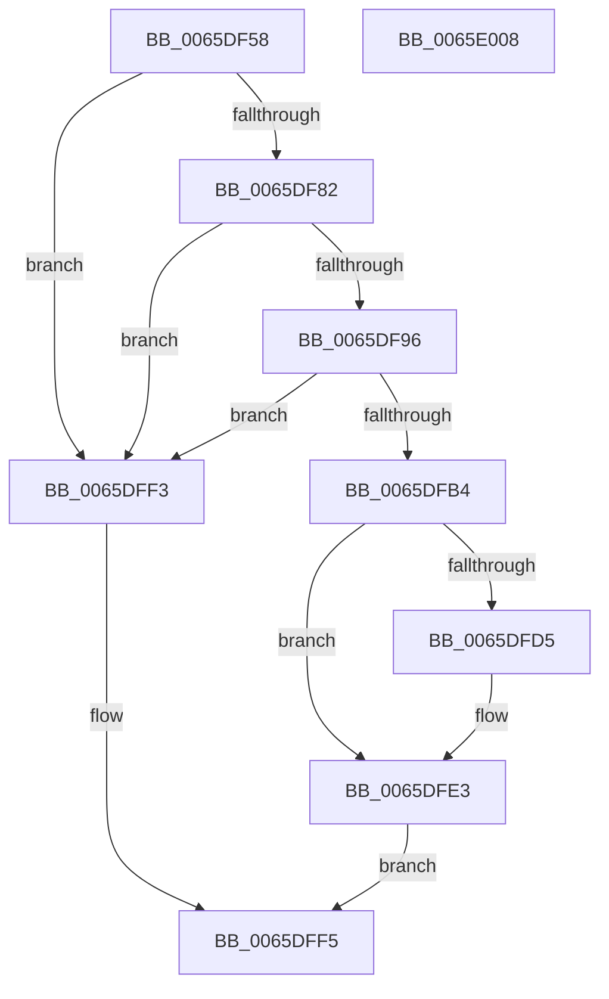

# WheapReportBootError

- RVA: `0x0065DF58`–`0x0065E009` (길이 `177` bytes)
- VA: `0x000000014065DF58`
- 실행 섹션: `.text`
- PDB 이름 있음: `예`; PDB Function 태그: `아니요`
- unwind 정보 RVA: `0x00061768`
- 디코드: `51`개 명령, `177/177` bytes 표시
- 미해석 바이트: `0` (있으면 어셈블리에 `.byte`로 보존)

> 이 문서는 커널 이미지의 기계어와 PDB 기호를 분석해 생성했습니다. 4번과 5번은 함수 원형과 자료형을 바이너리 사용 방식에서 추정한 C 해석이며 원본 소스 복구 결과는 아닙니다.

## 1. Dependencies

- 직접 호출 지점: **6**; 고유 호출 대상: **6**
- 직접 호출자로 확인된 함수: **1**
- RIP 상대 이미지 참조: **0**

### Outgoing calls
- `0x0065DF89` → [WheapGetErrorSource](../49/WheapGetErrorSource_function_0049554C.md) (function, `0x0049554C`)
- `0x0065DFA7` → [WheapAllocErrorRecord](../49/WheapAllocErrorRecord_function_004985C0.md) (function, `0x004985C0`)
- `0x0065DFC7` → [WheapCallErrorSourceCreateRecord](../49/WheapCallErrorSourceCreateRecord_function_00495354.md) (function, `0x00495354`)
- `0x0065DFCC` → [Feature_Servicing_WheaLiveDumpBertSizeFix__private_IsEnabledDeviceUsageNoInline](Feature_Servicing_WheaLiveDumpBertSizeFix__private_IsEnabledDeviceUsageNoInline_function_0065DBDC.md) (function, `0x0065DBDC`)
- `0x0065DFDE` → [WheapCompressErrorRecord](../48/WheapCompressErrorRecord_function_004849C8.md) (function, `0x004849C8`)
- `0x0065DFEA` → [WheapWorkQueueAddItem](../38/WheapWorkQueueAddItem_function_0038662C.md) (function, `0x0038662C`)

### Direct callers
- [WheapCheckForAndReportErrorsFromPreviousSession](WheapCheckForAndReportErrorsFromPreviousSession_function_0065DC98.md) at `0x0065DD73`

### Static image references
- 디코드된 RIP-relative 메모리 참조가 없습니다.

## 2. Other-region calls and transfers

- 다른 실행 섹션으로 향하는 call: **0**
- 별도 외부 분기/꼬리 이동을 확인하지 못했습니다.

## 3. Assembly (complete function range)

```asm
0065DF58  48 89 5C 24 08                  mov qword ptr [rsp + 8], rbx
0065DF5D  48 89 6C 24 18                  mov qword ptr [rsp + 0x18], rbp
0065DF62  56                              push rsi
0065DF63  57                              push rdi
0065DF64  41 56                           push r14
0065DF66  48 83 EC 20                     sub rsp, 0x20
0065DF6A  65 48 8B 04 25 18 00 00 00      mov rax, qword ptr gs:[0x18]
0065DF73  48 8B E9                        mov rbp, rcx
0065DF76  48 8B B8 20 8D 00 00            mov rdi, qword ptr [rax + 0x8d20]
0065DF7D  48 85 FF                        test rdi, rdi
0065DF80  74 71                           je 0x14065dff3
0065DF82  8B 51 18                        mov edx, dword ptr [rcx + 0x18]
0065DF85  48 8B 4F 08                     mov rcx, qword ptr [rdi + 8]
0065DF89  E8 BE 75 E3 FF                  call 0x14049554c
0065DF8E  48 8B D8                        mov rbx, rax
0065DF91  48 85 C0                        test rax, rax
0065DF94  74 5D                           je 0x14065dff3
0065DF96  F0 FF 40 18                     lock inc dword ptr [rax + 0x18]
0065DF9A  83 64 24 48 00                  and dword ptr [rsp + 0x48], 0
0065DF9F  48 8D 54 24 48                  lea rdx, [rsp + 0x48]
0065DFA4  48 8B C8                        mov rcx, rax
0065DFA7  E8 14 A6 E3 FF                  call 0x1404985c0
0065DFAC  48 8B F0                        mov rsi, rax
0065DFAF  48 85 C0                        test rax, rax
0065DFB2  74 3F                           je 0x14065dff3
0065DFB4  44 8B 44 24 48                  mov r8d, dword ptr [rsp + 0x48]
0065DFB9  4C 8D 48 28                     lea r9, [rax + 0x28]
0065DFBD  41 83 C0 D8                     add r8d, -0x28
0065DFC1  48 8B D5                        mov rdx, rbp
0065DFC4  48 8B CB                        mov rcx, rbx
0065DFC7  E8 88 73 E3 FF                  call 0x140495354
0065DFCC  E8 0B FC FF FF                  call 0x14065dbdc
0065DFD1  85 C0                           test eax, eax
0065DFD3  74 0E                           je 0x14065dfe3
0065DFD5  48 8D 56 28                     lea rdx, [rsi + 0x28]
0065DFD9  B9 03 00 00 00                  mov ecx, 3
0065DFDE  E8 E5 69 E2 FF                  call 0x1404849c8
0065DFE3  48 8B 4F 10                     mov rcx, qword ptr [rdi + 0x10]
0065DFE7  48 8B D6                        mov rdx, rsi
0065DFEA  E8 3D 86 D2 FF                  call 0x14038662c
0065DFEF  B0 01                           mov al, 1
0065DFF1  EB 02                           jmp 0x14065dff5
0065DFF3  32 C0                           xor al, al
0065DFF5  48 8B 5C 24 40                  mov rbx, qword ptr [rsp + 0x40]
0065DFFA  48 8B 6C 24 50                  mov rbp, qword ptr [rsp + 0x50]
0065DFFF  48 83 C4 20                     add rsp, 0x20
0065E003  41 5E                           pop r14
0065E005  5F                              pop rdi
0065E006  5E                              pop rsi
0065E007  C3                              ret
0065E008  CC                              int3
```

## 4. C-style interpretation (structured pseudocode)

```c
__int64 __fastcall WheapReportBootError(__int64 a1)
{
    __int64 result;
    __int64 v_rsp;
    unsigned int v_stack_p10;
    unsigned __int64 v_stack_p18;
    unsigned __int64 v_stack_p8;

    v_stack_p8 = v_rbx;
    v_stack_p18 = v_rbp;
    v_rsp = (v_rsp) - (32);
    if (*(unsigned __int64 *)(*(unsigned __int64 *)(gs_base + (0 + 24)) + 36128) == 0) goto loc_0065DFF3;
    result = WheapGetErrorSource(*(unsigned __int64 *)(*(unsigned __int64 *)(*(unsigned __int64 *)(gs_base + (0 + 24)) + 36128) + 8), (unsigned int)(*(unsigned int *)(a1 + 24)), a3, a4);
    if (result == 0) goto loc_0065DFF3;
    result = WheapAllocErrorRecord(result, v_stack_p10, a3, a4);
    if (result == 0) goto loc_0065DFF3;
    a3 = (unsigned int)(((unsigned int)(v_stack_p10)) + (-40));
    result = WheapCallErrorSourceCreateRecord(result, a1, a3, result + 40);
    result = Feature_Servicing_WheaLiveDumpBertSizeFix__private_IsEnabledDeviceUsageNoInline(result, a1, a3, result + 40);
    if ((unsigned int)(result) != 0) {
        a2 = result + 40;
        a1 = 3;
        result = WheapCompressErrorRecord(a1, a2, a3, result + 40);
    }
    result = WheapWorkQueueAddItem(*(unsigned __int64 *)(*(unsigned __int64 *)(*(unsigned __int64 *)(gs_base + (0 + 24)) + 36128) + 16), result, a3, result + 40);
    goto loc_0065DFF5;
loc_0065DFF3:
    result = 0;
loc_0065DFF5:
    v_rsp = (v_rsp) + (32);
    return result;
}
```

## 5. (Beta) C Style

```c
int64_t WheapReportBootError(void *Arg1)
{
    uint8_t *arg1 = (uint8_t *)Arg1;

    int64_t result;
    int64_t local_rsp;
    uint32_t v_stack_p10;
    uint64_t v_stack_p18;
    uint64_t v_stack_p8;

    v_stack_p8 = local_rbx;
    v_stack_p18 = local_rbp;
    local_rsp = (local_rsp) - (32);
    if (*(uint64_t *)(*(uint64_t *)(gs_base + (0 + 0x18)) + 0x8D20) == 0) goto loc_0065DFF3;
    result = WheapGetErrorSource(*(uint64_t *)(*(uint64_t *)(*(uint64_t *)(gs_base + (0 + 0x18)) + 0x8D20) + 0x8), (uint32_t)(*(uint32_t *)(arg1 + 0x18)), a3, a4);
    if (result == 0) goto loc_0065DFF3;
    result = WheapAllocErrorRecord(result, v_stack_p10, a3, a4);
    if (result == 0) goto loc_0065DFF3;
    a3 = (uint32_t)(((uint32_t)(v_stack_p10)) + (-40));
    result = WheapCallErrorSourceCreateRecord(result, Arg1, a3, result + 40);
    result = Feature_Servicing_WheaLiveDumpBertSizeFix__private_IsEnabledDeviceUsageNoInline(result, Arg1, a3, result + 40);
    if ((uint32_t)(result) != 0) {
        a2 = result + 40;
        Arg1 = 3;
        result = WheapCompressErrorRecord(Arg1, a2, a3, result + 40);
    }
    result = WheapWorkQueueAddItem(*(uint64_t *)(*(uint64_t *)(*(uint64_t *)(gs_base + (0 + 0x18)) + 0x8D20) + 0x10), result, a3, result + 40);
    goto loc_0065DFF5;
loc_0065DFF3:
    result = 0;
loc_0065DFF5:
    local_rsp = (local_rsp) + (32);
    return result;
}
```

### 관측된 메모리 오프셋

구조체 형식이 확인되지 않은 접근은 인자 기준의 오프셋으로만 기록했습니다.

| 기준 인자 | 오프셋 표현 | 폭 (bit) | 접근 |
|---|---:|---:|---|
| `Arg1` | `+ 0x18` | `32` | `R` |

## 6. Execution-region graph

[열기: 2D/3D 그래프와 함수 탐색 컨트롤 패널](../../../control-panel.html?section=text&rva=0x0065DF58&view=graph)

- 2D 그래프는 위에서 아래로 흐르고, 3D 그래프는 빈 공간을 드래그해 회전합니다. Shift+드래그는 이동, 휠은 확대·축소, 함수 노드 선택은 대상 보고서 이동입니다.

### Static fallback


