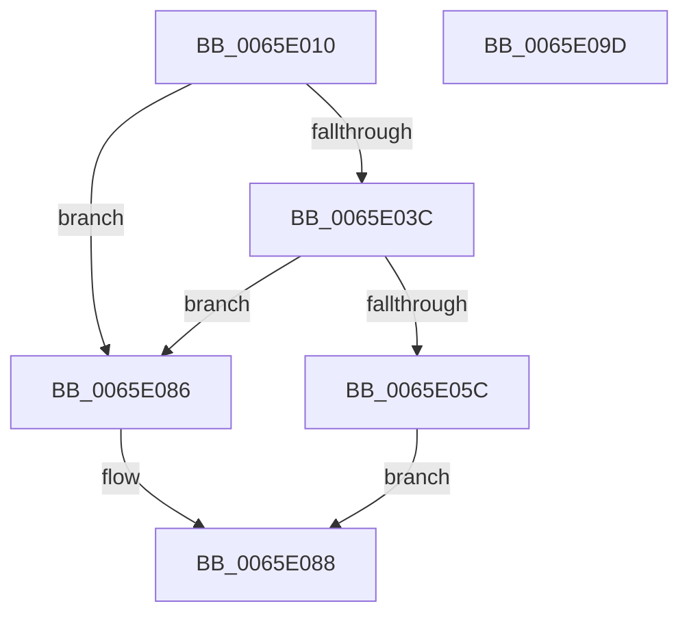

# WheapReportPersistedErrorRecord

- RVA: `0x0065E010`–`0x0065E09E` (길이 `142` bytes)
- VA: `0x000000014065E010`
- 실행 섹션: `.text`
- PDB 이름 있음: `예`; PDB Function 태그: `아니요`
- unwind 정보 RVA: `0x0005C954`
- 디코드: `38`개 명령, `142/142` bytes 표시
- 미해석 바이트: `0` (있으면 어셈블리에 `.byte`로 보존)

> 이 문서는 커널 이미지의 기계어와 PDB 기호를 분석해 생성했습니다. 4번과 5번은 함수 원형과 자료형을 바이너리 사용 방식에서 추정한 C 해석이며 원본 소스 복구 결과는 아닙니다.

## 1. Dependencies

- 직접 호출 지점: **3**; 고유 호출 대상: **3**
- 직접 호출자로 확인된 함수: **1**
- RIP 상대 이미지 참조: **0**

### Outgoing calls
- `0x0065E04F` → [ExAllocatePool2](../../poolcode/B8/ExAllocatePool2_function_00B820F0.md) (function, `0x00B820F0`)
- `0x0065E071` → [memcpy](../6C/memcpy_function_006C6840.md) (function, `0x006C6840`)
- `0x0065E07D` → [WheapWorkQueueAddItem](../38/WheapWorkQueueAddItem_function_0038662C.md) (function, `0x0038662C`)

### Direct callers
- [WheapCheckForAndReportErrorsFromPreviousSession](WheapCheckForAndReportErrorsFromPreviousSession_function_0065DC98.md) at `0x0065DD15`

### Static image references
- 디코드된 RIP-relative 메모리 참조가 없습니다.

## 2. Other-region calls and transfers

- 다른 실행 섹션으로 향하는 call: **1**
  - `0x0065E04F` → [ExAllocatePool2](../../poolcode/B8/ExAllocatePool2_function_00B820F0.md) (`.text` → `POOLCODE`)
- 별도 외부 분기/꼬리 이동을 확인하지 못했습니다.

## 3. Assembly (complete function range)

```asm
0065E010  48 89 5C 24 08                  mov qword ptr [rsp + 8], rbx
0065E015  48 89 6C 24 10                  mov qword ptr [rsp + 0x10], rbp
0065E01A  48 89 74 24 18                  mov qword ptr [rsp + 0x18], rsi
0065E01F  57                              push rdi
0065E020  48 83 EC 20                     sub rsp, 0x20
0065E024  65 48 8B 04 25 18 00 00 00      mov rax, qword ptr gs:[0x18]
0065E02D  48 8B F9                        mov rdi, rcx
0065E030  48 8B B0 20 8D 00 00            mov rsi, qword ptr [rax + 0x8d20]
0065E037  48 85 F6                        test rsi, rsi
0065E03A  74 4A                           je 0x14065e086
0065E03C  8B 69 14                        mov ebp, dword ptr [rcx + 0x14]
0065E03F  41 B8 57 68 65 61               mov r8d, 0x61656857
0065E045  83 C5 28                        add ebp, 0x28
0065E048  B9 40 00 00 00                  mov ecx, 0x40
0065E04D  8B D5                           mov edx, ebp
0065E04F  E8 9C 40 52 00                  call 0x140b820f0
0065E054  48 8B D8                        mov rbx, rax
0065E057  48 85 C0                        test rax, rax
0065E05A  74 2A                           je 0x14065e086
0065E05C  89 68 10                        mov dword ptr [rax + 0x10], ebp
0065E05F  48 8D 48 28                     lea rcx, [rax + 0x28]
0065E063  C7 40 18 02 00 00 00            mov dword ptr [rax + 0x18], 2
0065E06A  48 8B D7                        mov rdx, rdi
0065E06D  44 8B 47 14                     mov r8d, dword ptr [rdi + 0x14]
0065E071  E8 CA 87 06 00                  call 0x1406c6840
0065E076  48 8B 4E 10                     mov rcx, qword ptr [rsi + 0x10]
0065E07A  48 8B D3                        mov rdx, rbx
0065E07D  E8 AA 85 D2 FF                  call 0x14038662c
0065E082  B0 01                           mov al, 1
0065E084  EB 02                           jmp 0x14065e088
0065E086  32 C0                           xor al, al
0065E088  48 8B 5C 24 30                  mov rbx, qword ptr [rsp + 0x30]
0065E08D  48 8B 6C 24 38                  mov rbp, qword ptr [rsp + 0x38]
0065E092  48 8B 74 24 40                  mov rsi, qword ptr [rsp + 0x40]
0065E097  48 83 C4 20                     add rsp, 0x20
0065E09B  5F                              pop rdi
0065E09C  C3                              ret
0065E09D  CC                              int3
```

## 4. C-style interpretation (structured pseudocode)

```c
__int64 __fastcall WheapReportPersistedErrorRecord(__int64 a1)
{
    __int64 result;
    __int64 v_rbp;
    __int64 v_rsp;
    unsigned __int64 v_stack_p10;
    unsigned __int64 v_stack_p18;
    unsigned __int64 v_stack_p8;

    v_stack_p8 = v_rbx;
    v_stack_p10 = v_rbp;
    v_stack_p18 = v_rsi;
    v_rsp = (v_rsp) - (32);
    if (*(unsigned __int64 *)(*(unsigned __int64 *)(gs_base + (0 + 24)) + 36128) == 0) goto loc_0065E086;
    v_rbp = (unsigned int)(((unsigned int)(*(unsigned int *)(a1 + 20))) + (40));
    result = ExAllocatePool2(64, (unsigned int)((unsigned int)(v_rbp)), (unsigned int)(0x61656857ULL), a4);
    if (result == 0) goto loc_0065E086;
    *(unsigned int *)(result + 16) = (unsigned int)(v_rbp);
    *(unsigned int *)(result + 24) = 2;
    result = memcpy(result + 40, a1, (unsigned int)(*(unsigned int *)(a1 + 20)), a4);
    result = WheapWorkQueueAddItem(*(unsigned __int64 *)(*(unsigned __int64 *)(*(unsigned __int64 *)(gs_base + (0 + 24)) + 36128) + 16), result, (unsigned int)(*(unsigned int *)(a1 + 20)), a4);
    goto loc_0065E088;
loc_0065E086:
    result = 0;
loc_0065E088:
    v_rsp = (v_rsp) + (32);
    return result;
}
```

## 5. (Beta) C Style

```c
int64_t WheapReportPersistedErrorRecord(void *Arg1)
{
    uint8_t *arg1 = (uint8_t *)Arg1;

    int64_t result;
    int64_t local_rbp;
    int64_t local_rsp;
    uint64_t v_stack_p10;
    uint64_t v_stack_p18;
    uint64_t v_stack_p8;

    v_stack_p8 = local_rbx;
    v_stack_p10 = local_rbp;
    v_stack_p18 = local_rsi;
    local_rsp = (local_rsp) - (32);
    if (*(uint64_t *)(*(uint64_t *)(gs_base + (0 + 0x18)) + 0x8D20) == 0) goto loc_0065E086;
    local_rbp = (uint32_t)(((uint32_t)(*(uint32_t *)(arg1 + 0x14))) + (40));
    result = ExAllocatePool2(64, (uint32_t)((uint32_t)(local_rbp)), (uint32_t)(0x61656857ULL), a4);
    if (result == 0) goto loc_0065E086;
    *(uint32_t *)(result + 0x10) = (uint32_t)(local_rbp);
    *(uint32_t *)(result + 0x18) = 2;
    result = memcpy(result + 40, Arg1, (uint32_t)(*(uint32_t *)(arg1 + 0x14)), a4);
    result = WheapWorkQueueAddItem(*(uint64_t *)(*(uint64_t *)(*(uint64_t *)(gs_base + (0 + 0x18)) + 0x8D20) + 0x10), result, (uint32_t)(*(uint32_t *)(arg1 + 0x14)), a4);
    goto loc_0065E088;
loc_0065E086:
    result = 0;
loc_0065E088:
    local_rsp = (local_rsp) + (32);
    return result;
}
```

### 관측된 메모리 오프셋

구조체 형식이 확인되지 않은 접근은 인자 기준의 오프셋으로만 기록했습니다.

| 기준 인자 | 오프셋 표현 | 폭 (bit) | 접근 |
|---|---:|---:|---|
| `Arg1` | `+ 0x14` | `32` | `R` |

## 6. Execution-region graph

[열기: 2D/3D 그래프와 함수 탐색 컨트롤 패널](../../../control-panel.html?section=text&rva=0x0065E010&view=graph)

- 2D 그래프는 위에서 아래로 흐르고, 3D 그래프는 빈 공간을 드래그해 회전합니다. Shift+드래그는 이동, 휠은 확대·축소, 함수 노드 선택은 대상 보고서 이동입니다.

### Static fallback


