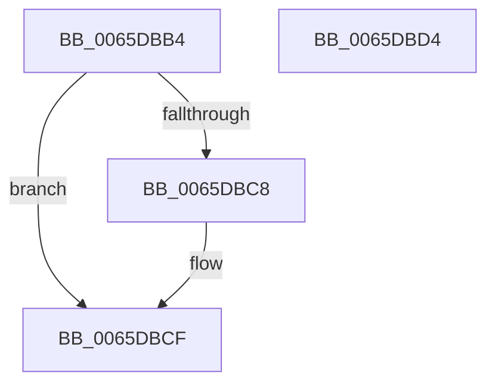

# WheapSelLogSetNtSchedulerAvailabilityNoLock

- RVA: `0x0065DBB4`–`0x0065DBD5` (길이 `33` bytes)
- VA: `0x000000014065DBB4`
- 실행 섹션: `.text`
- PDB 이름 있음: `예`; PDB Function 태그: `아니요`
- unwind 정보 RVA: `0x0005C788`
- 디코드: `9`개 명령, `33/33` bytes 표시
- 미해석 바이트: `0` (있으면 어셈블리에 `.byte`로 보존)

> 이 문서는 커널 이미지의 기계어와 PDB 기호를 분석해 생성했습니다. 4번과 5번은 함수 원형과 자료형을 바이너리 사용 방식에서 추정한 C 해석이며 원본 소스 복구 결과는 아닙니다.

## 1. Dependencies

- 직접 호출 지점: **1**; 고유 호출 대상: **1**
- 직접 호출자로 확인된 함수: **2**
- RIP 상대 이미지 참조: **2**

### Outgoing calls
- `0x0065DBBF` → [IpmiHwContextInitialized](../6A/IpmiHwContextInitialized_function_006A64DC.md) (function, `0x006A64DC`)

### Direct callers
- [KeBugCheck2](../5B/KeBugCheck2_function_005B27D0.md) at `0x005B30E7`
- [WheaSelLogSetNtSchedulerAvailability](WheaSelLogSetNtSchedulerAvailability_function_0065DB18.md) at `0x0065DB72`

### Static image references
- `0x0065DBB8` → RVA `0x00EFA080` (`.data`; read)
- `0x0065DBC8` → RVA `0x00EFA0A0` (`.data`; read/write)

## 2. Other-region calls and transfers

- 다른 실행 섹션으로 향하는 call: **0**
- 별도 외부 분기/꼬리 이동을 확인하지 못했습니다.

## 3. Assembly (complete function range)

```asm
0065DBB4  48 83 EC 28                     sub rsp, 0x28
0065DBB8  48 8D 0D C1 C4 89 00            lea rcx, [rip + 0x89c4c1]
0065DBBF  E8 18 89 04 00                  call 0x1406a64dc
0065DBC4  84 C0                           test al, al
0065DBC6  74 07                           je 0x14065dbcf
0065DBC8  83 0D D1 C4 89 00 04            or dword ptr [rip + 0x89c4d1], 4
0065DBCF  48 83 C4 28                     add rsp, 0x28
0065DBD3  C3                              ret
0065DBD4  CC                              int3
```

## 4. C-style interpretation (structured pseudocode)

```c
__int64 __fastcall WheapSelLogSetNtSchedulerAvailabilityNoLock(void)
{
    __int64 result;
    __int64 v_rsp;

    v_rsp = (v_rsp) - (40);
    result = IpmiHwContextInitialized(v_rip + 9028801, a2, a3, a4);
    if ((unsigned __int8)(result) != 0) {
    }
    v_rsp = (v_rsp) + (40);
    return result;
}
```

## 5. (Beta) C Style

```c
void WheapSelLogSetNtSchedulerAvailabilityNoLock(void)
{
    int64_t result;
    int64_t local_rsp;

    local_rsp = (local_rsp) - (40);
    result = IpmiHwContextInitialized(v_rip + 9028801, a2, a3, a4);
    if ((uint8_t)(result) != 0) {
    }
    local_rsp = (local_rsp) + (40);
    return result;
}
```

## 6. Execution-region graph

[열기: 2D/3D 그래프와 함수 탐색 컨트롤 패널](../../../control-panel.html?section=text&rva=0x0065DBB4&view=graph)

- 2D 그래프는 위에서 아래로 흐르고, 3D 그래프는 빈 공간을 드래그해 회전합니다. Shift+드래그는 이동, 휠은 확대·축소, 함수 노드 선택은 대상 보고서 이동입니다.

### Static fallback


