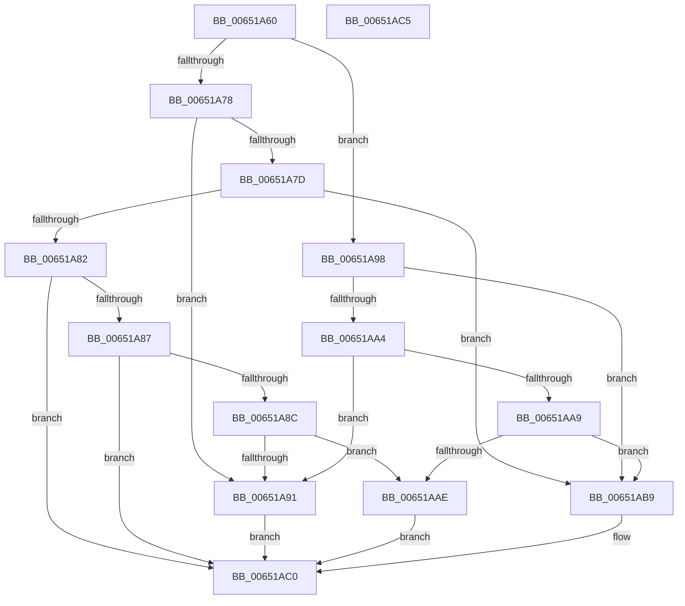

# WmiGetClock

- RVA: `0x00651A60`–`0x00651AC6` (길이 `102` bytes)
- VA: `0x0000000140651A60`
- 실행 섹션: `.text`
- PDB 이름 있음: `예`; PDB Function 태그: `아니요`
- unwind 정보 RVA: `0x0005C788`
- 디코드: `35`개 명령, `102/102` bytes 표시
- 미해석 바이트: `0` (있으면 어셈블리에 `.byte`로 보존)

> 이 문서는 커널 이미지의 기계어와 PDB 기호를 분석해 생성했습니다. 4번과 5번은 함수 원형과 자료형을 바이너리 사용 방식에서 추정한 C 해석이며 원본 소스 복구 결과는 아닙니다.

## 1. Dependencies

- 직접 호출 지점: **3**; 고유 호출 대상: **3**
- 직접 호출자로 확인된 함수: **0**
- RIP 상대 이미지 참조: **0**

### Outgoing calls
- `0x00651A66` → [PsGetCurrentServerSiloGlobals](../2F/PsGetCurrentServerSiloGlobals_function_002FE1F0.md) (function, `0x002FE1F0`)
- `0x00651A91` → [RtlGetSystemTimePrecise](../37/RtlGetSystemTimePrecise_function_0037EDD0.md) (function, `0x0037EDD0`)
- `0x00651ABB` → [KeQueryPerformanceCounter](../37/KeQueryPerformanceCounter_function_0037E7E0.md) (function, `0x0037E7E0`)

### Direct callers
- 이 함수 시작 RVA로 연결되는 직접 call은 확인되지 않았습니다. 간접 호출은 완전히 역산할 수 없습니다.

### Static image references
- 디코드된 RIP-relative 메모리 참조가 없습니다.

## 2. Other-region calls and transfers

- 다른 실행 섹션으로 향하는 call: **0**
- 별도 외부 분기/꼬리 이동을 확인하지 못했습니다.

## 3. Assembly (complete function range)

```asm
00651A60  48 83 EC 28                     sub rsp, 0x28
00651A64  8B D1                           mov edx, ecx
00651A66  E8 85 C7 CA FF                  call 0x1402fe1f0
00651A6B  48 8B 88 40 03 00 00            mov rcx, qword ptr [rax + 0x340]
00651A72  33 C0                           xor eax, eax
00651A74  85 D2                           test edx, edx
00651A76  74 20                           je 0x140651a98
00651A78  83 EA 01                        sub edx, 1
00651A7B  74 14                           je 0x140651a91
00651A7D  83 EA 01                        sub edx, 1
00651A80  74 37                           je 0x140651ab9
00651A82  83 EA 01                        sub edx, 1
00651A85  74 39                           je 0x140651ac0
00651A87  83 EA 01                        sub edx, 1
00651A8A  74 34                           je 0x140651ac0
00651A8C  83 FA 01                        cmp edx, 1
00651A8F  74 1D                           je 0x140651aae
00651A91  E8 3A D3 D2 FF                  call 0x14037edd0
00651A96  EB 28                           jmp 0x140651ac0
00651A98  0F B6 89 99 11 00 00            movzx ecx, byte ptr [rcx + 0x1199]
00651A9F  83 E9 01                        sub ecx, 1
00651AA2  74 15                           je 0x140651ab9
00651AA4  83 E9 01                        sub ecx, 1
00651AA7  74 E8                           je 0x140651a91
00651AA9  83 F9 01                        cmp ecx, 1
00651AAC  75 0B                           jne 0x140651ab9
00651AAE  0F 31                           rdtsc
00651AB0  48 C1 E2 20                     shl rdx, 0x20
00651AB4  48 0B C2                        or rax, rdx
00651AB7  EB 07                           jmp 0x140651ac0
00651AB9  33 C9                           xor ecx, ecx
00651ABB  E8 20 CD D2 FF                  call 0x14037e7e0
00651AC0  48 83 C4 28                     add rsp, 0x28
00651AC4  C3                              ret
00651AC5  CC                              int3
```

## 4. C-style interpretation (structured pseudocode)

```c
__int64 __fastcall WmiGetClock(int a1)
{
    __int64 result;
    __int64 v_rsp;

    v_rsp = (v_rsp) - (40);
    result = PsGetCurrentServerSiloGlobals(a1, (unsigned int)(a1), a3, a4);
    result = 0;
    if ((unsigned int)((unsigned int)(a1)) == 0) goto loc_00651A98;
    a2 = (unsigned int)(((unsigned int)(a1)) - (1));
    if (condition_is_equal) goto loc_00651A91;
    a2 = (unsigned int)((a2) - (1));
    if (condition_is_equal) goto loc_00651AB9;
    a2 = (unsigned int)((a2) - (1));
    if (condition_is_equal) goto loc_00651AC0;
    a2 = (unsigned int)((a2) - (1));
    if (condition_is_equal) goto loc_00651AC0;
    if (((unsigned int)(a2)) == 1) goto loc_00651AAE;
loc_00651A91:
    result = RtlGetSystemTimePrecise(*(unsigned __int64 *)(result + 832), a2, a3, a4);
    goto loc_00651AC0;
loc_00651A98:
    a1 = (unsigned int)((*(unsigned __int8 *)(*(unsigned __int64 *)(result + 832) + 4505)) - (1));
    if (condition_is_equal) goto loc_00651AB9;
    a1 = (unsigned int)((a1) - (1));
    if (condition_is_equal) goto loc_00651A91;
    if (a1 != 1) goto loc_00651AB9;
loc_00651AAE:
    a2 = (a2) << (32);
    result = (result) | (a2);
    goto loc_00651AC0;
loc_00651AB9:
    a1 = 0;
    result = KeQueryPerformanceCounter(a1, a2, a3, a4);
loc_00651AC0:
    v_rsp = (v_rsp) + (40);
    return result;
}
```

## 5. (Beta) C Style

```c
int64_t WmiGetClock(int32_t Arg1)
{
    int64_t result;
    int64_t local_rsp;

    local_rsp = (local_rsp) - (40);
    result = PsGetCurrentServerSiloGlobals(Arg1, (uint32_t)(Arg1), a3, a4);
    result = 0;
    if ((uint32_t)((uint32_t)(Arg1)) == 0) goto loc_00651A98;
    a2 = (uint32_t)(((uint32_t)(Arg1)) - (1));
    if (condition_is_equal) goto loc_00651A91;
    a2 = (uint32_t)((a2) - (1));
    if (condition_is_equal) goto loc_00651AB9;
    a2 = (uint32_t)((a2) - (1));
    if (condition_is_equal) goto loc_00651AC0;
    a2 = (uint32_t)((a2) - (1));
    if (condition_is_equal) goto loc_00651AC0;
    if (((uint32_t)(a2)) == 1) goto loc_00651AAE;
loc_00651A91:
    result = RtlGetSystemTimePrecise(*(uint64_t *)(result + 0x340), a2, a3, a4);
    goto loc_00651AC0;
loc_00651A98:
    Arg1 = (uint32_t)((*(uint8_t *)(*(uint64_t *)(result + 0x340) + 0x1199)) - (1));
    if (condition_is_equal) goto loc_00651AB9;
    Arg1 = (uint32_t)((Arg1) - (1));
    if (condition_is_equal) goto loc_00651A91;
    if (Arg1 != 1) goto loc_00651AB9;
loc_00651AAE:
    a2 = (a2) << (32);
    result = (result) | (a2);
    goto loc_00651AC0;
loc_00651AB9:
    Arg1 = 0;
    result = KeQueryPerformanceCounter(Arg1, a2, a3, a4);
loc_00651AC0:
    local_rsp = (local_rsp) + (40);
    return result;
}
```

## 6. Execution-region graph

[열기: 2D/3D 그래프와 함수 탐색 컨트롤 패널](../../../control-panel.html?section=text&rva=0x00651A60&view=graph)

- 2D 그래프는 위에서 아래로 흐르고, 3D 그래프는 빈 공간을 드래그해 회전합니다. Shift+드래그는 이동, 휠은 확대·축소, 함수 노드 선택은 대상 보고서 이동입니다.

### Static fallback


