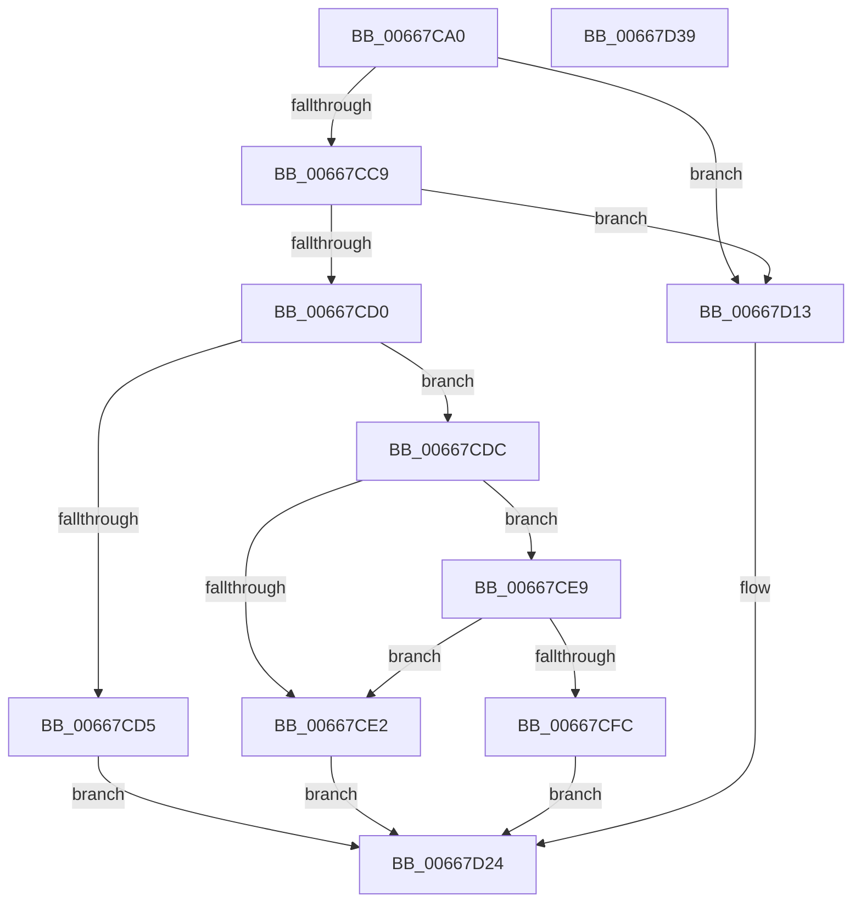

# AMDMicrocodeGetRecordData

- RVA: `0x00667CA0`–`0x00667D3A` (길이 `154` bytes)
- VA: `0x0000000140667CA0`
- 실행 섹션: `.text`
- PDB 이름 있음: `예`; PDB Function 태그: `아니요`
- unwind 정보 RVA: `0x0005C954`
- 디코드: `47`개 명령, `154/154` bytes 표시
- 미해석 바이트: `0` (있으면 어셈블리에 `.byte`로 보존)

> 이 문서는 커널 이미지의 기계어와 PDB 기호를 분석해 생성했습니다. 4번과 5번은 함수 원형과 자료형을 바이너리 사용 방식에서 추정한 C 해석이며 원본 소스 복구 결과는 아닙니다.

## 1. Dependencies

- 직접 호출 지점: **3**; 고유 호출 대상: **3**
- 직접 호출자로 확인된 함수: **2**
- RIP 상대 이미지 참조: **0**

### Outgoing calls
- `0x00667CC0` → [Feature_Microcode_Client_CD__private_IsEnabledDeviceUsageNoInline](Feature_Microcode_Client_CD__private_IsEnabledDeviceUsageNoInline_function_00666A18.md) (function, `0x00666A18`)
- `0x00667D0C` → [PrExtGetRecordDataLength](PrExtGetRecordDataLength_function_00666D90.md) (function, `0x00666D90`)
- `0x00667D1F` → [AMDMicrocodeV1GetRecordData](AMDMicrocodeV1GetRecordData_function_00667EC8.md) (function, `0x00667EC8`)

### Direct callers
- [GetMicrocodePatchData](GetMicrocodePatchData_function_00666E48.md) at `0x00666F81`
- [MicrocodeUpdate](MicrocodeUpdate_function_00667480.md) at `0x00667538`

### Static image references
- 디코드된 RIP-relative 메모리 참조가 없습니다.

## 2. Other-region calls and transfers

- 다른 실행 섹션으로 향하는 call: **0**
- 별도 외부 분기/꼬리 이동을 확인하지 못했습니다.

## 3. Assembly (complete function range)

```asm
00667CA0  48 89 5C 24 08                  mov qword ptr [rsp + 8], rbx
00667CA5  48 89 6C 24 10                  mov qword ptr [rsp + 0x10], rbp
00667CAA  48 89 74 24 18                  mov qword ptr [rsp + 0x18], rsi
00667CAF  57                              push rdi
00667CB0  48 83 EC 20                     sub rsp, 0x20
00667CB4  49 8B F1                        mov rsi, r9
00667CB7  49 8B E8                        mov rbp, r8
00667CBA  48 8B FA                        mov rdi, rdx
00667CBD  48 8B D9                        mov rbx, rcx
00667CC0  E8 53 ED FF FF                  call 0x140666a18
00667CC5  85 C0                           test eax, eax
00667CC7  74 4A                           je 0x140667d13
00667CC9  8B 0B                           mov ecx, dword ptr [rbx]
00667CCB  83 E9 01                        sub ecx, 1
00667CCE  74 43                           je 0x140667d13
00667CD0  83 F9 0C                        cmp ecx, 0xc
00667CD3  74 07                           je 0x140667cdc
00667CD5  B8 BB 00 00 C0                  mov eax, 0xc00000bb
00667CDA  EB 48                           jmp 0x140667d24
00667CDC  48 83 FF 10                     cmp rdi, 0x10
00667CE0  73 07                           jae 0x140667ce9
00667CE2  B8 0D 00 00 C0                  mov eax, 0xc000000d
00667CE7  EB 3B                           jmp 0x140667d24
00667CE9  8B 43 20                        mov eax, dword ptr [rbx + 0x20]
00667CEC  48 8D 0C 85 24 00 00 00         lea rcx, [rax*4 + 0x24]
00667CF4  8B 43 10                        mov eax, dword ptr [rbx + 0x10]
00667CF7  48 3B C8                        cmp rcx, rax
00667CFA  75 E6                           jne 0x140667ce2
00667CFC  48 8D 04 19                     lea rax, [rcx + rbx]
00667D00  4C 8B C5                        mov r8, rbp
00667D03  48 8B CB                        mov rcx, rbx
00667D06  48 89 06                        mov qword ptr [rsi], rax
00667D09  48 8B D7                        mov rdx, rdi
00667D0C  E8 7F F0 FF FF                  call 0x140666d90
00667D11  EB 11                           jmp 0x140667d24
00667D13  4C 8B CE                        mov r9, rsi
00667D16  4C 8B C5                        mov r8, rbp
00667D19  48 8B D7                        mov rdx, rdi
00667D1C  48 8B CB                        mov rcx, rbx
00667D1F  E8 A4 01 00 00                  call 0x140667ec8
00667D24  48 8B 5C 24 30                  mov rbx, qword ptr [rsp + 0x30]
00667D29  48 8B 6C 24 38                  mov rbp, qword ptr [rsp + 0x38]
00667D2E  48 8B 74 24 40                  mov rsi, qword ptr [rsp + 0x40]
00667D33  48 83 C4 20                     add rsp, 0x20
00667D37  5F                              pop rdi
00667D38  C3                              ret
00667D39  CC                              int3
```

## 4. C-style interpretation (structured pseudocode)

```c
__int64 __fastcall AMDMicrocodeGetRecordData(__int64 a1, __int64 a2, __int64 a3, __int64 a4)
{
    __int64 result;
    __int64 v_rsp;
    unsigned __int64 v_stack_p10;
    unsigned __int64 v_stack_p18;
    unsigned __int64 v_stack_p8;

    v_stack_p8 = v_rbx;
    v_stack_p10 = v_rbp;
    v_stack_p18 = v_rsi;
    v_rsp = (v_rsp) - (32);
    result = Feature_Microcode_Client_CD__private_IsEnabledDeviceUsageNoInline(a1, a2, a3, a4);
    if ((unsigned int)(result) == 0) goto loc_00667D13;
    a1 = (unsigned int)(((unsigned int)(*(unsigned int *)(a1))) - (1));
    if (condition_is_equal) goto loc_00667D13;
    if (((unsigned int)(a1)) == 12) goto loc_00667CDC;
    goto loc_00667D24;
loc_00667CDC:
    if (a2 >= 16) goto loc_00667CE9;
loc_00667CE2:
    goto loc_00667D24;
loc_00667CE9:
    if (((unsigned int)(*(unsigned int *)(a1 + 32)) * 4 + 36) != ((unsigned int)(*(unsigned int *)(a1 + 16)))) goto loc_00667CE2;
    *(unsigned __int64 *)(a4) = (unsigned int)(*(unsigned int *)(a1 + 32)) * 4 + 36 + a1 * 1;
    result = PrExtGetRecordDataLength(a1, a2, a3, a4);
    goto loc_00667D24;
loc_00667D13:
    result = AMDMicrocodeV1GetRecordData(a1, a2, a3, a4);
loc_00667D24:
    v_rsp = (v_rsp) + (32);
    return result;
}
```

## 5. (Beta) C Style

```c
int64_t AMDMicrocodeGetRecordData(void *Arg1, int64_t Arg2, int64_t Arg3, void *Arg4)
{
    uint8_t *arg1 = (uint8_t *)Arg1;
    uint8_t *arg4 = (uint8_t *)Arg4;

    int64_t result;
    int64_t local_rsp;
    uint64_t v_stack_p10;
    uint64_t v_stack_p18;
    uint64_t v_stack_p8;

    v_stack_p8 = local_rbx;
    v_stack_p10 = local_rbp;
    v_stack_p18 = local_rsi;
    local_rsp = (local_rsp) - (32);
    result = Feature_Microcode_Client_CD__private_IsEnabledDeviceUsageNoInline(Arg1, Arg2, Arg3, Arg4);
    if ((uint32_t)(result) == 0) goto loc_00667D13;
    Arg1 = (uint32_t)(((uint32_t)(*(uint32_t *)(arg1))) - (1));
    if (condition_is_equal) goto loc_00667D13;
    if (((uint32_t)(Arg1)) == 12) goto loc_00667CDC;
    goto loc_00667D24;
loc_00667CDC:
    if (Arg2 >= 16) goto loc_00667CE9;
loc_00667CE2:
    goto loc_00667D24;
loc_00667CE9:
    if (((uint32_t)(*(uint32_t *)(arg1 + 0x20)) * 4 + 36) != ((uint32_t)(*(uint32_t *)(arg1 + 0x10)))) goto loc_00667CE2;
    *(uint64_t *)(arg4) = (uint32_t)(*(uint32_t *)(arg1 + 0x20)) * 4 + 36 + Arg1 * 1;
    result = PrExtGetRecordDataLength(Arg1, Arg2, Arg3, Arg4);
    goto loc_00667D24;
loc_00667D13:
    result = AMDMicrocodeV1GetRecordData(Arg1, Arg2, Arg3, Arg4);
loc_00667D24:
    local_rsp = (local_rsp) + (32);
    return result;
}
```

### 관측된 메모리 오프셋

구조체 형식이 확인되지 않은 접근은 인자 기준의 오프셋으로만 기록했습니다.

| 기준 인자 | 오프셋 표현 | 폭 (bit) | 접근 |
|---|---:|---:|---|
| `Arg1` | `+ 0x0` | `32` | `R` |
| `Arg1` | `+ 0x10` | `32` | `R` |
| `Arg1` | `+ 0x20` | `32` | `R` |
| `Arg4` | `+ 0x0` | `64` | `W` |

## 6. Execution-region graph

[열기: 2D/3D 그래프와 함수 탐색 컨트롤 패널](../../../control-panel.html?section=text&rva=0x00667CA0&view=graph)

- 2D 그래프는 위에서 아래로 흐르고, 3D 그래프는 빈 공간을 드래그해 회전합니다. Shift+드래그는 이동, 휠은 확대·축소, 함수 노드 선택은 대상 보고서 이동입니다.

### Static fallback


