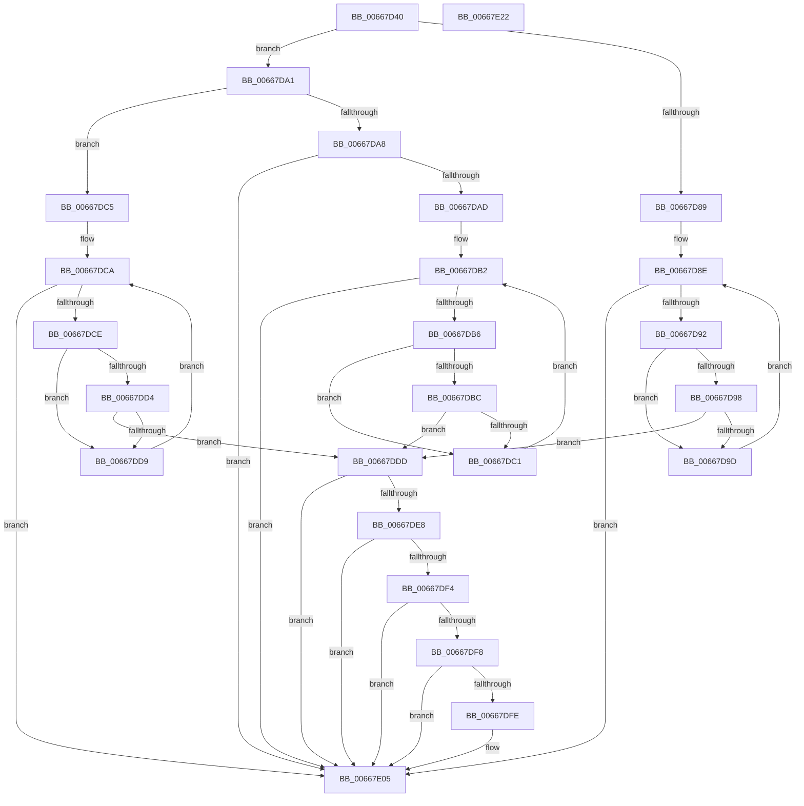

# AMDMicrocodeMetaDataCheck

- RVA: `0x00667D40`–`0x00667E23` (길이 `227` bytes)
- VA: `0x0000000140667D40`
- 실행 섹션: `.text`
- PDB 이름 있음: `예`; PDB Function 태그: `아니요`
- unwind 정보 RVA: `0x0005D7BC`
- 디코드: `77`개 명령, `227/227` bytes 표시
- 미해석 바이트: `0` (있으면 어셈블리에 `.byte`로 보존)

> 이 문서는 커널 이미지의 기계어와 PDB 기호를 분석해 생성했습니다. 4번과 5번은 함수 원형과 자료형을 바이너리 사용 방식에서 추정한 C 해석이며 원본 소스 복구 결과는 아닙니다.

## 1. Dependencies

- 직접 호출 지점: **1**; 고유 호출 대상: **1**
- 직접 호출자로 확인된 함수: **1**
- RIP 상대 이미지 참조: **3**

### Outgoing calls
- `0x00667D80` → [Feature_Microcode_Client_CD__private_IsEnabledDeviceUsageNoInline](Feature_Microcode_Client_CD__private_IsEnabledDeviceUsageNoInline_function_00666A18.md) (function, `0x00666A18`)

### Direct callers
- [MicrocodeGetRecord](MicrocodeGetRecord_function_00667060.md) at `0x006671D4`

### Static image references
- `0x00667DDF` → RVA `0x00EF7CE0` (`.data`; read)
- `0x00667DE8` → RVA `0x00EF7CD8` (`.data`; read)
- `0x00667DFE` → RVA `0x00EF7CE0` (`.data`; write)

## 2. Other-region calls and transfers

- 다른 실행 섹션으로 향하는 call: **0**
- 별도 외부 분기/꼬리 이동을 확인하지 못했습니다.

## 3. Assembly (complete function range)

```asm
00667D40  48 8B C4                        mov rax, rsp
00667D43  48 89 58 08                     mov qword ptr [rax + 8], rbx
00667D47  48 89 68 10                     mov qword ptr [rax + 0x10], rbp
00667D4B  48 89 70 18                     mov qword ptr [rax + 0x18], rsi
00667D4F  48 89 78 20                     mov qword ptr [rax + 0x20], rdi
00667D53  41 56                           push r14
00667D55  48 83 EC 30                     sub rsp, 0x30
00667D59  48 8B F9                        mov rdi, rcx
00667D5C  B8 01 00 00 00                  mov eax, 1
00667D61  33 C9                           xor ecx, ecx
00667D63  44 8B F2                        mov r14d, edx
00667D66  0F A2                           cpuid
00667D68  8B E8                           mov ebp, eax
00667D6A  B9 8B 00 00 00                  mov ecx, 0x8b
00667D6F  BE 25 02 00 C0                  mov esi, 0xc0000225
00667D74  0F 32                           rdmsr
00667D76  48 C1 E2 20                     shl rdx, 0x20
00667D7A  48 0B C2                        or rax, rdx
00667D7D  48 8B D8                        mov rbx, rax
00667D80  E8 93 EC FF FF                  call 0x140666a18
00667D85  85 C0                           test eax, eax
00667D87  75 18                           jne 0x140667da1
00667D89  8B 57 18                        mov edx, dword ptr [rdi + 0x18]
00667D8C  33 C9                           xor ecx, ecx
00667D8E  3B CA                           cmp ecx, edx
00667D90  73 73                           jae 0x140667e05
00667D92  39 6C 8F 1C                     cmp dword ptr [rdi + rcx*4 + 0x1c], ebp
00667D96  75 05                           jne 0x140667d9d
00667D98  39 5F 14                        cmp dword ptr [rdi + 0x14], ebx
00667D9B  76 40                           jbe 0x140667ddd
00667D9D  FF C1                           inc ecx
00667D9F  EB ED                           jmp 0x140667d8e
00667DA1  8B 0F                           mov ecx, dword ptr [rdi]
00667DA3  83 E9 01                        sub ecx, 1
00667DA6  74 1D                           je 0x140667dc5
00667DA8  83 F9 0C                        cmp ecx, 0xc
00667DAB  75 58                           jne 0x140667e05
00667DAD  8B 57 20                        mov edx, dword ptr [rdi + 0x20]
00667DB0  33 C9                           xor ecx, ecx
00667DB2  3B CA                           cmp ecx, edx
00667DB4  73 4F                           jae 0x140667e05
00667DB6  39 6C 8F 24                     cmp dword ptr [rdi + rcx*4 + 0x24], ebp
00667DBA  75 05                           jne 0x140667dc1
00667DBC  39 5F 14                        cmp dword ptr [rdi + 0x14], ebx
00667DBF  76 1C                           jbe 0x140667ddd
00667DC1  FF C1                           inc ecx
00667DC3  EB ED                           jmp 0x140667db2
00667DC5  8B 57 18                        mov edx, dword ptr [rdi + 0x18]
00667DC8  33 C9                           xor ecx, ecx
00667DCA  3B CA                           cmp ecx, edx
00667DCC  73 37                           jae 0x140667e05
00667DCE  39 6C 8F 1C                     cmp dword ptr [rdi + rcx*4 + 0x1c], ebp
00667DD2  75 05                           jne 0x140667dd9
00667DD4  39 5F 14                        cmp dword ptr [rdi + 0x14], ebx
00667DD7  76 04                           jbe 0x140667ddd
00667DD9  FF C1                           inc ecx
00667DDB  EB ED                           jmp 0x140667dca
00667DDD  33 F6                           xor esi, esi
00667DDF  40 38 35 FA FE 88 00            cmp byte ptr [rip + 0x88fefa], sil
00667DE6  75 1D                           jne 0x140667e05
00667DE8  48 8B 0D E9 FE 88 00            mov rcx, qword ptr [rip + 0x88fee9]
00667DEF  48 85 C9                        test rcx, rcx
00667DF2  74 11                           je 0x140667e05
00667DF4  39 29                           cmp dword ptr [rcx], ebp
00667DF6  75 0D                           jne 0x140667e05
00667DF8  44 39 71 04                     cmp dword ptr [rcx + 4], r14d
00667DFC  75 07                           jne 0x140667e05
00667DFE  C6 05 DB FE 88 00 01            mov byte ptr [rip + 0x88fedb], 1
00667E05  48 8B 5C 24 40                  mov rbx, qword ptr [rsp + 0x40]
00667E0A  8B C6                           mov eax, esi
00667E0C  48 8B 74 24 50                  mov rsi, qword ptr [rsp + 0x50]
00667E11  48 8B 6C 24 48                  mov rbp, qword ptr [rsp + 0x48]
00667E16  48 8B 7C 24 58                  mov rdi, qword ptr [rsp + 0x58]
00667E1B  48 83 C4 30                     add rsp, 0x30
00667E1F  41 5E                           pop r14
00667E21  C3                              ret
00667E22  CC                              int3
```

## 4. C-style interpretation (structured pseudocode)

```c
__int64 __fastcall AMDMicrocodeMetaDataCheck(__int64 a1, __int64 a2)
{
    __int64 result;
    __int64 v_rsi;
    __int64 v_rsp;
    unsigned __int64 v_stack_p10;
    unsigned __int64 v_stack_p18;
    unsigned __int64 v_stack_p20;
    unsigned __int64 v_stack_p8;

    *(unsigned __int64 *)(v_rsp + 8) = v_rbx;
    *(unsigned __int64 *)(v_rsp + 16) = v_rbp;
    *(unsigned __int64 *)(v_rsp + 24) = v_rsi;
    *(unsigned __int64 *)(v_rsp + 32) = v_rdi;
    v_rsp = (v_rsp) - (48);
    a1 = 0;
    a2 = (a2) << (32);
    result = (1) | (a2);
    result = Feature_Microcode_Client_CD__private_IsEnabledDeviceUsageNoInline(139, a2, a3, a4);
    if ((unsigned int)(result) != 0) goto loc_00667DA1;
    a1 = 0;
loc_00667D8E:
    if (0 >= ((unsigned int)((unsigned int)(*(unsigned int *)(a1 + 24))))) goto loc_00667E05;
    if ((*(unsigned int *)(a1 + a1 * 4 + 28)) != 1) goto loc_00667D9D;
    if ((*(unsigned int *)(a1 + 20)) <= ((unsigned int)(result))) goto loc_00667DDD;
loc_00667D9D:
    a1 = (unsigned int)((a1) + 1);
    goto loc_00667D8E;
loc_00667DA1:
    a1 = (unsigned int)(((unsigned int)(*(unsigned int *)(a1))) - (1));
    if (condition_is_equal) goto loc_00667DC5;
    if (((unsigned int)(a1)) != 12) goto loc_00667E05;
    a1 = 0;
loc_00667DB2:
    if (0 >= ((unsigned int)((unsigned int)(*(unsigned int *)(a1 + 32))))) goto loc_00667E05;
    if ((*(unsigned int *)(a1 + a1 * 4 + 36)) != 1) goto loc_00667DC1;
    if ((*(unsigned int *)(a1 + 20)) <= ((unsigned int)(result))) goto loc_00667DDD;
loc_00667DC1:
    a1 = (unsigned int)((a1) + 1);
    goto loc_00667DB2;
loc_00667DC5:
    a1 = 0;
loc_00667DCA:
    if (0 >= ((unsigned int)((unsigned int)(*(unsigned int *)(a1 + 24))))) goto loc_00667E05;
    if ((*(unsigned int *)(a1 + a1 * 4 + 28)) != 1) goto loc_00667DD9;
    if ((*(unsigned int *)(a1 + 20)) <= ((unsigned int)(result))) goto loc_00667DDD;
loc_00667DD9:
    a1 = (unsigned int)((a1) + 1);
    goto loc_00667DCA;
loc_00667DDD:
    v_rsi = 0;
    if ((*(unsigned __int8 *)(v_rip + 8978170)) != 0) goto loc_00667E05;
    if (*(unsigned __int64 *)(v_rip + 8978153) == 0) goto loc_00667E05;
    if ((*(unsigned int *)(*(unsigned __int64 *)(v_rip + 8978153))) != 1) goto loc_00667E05;
    if ((*(unsigned int *)(*(unsigned __int64 *)(v_rip + 8978153) + 4)) == ((unsigned int)((unsigned int)((unsigned int)(a2))))) {
        *(unsigned __int8 *)(v_rip + 8978139) = 1;
    }
    v_rsp = (v_rsp) + (48);
    return 0;
}
```

## 5. (Beta) C Style

```c
int64_t AMDMicrocodeMetaDataCheck(void *Arg1, int64_t Arg2)
{
    uint8_t *arg1 = (uint8_t *)Arg1;

    int64_t result;
    int64_t local_rsi;
    int64_t local_rsp;
    uint64_t v_stack_p10;
    uint64_t v_stack_p18;
    uint64_t v_stack_p20;
    uint64_t v_stack_p8;

    *(uint64_t *)(local_rsp + 0x8) = local_rbx;
    *(uint64_t *)(local_rsp + 0x10) = local_rbp;
    *(uint64_t *)(local_rsp + 0x18) = local_rsi;
    *(uint64_t *)(local_rsp + 0x20) = local_rdi;
    local_rsp = (local_rsp) - (48);
    Arg1 = 0;
    Arg2 = (Arg2) << (32);
    result = (1) | (Arg2);
    result = Feature_Microcode_Client_CD__private_IsEnabledDeviceUsageNoInline(139, Arg2, a3, a4);
    if ((uint32_t)(result) != 0) goto loc_00667DA1;
    Arg1 = 0;
loc_00667D8E:
    if (0 >= ((uint32_t)((uint32_t)(*(uint32_t *)(arg1 + 0x18))))) goto loc_00667E05;
    if ((*(uint32_t *)(arg1 + arg1 * 4 + 0x1C)) != 1) goto loc_00667D9D;
    if ((*(uint32_t *)(arg1 + 0x14)) <= ((uint32_t)(result))) goto loc_00667DDD;
loc_00667D9D:
    Arg1 = (uint32_t)((Arg1) + 1);
    goto loc_00667D8E;
loc_00667DA1:
    Arg1 = (uint32_t)(((uint32_t)(*(uint32_t *)(arg1))) - (1));
    if (condition_is_equal) goto loc_00667DC5;
    if (((uint32_t)(Arg1)) != 12) goto loc_00667E05;
    Arg1 = 0;
loc_00667DB2:
    if (0 >= ((uint32_t)((uint32_t)(*(uint32_t *)(arg1 + 0x20))))) goto loc_00667E05;
    if ((*(uint32_t *)(arg1 + arg1 * 4 + 0x24)) != 1) goto loc_00667DC1;
    if ((*(uint32_t *)(arg1 + 0x14)) <= ((uint32_t)(result))) goto loc_00667DDD;
loc_00667DC1:
    Arg1 = (uint32_t)((Arg1) + 1);
    goto loc_00667DB2;
loc_00667DC5:
    Arg1 = 0;
loc_00667DCA:
    if (0 >= ((uint32_t)((uint32_t)(*(uint32_t *)(arg1 + 0x18))))) goto loc_00667E05;
    if ((*(uint32_t *)(arg1 + arg1 * 4 + 0x1C)) != 1) goto loc_00667DD9;
    if ((*(uint32_t *)(arg1 + 0x14)) <= ((uint32_t)(result))) goto loc_00667DDD;
loc_00667DD9:
    Arg1 = (uint32_t)((Arg1) + 1);
    goto loc_00667DCA;
loc_00667DDD:
    local_rsi = 0;
    if ((*(uint8_t *)(v_rip + 0x88FEFA)) != 0) goto loc_00667E05;
    if (*(uint64_t *)(v_rip + 0x88FEE9) == 0) goto loc_00667E05;
    if ((*(uint32_t *)(*(uint64_t *)(v_rip + 0x88FEE9))) != 1) goto loc_00667E05;
    if ((*(uint32_t *)(*(uint64_t *)(v_rip + 0x88FEE9) + 0x4)) == ((uint32_t)((uint32_t)((uint32_t)(Arg2))))) {
        *(uint8_t *)(v_rip + 0x88FEDB) = 1;
    }
    local_rsp = (local_rsp) + (48);
    return 0;
}
```

### 관측된 메모리 오프셋

구조체 형식이 확인되지 않은 접근은 인자 기준의 오프셋으로만 기록했습니다.

| 기준 인자 | 오프셋 표현 | 폭 (bit) | 접근 |
|---|---:|---:|---|
| `Arg1` | `+ 0x0` | `32` | `R` |
| `Arg1` | `+ 0x14` | `32` | `R` |
| `Arg1` | `+ 0x18` | `32` | `R` |
| `Arg1` | `+ 0x1C + rcx*4` | `32` | `R` |
| `Arg1` | `+ 0x20` | `32` | `R` |
| `Arg1` | `+ 0x24 + rcx*4` | `32` | `R` |

## 6. Execution-region graph

[열기: 2D/3D 그래프와 함수 탐색 컨트롤 패널](../../../control-panel.html?section=text&rva=0x00667D40&view=graph)

- 2D 그래프는 위에서 아래로 흐르고, 3D 그래프는 빈 공간을 드래그해 회전합니다. Shift+드래그는 이동, 휠은 확대·축소, 함수 노드 선택은 대상 보고서 이동입니다.

### Static fallback


