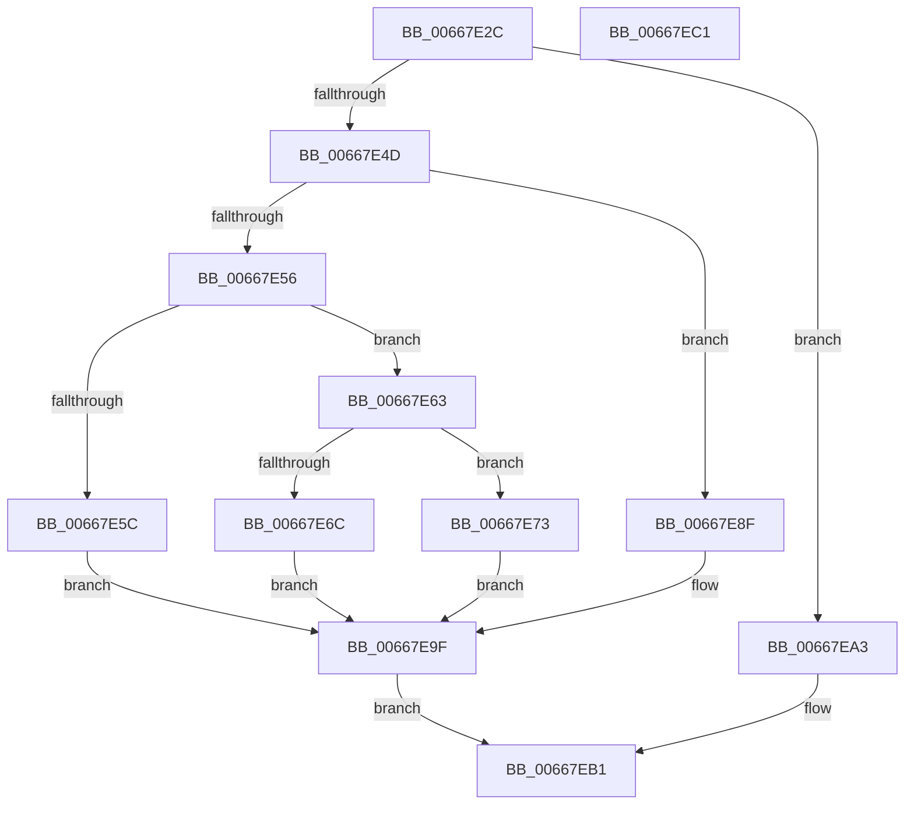

# AMDMicrocodeRecordSizeCheck

- RVA: `0x00667E2C`–`0x00667EC2` (길이 `150` bytes)
- VA: `0x0000000140667E2C`
- 실행 섹션: `.text`
- PDB 이름 있음: `예`; PDB Function 태그: `아니요`
- unwind 정보 RVA: `0x00060BC4`
- 디코드: `48`개 명령, `150/150` bytes 표시
- 미해석 바이트: `0` (있으면 어셈블리에 `.byte`로 보존)

> 이 문서는 커널 이미지의 기계어와 PDB 기호를 분석해 생성했습니다. 4번과 5번은 함수 원형과 자료형을 바이너리 사용 방식에서 추정한 C 해석이며 원본 소스 복구 결과는 아닙니다.

## 1. Dependencies

- 직접 호출 지점: **3**; 고유 호출 대상: **2**
- 직접 호출자로 확인된 함수: **1**
- RIP 상대 이미지 참조: **0**

### Outgoing calls
- `0x00667E44` → [Feature_Microcode_Client_CD__private_IsEnabledDeviceUsageNoInline](Feature_Microcode_Client_CD__private_IsEnabledDeviceUsageNoInline_function_00666A18.md) (function, `0x00666A18`)
- `0x00667E98` → [AMDMicrocodeV1RecordSizeCheck](AMDMicrocodeV1RecordSizeCheck_function_00667F0C.md) (function, `0x00667F0C`)
- `0x00667EAC` → [AMDMicrocodeV1RecordSizeCheck](AMDMicrocodeV1RecordSizeCheck_function_00667F0C.md) (function, `0x00667F0C`)

### Direct callers
- [MicrocodeGetRecord](MicrocodeGetRecord_function_00667060.md) at `0x006671C5`

### Static image references
- 디코드된 RIP-relative 메모리 참조가 없습니다.

## 2. Other-region calls and transfers

- 다른 실행 섹션으로 향하는 call: **0**
- 별도 외부 분기/꼬리 이동을 확인하지 못했습니다.

## 3. Assembly (complete function range)

```asm
00667E2C  48 89 5C 24 08                  mov qword ptr [rsp + 8], rbx
00667E31  48 89 74 24 10                  mov qword ptr [rsp + 0x10], rsi
00667E36  57                              push rdi
00667E37  48 83 EC 20                     sub rsp, 0x20
00667E3B  49 8B F8                        mov rdi, r8
00667E3E  48 8B F2                        mov rsi, rdx
00667E41  48 8B D9                        mov rbx, rcx
00667E44  E8 CF EB FF FF                  call 0x140666a18
00667E49  85 C0                           test eax, eax
00667E4B  74 56                           je 0x140667ea3
00667E4D  44 8B 0B                        mov r9d, dword ptr [rbx]
00667E50  41 83 E9 01                     sub r9d, 1
00667E54  74 39                           je 0x140667e8f
00667E56  41 83 F9 0C                     cmp r9d, 0xc
00667E5A  74 07                           je 0x140667e63
00667E5C  B9 BB 00 00 C0                  mov ecx, 0xc00000bb
00667E61  EB 3C                           jmp 0x140667e9f
00667E63  48 83 C6 24                     add rsi, 0x24
00667E67  48 3B F7                        cmp rsi, rdi
00667E6A  76 07                           jbe 0x140667e73
00667E6C  B9 0D 00 00 C0                  mov ecx, 0xc000000d
00667E71  EB 2C                           jmp 0x140667e9f
00667E73  48 8B 4B 08                     mov rcx, qword ptr [rbx + 8]
00667E77  8B 43 20                        mov eax, dword ptr [rbx + 0x20]
00667E7A  48 8D 14 81                     lea rdx, [rcx + rax*4]
00667E7E  B9 0D 00 00 C0                  mov ecx, 0xc000000d
00667E83  48 03 D6                        add rdx, rsi
00667E86  48 3B FA                        cmp rdi, rdx
00667E89  1B C0                           sbb eax, eax
00667E8B  23 C8                           and ecx, eax
00667E8D  EB 10                           jmp 0x140667e9f
00667E8F  4C 8B C7                        mov r8, rdi
00667E92  48 8B D6                        mov rdx, rsi
00667E95  48 8B CB                        mov rcx, rbx
00667E98  E8 6F 00 00 00                  call 0x140667f0c
00667E9D  8B C8                           mov ecx, eax
00667E9F  8B C1                           mov eax, ecx
00667EA1  EB 0E                           jmp 0x140667eb1
00667EA3  4C 8B C7                        mov r8, rdi
00667EA6  48 8B D6                        mov rdx, rsi
00667EA9  48 8B CB                        mov rcx, rbx
00667EAC  E8 5B 00 00 00                  call 0x140667f0c
00667EB1  48 8B 5C 24 30                  mov rbx, qword ptr [rsp + 0x30]
00667EB6  48 8B 74 24 38                  mov rsi, qword ptr [rsp + 0x38]
00667EBB  48 83 C4 20                     add rsp, 0x20
00667EBF  5F                              pop rdi
00667EC0  C3                              ret
00667EC1  CC                              int3
```

## 4. C-style interpretation (structured pseudocode)

```c
__int64 __fastcall AMDMicrocodeRecordSizeCheck(__int64 a1, __int64 a2, __int64 a3)
{
    __int64 result;
    __int64 v_rsi;
    __int64 v_rsp;
    unsigned __int64 v_stack_p10;
    unsigned __int64 v_stack_p8;

    v_stack_p8 = v_rbx;
    v_stack_p10 = v_rsi;
    v_rsp = (v_rsp) - (32);
    result = Feature_Microcode_Client_CD__private_IsEnabledDeviceUsageNoInline(a1, a2, a3, a4);
    if ((unsigned int)(result) == 0) goto loc_00667EA3;
    a4 = (unsigned int)(((unsigned int)(*(unsigned int *)(a1))) - (1));
    if (condition_is_equal) goto loc_00667E8F;
    if (((unsigned int)(a4)) == 12) goto loc_00667E63;
    goto loc_00667E9F;
loc_00667E63:
    v_rsi = (a2) + (36);
    if (v_rsi <= a3) goto loc_00667E73;
    goto loc_00667E9F;
loc_00667E73:
    a2 = (*(unsigned __int64 *)(a1 + 8) + (unsigned int)(*(unsigned int *)(a1 + 32)) * 4) + (v_rsi);
    a1 = (unsigned int)(((unsigned int)(0xC000000DULL)) & ((unsigned int)((unsigned int)(*(unsigned int *)(a1 + 32)))));
    goto loc_00667E9F;
loc_00667E8F:
    result = AMDMicrocodeV1RecordSizeCheck(a1, v_rsi, a3, a4);
loc_00667E9F:
    goto loc_00667EB1;
loc_00667EA3:
    result = AMDMicrocodeV1RecordSizeCheck(a1, v_rsi, a3, a4);
loc_00667EB1:
    v_rsp = (v_rsp) + (32);
    return result;
}
```

## 5. (Beta) C Style

```c
int64_t AMDMicrocodeRecordSizeCheck(void *Arg1, int64_t Arg2, int64_t Arg3)
{
    uint8_t *arg1 = (uint8_t *)Arg1;

    int64_t result;
    int64_t local_rsi;
    int64_t local_rsp;
    uint64_t v_stack_p10;
    uint64_t v_stack_p8;

    v_stack_p8 = local_rbx;
    v_stack_p10 = local_rsi;
    local_rsp = (local_rsp) - (32);
    result = Feature_Microcode_Client_CD__private_IsEnabledDeviceUsageNoInline(Arg1, Arg2, Arg3, a4);
    if ((uint32_t)(result) == 0) goto loc_00667EA3;
    a4 = (uint32_t)(((uint32_t)(*(uint32_t *)(arg1))) - (1));
    if (condition_is_equal) goto loc_00667E8F;
    if (((uint32_t)(a4)) == 12) goto loc_00667E63;
    goto loc_00667E9F;
loc_00667E63:
    local_rsi = (Arg2) + (36);
    if (local_rsi <= Arg3) goto loc_00667E73;
    goto loc_00667E9F;
loc_00667E73:
    Arg2 = (*(uint64_t *)(arg1 + 0x8) + (uint32_t)(*(uint32_t *)(arg1 + 0x20)) * 4) + (local_rsi);
    Arg1 = (uint32_t)(((uint32_t)(0xC000000DULL)) & ((uint32_t)((uint32_t)(*(uint32_t *)(arg1 + 0x20)))));
    goto loc_00667E9F;
loc_00667E8F:
    result = AMDMicrocodeV1RecordSizeCheck(Arg1, local_rsi, Arg3, a4);
loc_00667E9F:
    goto loc_00667EB1;
loc_00667EA3:
    result = AMDMicrocodeV1RecordSizeCheck(Arg1, local_rsi, Arg3, a4);
loc_00667EB1:
    local_rsp = (local_rsp) + (32);
    return result;
}
```

### 관측된 메모리 오프셋

구조체 형식이 확인되지 않은 접근은 인자 기준의 오프셋으로만 기록했습니다.

| 기준 인자 | 오프셋 표현 | 폭 (bit) | 접근 |
|---|---:|---:|---|
| `Arg1` | `+ 0x0` | `32` | `R` |
| `Arg1` | `+ 0x8` | `64` | `R` |
| `Arg1` | `+ 0x20` | `32` | `R` |

## 6. Execution-region graph

[열기: 2D/3D 그래프와 함수 탐색 컨트롤 패널](../../../control-panel.html?section=text&rva=0x00667E2C&view=graph)

- 2D 그래프는 위에서 아래로 흐르고, 3D 그래프는 빈 공간을 드래그해 회전합니다. Shift+드래그는 이동, 휠은 확대·축소, 함수 노드 선택은 대상 보고서 이동입니다.

### Static fallback


