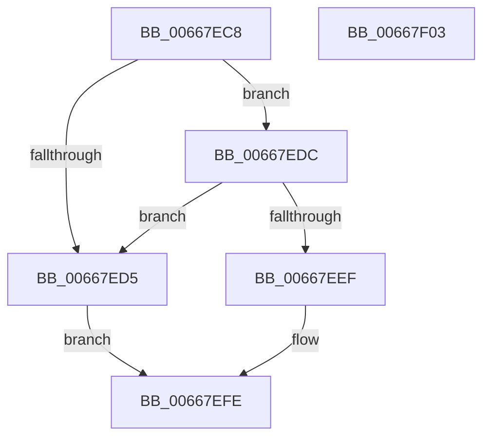

# AMDMicrocodeV1GetRecordData

- RVA: `0x00667EC8`–`0x00667F04` (길이 `60` bytes)
- VA: `0x0000000140667EC8`
- 실행 섹션: `.text`
- PDB 이름 있음: `예`; PDB Function 태그: `아니요`
- unwind 정보 RVA: `0x0005C788`
- 디코드: `18`개 명령, `60/60` bytes 표시
- 미해석 바이트: `0` (있으면 어셈블리에 `.byte`로 보존)

> 이 문서는 커널 이미지의 기계어와 PDB 기호를 분석해 생성했습니다. 4번과 5번은 함수 원형과 자료형을 바이너리 사용 방식에서 추정한 C 해석이며 원본 소스 복구 결과는 아닙니다.

## 1. Dependencies

- 직접 호출 지점: **1**; 고유 호출 대상: **1**
- 직접 호출자로 확인된 함수: **1**
- RIP 상대 이미지 참조: **0**

### Outgoing calls
- `0x00667EF9` → [PrExtGetRecordDataLength](PrExtGetRecordDataLength_function_00666D90.md) (function, `0x00666D90`)

### Direct callers
- [AMDMicrocodeGetRecordData](AMDMicrocodeGetRecordData_function_00667CA0.md) at `0x00667D1F`

### Static image references
- 디코드된 RIP-relative 메모리 참조가 없습니다.

## 2. Other-region calls and transfers

- 다른 실행 섹션으로 향하는 call: **0**
- 별도 외부 분기/꼬리 이동을 확인하지 못했습니다.

## 3. Assembly (complete function range)

```asm
00667EC8  48 83 EC 28                     sub rsp, 0x28
00667ECC  4C 8B D2                        mov r10, rdx
00667ECF  48 83 FA 10                     cmp rdx, 0x10
00667ED3  73 07                           jae 0x140667edc
00667ED5  B8 0D 00 00 C0                  mov eax, 0xc000000d
00667EDA  EB 22                           jmp 0x140667efe
00667EDC  8B 41 18                        mov eax, dword ptr [rcx + 0x18]
00667EDF  48 8D 14 85 1C 00 00 00         lea rdx, [rax*4 + 0x1c]
00667EE7  8B 41 10                        mov eax, dword ptr [rcx + 0x10]
00667EEA  48 3B D0                        cmp rdx, rax
00667EED  75 E6                           jne 0x140667ed5
00667EEF  48 8D 04 0A                     lea rax, [rdx + rcx]
00667EF3  49 8B D2                        mov rdx, r10
00667EF6  49 89 01                        mov qword ptr [r9], rax
00667EF9  E8 92 EE FF FF                  call 0x140666d90
00667EFE  48 83 C4 28                     add rsp, 0x28
00667F02  C3                              ret
00667F03  CC                              int3
```

## 4. C-style interpretation (structured pseudocode)

```c
__int64 __fastcall AMDMicrocodeV1GetRecordData(__int64 a1, __int64 a2, __int64 a3, __int64 a4)
{
    __int64 result;
    __int64 v_rsp;

    v_rsp = (v_rsp) - (40);
    if (a2 >= 16) goto loc_00667EDC;
loc_00667ED5:
    goto loc_00667EFE;
loc_00667EDC:
    if (((unsigned int)(*(unsigned int *)(a1 + 24)) * 4 + 28) != ((unsigned int)(*(unsigned int *)(a1 + 16)))) goto loc_00667ED5;
    *(unsigned __int64 *)(a4) = (unsigned int)(*(unsigned int *)(a1 + 24)) * 4 + 28 + a1 * 1;
    result = PrExtGetRecordDataLength(a1, a2, a3, a4);
loc_00667EFE:
    v_rsp = (v_rsp) + (40);
    return result;
}
```

## 5. (Beta) C Style

```c
int64_t AMDMicrocodeV1GetRecordData(void *Arg1, int64_t Arg2, int64_t Arg3, void *Arg4)
{
    uint8_t *arg1 = (uint8_t *)Arg1;
    uint8_t *arg4 = (uint8_t *)Arg4;

    int64_t result;
    int64_t local_rsp;

    local_rsp = (local_rsp) - (40);
    if (Arg2 >= 16) goto loc_00667EDC;
loc_00667ED5:
    goto loc_00667EFE;
loc_00667EDC:
    if (((uint32_t)(*(uint32_t *)(arg1 + 0x18)) * 4 + 28) != ((uint32_t)(*(uint32_t *)(arg1 + 0x10)))) goto loc_00667ED5;
    *(uint64_t *)(arg4) = (uint32_t)(*(uint32_t *)(arg1 + 0x18)) * 4 + 28 + Arg1 * 1;
    result = PrExtGetRecordDataLength(Arg1, Arg2, Arg3, Arg4);
loc_00667EFE:
    local_rsp = (local_rsp) + (40);
    return result;
}
```

### 관측된 메모리 오프셋

구조체 형식이 확인되지 않은 접근은 인자 기준의 오프셋으로만 기록했습니다.

| 기준 인자 | 오프셋 표현 | 폭 (bit) | 접근 |
|---|---:|---:|---|
| `Arg1` | `+ 0x10` | `32` | `R` |
| `Arg1` | `+ 0x18` | `32` | `R` |
| `Arg4` | `+ 0x0` | `64` | `W` |

## 6. Execution-region graph

[열기: 2D/3D 그래프와 함수 탐색 컨트롤 패널](../../../control-panel.html?section=text&rva=0x00667EC8&view=graph)

- 2D 그래프는 위에서 아래로 흐르고, 3D 그래프는 빈 공간을 드래그해 회전합니다. Shift+드래그는 이동, 휠은 확대·축소, 함수 노드 선택은 대상 보고서 이동입니다.

### Static fallback


