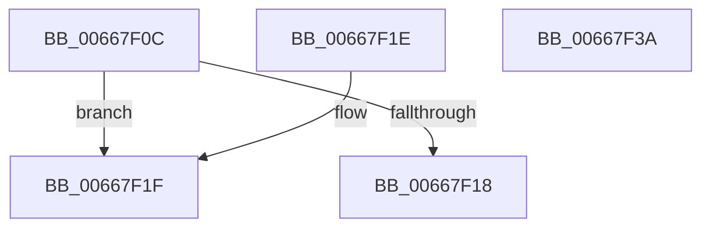

# AMDMicrocodeV1RecordSizeCheck

- RVA: `0x00667F0C`–`0x00667F3B` (길이 `47` bytes)
- VA: `0x0000000140667F0C`
- 실행 섹션: `.text`
- PDB 이름 있음: `예`; PDB Function 태그: `아니요`
- unwind 정보 RVA: `0x000DB714`
- 디코드: `17`개 명령, `47/47` bytes 표시
- 미해석 바이트: `0` (있으면 어셈블리에 `.byte`로 보존)

> 이 문서는 커널 이미지의 기계어와 PDB 기호를 분석해 생성했습니다. 4번과 5번은 함수 원형과 자료형을 바이너리 사용 방식에서 추정한 C 해석이며 원본 소스 복구 결과는 아닙니다.

## 1. Dependencies

- 직접 호출 지점: **0**; 고유 호출 대상: **0**
- 직접 호출자로 확인된 함수: **1**
- RIP 상대 이미지 참조: **0**

### Outgoing calls
- 직접 디코드된 call 명령이 없습니다.

### Direct callers
- [AMDMicrocodeRecordSizeCheck](AMDMicrocodeRecordSizeCheck_function_00667E2C.md) at `0x00667E98`
- [AMDMicrocodeRecordSizeCheck](AMDMicrocodeRecordSizeCheck_function_00667E2C.md) at `0x00667EAC`

### Static image references
- 디코드된 RIP-relative 메모리 참조가 없습니다.

## 2. Other-region calls and transfers

- 다른 실행 섹션으로 향하는 call: **0**
- 별도 외부 분기/꼬리 이동을 확인하지 못했습니다.

## 3. Assembly (complete function range)

```asm
00667F0C  4C 8D 4A 1C                     lea r9, [rdx + 0x1c]
00667F10  48 8B C1                        mov rax, rcx
00667F13  4D 3B C8                        cmp r9, r8
00667F16  76 07                           jbe 0x140667f1f
00667F18  B8 0D 00 00 C0                  mov eax, 0xc000000d
00667F1D  C3                              ret
00667F1E  CC                              int3
00667F1F  8B 40 18                        mov eax, dword ptr [rax + 0x18]
00667F22  48 8B 49 08                     mov rcx, qword ptr [rcx + 8]
00667F26  48 8D 14 81                     lea rdx, [rcx + rax*4]
00667F2A  B8 0D 00 00 C0                  mov eax, 0xc000000d
00667F2F  49 03 D1                        add rdx, r9
00667F32  4C 3B C2                        cmp r8, rdx
00667F35  1B C9                           sbb ecx, ecx
00667F37  23 C1                           and eax, ecx
00667F39  C3                              ret
00667F3A  CC                              int3
```

## 4. C-style interpretation (structured pseudocode)

```c
__int64 __fastcall AMDMicrocodeV1RecordSizeCheck(__int64 a1, __int64 a2, __int64 a3)
{
    __int64 result;

    if ((a2 + 28) <= a3) goto loc_00667F1F;
    return (unsigned int)(0xC000000DULL);
loc_00667F1F:
    a2 = (*(unsigned __int64 *)(a1 + 8) + (unsigned int)(*(unsigned int *)((unsigned int)(0xC000000DULL) + 24)) * 4) + (a2 + 28);
    result = (unsigned int)(((unsigned int)(0xC000000DULL)) & ((unsigned int)(*(unsigned __int64 *)(a1 + 8))));
    return result;
}
```

## 5. (Beta) C Style

```c
int64_t AMDMicrocodeV1RecordSizeCheck(void *Arg1, void *Arg2, int64_t Arg3)
{
    uint8_t *arg1 = (uint8_t *)Arg1;
    uint8_t *arg2 = (uint8_t *)Arg2;

    int64_t result;

    if ((Arg2 + 28) <= Arg3) goto loc_00667F1F;
    return (uint32_t)(0xC000000DULL);
loc_00667F1F:
    Arg2 = (*(uint64_t *)(arg1 + 0x8) + (uint32_t)(*(uint32_t *)((uint32_t)(0xC000000DULL) + 0x18)) * 4) + (Arg2 + 28);
    result = (uint32_t)(((uint32_t)(0xC000000DULL)) & ((uint32_t)(*(uint64_t *)(arg1 + 0x8))));
    return result;
}
```

### 관측된 메모리 오프셋

구조체 형식이 확인되지 않은 접근은 인자 기준의 오프셋으로만 기록했습니다.

| 기준 인자 | 오프셋 표현 | 폭 (bit) | 접근 |
|---|---:|---:|---|
| `Arg1` | `+ 0x8` | `64` | `R` |
| `Arg1` | `+ 0x18` | `32` | `R` |
| `Arg2` | `+ 0x1C` | `64` | `R` |

## 6. Execution-region graph

[열기: 2D/3D 그래프와 함수 탐색 컨트롤 패널](../../../control-panel.html?section=text&rva=0x00667F0C&view=graph)

- 2D 그래프는 위에서 아래로 흐르고, 3D 그래프는 빈 공간을 드래그해 회전합니다. Shift+드래그는 이동, 휠은 확대·축소, 함수 노드 선택은 대상 보고서 이동입니다.

### Static fallback


