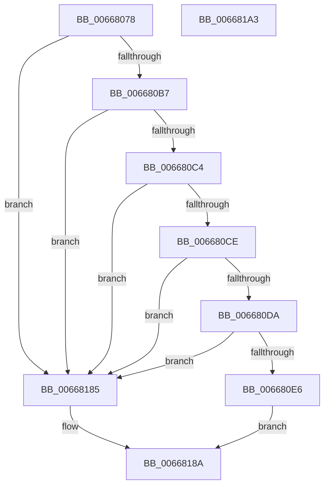

# AccelBuildDescriptorMemoryDecompress

- RVA: `0x00668078`–`0x006681A4` (길이 `300` bytes)
- VA: `0x0000000140668078`
- 실행 섹션: `.text`
- PDB 이름 있음: `예`; PDB Function 태그: `아니요`
- unwind 정보 RVA: `0x000D6260`
- 디코드: `79`개 명령, `300/300` bytes 표시
- 미해석 바이트: `0` (있으면 어셈블리에 `.byte`로 보존)

> 이 문서는 커널 이미지의 기계어와 PDB 기호를 분석해 생성했습니다. 4번과 5번은 함수 원형과 자료형을 바이너리 사용 방식에서 추정한 C 해석이며 원본 소스 복구 결과는 아닙니다.

## 1. Dependencies

- 직접 호출 지점: **4**; 고유 호출 대상: **2**
- 직접 호출자로 확인된 함수: **1**
- RIP 상대 이미지 참조: **0**

### Outgoing calls
- `0x006680A5` → [memset](../6C/memset_function_006C6C40.md) (function, `0x006C6C40`)
- `0x006680FA` → [memset](../6C/memset_function_006C6C40.md) (function, `0x006C6C40`)
- `0x00668113` → [memset](../6C/memset_function_006C6C40.md) (function, `0x006C6C40`)
- `0x0066817E` → [AccelpInternalOperationHandler](../2C/AccelpInternalOperationHandler_function_002C7DAC.md) (function, `0x002C7DAC`)

### Direct callers
- [AccelDecompressBuffer](AccelDecompressBuffer_function_006683C8.md) at `0x00668440`

### Static image references
- 디코드된 RIP-relative 메모리 참조가 없습니다.

## 2. Other-region calls and transfers

- 다른 실행 섹션으로 향하는 call: **0**
- 별도 외부 분기/꼬리 이동을 확인하지 못했습니다.

## 3. Assembly (complete function range)

```asm
00668078  48 8B C4                        mov rax, rsp
0066807B  48 89 58 08                     mov qword ptr [rax + 8], rbx
0066807F  48 89 70 10                     mov qword ptr [rax + 0x10], rsi
00668083  48 89 78 18                     mov qword ptr [rax + 0x18], rdi
00668087  55                              push rbp
00668088  48 8D 68 A1                     lea rbp, [rax - 0x5f]
0066808C  48 81 EC 90 00 00 00            sub rsp, 0x90
00668093  33 C0                           xor eax, eax
00668095  48 8B D9                        mov rbx, rcx
00668098  33 D2                           xor edx, edx
0066809A  89 45 EB                        mov dword ptr [rbp - 0x15], eax
0066809D  48 8D 4D E7                     lea rcx, [rbp - 0x19]
006680A1  44 8D 40 6C                     lea r8d, [rax + 0x6c]
006680A5  E8 96 EB 05 00                  call 0x1406c6c40
006680AA  48 8B 73 08                     mov rsi, qword ptr [rbx + 8]
006680AE  48 85 F6                        test rsi, rsi
006680B1  0F 84 CE 00 00 00               je 0x140668185
006680B7  48 8B 7B 18                     mov rdi, qword ptr [rbx + 0x18]
006680BB  48 85 FF                        test rdi, rdi
006680BE  0F 84 C1 00 00 00               je 0x140668185
006680C4  83 7F 04 07                     cmp dword ptr [rdi + 4], 7
006680C8  0F 85 B7 00 00 00               jne 0x140668185
006680CE  8B 43 10                        mov eax, dword ptr [rbx + 0x10]
006680D1  39 47 08                        cmp dword ptr [rdi + 8], eax
006680D4  0F 85 AB 00 00 00               jne 0x140668185
006680DA  8B 43 14                        mov eax, dword ptr [rbx + 0x14]
006680DD  39 47 0C                        cmp dword ptr [rdi + 0xc], eax
006680E0  0F 85 9F 00 00 00               jne 0x140668185
006680E6  48 8B 06                        mov rax, qword ptr [rsi]
006680E9  33 D2                           xor edx, edx
006680EB  48 8B 48 10                     mov rcx, qword ptr [rax + 0x10]
006680EF  44 8B 81 0C 01 00 00            mov r8d, dword ptr [rcx + 0x10c]
006680F6  48 8B 4E 18                     mov rcx, qword ptr [rsi + 0x18]
006680FA  E8 41 EB 05 00                  call 0x1406c6c40
006680FF  48 8B 06                        mov rax, qword ptr [rsi]
00668102  33 D2                           xor edx, edx
00668104  48 8B 48 10                     mov rcx, qword ptr [rax + 0x10]
00668108  44 8B 81 10 01 00 00            mov r8d, dword ptr [rcx + 0x110]
0066810F  48 8B 4E 20                     mov rcx, qword ptr [rsi + 0x20]
00668113  E8 28 EB 05 00                  call 0x1406c6c40
00668118  48 8B 06                        mov rax, qword ptr [rsi]
0066811B  48 8D 4D E7                     lea rcx, [rbp - 0x19]
0066811F  48 89 45 EF                     mov qword ptr [rbp - 0x11], rax
00668123  33 D2                           xor edx, edx
00668125  8B 46 10                        mov eax, dword ptr [rsi + 0x10]
00668128  89 45 F7                        mov dword ptr [rbp - 9], eax
0066812B  48 8B 46 18                     mov rax, qword ptr [rsi + 0x18]
0066812F  48 89 45 FF                     mov qword ptr [rbp - 1], rax
00668133  48 8B 46 20                     mov rax, qword ptr [rsi + 0x20]
00668137  48 89 45 07                     mov qword ptr [rbp + 7], rax
0066813B  48 8B 43 20                     mov rax, qword ptr [rbx + 0x20]
0066813F  48 89 45 0F                     mov qword ptr [rbp + 0xf], rax
00668143  48 8B 43 28                     mov rax, qword ptr [rbx + 0x28]
00668147  48 89 45 17                     mov qword ptr [rbp + 0x17], rax
0066814B  8B 43 30                        mov eax, dword ptr [rbx + 0x30]
0066814E  89 45 1F                        mov dword ptr [rbp + 0x1f], eax
00668151  48 8B 43 38                     mov rax, qword ptr [rbx + 0x38]
00668155  48 89 45 27                     mov qword ptr [rbp + 0x27], rax
00668159  8B 43 40                        mov eax, dword ptr [rbx + 0x40]
0066815C  89 45 2F                        mov dword ptr [rbp + 0x2f], eax
0066815F  8B 43 10                        mov eax, dword ptr [rbx + 0x10]
00668162  89 45 3F                        mov dword ptr [rbp + 0x3f], eax
00668165  8B 43 14                        mov eax, dword ptr [rbx + 0x14]
00668168  89 45 43                        mov dword ptr [rbp + 0x43], eax
0066816B  48 8D 43 44                     lea rax, [rbx + 0x44]
0066816F  48 89 45 4F                     mov qword ptr [rbp + 0x4f], rax
00668173  C7 45 E7 0C 00 00 00            mov dword ptr [rbp - 0x19], 0xc
0066817A  48 89 7D 37                     mov qword ptr [rbp + 0x37], rdi
0066817E  E8 29 FC C5 FF                  call 0x1402c7dac
00668183  EB 05                           jmp 0x14066818a
00668185  B8 0D 00 00 C0                  mov eax, 0xc000000d
0066818A  4C 8D 9C 24 90 00 00 00         lea r11, [rsp + 0x90]
00668192  49 8B 5B 10                     mov rbx, qword ptr [r11 + 0x10]
00668196  49 8B 73 18                     mov rsi, qword ptr [r11 + 0x18]
0066819A  49 8B 7B 20                     mov rdi, qword ptr [r11 + 0x20]
0066819E  49 8B E3                        mov rsp, r11
006681A1  5D                              pop rbp
006681A2  C3                              ret
006681A3  CC                              int3
```

## 4. C-style interpretation (structured pseudocode)

```c
__int64 __fastcall AccelBuildDescriptorMemoryDecompress(__int64 a1, int a2)
{
    __int64 result;
    __int64 v_rsp;
    unsigned __int64 v_stack_m8;

    *(unsigned __int64 *)(v_rsp + 8) = v_rbx;
    *(unsigned __int64 *)(v_rsp + 16) = v_rsi;
    *(unsigned __int64 *)(v_rsp + 24) = v_rdi;
    v_rsp = (v_rsp) - (144);
    result = 0;
    a2 = 0;
    *(unsigned int *)(v_rsp - 95 - 21) = 0;
    result = memset(v_rsp - 95 - 25, a2, result + 108, a4);
    if (*(unsigned __int64 *)(a1 + 8) == 0) goto loc_00668185;
    if (*(unsigned __int64 *)(a1 + 24) == 0) goto loc_00668185;
    if ((*(unsigned int *)(*(unsigned __int64 *)(a1 + 24) + 4)) != 7) goto loc_00668185;
    if ((*(unsigned int *)(*(unsigned __int64 *)(a1 + 24) + 8)) != ((unsigned int)((unsigned int)(*(unsigned int *)(a1 + 16))))) goto loc_00668185;
    if ((*(unsigned int *)(*(unsigned __int64 *)(a1 + 24) + 12)) != ((unsigned int)((unsigned int)(*(unsigned int *)(a1 + 20))))) goto loc_00668185;
    a2 = 0;
    result = memset(*(unsigned __int64 *)(*(unsigned __int64 *)(a1 + 8) + 24), a2, (unsigned int)(*(unsigned int *)(*(unsigned __int64 *)(*(unsigned __int64 *)(*(unsigned __int64 *)(a1 + 8)) + 16) + 268)), a4);
    a2 = 0;
    result = memset(*(unsigned __int64 *)(*(unsigned __int64 *)(a1 + 8) + 32), a2, (unsigned int)(*(unsigned int *)(*(unsigned __int64 *)(*(unsigned __int64 *)(*(unsigned __int64 *)(a1 + 8)) + 16) + 272)), a4);
    *(unsigned __int64 *)(v_rsp - 95 - 17) = *(unsigned __int64 *)(*(unsigned __int64 *)(a1 + 8));
    a2 = 0;
    *(unsigned int *)(v_rsp - 95 - 9) = (unsigned int)((unsigned int)(*(unsigned int *)(*(unsigned __int64 *)(a1 + 8) + 16)));
    *(unsigned __int64 *)(v_rsp - 95 - 1) = *(unsigned __int64 *)(*(unsigned __int64 *)(a1 + 8) + 24);
    *(unsigned __int64 *)(v_rsp - 95 + 7) = *(unsigned __int64 *)(*(unsigned __int64 *)(a1 + 8) + 32);
    *(unsigned __int64 *)(v_rsp - 95 + 15) = *(unsigned __int64 *)(a1 + 32);
    *(unsigned __int64 *)(v_rsp - 95 + 23) = *(unsigned __int64 *)(a1 + 40);
    *(unsigned int *)(v_rsp - 95 + 31) = (unsigned int)((unsigned int)(*(unsigned int *)(a1 + 48)));
    *(unsigned __int64 *)(v_rsp - 95 + 39) = *(unsigned __int64 *)(a1 + 56);
    *(unsigned int *)(v_rsp - 95 + 47) = (unsigned int)((unsigned int)(*(unsigned int *)(a1 + 64)));
    *(unsigned int *)(v_rsp - 95 + 63) = (unsigned int)((unsigned int)(*(unsigned int *)(a1 + 16)));
    *(unsigned int *)(v_rsp - 95 + 67) = (unsigned int)((unsigned int)(*(unsigned int *)(a1 + 20)));
    *(unsigned __int64 *)(v_rsp - 95 + 79) = a1 + 68;
    *(unsigned int *)(v_rsp - 95 - 25) = 12;
    *(unsigned __int64 *)(v_rsp - 95 + 55) = *(unsigned __int64 *)(a1 + 24);
    result = AccelpInternalOperationHandler(v_rsp - 95 - 25, a2, (unsigned int)(*(unsigned int *)(*(unsigned __int64 *)(*(unsigned __int64 *)(*(unsigned __int64 *)(a1 + 8)) + 16) + 272)), a4);
    goto loc_0066818A;
loc_00668185:
loc_0066818A:
    return (unsigned int)(0xC000000DULL);
}
```

## 5. (Beta) C Style

```c
int64_t AccelBuildDescriptorMemoryDecompress(void *Arg1, int32_t Arg2)
{
    uint8_t *arg1 = (uint8_t *)Arg1;

    int64_t result;
    int64_t local_rsp;
    uint64_t v_stack_m8;

    *(uint64_t *)(local_rsp + 0x8) = local_rbx;
    *(uint64_t *)(local_rsp + 0x10) = local_rsi;
    *(uint64_t *)(local_rsp + 0x18) = local_rdi;
    local_rsp = (local_rsp) - (144);
    result = 0;
    Arg2 = 0;
    *(uint32_t *)(local_rsp - 0x5F - 0x15) = 0;
    result = memset(local_rsp - 95 - 25, Arg2, result + 108, a4);
    if (*(uint64_t *)(arg1 + 0x8) == 0) goto loc_00668185;
    if (*(uint64_t *)(arg1 + 0x18) == 0) goto loc_00668185;
    if ((*(uint32_t *)(*(uint64_t *)(arg1 + 0x18) + 0x4)) != 7) goto loc_00668185;
    if ((*(uint32_t *)(*(uint64_t *)(arg1 + 0x18) + 0x8)) != ((uint32_t)((uint32_t)(*(uint32_t *)(arg1 + 0x10))))) goto loc_00668185;
    if ((*(uint32_t *)(*(uint64_t *)(arg1 + 0x18) + 0xC)) != ((uint32_t)((uint32_t)(*(uint32_t *)(arg1 + 0x14))))) goto loc_00668185;
    Arg2 = 0;
    result = memset(*(uint64_t *)(*(uint64_t *)(arg1 + 0x8) + 0x18), Arg2, (uint32_t)(*(uint32_t *)(*(uint64_t *)(*(uint64_t *)(*(uint64_t *)(arg1 + 0x8)) + 0x10) + 0x10C)), a4);
    Arg2 = 0;
    result = memset(*(uint64_t *)(*(uint64_t *)(arg1 + 0x8) + 0x20), Arg2, (uint32_t)(*(uint32_t *)(*(uint64_t *)(*(uint64_t *)(*(uint64_t *)(arg1 + 0x8)) + 0x10) + 0x110)), a4);
    *(uint64_t *)(local_rsp - 0x5F - 0x11) = *(uint64_t *)(*(uint64_t *)(arg1 + 0x8));
    Arg2 = 0;
    *(uint32_t *)(local_rsp - 0x5F - 0x9) = (uint32_t)((uint32_t)(*(uint32_t *)(*(uint64_t *)(arg1 + 0x8) + 0x10)));
    *(uint64_t *)(local_rsp - 0x5F - 0x1) = *(uint64_t *)(*(uint64_t *)(arg1 + 0x8) + 0x18);
    *(uint64_t *)(local_rsp - 0x5F + 0x7) = *(uint64_t *)(*(uint64_t *)(arg1 + 0x8) + 0x20);
    *(uint64_t *)(local_rsp - 0x5F + 0xF) = *(uint64_t *)(arg1 + 0x20);
    *(uint64_t *)(local_rsp - 0x5F + 0x17) = *(uint64_t *)(arg1 + 0x28);
    *(uint32_t *)(local_rsp - 0x5F + 0x1F) = (uint32_t)((uint32_t)(*(uint32_t *)(arg1 + 0x30)));
    *(uint64_t *)(local_rsp - 0x5F + 0x27) = *(uint64_t *)(arg1 + 0x38);
    *(uint32_t *)(local_rsp - 0x5F + 0x2F) = (uint32_t)((uint32_t)(*(uint32_t *)(arg1 + 0x40)));
    *(uint32_t *)(local_rsp - 0x5F + 0x3F) = (uint32_t)((uint32_t)(*(uint32_t *)(arg1 + 0x10)));
    *(uint32_t *)(local_rsp - 0x5F + 0x43) = (uint32_t)((uint32_t)(*(uint32_t *)(arg1 + 0x14)));
    *(void **)(local_rsp - 0x5F + 0x4F) = Arg1 + 68;
    *(uint32_t *)(local_rsp - 0x5F - 0x19) = 12;
    *(uint64_t *)(local_rsp - 0x5F + 0x37) = *(uint64_t *)(arg1 + 0x18);
    result = AccelpInternalOperationHandler(local_rsp - 95 - 25, Arg2, (uint32_t)(*(uint32_t *)(*(uint64_t *)(*(uint64_t *)(*(uint64_t *)(arg1 + 0x8)) + 0x10) + 0x110)), a4);
    goto loc_0066818A;
loc_00668185:
loc_0066818A:
    return (uint32_t)(0xC000000DULL);
}
```

### 관측된 메모리 오프셋

구조체 형식이 확인되지 않은 접근은 인자 기준의 오프셋으로만 기록했습니다.

| 기준 인자 | 오프셋 표현 | 폭 (bit) | 접근 |
|---|---:|---:|---|
| `Arg1` | `+ 0x8` | `64` | `R` |
| `Arg1` | `+ 0x10` | `32` | `R` |
| `Arg1` | `+ 0x14` | `32` | `R` |
| `Arg1` | `+ 0x18` | `64` | `R` |
| `Arg1` | `+ 0x20` | `64` | `R` |
| `Arg1` | `+ 0x28` | `64` | `R` |
| `Arg1` | `+ 0x30` | `32` | `R` |
| `Arg1` | `+ 0x38` | `64` | `R` |
| `Arg1` | `+ 0x40` | `32` | `R` |
| `Arg1` | `+ 0x44` | `64` | `R` |

## 6. Execution-region graph

[열기: 2D/3D 그래프와 함수 탐색 컨트롤 패널](../../../control-panel.html?section=text&rva=0x00668078&view=graph)

- 2D 그래프는 위에서 아래로 흐르고, 3D 그래프는 빈 공간을 드래그해 회전합니다. Shift+드래그는 이동, 휠은 확대·축소, 함수 노드 선택은 대상 보고서 이동입니다.

### Static fallback


