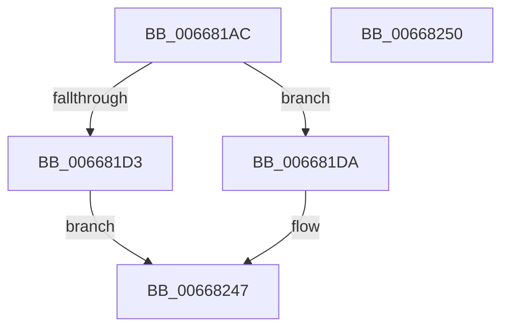

# AccelBuildDescriptorNop

- RVA: `0x006681AC`–`0x00668251` (길이 `165` bytes)
- VA: `0x00000001406681AC`
- 실행 섹션: `.text`
- PDB 이름 있음: `예`; PDB Function 태그: `아니요`
- unwind 정보 RVA: `0x0008A5A0`
- 디코드: `42`개 명령, `165/165` bytes 표시
- 미해석 바이트: `0` (있으면 어셈블리에 `.byte`로 보존)

> 이 문서는 커널 이미지의 기계어와 PDB 기호를 분석해 생성했습니다. 4번과 5번은 함수 원형과 자료형을 바이너리 사용 방식에서 추정한 C 해석이며 원본 소스 복구 결과는 아닙니다.

## 1. Dependencies

- 직접 호출 지점: **4**; 고유 호출 대상: **2**
- 직접 호출자로 확인된 함수: **1**
- RIP 상대 이미지 참조: **0**

### Outgoing calls
- `0x006681C9` → [memset](../6C/memset_function_006C6C40.md) (function, `0x006C6C40`)
- `0x006681EE` → [memset](../6C/memset_function_006C6C40.md) (function, `0x006C6C40`)
- `0x00668207` → [memset](../6C/memset_function_006C6C40.md) (function, `0x006C6C40`)
- `0x00668242` → [AccelpInternalOperationHandler](../2C/AccelpInternalOperationHandler_function_002C7DAC.md) (function, `0x002C7DAC`)

### Direct callers
- [sub_006DC7EE](../6D/Unknown_function_006DC7EE.md) at `0x006DC837`

### Static image references
- 디코드된 RIP-relative 메모리 참조가 없습니다.

## 2. Other-region calls and transfers

- 다른 실행 섹션으로 향하는 call: **0**
- 별도 외부 분기/꼬리 이동을 확인하지 못했습니다.

## 3. Assembly (complete function range)

```asm
006681AC  40 53                           push rbx
006681AE  48 81 EC 90 00 00 00            sub rsp, 0x90
006681B5  33 C0                           xor eax, eax
006681B7  48 8B D9                        mov rbx, rcx
006681BA  33 D2                           xor edx, edx
006681BC  89 44 24 24                     mov dword ptr [rsp + 0x24], eax
006681C0  48 8D 4C 24 20                  lea rcx, [rsp + 0x20]
006681C5  44 8D 40 6C                     lea r8d, [rax + 0x6c]
006681C9  E8 72 EA 05 00                  call 0x1406c6c40
006681CE  48 85 DB                        test rbx, rbx
006681D1  75 07                           jne 0x1406681da
006681D3  B8 0D 00 00 C0                  mov eax, 0xc000000d
006681D8  EB 6D                           jmp 0x140668247
006681DA  48 8B 03                        mov rax, qword ptr [rbx]
006681DD  33 D2                           xor edx, edx
006681DF  48 8B 48 10                     mov rcx, qword ptr [rax + 0x10]
006681E3  44 8B 81 0C 01 00 00            mov r8d, dword ptr [rcx + 0x10c]
006681EA  48 8B 4B 18                     mov rcx, qword ptr [rbx + 0x18]
006681EE  E8 4D EA 05 00                  call 0x1406c6c40
006681F3  48 8B 03                        mov rax, qword ptr [rbx]
006681F6  33 D2                           xor edx, edx
006681F8  48 8B 48 10                     mov rcx, qword ptr [rax + 0x10]
006681FC  44 8B 81 10 01 00 00            mov r8d, dword ptr [rcx + 0x110]
00668203  48 8B 4B 20                     mov rcx, qword ptr [rbx + 0x20]
00668207  E8 34 EA 05 00                  call 0x1406c6c40
0066820C  48 8B 03                        mov rax, qword ptr [rbx]
0066820F  48 8D 4C 24 20                  lea rcx, [rsp + 0x20]
00668214  48 83 64 24 48 00               and qword ptr [rsp + 0x48], 0
0066821A  33 D2                           xor edx, edx
0066821C  48 89 44 24 28                  mov qword ptr [rsp + 0x28], rax
00668221  8B 43 10                        mov eax, dword ptr [rbx + 0x10]
00668224  89 44 24 30                     mov dword ptr [rsp + 0x30], eax
00668228  48 8B 43 18                     mov rax, qword ptr [rbx + 0x18]
0066822C  48 89 44 24 38                  mov qword ptr [rsp + 0x38], rax
00668231  48 8B 43 20                     mov rax, qword ptr [rbx + 0x20]
00668235  48 89 44 24 40                  mov qword ptr [rsp + 0x40], rax
0066823A  C7 44 24 20 09 00 00 00         mov dword ptr [rsp + 0x20], 9
00668242  E8 65 FB C5 FF                  call 0x1402c7dac
00668247  48 81 C4 90 00 00 00            add rsp, 0x90
0066824E  5B                              pop rbx
0066824F  C3                              ret
00668250  CC                              int3
```

## 4. C-style interpretation (structured pseudocode)

```c
__int64 __fastcall AccelBuildDescriptorNop(__int64 a1, int a2)
{
    __int64 result;
    __int64 v_rsp;
    unsigned __int64 v_stack_m50;
    unsigned __int64 v_stack_m58;
    unsigned __int64 v_stack_m60;
    unsigned int v_stack_m68;
    unsigned __int64 v_stack_m70;
    unsigned int v_stack_m74;
    unsigned __int64 v_stack_m78;

    v_rsp = (v_rsp) - (144);
    result = 0;
    a2 = 0;
    v_stack_m74 = 0;
    result = memset(v_stack_m78, a2, result + 108, a4);
    if (a1 != 0) goto loc_006681DA;
    goto loc_00668247;
loc_006681DA:
    a2 = 0;
    result = memset(*(unsigned __int64 *)(a1 + 24), a2, (unsigned int)(*(unsigned int *)(*(unsigned __int64 *)(*(unsigned __int64 *)(a1) + 16) + 268)), a4);
    a2 = 0;
    result = memset(*(unsigned __int64 *)(a1 + 32), a2, (unsigned int)(*(unsigned int *)(*(unsigned __int64 *)(*(unsigned __int64 *)(a1) + 16) + 272)), a4);
    a2 = 0;
    v_stack_m70 = *(unsigned __int64 *)(a1);
    v_stack_m68 = (unsigned int)((unsigned int)(*(unsigned int *)(a1 + 16)));
    v_stack_m60 = *(unsigned __int64 *)(a1 + 24);
    v_stack_m58 = *(unsigned __int64 *)(a1 + 32);
    v_stack_m78 = 9;
    result = AccelpInternalOperationHandler(v_stack_m78, a2, (unsigned int)(*(unsigned int *)(*(unsigned __int64 *)(*(unsigned __int64 *)(a1) + 16) + 272)), a4);
loc_00668247:
    v_rsp = (v_rsp) + (144);
    return result;
}
```

## 5. (Beta) C Style

```c
int64_t AccelBuildDescriptorNop(int64_t Arg1, int32_t Arg2)
{
    int64_t result;
    int64_t local_rsp;
    uint64_t v_stack_m50;
    uint64_t v_stack_m58;
    uint64_t v_stack_m60;
    uint32_t v_stack_m68;
    uint64_t v_stack_m70;
    uint32_t v_stack_m74;
    uint64_t v_stack_m78;

    local_rsp = (local_rsp) - (144);
    result = 0;
    Arg2 = 0;
    v_stack_m74 = 0;
    result = memset(v_stack_m78, Arg2, result + 108, a4);
    if (Arg1 != 0) goto loc_006681DA;
    goto loc_00668247;
loc_006681DA:
    Arg2 = 0;
    result = memset(*(uint64_t *)(Arg1 + 0x18), Arg2, (uint32_t)(*(uint32_t *)(*(uint64_t *)(*(uint64_t *)(Arg1) + 0x10) + 0x10C)), a4);
    Arg2 = 0;
    result = memset(*(uint64_t *)(Arg1 + 0x20), Arg2, (uint32_t)(*(uint32_t *)(*(uint64_t *)(*(uint64_t *)(Arg1) + 0x10) + 0x110)), a4);
    Arg2 = 0;
    v_stack_m70 = *(uint64_t *)(Arg1);
    v_stack_m68 = (uint32_t)((uint32_t)(*(uint32_t *)(Arg1 + 0x10)));
    v_stack_m60 = *(uint64_t *)(Arg1 + 0x18);
    v_stack_m58 = *(uint64_t *)(Arg1 + 0x20);
    v_stack_m78 = 9;
    result = AccelpInternalOperationHandler(v_stack_m78, Arg2, (uint32_t)(*(uint32_t *)(*(uint64_t *)(*(uint64_t *)(Arg1) + 0x10) + 0x110)), a4);
loc_00668247:
    local_rsp = (local_rsp) + (144);
    return result;
}
```

## 6. Execution-region graph

[열기: 2D/3D 그래프와 함수 탐색 컨트롤 패널](../../../control-panel.html?section=text&rva=0x006681AC&view=graph)

- 2D 그래프는 위에서 아래로 흐르고, 3D 그래프는 빈 공간을 드래그해 회전합니다. Shift+드래그는 이동, 휠은 확대·축소, 함수 노드 선택은 대상 보고서 이동입니다.

### Static fallback


