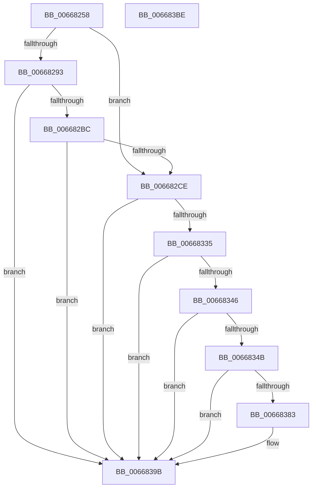

# AccelCompressBuffer

- RVA: `0x00668258`–`0x006683BF` (길이 `359` bytes)
- VA: `0x0000000140668258`
- 실행 섹션: `.text`
- PDB 이름 있음: `예`; PDB Function 태그: `아니요`
- unwind 정보 RVA: `0x000C8BD8`
- 디코드: `108`개 명령, `359/359` bytes 표시
- 미해석 바이트: `0` (있으면 어셈블리에 `.byte`로 보존)

> 이 문서는 커널 이미지의 기계어와 PDB 기호를 분석해 생성했습니다. 4번과 5번은 함수 원형과 자료형을 바이너리 사용 방식에서 추정한 C 해석이며 원본 소스 복구 결과는 아닙니다.

## 1. Dependencies

- 직접 호출 지점: **5**; 고유 호출 대상: **5**
- 직접 호출자로 확인된 함수: **1**
- RIP 상대 이미지 참조: **0**

### Outgoing calls
- `0x006682AD` → [AccelpComputeHistogram](AccelpComputeHistogram_function_00668BA0.md) (function, `0x00668BA0`)
- `0x006682BF` → [AccelpBuildHuffmanEncoding](AccelpBuildHuffmanEncoding_function_00668900.md) (function, `0x00668900`)
- `0x0066832A` → [AccelBuildDescriptorMemoryCompress](AccelBuildDescriptorMemoryCompress_function_00667F44.md) (function, `0x00667F44`)
- `0x0066833B` → [AccelpSubmitWork](../2C/AccelpSubmitWork_function_002C8190.md) (function, `0x002C8190`)
- `0x00668378` → [AccelQueryCompletionInformation](AccelQueryCompletionInformation_function_006686A4.md) (function, `0x006686A4`)

### Direct callers
- [SmHwAcceleratorIssueRequest](../61/SmHwAcceleratorIssueRequest_function_006114C0.md) at `0x006115C0`

### Static image references
- 디코드된 RIP-relative 메모리 참조가 없습니다.

## 2. Other-region calls and transfers

- 다른 실행 섹션으로 향하는 call: **0**
- 별도 외부 분기/꼬리 이동을 확인하지 못했습니다.

## 3. Assembly (complete function range)

```asm
00668258  48 8B C4                        mov rax, rsp
0066825B  48 89 58 08                     mov qword ptr [rax + 8], rbx
0066825F  48 89 70 10                     mov qword ptr [rax + 0x10], rsi
00668263  48 89 78 18                     mov qword ptr [rax + 0x18], rdi
00668267  55                              push rbp
00668268  41 54                           push r12
0066826A  41 55                           push r13
0066826C  41 56                           push r14
0066826E  41 57                           push r15
00668270  48 8D 68 A1                     lea rbp, [rax - 0x5f]
00668274  48 81 EC C0 00 00 00            sub rsp, 0xc0
0066827B  45 33 ED                        xor r13d, r13d
0066827E  4C 8D 71 18                     lea r14, [rcx + 0x18]
00668282  83 79 14 03                     cmp dword ptr [rcx + 0x14], 3
00668286  48 8D 79 20                     lea rdi, [rcx + 0x20]
0066828A  48 8B D9                        mov rbx, rcx
0066828D  48 8D 71 08                     lea rsi, [rcx + 8]
00668291  75 3B                           jne 0x1406682ce
00668293  48 8B 07                        mov rax, qword ptr [rdi]
00668296  44 8B 41 30                     mov r8d, dword ptr [rcx + 0x30]
0066829A  48 83 E0 FB                     and rax, 0xfffffffffffffffb
0066829E  48 8B 51 28                     mov rdx, qword ptr [rcx + 0x28]
006682A2  4D 8B 0E                        mov r9, qword ptr [r14]
006682A5  48 8B 0E                        mov rcx, qword ptr [rsi]
006682A8  48 89 44 24 20                  mov qword ptr [rsp + 0x20], rax
006682AD  E8 EE 08 00 00                  call 0x140668ba0
006682B2  8B C8                           mov ecx, eax
006682B4  85 C0                           test eax, eax
006682B6  0F 88 DF 00 00 00               js 0x14066839b
006682BC  49 8B 0E                        mov rcx, qword ptr [r14]
006682BF  E8 3C 06 00 00                  call 0x140668900
006682C4  8B C8                           mov ecx, eax
006682C6  85 C0                           test eax, eax
006682C8  0F 88 CD 00 00 00               js 0x14066839b
006682CE  48 8B 06                        mov rax, qword ptr [rsi]
006682D1  48 8D 4D A7                     lea rcx, [rbp - 0x59]
006682D5  48 89 45 AF                     mov qword ptr [rbp - 0x51], rax
006682D9  8B 43 10                        mov eax, dword ptr [rbx + 0x10]
006682DC  89 45 B7                        mov dword ptr [rbp - 0x49], eax
006682DF  8B 43 14                        mov eax, dword ptr [rbx + 0x14]
006682E2  89 45 BB                        mov dword ptr [rbp - 0x45], eax
006682E5  49 8B 06                        mov rax, qword ptr [r14]
006682E8  48 89 45 BF                     mov qword ptr [rbp - 0x41], rax
006682EC  48 8B 07                        mov rax, qword ptr [rdi]
006682EF  48 89 45 C7                     mov qword ptr [rbp - 0x39], rax
006682F3  48 8B 43 28                     mov rax, qword ptr [rbx + 0x28]
006682F7  48 89 45 CF                     mov qword ptr [rbp - 0x31], rax
006682FB  8B 43 30                        mov eax, dword ptr [rbx + 0x30]
006682FE  89 45 D7                        mov dword ptr [rbp - 0x29], eax
00668301  48 8B 43 38                     mov rax, qword ptr [rbx + 0x38]
00668305  48 89 45 DF                     mov qword ptr [rbp - 0x21], rax
00668309  8B 43 40                        mov eax, dword ptr [rbx + 0x40]
0066830C  89 45 E7                        mov dword ptr [rbp - 0x19], eax
0066830F  8A 43 44                        mov al, byte ptr [rbx + 0x44]
00668312  88 45 EB                        mov byte ptr [rbp - 0x15], al
00668315  48 C7 45 A7 01 00 48 00         mov qword ptr [rbp - 0x59], 0x480001
0066831D  44 89 6D DB                     mov dword ptr [rbp - 0x25], r13d
00668321  66 44 89 6D EC                  mov word ptr [rbp - 0x14], r13w
00668326  44 88 6D EE                     mov byte ptr [rbp - 0x12], r13b
0066832A  E8 15 FC FF FF                  call 0x140667f44
0066832F  8B C8                           mov ecx, eax
00668331  85 C0                           test eax, eax
00668333  78 66                           js 0x14066839b
00668335  48 8B 17                        mov rdx, qword ptr [rdi]
00668338  48 8B 0E                        mov rcx, qword ptr [rsi]
0066833B  E8 50 FE C5 FF                  call 0x1402c8190
00668340  8B C8                           mov ecx, eax
00668342  85 C0                           test eax, eax
00668344  78 55                           js 0x14066839b
00668346  F6 07 04                        test byte ptr [rdi], 4
00668349  75 50                           jne 0x14066839b
0066834B  33 C0                           xor eax, eax
0066834D  0F 57 C0                        xorps xmm0, xmm0
00668350  0F 11 45 F7                     movups xmmword ptr [rbp - 9], xmm0
00668354  48 89 45 27                     mov qword ptr [rbp + 0x27], rax
00668358  0F 11 45 07                     movups xmmword ptr [rbp + 7], xmm0
0066835C  8D 48 01                        lea ecx, [rax + 1]
0066835F  C7 45 F7 01 00 38 00            mov dword ptr [rbp - 9], 0x380001
00668366  48 8B 06                        mov rax, qword ptr [rsi]
00668369  89 4D 07                        mov dword ptr [rbp + 7], ecx
0066836C  48 8D 4D F7                     lea rcx, [rbp - 9]
00668370  0F 11 45 17                     movups xmmword ptr [rbp + 0x17], xmm0
00668374  48 89 45 FF                     mov qword ptr [rbp - 1], rax
00668378  E8 27 03 00 00                  call 0x1406686a4
0066837D  8B C8                           mov ecx, eax
0066837F  85 C0                           test eax, eax
00668381  78 18                           js 0x14066839b
00668383  8B 45 0F                        mov eax, dword ptr [rbp + 0xf]
00668386  89 43 48                        mov dword ptr [rbx + 0x48], eax
00668389  8B 45 1B                        mov eax, dword ptr [rbp + 0x1b]
0066838C  89 43 54                        mov dword ptr [rbx + 0x54], eax
0066838F  8A 45 17                        mov al, byte ptr [rbp + 0x17]
00668392  88 43 50                        mov byte ptr [rbx + 0x50], al
00668395  8B 45 13                        mov eax, dword ptr [rbp + 0x13]
00668398  89 43 4C                        mov dword ptr [rbx + 0x4c], eax
0066839B  4C 8D 9C 24 C0 00 00 00         lea r11, [rsp + 0xc0]
006683A3  8B C1                           mov eax, ecx
006683A5  49 8B 5B 30                     mov rbx, qword ptr [r11 + 0x30]
006683A9  49 8B 73 38                     mov rsi, qword ptr [r11 + 0x38]
006683AD  49 8B 7B 40                     mov rdi, qword ptr [r11 + 0x40]
006683B1  49 8B E3                        mov rsp, r11
006683B4  41 5F                           pop r15
006683B6  41 5E                           pop r14
006683B8  41 5D                           pop r13
006683BA  41 5C                           pop r12
006683BC  5D                              pop rbp
006683BD  C3                              ret
006683BE  CC                              int3
```

## 4. C-style interpretation (structured pseudocode)

```c
__int64 __fastcall AccelCompressBuffer(__int64 a1)
{
    __int64 result;
    __int64 v_r13;
    __int64 v_rsp;
    unsigned __int64 v_stack_m28;
    unsigned __int64 v_stack_mC8;

    *(unsigned __int64 *)(v_rsp + 8) = v_rbx;
    *(unsigned __int64 *)(v_rsp + 16) = v_rsi;
    *(unsigned __int64 *)(v_rsp + 24) = v_rdi;
    v_rsp = (v_rsp) - (192);
    v_r13 = 0;
    if ((*(unsigned int *)(a1 + 20)) != 3) goto loc_006682CE;
    result = (*(unsigned __int64 *)(a1 + 32)) & (-5);
    v_stack_mC8 = result;
    result = AccelpComputeHistogram(*(unsigned __int64 *)(a1 + 8), *(unsigned __int64 *)(a1 + 40), (unsigned int)(*(unsigned int *)(a1 + 48)), *(unsigned __int64 *)(a1 + 24));
    if (sign_flag) goto loc_0066839B;
    result = AccelpBuildHuffmanEncoding(*(unsigned __int64 *)(a1 + 24), *(unsigned __int64 *)(a1 + 40), (unsigned int)(*(unsigned int *)(a1 + 48)), *(unsigned __int64 *)(a1 + 24));
    if (sign_flag) goto loc_0066839B;
loc_006682CE:
    *(unsigned __int64 *)(v_rsp - 95 - 81) = *(unsigned __int64 *)(a1 + 8);
    *(unsigned int *)(v_rsp - 95 - 73) = (unsigned int)((unsigned int)(*(unsigned int *)(a1 + 16)));
    *(unsigned int *)(v_rsp - 95 - 69) = (unsigned int)((unsigned int)(*(unsigned int *)(a1 + 20)));
    *(unsigned __int64 *)(v_rsp - 95 - 65) = *(unsigned __int64 *)(a1 + 24);
    *(unsigned __int64 *)(v_rsp - 95 - 57) = *(unsigned __int64 *)(a1 + 32);
    *(unsigned __int64 *)(v_rsp - 95 - 49) = *(unsigned __int64 *)(a1 + 40);
    *(unsigned int *)(v_rsp - 95 - 41) = (unsigned int)((unsigned int)(*(unsigned int *)(a1 + 48)));
    *(unsigned __int64 *)(v_rsp - 95 - 33) = *(unsigned __int64 *)(a1 + 56);
    *(unsigned int *)(v_rsp - 95 - 25) = (unsigned int)((unsigned int)(*(unsigned int *)(a1 + 64)));
    *(unsigned __int8 *)(v_rsp - 95 - 21) = (unsigned __int8)(*(unsigned __int8 *)(a1 + 68));
    *(unsigned __int64 *)(v_rsp - 95 - 89) = 0x480001ULL;
    *(unsigned int *)(v_rsp - 95 - 37) = 0;
    *(unsigned __int16 *)(v_rsp - 95 - 20) = 0;
    *(unsigned __int8 *)(v_rsp - 95 - 18) = 0;
    result = AccelBuildDescriptorMemoryCompress(v_rsp - 95 - 89, *(unsigned __int64 *)(a1 + 40), (unsigned int)(*(unsigned int *)(a1 + 48)), *(unsigned __int64 *)(a1 + 24));
    if (sign_flag) goto loc_0066839B;
    result = AccelpSubmitWork(*(unsigned __int64 *)(a1 + 8), *(unsigned __int64 *)(a1 + 32), (unsigned int)(*(unsigned int *)(a1 + 48)), *(unsigned __int64 *)(a1 + 24));
    if (sign_flag) goto loc_0066839B;
    if (((*(unsigned __int8 *)(a1 + 32)) & (4)) != 0) goto loc_0066839B;
    result = 0;
    *(unsigned __int64 *)(v_rsp - 95 - 9) = v_xmm0;
    *(unsigned __int64 *)(v_rsp - 95 + 39) = 0;
    *(unsigned __int64 *)(v_rsp - 95 + 7) = v_xmm0;
    *(unsigned int *)(v_rsp - 95 - 9) = 0x380001ULL;
    *(unsigned int *)(v_rsp - 95 + 7) = (unsigned int)(result + 1);
    *(unsigned __int64 *)(v_rsp - 95 + 23) = v_xmm0;
    *(unsigned __int64 *)(v_rsp - 95 - 1) = *(unsigned __int64 *)(a1 + 8);
    result = AccelQueryCompletionInformation(v_rsp - 95 - 9, *(unsigned __int64 *)(a1 + 32), (unsigned int)(*(unsigned int *)(a1 + 48)), *(unsigned __int64 *)(a1 + 24));
    if (!(sign_flag)) {
        result = *(unsigned int *)(v_rsp - 95 + 15);
        *(unsigned int *)(a1 + 72) = (unsigned int)(result);
        result = *(unsigned int *)(v_rsp - 95 + 27);
        *(unsigned int *)(a1 + 84) = (unsigned int)(result);
        result = *(unsigned __int8 *)(v_rsp - 95 + 23);
        *(unsigned __int8 *)(a1 + 80) = (unsigned __int8)(result);
        result = *(unsigned int *)(v_rsp - 95 + 19);
        *(unsigned int *)(a1 + 76) = (unsigned int)(result);
    }
    return (unsigned int)((unsigned int)((unsigned int)((unsigned int)(result))));
}
```

## 5. (Beta) C Style

```c
int64_t AccelCompressBuffer(void *Arg1)
{
    uint8_t *arg1 = (uint8_t *)Arg1;

    int64_t result;
    int64_t local_r13;
    int64_t local_rsp;
    uint64_t v_stack_m28;
    uint64_t v_stack_mC8;

    *(uint64_t *)(local_rsp + 0x8) = local_rbx;
    *(uint64_t *)(local_rsp + 0x10) = local_rsi;
    *(uint64_t *)(local_rsp + 0x18) = local_rdi;
    local_rsp = (local_rsp) - (192);
    local_r13 = 0;
    if ((*(uint32_t *)(arg1 + 0x14)) != 3) goto loc_006682CE;
    result = (*(uint64_t *)(arg1 + 0x20)) & (-5);
    v_stack_mC8 = result;
    result = AccelpComputeHistogram(*(uint64_t *)(arg1 + 0x8), *(uint64_t *)(arg1 + 0x28), (uint32_t)(*(uint32_t *)(arg1 + 0x30)), *(uint64_t *)(arg1 + 0x18));
    if (sign_flag) goto loc_0066839B;
    result = AccelpBuildHuffmanEncoding(*(uint64_t *)(arg1 + 0x18), *(uint64_t *)(arg1 + 0x28), (uint32_t)(*(uint32_t *)(arg1 + 0x30)), *(uint64_t *)(arg1 + 0x18));
    if (sign_flag) goto loc_0066839B;
loc_006682CE:
    *(uint64_t *)(local_rsp - 0x5F - 0x51) = *(uint64_t *)(arg1 + 0x8);
    *(uint32_t *)(local_rsp - 0x5F - 0x49) = (uint32_t)((uint32_t)(*(uint32_t *)(arg1 + 0x10)));
    *(uint32_t *)(local_rsp - 0x5F - 0x45) = (uint32_t)((uint32_t)(*(uint32_t *)(arg1 + 0x14)));
    *(uint64_t *)(local_rsp - 0x5F - 0x41) = *(uint64_t *)(arg1 + 0x18);
    *(uint64_t *)(local_rsp - 0x5F - 0x39) = *(uint64_t *)(arg1 + 0x20);
    *(uint64_t *)(local_rsp - 0x5F - 0x31) = *(uint64_t *)(arg1 + 0x28);
    *(uint32_t *)(local_rsp - 0x5F - 0x29) = (uint32_t)((uint32_t)(*(uint32_t *)(arg1 + 0x30)));
    *(uint64_t *)(local_rsp - 0x5F - 0x21) = *(uint64_t *)(arg1 + 0x38);
    *(uint32_t *)(local_rsp - 0x5F - 0x19) = (uint32_t)((uint32_t)(*(uint32_t *)(arg1 + 0x40)));
    *(uint8_t *)(local_rsp - 0x5F - 0x15) = (uint8_t)(*(uint8_t *)(arg1 + 0x44));
    *(uint64_t *)(local_rsp - 0x5F - 0x59) = 0x480001ULL;
    *(uint32_t *)(local_rsp - 0x5F - 0x25) = 0;
    *(uint16_t *)(local_rsp - 0x5F - 0x14) = 0;
    *(uint8_t *)(local_rsp - 0x5F - 0x12) = 0;
    result = AccelBuildDescriptorMemoryCompress(local_rsp - 95 - 89, *(uint64_t *)(arg1 + 0x28), (uint32_t)(*(uint32_t *)(arg1 + 0x30)), *(uint64_t *)(arg1 + 0x18));
    if (sign_flag) goto loc_0066839B;
    result = AccelpSubmitWork(*(uint64_t *)(arg1 + 0x8), *(uint64_t *)(arg1 + 0x20), (uint32_t)(*(uint32_t *)(arg1 + 0x30)), *(uint64_t *)(arg1 + 0x18));
    if (sign_flag) goto loc_0066839B;
    if (((*(uint8_t *)(arg1 + 0x20)) & (4)) != 0) goto loc_0066839B;
    result = 0;
    *(uint64_t *)(local_rsp - 0x5F - 0x9) = v_xmm0;
    *(uint64_t *)(local_rsp - 0x5F + 0x27) = 0;
    *(uint64_t *)(local_rsp - 0x5F + 0x7) = v_xmm0;
    *(uint32_t *)(local_rsp - 0x5F - 0x9) = 0x380001ULL;
    *(uint32_t *)(local_rsp - 0x5F + 0x7) = (uint32_t)(result + 1);
    *(uint64_t *)(local_rsp - 0x5F + 0x17) = v_xmm0;
    *(uint64_t *)(local_rsp - 0x5F - 0x1) = *(uint64_t *)(arg1 + 0x8);
    result = AccelQueryCompletionInformation(local_rsp - 95 - 9, *(uint64_t *)(arg1 + 0x20), (uint32_t)(*(uint32_t *)(arg1 + 0x30)), *(uint64_t *)(arg1 + 0x18));
    if (!(sign_flag)) {
        result = *(uint32_t *)(local_rsp - 0x5F + 0xF);
        *(uint32_t *)(arg1 + 0x48) = (uint32_t)(result);
        result = *(uint32_t *)(local_rsp - 0x5F + 0x1B);
        *(uint32_t *)(arg1 + 0x54) = (uint32_t)(result);
        result = *(uint8_t *)(local_rsp - 0x5F + 0x17);
        *(uint8_t *)(arg1 + 0x50) = (uint8_t)(result);
        result = *(uint32_t *)(local_rsp - 0x5F + 0x13);
        *(uint32_t *)(arg1 + 0x4C) = (uint32_t)(result);
    }
    return (uint32_t)((uint32_t)((uint32_t)((uint32_t)(result))));
}
```

### 관측된 메모리 오프셋

구조체 형식이 확인되지 않은 접근은 인자 기준의 오프셋으로만 기록했습니다.

| 기준 인자 | 오프셋 표현 | 폭 (bit) | 접근 |
|---|---:|---:|---|
| `Arg1` | `+ 0x0` | `8` | `R` |
| `Arg1` | `+ 0x0` | `64` | `R` |
| `Arg1` | `+ 0x8` | `64` | `R` |
| `Arg1` | `+ 0x10` | `32` | `R` |
| `Arg1` | `+ 0x14` | `32` | `R` |
| `Arg1` | `+ 0x18` | `64` | `R` |
| `Arg1` | `+ 0x20` | `64` | `R` |
| `Arg1` | `+ 0x28` | `64` | `R` |
| `Arg1` | `+ 0x30` | `32` | `R` |
| `Arg1` | `+ 0x38` | `64` | `R` |
| `Arg1` | `+ 0x40` | `32` | `R` |
| `Arg1` | `+ 0x44` | `8` | `R` |
| `Arg1` | `+ 0x48` | `32` | `W` |
| `Arg1` | `+ 0x4C` | `32` | `W` |
| `Arg1` | `+ 0x50` | `8` | `W` |
| `Arg1` | `+ 0x54` | `32` | `W` |

## 6. Execution-region graph

[열기: 2D/3D 그래프와 함수 탐색 컨트롤 패널](../../../control-panel.html?section=text&rva=0x00668258&view=graph)

- 2D 그래프는 위에서 아래로 흐르고, 3D 그래프는 빈 공간을 드래그해 회전합니다. Shift+드래그는 이동, 휠은 확대·축소, 함수 노드 선택은 대상 보고서 이동입니다.

### Static fallback


