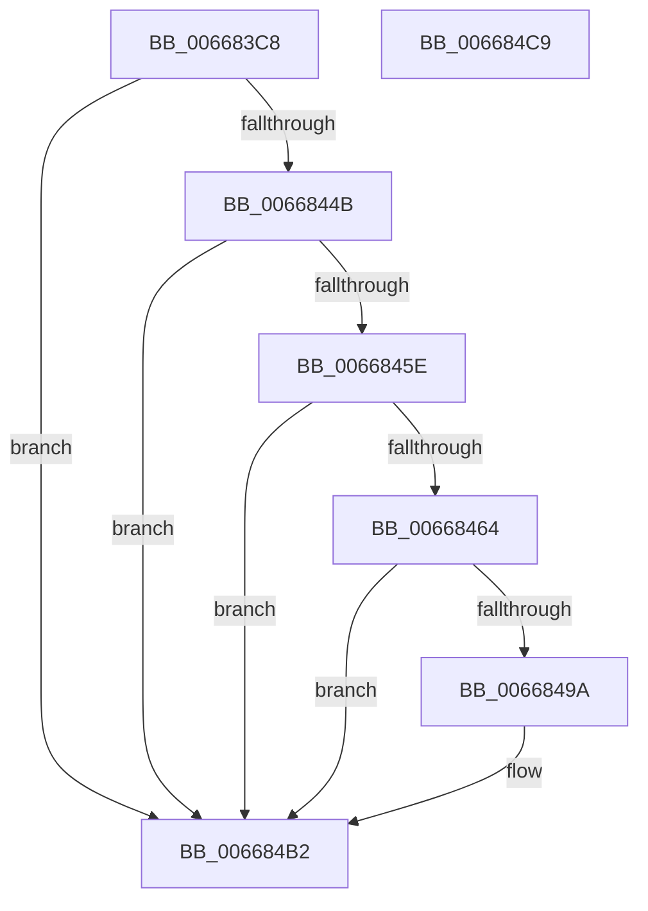

# AccelDecompressBuffer

- RVA: `0x006683C8`–`0x006684CA` (길이 `258` bytes)
- VA: `0x00000001406683C8`
- 실행 섹션: `.text`
- PDB 이름 있음: `예`; PDB Function 태그: `아니요`
- unwind 정보 RVA: `0x000D62B8`
- 디코드: `74`개 명령, `258/258` bytes 표시
- 미해석 바이트: `0` (있으면 어셈블리에 `.byte`로 보존)

> 이 문서는 커널 이미지의 기계어와 PDB 기호를 분석해 생성했습니다. 4번과 5번은 함수 원형과 자료형을 바이너리 사용 방식에서 추정한 C 해석이며 원본 소스 복구 결과는 아닙니다.

## 1. Dependencies

- 직접 호출 지점: **3**; 고유 호출 대상: **3**
- 직접 호출자로 확인된 함수: **1**
- RIP 상대 이미지 참조: **0**

### Outgoing calls
- `0x00668440` → [AccelBuildDescriptorMemoryDecompress](AccelBuildDescriptorMemoryDecompress_function_00668078.md) (function, `0x00668078`)
- `0x00668453` → [AccelpSubmitWork](../2C/AccelpSubmitWork_function_002C8190.md) (function, `0x002C8190`)
- `0x0066848F` → [AccelQueryCompletionInformation](AccelQueryCompletionInformation_function_006686A4.md) (function, `0x006686A4`)

### Direct callers
- [SmHwAcceleratorIssueRequest](../61/SmHwAcceleratorIssueRequest_function_006114C0.md) at `0x006115B5`

### Static image references
- 디코드된 RIP-relative 메모리 참조가 없습니다.

## 2. Other-region calls and transfers

- 다른 실행 섹션으로 향하는 call: **0**
- 별도 외부 분기/꼬리 이동을 확인하지 못했습니다.

## 3. Assembly (complete function range)

```asm
006683C8  48 89 5C 24 08                  mov qword ptr [rsp + 8], rbx
006683CD  48 89 7C 24 10                  mov qword ptr [rsp + 0x10], rdi
006683D2  55                              push rbp
006683D3  48 8D 6C 24 A9                  lea rbp, [rsp - 0x57]
006683D8  48 81 EC B0 00 00 00            sub rsp, 0xb0
006683DF  48 8B 41 08                     mov rax, qword ptr [rcx + 8]
006683E3  48 8B D9                        mov rbx, rcx
006683E6  83 65 0B 00                     and dword ptr [rbp + 0xb], 0
006683EA  BF 01 00 00 00                  mov edi, 1
006683EF  83 65 3B 00                     and dword ptr [rbp + 0x3b], 0
006683F3  48 89 45 0F                     mov qword ptr [rbp + 0xf], rax
006683F7  8B 41 10                        mov eax, dword ptr [rcx + 0x10]
006683FA  89 45 17                        mov dword ptr [rbp + 0x17], eax
006683FD  8B 41 14                        mov eax, dword ptr [rcx + 0x14]
00668400  89 45 1B                        mov dword ptr [rbp + 0x1b], eax
00668403  48 8B 41 18                     mov rax, qword ptr [rcx + 0x18]
00668407  48 89 45 1F                     mov qword ptr [rbp + 0x1f], rax
0066840B  48 8B 41 20                     mov rax, qword ptr [rcx + 0x20]
0066840F  48 89 45 27                     mov qword ptr [rbp + 0x27], rax
00668413  48 8B 41 38                     mov rax, qword ptr [rcx + 0x38]
00668417  48 89 45 2F                     mov qword ptr [rbp + 0x2f], rax
0066841B  8B 41 40                        mov eax, dword ptr [rcx + 0x40]
0066841E  89 45 37                        mov dword ptr [rbp + 0x37], eax
00668421  48 8B 41 28                     mov rax, qword ptr [rcx + 0x28]
00668425  48 89 45 3F                     mov qword ptr [rbp + 0x3f], rax
00668429  8B 41 30                        mov eax, dword ptr [rcx + 0x30]
0066842C  89 45 47                        mov dword ptr [rbp + 0x47], eax
0066842F  8B 41 44                        mov eax, dword ptr [rcx + 0x44]
00668432  48 8D 4D 07                     lea rcx, [rbp + 7]
00668436  C7 45 07 01 00 48 00            mov dword ptr [rbp + 7], 0x480001
0066843D  89 45 4B                        mov dword ptr [rbp + 0x4b], eax
00668440  E8 33 FC FF FF                  call 0x140668078
00668445  8B C8                           mov ecx, eax
00668447  85 C0                           test eax, eax
00668449  78 67                           js 0x1406684b2
0066844B  48 8B 53 20                     mov rdx, qword ptr [rbx + 0x20]
0066844F  48 8B 4B 08                     mov rcx, qword ptr [rbx + 8]
00668453  E8 38 FD C5 FF                  call 0x1402c8190
00668458  8B C8                           mov ecx, eax
0066845A  85 C0                           test eax, eax
0066845C  78 54                           js 0x1406684b2
0066845E  F6 43 20 04                     test byte ptr [rbx + 0x20], 4
00668462  75 4E                           jne 0x1406684b2
00668464  0F 57 C0                        xorps xmm0, xmm0
00668467  48 8D 4D C7                     lea rcx, [rbp - 0x39]
0066846B  33 C0                           xor eax, eax
0066846D  0F 11 45 C7                     movups xmmword ptr [rbp - 0x39], xmm0
00668471  48 89 45 F7                     mov qword ptr [rbp - 9], rax
00668475  48 8B 43 08                     mov rax, qword ptr [rbx + 8]
00668479  0F 11 45 D7                     movups xmmword ptr [rbp - 0x29], xmm0
0066847D  48 89 45 CF                     mov qword ptr [rbp - 0x31], rax
00668481  0F 11 45 E7                     movups xmmword ptr [rbp - 0x19], xmm0
00668485  C7 45 C7 01 00 38 00            mov dword ptr [rbp - 0x39], 0x380001
0066848C  89 7D D7                        mov dword ptr [rbp - 0x29], edi
0066848F  E8 10 02 00 00                  call 0x1406686a4
00668494  8B C8                           mov ecx, eax
00668496  85 C0                           test eax, eax
00668498  78 18                           js 0x1406684b2
0066849A  8B 45 DF                        mov eax, dword ptr [rbp - 0x21]
0066849D  89 43 48                        mov dword ptr [rbx + 0x48], eax
006684A0  8B 45 EB                        mov eax, dword ptr [rbp - 0x15]
006684A3  89 43 54                        mov dword ptr [rbx + 0x54], eax
006684A6  8A 45 E7                        mov al, byte ptr [rbp - 0x19]
006684A9  88 43 50                        mov byte ptr [rbx + 0x50], al
006684AC  8B 45 E3                        mov eax, dword ptr [rbp - 0x1d]
006684AF  89 43 4C                        mov dword ptr [rbx + 0x4c], eax
006684B2  4C 8D 9C 24 B0 00 00 00         lea r11, [rsp + 0xb0]
006684BA  8B C1                           mov eax, ecx
006684BC  49 8B 5B 10                     mov rbx, qword ptr [r11 + 0x10]
006684C0  49 8B 7B 18                     mov rdi, qword ptr [r11 + 0x18]
006684C4  49 8B E3                        mov rsp, r11
006684C7  5D                              pop rbp
006684C8  C3                              ret
006684C9  CC                              int3
```

## 4. C-style interpretation (structured pseudocode)

```c
__int64 __fastcall AccelDecompressBuffer(__int64 a1)
{
    __int64 result;
    __int64 v_rsp;
    unsigned int v_stack_m14;
    unsigned int v_stack_m18;
    unsigned __int64 v_stack_m20;
    unsigned int v_stack_m24;
    unsigned int v_stack_m28;
    unsigned __int64 v_stack_m30;
    unsigned __int64 v_stack_m38;
    unsigned __int64 v_stack_m40;
    unsigned int v_stack_m44;
    unsigned int v_stack_m48;
    unsigned __int64 v_stack_m50;
    unsigned int v_stack_m54;
    unsigned __int64 v_stack_m58;
    unsigned __int64 v_stack_m5F;
    unsigned __int64 v_stack_m68;
    unsigned int v_stack_m74;
    unsigned __int64 v_stack_m78;
    unsigned int v_stack_m7C;
    unsigned __int64 v_stack_m8;
    unsigned int v_stack_m80;
    unsigned __int64 v_stack_m88;
    unsigned __int64 v_stack_m90;
    unsigned __int64 v_stack_m98;
    unsigned __int64 v_stack_p10;
    unsigned __int64 v_stack_p8;

    v_stack_p8 = v_rbx;
    v_stack_p10 = v_rdi;
    v_rsp = (v_rsp) - (176);
    v_stack_m50 = *(unsigned __int64 *)(a1 + 8);
    v_stack_m48 = (unsigned int)((unsigned int)(*(unsigned int *)(a1 + 16)));
    v_stack_m44 = (unsigned int)((unsigned int)(*(unsigned int *)(a1 + 20)));
    v_stack_m40 = *(unsigned __int64 *)(a1 + 24);
    v_stack_m38 = *(unsigned __int64 *)(a1 + 32);
    v_stack_m30 = *(unsigned __int64 *)(a1 + 56);
    v_stack_m28 = (unsigned int)((unsigned int)(*(unsigned int *)(a1 + 64)));
    v_stack_m20 = *(unsigned __int64 *)(a1 + 40);
    v_stack_m18 = (unsigned int)((unsigned int)(*(unsigned int *)(a1 + 48)));
    v_stack_m58 = 0x480001ULL;
    v_stack_m14 = (unsigned int)((unsigned int)(*(unsigned int *)(a1 + 68)));
    result = AccelBuildDescriptorMemoryDecompress(v_stack_m58, a2, a3, a4);
    if (sign_flag) goto loc_006684B2;
    result = AccelpSubmitWork(*(unsigned __int64 *)(a1 + 8), *(unsigned __int64 *)(a1 + 32), a3, a4);
    if (sign_flag) goto loc_006684B2;
    if (((*(unsigned __int8 *)(a1 + 32)) & (4)) != 0) goto loc_006684B2;
    result = 0;
    v_stack_m98 = v_xmm0;
    v_stack_m68 = 0;
    v_stack_m88 = v_xmm0;
    v_stack_m90 = *(unsigned __int64 *)(a1 + 8);
    v_stack_m78 = v_xmm0;
    v_stack_m98 = 0x380001ULL;
    v_stack_m88 = 1;
    result = AccelQueryCompletionInformation(v_stack_m98, *(unsigned __int64 *)(a1 + 32), a3, a4);
    if (!(sign_flag)) {
        result = v_stack_m80;
        *(unsigned int *)(a1 + 72) = (unsigned int)(result);
        result = v_stack_m74;
        *(unsigned int *)(a1 + 84) = (unsigned int)(result);
        result = v_stack_m78;
        *(unsigned __int8 *)(a1 + 80) = (unsigned __int8)(result);
        result = v_stack_m7C;
        *(unsigned int *)(a1 + 76) = (unsigned int)(result);
    }
    return (unsigned int)((unsigned int)((unsigned int)((unsigned int)(result))));
}
```

## 5. (Beta) C Style

```c
int64_t AccelDecompressBuffer(void *Arg1)
{
    uint8_t *arg1 = (uint8_t *)Arg1;

    int64_t result;
    int64_t local_rsp;
    uint32_t v_stack_m14;
    uint32_t v_stack_m18;
    uint64_t v_stack_m20;
    uint32_t v_stack_m24;
    uint32_t v_stack_m28;
    uint64_t v_stack_m30;
    uint64_t v_stack_m38;
    uint64_t v_stack_m40;
    uint32_t v_stack_m44;
    uint32_t v_stack_m48;
    uint64_t v_stack_m50;
    uint32_t v_stack_m54;
    uint64_t v_stack_m58;
    uint64_t v_stack_m5F;
    uint64_t v_stack_m68;
    uint32_t v_stack_m74;
    uint64_t v_stack_m78;
    uint32_t v_stack_m7C;
    uint64_t v_stack_m8;
    uint32_t v_stack_m80;
    uint64_t v_stack_m88;
    uint64_t v_stack_m90;
    uint64_t v_stack_m98;
    uint64_t v_stack_p10;
    uint64_t v_stack_p8;

    v_stack_p8 = local_rbx;
    v_stack_p10 = local_rdi;
    local_rsp = (local_rsp) - (176);
    v_stack_m50 = *(uint64_t *)(arg1 + 0x8);
    v_stack_m48 = (uint32_t)((uint32_t)(*(uint32_t *)(arg1 + 0x10)));
    v_stack_m44 = (uint32_t)((uint32_t)(*(uint32_t *)(arg1 + 0x14)));
    v_stack_m40 = *(uint64_t *)(arg1 + 0x18);
    v_stack_m38 = *(uint64_t *)(arg1 + 0x20);
    v_stack_m30 = *(uint64_t *)(arg1 + 0x38);
    v_stack_m28 = (uint32_t)((uint32_t)(*(uint32_t *)(arg1 + 0x40)));
    v_stack_m20 = *(uint64_t *)(arg1 + 0x28);
    v_stack_m18 = (uint32_t)((uint32_t)(*(uint32_t *)(arg1 + 0x30)));
    v_stack_m58 = 0x480001ULL;
    v_stack_m14 = (uint32_t)((uint32_t)(*(uint32_t *)(arg1 + 0x44)));
    result = AccelBuildDescriptorMemoryDecompress(v_stack_m58, a2, a3, a4);
    if (sign_flag) goto loc_006684B2;
    result = AccelpSubmitWork(*(uint64_t *)(arg1 + 0x8), *(uint64_t *)(arg1 + 0x20), a3, a4);
    if (sign_flag) goto loc_006684B2;
    if (((*(uint8_t *)(arg1 + 0x20)) & (4)) != 0) goto loc_006684B2;
    result = 0;
    v_stack_m98 = v_xmm0;
    v_stack_m68 = 0;
    v_stack_m88 = v_xmm0;
    v_stack_m90 = *(uint64_t *)(arg1 + 0x8);
    v_stack_m78 = v_xmm0;
    v_stack_m98 = 0x380001ULL;
    v_stack_m88 = 1;
    result = AccelQueryCompletionInformation(v_stack_m98, *(uint64_t *)(arg1 + 0x20), a3, a4);
    if (!(sign_flag)) {
        result = v_stack_m80;
        *(uint32_t *)(arg1 + 0x48) = (uint32_t)(result);
        result = v_stack_m74;
        *(uint32_t *)(arg1 + 0x54) = (uint32_t)(result);
        result = v_stack_m78;
        *(uint8_t *)(arg1 + 0x50) = (uint8_t)(result);
        result = v_stack_m7C;
        *(uint32_t *)(arg1 + 0x4C) = (uint32_t)(result);
    }
    return (uint32_t)((uint32_t)((uint32_t)((uint32_t)(result))));
}
```

### 관측된 메모리 오프셋

구조체 형식이 확인되지 않은 접근은 인자 기준의 오프셋으로만 기록했습니다.

| 기준 인자 | 오프셋 표현 | 폭 (bit) | 접근 |
|---|---:|---:|---|
| `Arg1` | `+ 0x8` | `64` | `R` |
| `Arg1` | `+ 0x10` | `32` | `R` |
| `Arg1` | `+ 0x14` | `32` | `R` |
| `Arg1` | `+ 0x18` | `64` | `R` |
| `Arg1` | `+ 0x20` | `8` | `R` |
| `Arg1` | `+ 0x20` | `64` | `R` |
| `Arg1` | `+ 0x28` | `64` | `R` |
| `Arg1` | `+ 0x30` | `32` | `R` |
| `Arg1` | `+ 0x38` | `64` | `R` |
| `Arg1` | `+ 0x40` | `32` | `R` |
| `Arg1` | `+ 0x44` | `32` | `R` |
| `Arg1` | `+ 0x48` | `32` | `W` |
| `Arg1` | `+ 0x4C` | `32` | `W` |
| `Arg1` | `+ 0x50` | `8` | `W` |
| `Arg1` | `+ 0x54` | `32` | `W` |

## 6. Execution-region graph

[열기: 2D/3D 그래프와 함수 탐색 컨트롤 패널](../../../control-panel.html?section=text&rva=0x006683C8&view=graph)

- 2D 그래프는 위에서 아래로 흐르고, 3D 그래프는 빈 공간을 드래그해 회전합니다. Shift+드래그는 이동, 휠은 확대·축소, 함수 노드 선택은 대상 보고서 이동입니다.

### Static fallback


